<p align="center">
  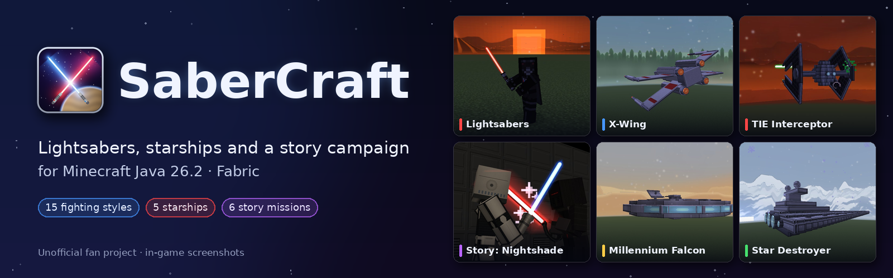
</p>

<p align="center">
  
  
  
  
  <a href="LICENSE"></a>
</p>

<p align="center">
  <a href="README.md">English</a> · <b>Deutsch</b>
</p>

**SaberCraft bringt das Lichtschwert nach Minecraft und baut eine ganze Galaxis drumherum.** Zünde eine Klinge, die summt, leuchtet und kracht wie im Film, kämpfe mit fünfzehn Stilen und der Macht, ruf deine Droiden, steig in einen X-Wing oder lauf durch die Gänge eines Sternzerstörers. Und wenn du bereit bist, schleich dich in **„Nachtschatten“** an Bord der *Tenebris*: eine Schleich-Geschichte in sechs Missionen, die mit einem Lichtschwertduell endet.

<table>
  <tr>
    <td width="50%">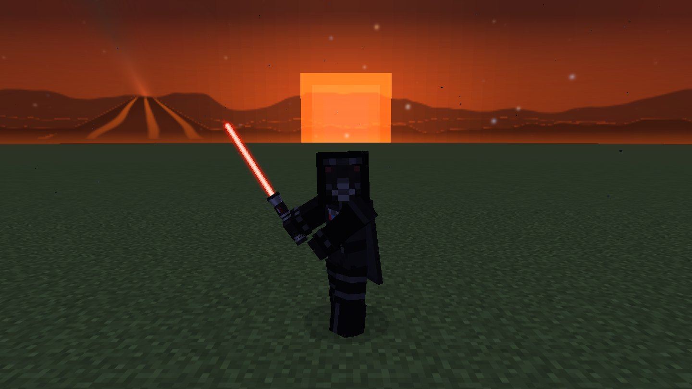</td>
    <td width="50%">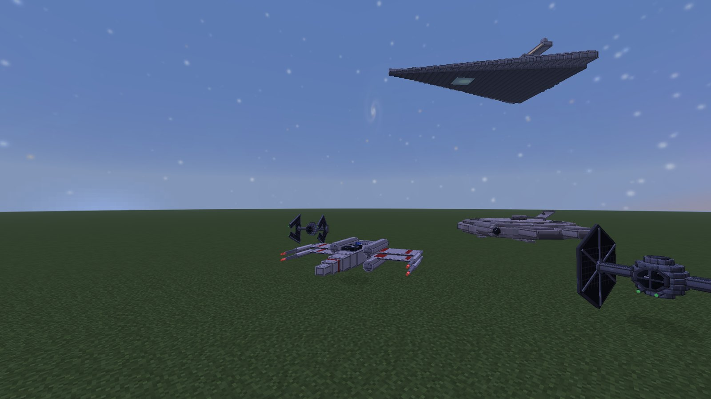</td>
  </tr>
  <tr>
    <td width="50%">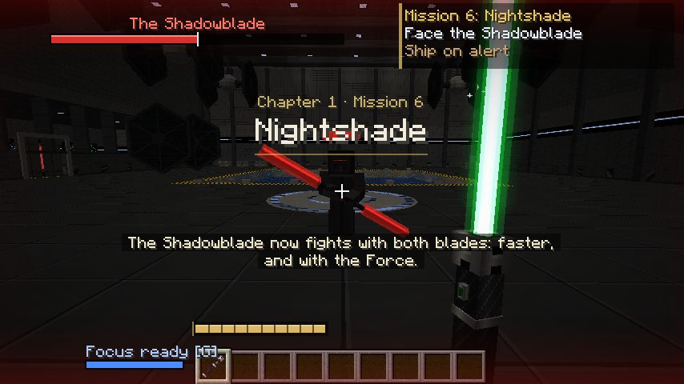</td>
    <td width="50%">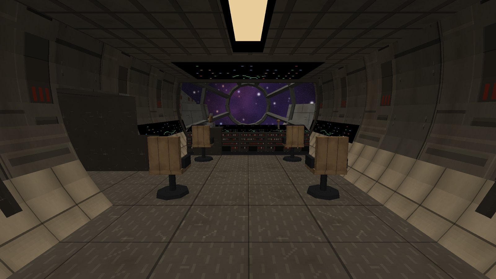</td>
  </tr>
</table>

> [!NOTE]
> SaberCraft ist ein **inoffizielles, kostenloses Fanprojekt** ohne Verbindung zu Lucasfilm, Disney, Mojang oder Microsoft. Es enthält **keine Filmmusik, keine Filmgeräusche und kein Filmmaterial**: Jedes Modell, jede Textur, jedes Geräusch und jedes Musikstück wurde für diese Mod gemacht.

## Inhalt

[Lichtschwerter und Kampf](#lichtschwerter-und-kampf) · [Die Story: „Nachtschatten“](#die-story-nachtschatten) · [Raumschiffe](#raumschiffe) · [Droiden und Blaster](#droiden-und-blaster) · [Figuren](#figuren) · [Himmel und Musik](#himmel-und-musik) · [Zusammen spielen](#zusammen-spielen) · [Bilder](#bilder) · [Loslegen](#loslegen) · [Steuerung](#steuerung) · [Gut zu wissen](#gut-zu-wissen) · [Unterstützen](#unterstützen) · [Lizenz und Rechtliches](#lizenz-und-rechtliches)

## Lichtschwerter und Kampf

Nimm ein Schwert in die Hand, öffne mit **I** das SaberCraft-Menü und mach daraus ein Lichtschwert. Jede Klinge zündet in ihrem eigenen Rhythmus, summt lauter, wenn du sie bewegst, zieht eine Spur durch die Luft und sprüht Funken, wo Klingen sich treffen. Überlegst du es dir anders, wird daraus wieder genau das Schwert, das es war.

- **14 Griffe und 6 Klingenfarben**, von der klassischen Einzelklinge über ein Parierstangen-Schwert bis zum Doppelklingen-Stab. Kern, Leuchten, Länge und Flackern jeder Farbe lassen sich einstellen.
- **15 Kampfstile** mit eigenen Schlägen und eine Abwehr, die gutes Timing belohnt: halte die **Deckung**, **pariere** im richtigen Moment, **weiche aus**, rolle und stoße vor, entfessle einen **Wirbelangriff** und lenke Blasterschüsse mit der Klinge zurück.
- **Die Macht**: Stoß, Griff, Zug und Sprung, mit Abklingzeiten und Ausdauer.
- Griffe können sich unterschiedlich spielen (Schaden, Deckung, Paradefenster), und die Klinge hat einen eigenen Zeichenweg für **Iris-Shaderpacks**.

<table>
  <tr>
    <td width="50%">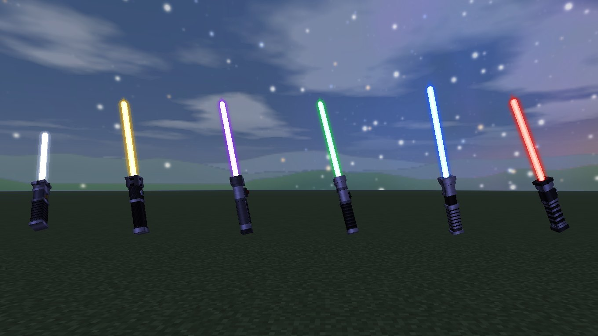</td>
    <td width="50%">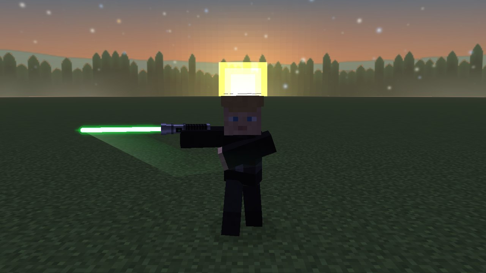</td>
  </tr>
</table>

## Die Story: „Nachtschatten“

*Drei Wochen lang hat Kestrel, eine Agentin an Bord des Sternzerstörers* Tenebris, *Daten an die Rebellion geschickt. Dann eine letzte Nachricht: „Nachtschatten ist kein Schiff. Es ist eine Jagd.“ Du wirst an Bord geschmuggelt, um sie zu finden und herauszufinden, was Nachtschatten ist.*

Kapitel 1 ist eine vollständige Geschichte in sechs Missionen, von der Einsatzbesprechung im Millennium Falken bis zur Flucht aus einem Schiff, das sich selbst zerreißt. Du startest sie im ersten Reiter des Menüs (**I**); deine eigenen Gegenstände und Droiden warten auf dich, bis du zurückkommst.

1. **Im Schatten der Tenebris**: die Besprechung, der Sprung, an Bord schleichen.
2. **Turmfalke**: deine Kontaktperson in ihrem Versteck finden und ihr bei einem gefährlichen Auftrag helfen.
3. **Kleider machen Sturmtruppen**: eine Verkleidung und ein Weg in die bewachten Decks.
4. **Herz aus Feuer**: hinunter zum Reaktor.
5. **Die Entdeckung**: wenn etwas schiefgeht.
6. **Nachtschatten**: das Labor unter dem Reaktor, der Kampf bis zum Hangar und ein Duell.

**So spielt es sich.** Bleib im Dunkeln und außer Sicht: Die Besatzung bemerkt dich in Stufen, vom misstrauischen Blick bis zum vollen Alarm, und Sturmtruppen verfolgen dich, rufen Hilfe und suchen dort, wo sie dich zuletzt gesehen haben. Kriech durch Lüftungsschächte, überwältige eine ahnungslose Wache von hinten, schick den Mausdroiden M-31 vor, um Lärm zu machen, oder lass den Astromech R2-V7 ein Schloss öffnen. In Sturmtruppen-Rüstung gehst du unter den Truppen unter, solange du dich wie einer benimmst. Die Figuren sprechen dich mit deinem eigenen Minecraft-Namen an, eine deiner Entscheidungen verändert, was später kommt, und im Finale stehst du Sturmtruppen gegenüber, die sofort schießen, wenn sie dich sehen, und dann der *Schattenklinge* mit ihrem drehenden Ringschwert.

Kontrollpunkte, drei Schwierigkeitsgrade (Leicht, Normal, Schwer), überspringbare Filmszenen, eigene Musik für jede Lage und Texte auf Deutsch und Englisch. Am Ende des Kapitels behältst du ein Lichtschwert.

<table>
  <tr>
    <td width="50%">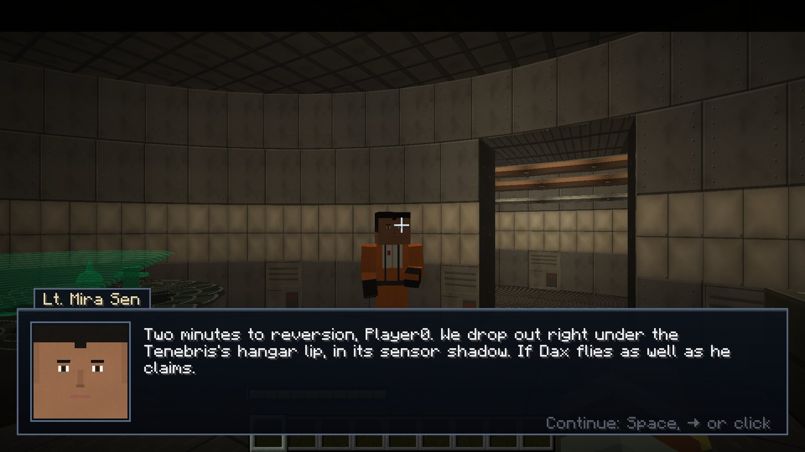<br><sub>Die Besprechung: Alle kennen deinen Namen (hier den des Testkontos, „Player0“).</sub></td>
    <td width="50%">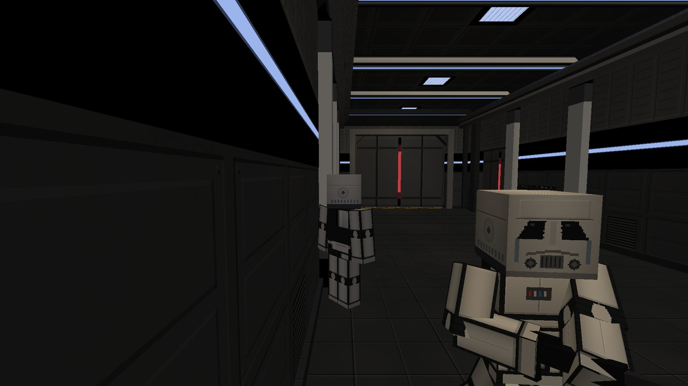<br><sub>Verkleidet unter den Truppen.</sub></td>
  </tr>
  <tr>
    <td width="50%">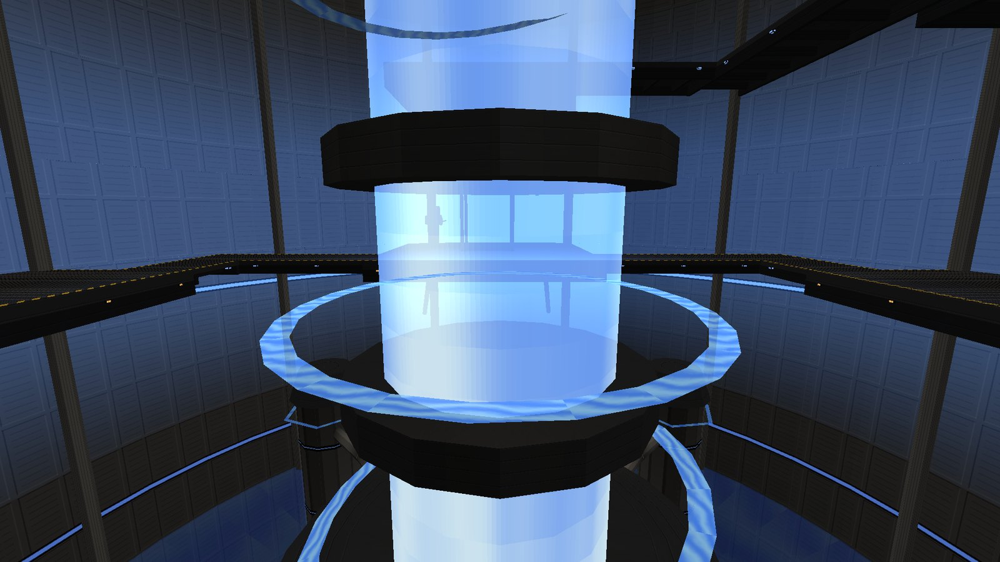<br><sub>Der Reaktor der <i>Tenebris</i>.</sub></td>
    <td width="50%">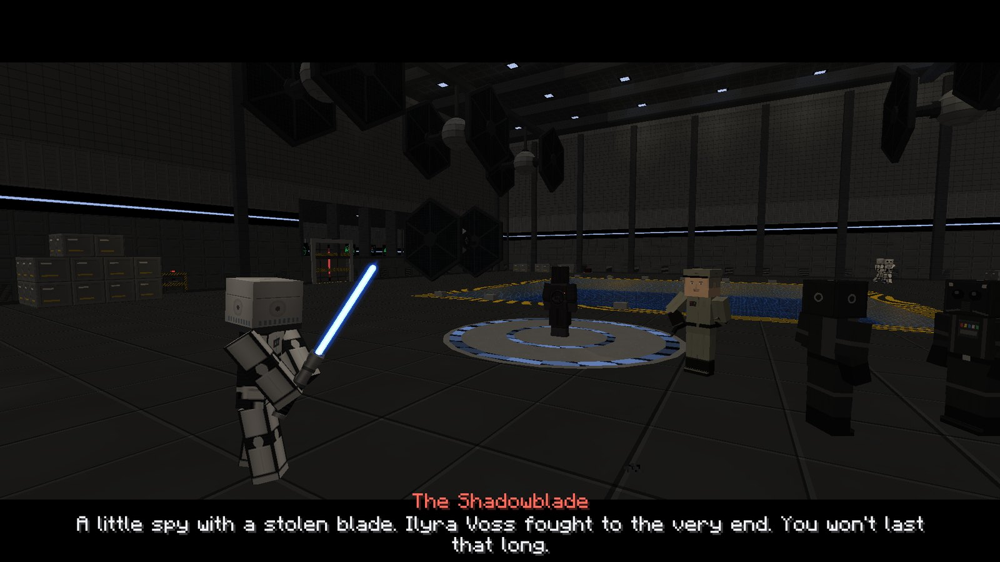<br><sub>Die Schattenklinge wartet im Hangar.</sub></td>
  </tr>
  <tr>
    <td width="50%">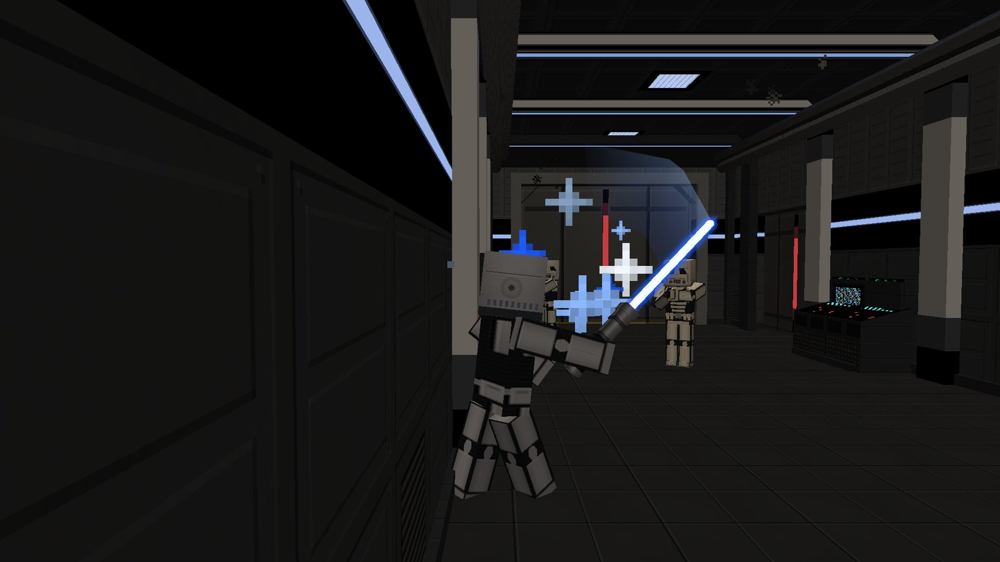<br><sub>Der Kampf bis zum Hangar.</sub></td>
    <td width="50%">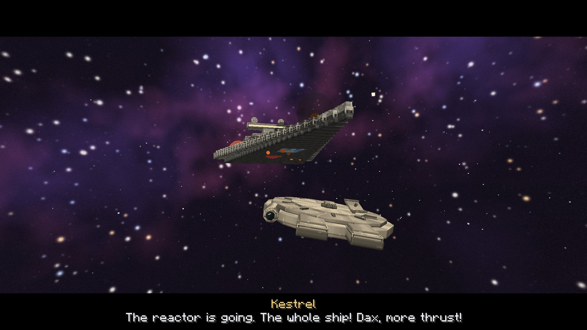<br><sub>Die Flucht.</sub></td>
  </tr>
</table>

## Raumschiffe

Fünf Schiffe, jedes mit eigenem Modell, eigenen Geräuschen und eigenem Flugverhalten. Ruf eins im Menü, steig ein und heb ab: Die Verfolgerkamera bleibt dran, eine Fluganzeige zeigt Geschwindigkeit, Höhe, Hülle und Flugenergie, und die Laser feuern mit deiner Angriffstaste.

- **X-Wing**, **TIE-Jäger** und **TIE-Abfangjäger**: schnelle Jäger mit Lasern.
- **Millennium Falke**: flieg ihn oder geh an Bord. Cockpit, Aufenthaltsraum, Gänge und Geschütztürme warten darauf, erkundet zu werden.
- **Sternzerstörer**: rund 80 Blöcke imperialer Stahl, langsam und ruhig in der Luft, innen mit Brücke, Gängen, Hangar und Reaktor und einer Besatzung bei der Arbeit.
- Schiffe nehmen Schaden und brauchen Flugenergie; ein zerstörtes Schiff kommt nach kurzer Wartezeit wieder. Abstürze machen Rauch und Funken, zerstören aber keine Blöcke, und nur du fliegst dein eigenes Schiff.

<table>
  <tr>
    <td width="50%">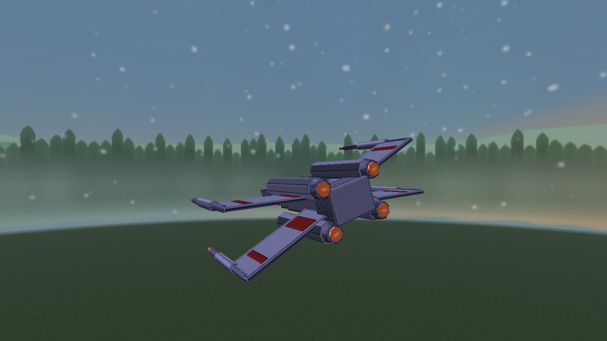</td>
    <td width="50%">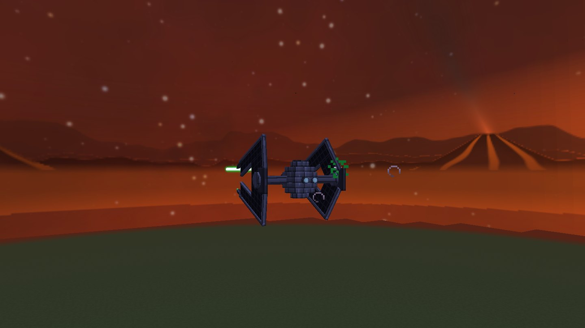</td>
  </tr>
  <tr>
    <td width="50%">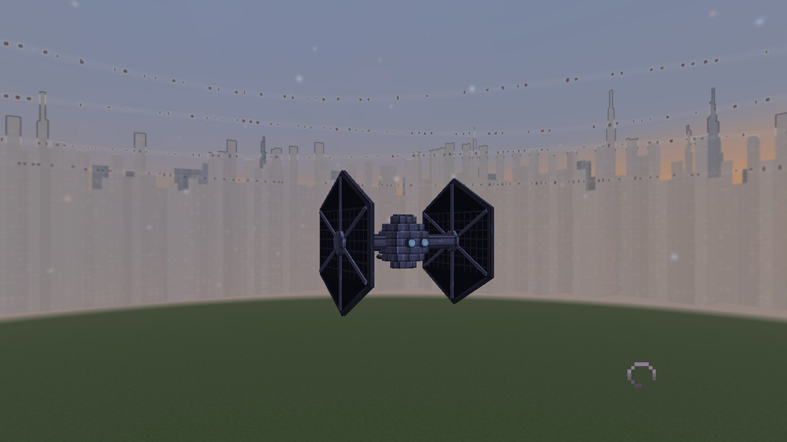</td>
    <td width="50%">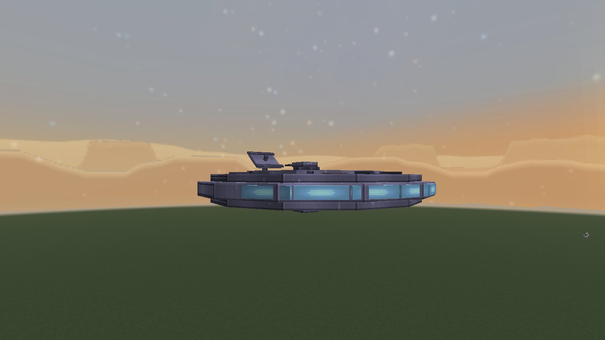</td>
  </tr>
  <tr>
    <td width="50%">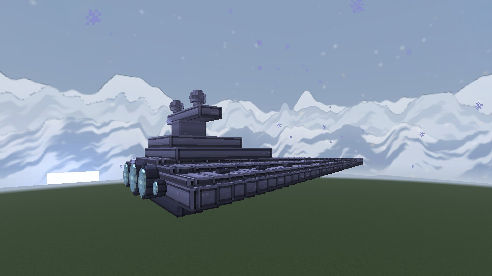</td>
    <td width="50%">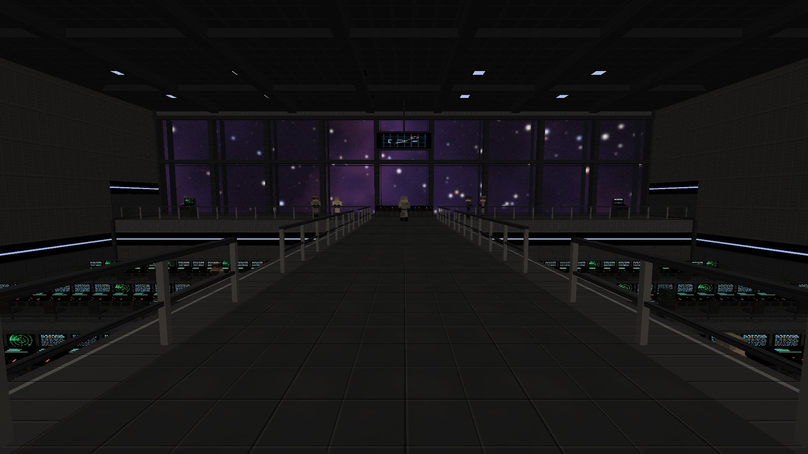</td>
  </tr>
</table>

## Droiden und Blaster

**Acht Droiden** begleiten dich: R2-D2, C-3PO, BB-8, Chopper, ein Mausdroide, ein Suchdroide, ein B1-Kampfdroide und K-2SO. Jeder hat bewegliche Teile, eine wortlose, synthetisch erzeugte Stimme und eine eigene Fähigkeit; schau einen an und drück **N**, um sie zu nutzen, oder **U**, damit er wartet.

**Neun Blaster**, vom DL-44 bis zum Bowcaster, machen aus einem Bogen einen Blaster mit eigenem Modell, Klang, Hitze und Rückstoß. Als Munition dienen ganz normale Pfeile, Survival bleibt also Survival.

<table>
  <tr>
    <td width="50%">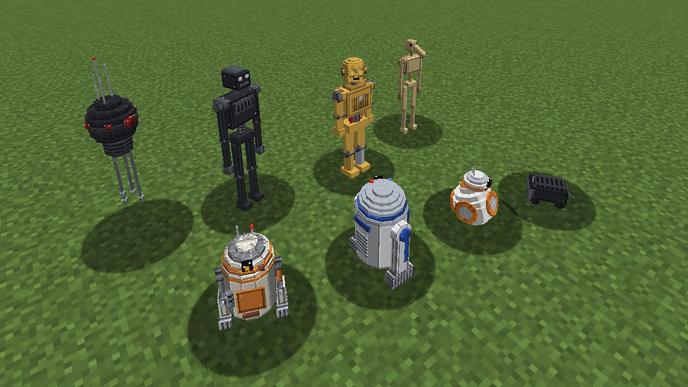</td>
    <td width="50%">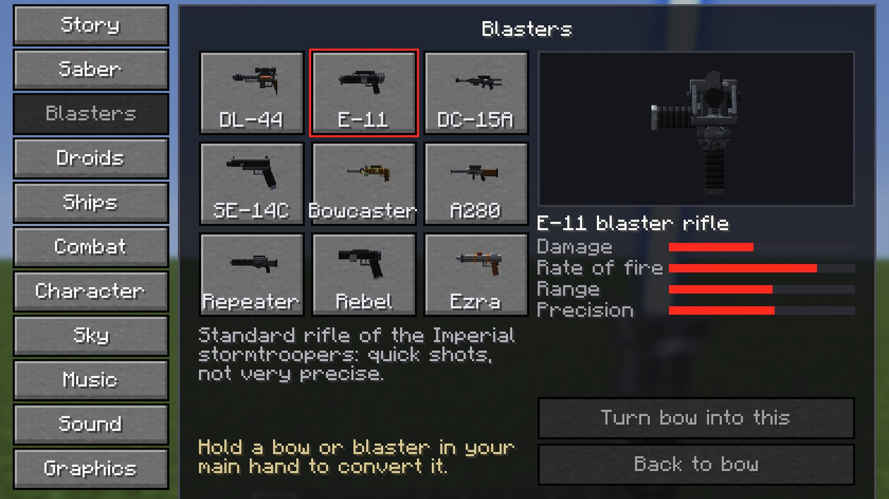</td>
  </tr>
</table>

## Figuren

Spiel als eine von **11 Filmfiguren**, darunter Darth Vader, Obi-Wan Kenobi, Ahsoka Tano und Ezra Bridger, jede mit eigenem Pixel-Skin, passendem Lichtschwert und Kampfstil. Oder trag eines von **5 neutralen Outfits** oder ein eigenes Profil. Umhänge bewegen sich mit, und Rüstung schützt weiter unter dem Aussehen, das du gewählt hast.

<table>
  <tr>
    <td width="50%">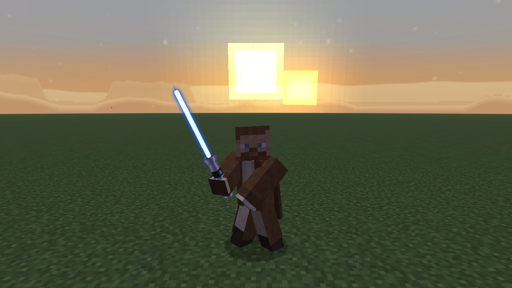</td>
    <td width="50%">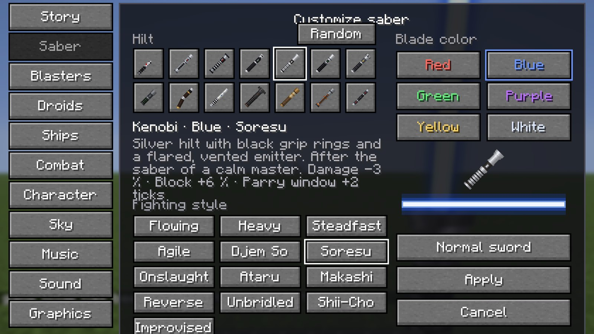</td>
  </tr>
</table>

## Himmel und Musik

Nachts zieht über der Oberwelt ein **Weltraumhimmel** mit Sternen, Nebeln und Galaxien auf. Wähle einen von **6 Planeten** (Tatooine, Coruscant, Endor, Hoth, Mustafar oder Naboo), und Himmel, Sonne, Mond und Geräusche passen sich an; das Gelände selbst bleibt deins.

**30 eigene Musikstücke** folgen dem Geschehen: Erkunden und Nacht, Kampf und Flug in der offenen Welt und eine eigene Musik für jeden Teil der Story, vom Schleichen bis zum letzten Duell, immer weich übergeblendet und nie zwei auf einmal. Ein eigener **Musikmodus** spielt Musikdateien, die du selbst hinzufügst, passend zu Lage, Planet und Figur.

<table>
  <tr>
    <td width="50%">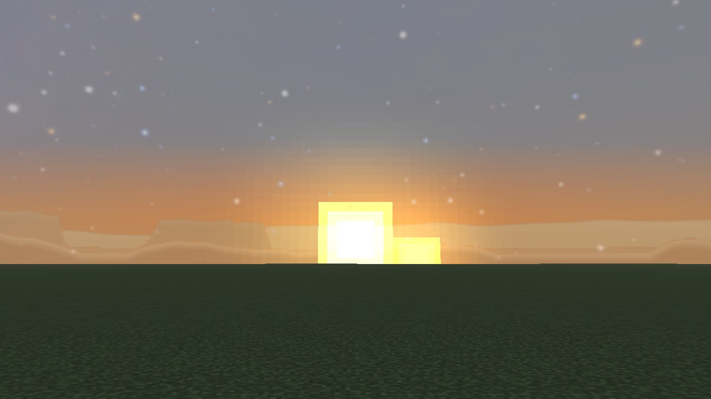</td>
    <td width="50%">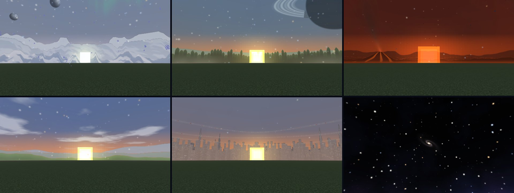</td>
  </tr>
</table>

## Zusammen spielen

SaberCraft läuft im Einzelspieler und auf Servern. Fordere andere mit `/sabercraft duel <Spieler>` zu einem freiwilligen Lichtschwertduell (Best of Three) heraus, sammle **11 Fortschritte** und lass den Server entscheiden, was erlaubt ist: Fähigkeiten, Abklingzeiten, Blaster und Munition, Droiden, Schiffe und wer Schwerter umwandeln darf. Auf einem Server spielt jeder seine eigene Ausgabe der Story.

## Bilder

<table>
  <tr>
    <td width="33%">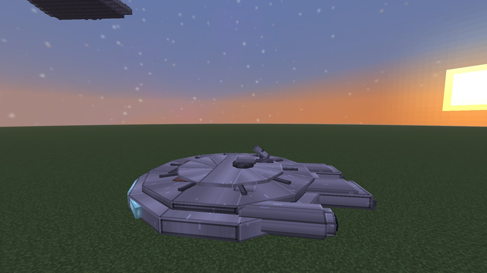</td>
    <td width="33%">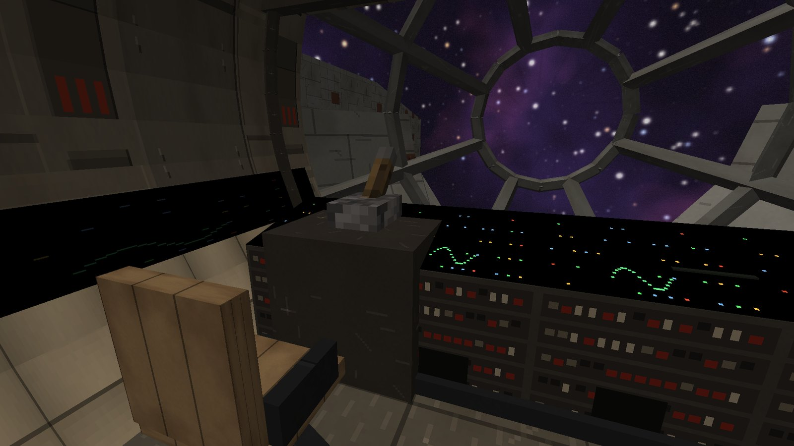</td>
    <td width="33%">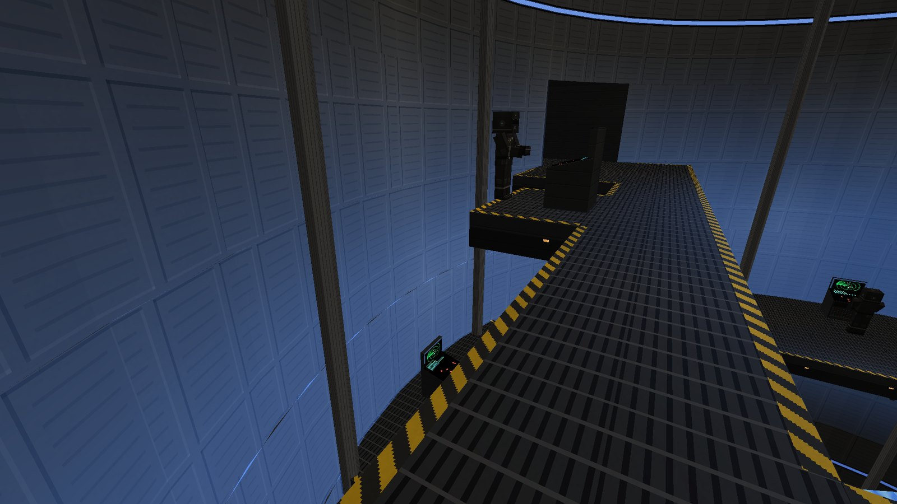</td>
  </tr>
  <tr>
    <td width="33%">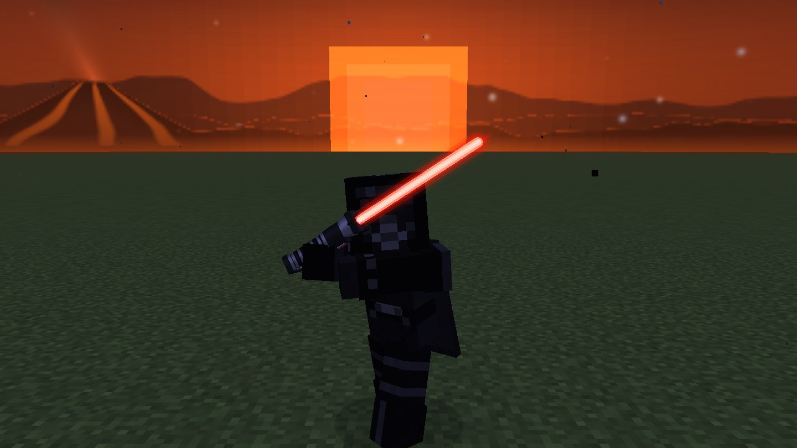</td>
    <td width="33%">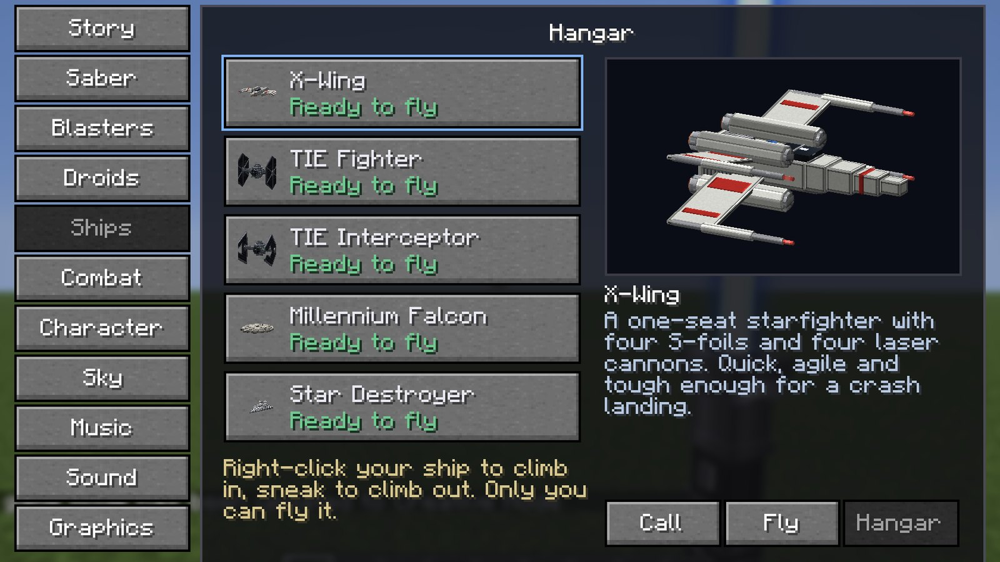</td>
    <td width="33%">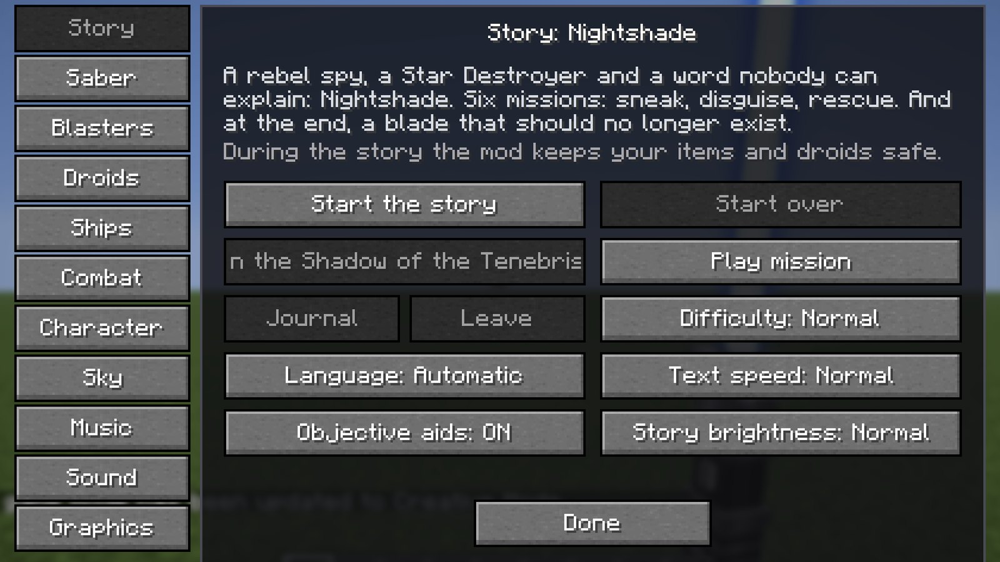</td>
  </tr>
</table>

<sub>Alle Bilder sind im Spiel mit SaberCraft aufgenommen, in 1920×1080 mit Software-Rendering; mit einer Grafikkarte sieht das Spiel etwas schärfer aus.</sub>

## Loslegen

**Du brauchst** Minecraft Java Edition **26.2**, **Fabric Loader 0.19.5** oder neuer und die **Fabric API** (gebaut und getestet mit 0.161.0+26.2). Das passende Java bringt der Launcher mit.

1. Installiere Fabric Loader für 26.2 mit dem [Fabric-Installer](https://fabricmc.net/use/installer/).
2. Leg die **Fabric API** und die **SaberCraft**-JAR in deinen `mods`-Ordner (Windows `%APPDATA%\.minecraft\mods`, macOS `~/Library/Application Support/minecraft/mods`, Linux `~/.minecraft/mods`). Nimm `sabercraft-<Version>.jar`, nicht die `-sources.jar`, und entferne ältere SaberCraft-JARs.
3. Starte das **Fabric**-Profil, nimm ein Schwert in die Hand, drück **I** und klick auf **Zum Lichtschwert machen**. Die Story ist der erste Reiter desselben Menüs.

**Auf einem Server** gehören SaberCraft und die Fabric API auf den Server und auf jeden Client. Wer die Mod nur auf einer Seite hat, bekommt nur einen Teil:

| | Mod nur auf dem Client | Mod auf Client und Server |
| --- | :---: | :---: |
| Aussehen und Klang der Klinge, Kampfanimationen, Himmel, Musik, Menü | ✔ | ✔ |
| Deckung, Parade, Machtfähigkeiten, Story, Blaster, Droiden, Schiffe, Duelle, Fortschritte, Befehle | | ✔ |

Im Einzelspieler ist alles dabei, wenn die Mod einmal installiert ist.

## Steuerung

Alle Tasten lassen sich unter **Optionen → Steuerung → Tastenbelegung → SaberCraft** ändern.

| Taste | Aktion |
| --- | --- |
| **I** | SaberCraft-Menü: Story, Lichtschwert, Blaster, Droiden, Schiffe, Kampf, Figur, Himmel, Musik, Grafik |
| Linke Maustaste | Angriff; der Schlag hängt vom Kampfstil ab |
| **R** (halten) | Deckung; direkt nach dem Heben eine Parade |
| **Z** | Wirbelangriff |
| **B** · **H** (halten) · **J** · **K** | Machtstoß · Machtgriff · Machtzug · Machtsprung |
| **Linke Alt-Taste** | Ausweichen oder Vorstoß, Richtung mit W/A/S/D |
| **N** · **U** | Fähigkeit des Droiden, den du ansiehst · warten lassen oder folgen |
| Rechte Maustaste (Blaster) | Schießen (kostet einen Pfeil) |

<details>
<summary><b>In der Story und im Schiff</b></summary>

| Taste | Aktion |
| --- | --- |
| Rechte Maustaste auf eine Person oder Sache | Sprechen, Konsole, Spind oder Terminal benutzen |
| Schleichen vor einer offenen Luke | Hineinkriechen |
| Schleichen + rechte Maustaste hinter einer ahnungslosen Sturmtruppe | Lautlos überwältigen |
| **Eingabe** / **Leertaste** / Klick, **1**–**4**, Pfeiltasten | Dialoge: weiter, Antwort wählen, zurückblättern |
| **Leertaste** / **Esc** | Filmszene überspringen |
| **G** | Der Fokus: verlangsamt deine Gegner einen Moment (sobald du das Lichtschwert hast) |
| **W / S**, **A / D** | Schiff: Schub und Bremse, Kurve |
| **Springen / Sprinten** | Schiff: Nase hoch und runter |
| **Angriff** · **Schleichen** | Schiff: Laser · aussteigen |

</details>

<details>
<summary><b>Befehle</b></summary>

| Befehl | Wirkung |
| --- | --- |
| `/sabercraft convert [Farbe] [Griff]` | Das Schwert in deiner Hand wird ein Lichtschwert |
| `/sabercraft revert` | Macht ein umgewandeltes Schwert oder einen Blaster wieder zu genau dem Gegenstand, der es war |
| `/sabercraft blaster [Typ]` | Der Bogen in deiner Hand wird ein Blaster: `dl44`, `e11`, `dc15a`, `se14c`, `bowcaster`, `a280`, `repeater`, `rebel`, `ezra` |
| `/sabercraft duel <Spieler>` | Einen Spieler herausfordern; `accept`, `decline`, `leave`, `ignore` |
| `/sabercraft droid <Droide>` | Einen Droiden rufen; `recall`, `stay`, `ability`, `dismiss <Droide>` |
| `/sabercraft ship call\|board\|dismiss [Schiff]` | Einen Jäger rufen, besteigen oder wegschicken: `xwing`, `tie_fighter`, `tie_interceptor` (Falke und Sternzerstörer gibt es im Menü) |

`convert`, `revert` und `blaster` dürfen alle benutzen, außer der Server setzt `commands_for_everyone` auf `false`.

</details>

<details>
<summary><b>Einstellungen</b></summary>

Fast alles lässt sich im Menü (**I**) einstellen; es speichert JSON-Dateien in `config/sabercraft/`: die Regeln des Servers in `abilities.json` und auf deinem eigenen Rechner Kampfeffekte, Himmel, Musik, Sprache, Story-Helligkeit, deine Figur und jede Klingenfarbe. Jede Einstellung mit ihrem Standardwert: [docs/configuration.md](docs/configuration.md). Anleitungen für [eigene Musik](docs/eigene-musik.md) und [eigene Figurenprofile](docs/custom-profiles.md).

</details>

## Gut zu wissen

- SaberCraft läuft nur mit **Minecraft 26.2 und Fabric**; eine Version für Forge, NeoForge oder Quilt gibt es nicht.
- **Kapitel 1** der Story ist vollständig; weitere Kapitel gibt es noch nicht. Die Texte sind auf Deutsch und Englisch.
- **Raumschiffe, Droiden und Blaster** sind die neuesten Teile der Mod und noch nicht mit vielen Spielern abgestimmt. Schiffe haben eine Hülle, aber keine Schilde; Hyperraumsprünge gibt es nur in der Story.
- Ein Server mit vielen echten Spielern gleichzeitig wurde noch nicht ausprobiert. Wenn dort etwas schiefgeht, sag uns bitte Bescheid.
- Mit Shaderpacks funktionieren die Klingen; mit manchen Packs wirken die Planetenhimmel blasser (bei BSL `SKYBOX_OPACITY` erhöhen und `SKY_DESATURATION` ausschalten).
- Ein zum Blaster umgewandelter Bogen heißt in der Schnellleiste weiter „Bogen“.

Einen Fehler gefunden? Bitte öffne ein [Issue](https://github.com/Phiro4241/SaberCraft/issues/new?template=bug_report.yml) mit deinen Versionen von Minecraft, Fabric Loader, Fabric API und SaberCraft und dem Log.

## Unterstützen

SaberCraft ist kostenlos und bleibt es; jede Funktion ist für alle da. Wer die Entwicklung unterstützen möchte, kann das freiwillig auf Patreon tun (Ersteller: **Phiro**).

**[SaberCraft auf Patreon unterstützen](https://patreon.com/Phiro4241?utm_medium=unknown&utm_source=join_link&utm_campaign=creatorshare_creator&utm_content=copyLink)**: freiwillig, es schaltet nichts in der Mod frei.

**Downloads** gibt es auf der [Release-Seite](https://github.com/Phiro4241/SaberCraft/releases) und auf Modrinth, sobald die erste Version veröffentlicht ist. Bis dahin kannst du die Mod selbst bauen:

```bash
git clone https://github.com/Phiro4241/SaberCraft.git
cd SaberCraft
./gradlew build            # braucht JDK 25; unter Windows: gradlew.bat build
```

Die JAR liegt dann in `build/libs/`. Ideen, Fehlerberichte und Pull Requests sind willkommen: siehe [CONTRIBUTING.md](CONTRIBUTING.md) und, für Sicherheitsprobleme, [SECURITY.md](SECURITY.md).

## Lizenz und Rechtliches

- Der Code von SaberCraft und seine eigenen Inhalte (Modelle, Texturen, Geräusche, Musik, Icon und Banner, alle von den Skripten in [`tools/`](tools/) erzeugt) stehen unter der [MIT-Lizenz](LICENSE), © 2026 Phiro4241.
- Die Lizenz gewährt **keine Rechte an Star Wars** oder anderen Marken, Namen, Figuren oder Designs von Lucasfilm Ltd. oder The Walt Disney Company. Namen wie Star Wars, Darth Vader, R2-D2 oder X-Wing und Figuren nach dem Vorbild der Filme werden nur verwendet, um zu beschreiben, worum es in der Mod geht, und unterliegen weiter diesen Rechten. Die Geschichte *Nachtschatten*, ihre Figuren und Dialoge sind eigene Werke.
- SaberCraft enthält keine Filmaufnahmen, Samples, Filmmusik oder Filmbilder. Der Musikmodus spielt nur Dateien, die Spieler selbst auf ihrem Rechner hinzufügen.
- Kein offizielles Minecraft-Produkt. Nicht von Mojang oder Microsoft genehmigt oder mit ihnen verbunden. Screenshots zeigen Minecrafts eigene Texturen, die die MIT-Lizenz nicht abdeckt.
