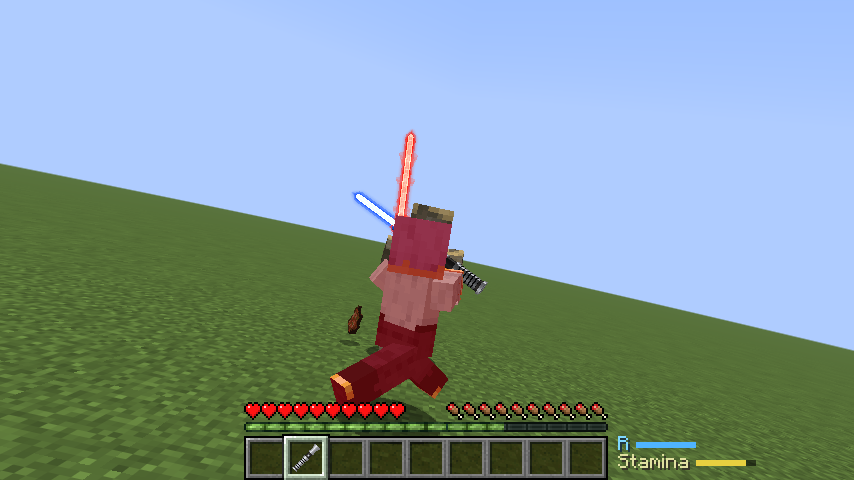
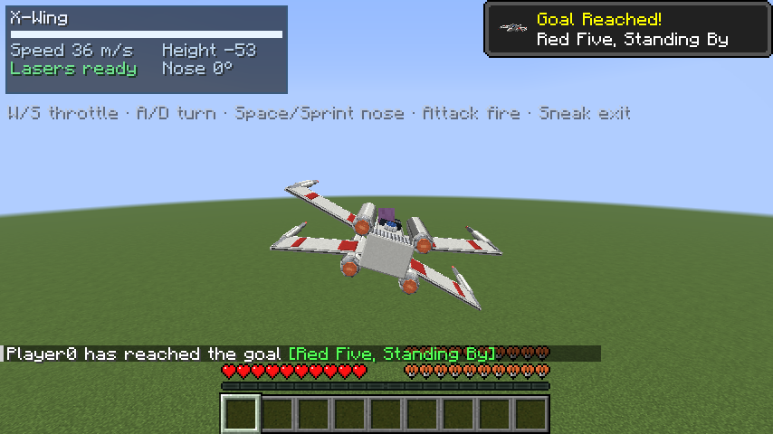

<p align="center">
  
</p>

<p align="center">
  
  
  
  
  <a href="LICENSE"></a>
</p>

<p align="center">
  <a href="README.md">English</a> · <b>Deutsch</b>
</p>

**SaberCraft** ist eine Fabric-Mod für Minecraft Java 26.2 rund um Lichtschwerter. Jedes Schwert kann zu einem Lichtschwert wie im Film werden, das zündet, leuchtet, summt und wieder einfährt. Dazu kommen Kampfstile und Machtfähigkeiten, Filmfiguren, Blaster, Droiden-Begleiter, fliegbare Raumschiffe, Planetenhimmel, eigene Musik und eine Story-Kampagne: **Kapitel 1, „Nachtschatten“**, sechs Missionen an Bord eines imperialen Sternzerstörers.

> [!NOTE]
> SaberCraft ist ein **inoffizielles Fanprojekt**. Es steht in keiner Verbindung zu Lucasfilm, Disney, Mojang oder Microsoft und wird von ihnen weder unterstützt noch geprüft. Star Wars und alle zugehörigen Namen sind Marken ihrer Inhaber. Die Mod enthält **keine Filmmusik, keine Filmgeräusche und kein Filmmaterial**: Alle Modelle, Texturen, Geräusche und Musikstücke wurden für dieses Projekt erstellt (siehe [Rechtliches](#rechtliches)).

## Inhalt

- [Auf einen Blick](#auf-einen-blick)
- [Story-Modus: Kapitel 1, „Nachtschatten“](#story-modus-kapitel-1-nachtschatten)
- [Funktionen](#funktionen)
- [Screenshots](#screenshots)
- [Voraussetzungen](#voraussetzungen)
- [Installation](#installation)
- [Steuerung](#steuerung)
- [Befehle](#befehle)
- [Einstellungen](#einstellungen)
- [Bekannte Probleme und Grenzen](#bekannte-probleme-und-grenzen)
- [Downloads und Links](#downloads-und-links)
- [Das Projekt unterstützen](#das-projekt-unterstützen)
- [Selbst bauen](#selbst-bauen)
- [Mitmachen](#mitmachen)
- [Rechtliches](#rechtliches)

## Auf einen Blick

- **Lichtschwerter** mit Zünden und Einfahren, mehrschichtigem Leuchten, Summen und Schwunggeräuschen: 14 Griffe, 6 Klingenfarben, 15 Kampfstile, Abwehr, Parade, Ausweichen und vier Machtfähigkeiten.
- **Eine Story-Kampagne** mit Schleichen, Verkleidung, Dialogen mit Entscheidungen, zwei Droiden-Helfern, kurzen Filmszenen, einem Bossduell und einer Flucht, auf Deutsch und Englisch. Die Figuren sprechen dich mit deinem eigenen Minecraft-Namen an.
- **11 Filmfiguren** und 5 neutrale Outfits, **9 Blaster**, die Pfeile als Munition nutzen, **8 Droiden-Begleiter**, **5 Raumschiffe** (zwei davon begehbar), **6 Planetenhimmel**.
- **30 eigene Musikstücke**, per Skript komponiert, die dem Geschehen in der Story und in der offenen Welt folgen.
- Läuft im Einzelspieler und auf Servern. Alle Einstellungen in einem Menü im Spiel (Taste **I**).

## Story-Modus: Kapitel 1, „Nachtschatten“

Drei Wochen lang hat Kestrel, eine Agentin an Bord des Sternzerstörers *Tenebris*, Daten an die Rebellion geschickt. Dann eine letzte Nachricht: *„Nachtschatten ist kein Schiff. Es ist eine Jagd.“* Du wirst an Bord geschmuggelt, um sie zu finden und herauszufinden, was Nachtschatten ist.

Die Story startest du im SaberCraft-Menü (Taste **I**, erster Reiter **Story**). Deine eigenen Gegenstände, dein Ort und deine Droiden werden beiseitegelegt, solange du spielst, und kommen zurück, wenn du die Story verlässt.

**Missionen**

1. **Im Schatten der Tenebris**: die Besprechung an Bord des Millennium Falken, der Sprung, an Bord schleichen.
2. **Turmfalke**: deine Kontaktperson in ihrem Versteck treffen und ihr bei einem gefährlichen Auftrag helfen.
3. **Kleider machen Sturmtruppen**: eine Verkleidung und einen Weg in die bewachten Bereiche beschaffen.
4. **Herz aus Feuer**: hinunter zum Reaktor.
5. **Die Entdeckung**: wenn etwas schiefgeht.
6. **Nachtschatten**: das Labor unter dem Reaktor, die Flucht durch ein zerfallendes Schiff und ein Lichtschwertduell.

**So spielt es sich**

- **Schleichen.** Die Besatzung bemerkt dich in Stufen (ruhig, misstrauisch, alarmiert, entdeckt), angezeigt durch ein kleines Auge. Dunkelheit, Lampen, Deckung, Schleichen und Kriechen zählen. Wirst du gesehen, verfolgen dich Sturmtruppen, rufen Hilfe und suchen dort, wo sie dich zuletzt gesehen haben.
- **Verkleidung.** Eine Sturmtruppen-Rüstung täuscht die Truppen, solange du dich wie einer verhältst; Offiziere schauen genauer hin.
- **Dialoge mit Entscheidungen.** Porträts, Namen und Antworten; eine Entscheidung verändert spätere Missionen.
- **Droiden-Helfer.** Der Mausdroide M-31 macht dort Lärm, wo du hinschaust, und passt durch kleine Luken; der Astromech R2-V7 öffnet Schlösser.
- **Lautlose Überwältigung** von hinten bei einer ahnungslosen Sturmtruppe, **Kriechwege** mit markierten Luken, Konsolen, Terminals und Spinde zum Benutzen.
- **Kurze Filmszenen** an wichtigen Stellen (überspringen mit **Leertaste** oder **Esc**).
- **Das Finale.** Ein Kampf über die Reaktorebene und durch die Gänge bis in den Hangar, mit Sturmtruppen, die schießen, sobald sie dich sehen, dann ein Duell in Phasen gegen die *Schattenklinge*, eine Kämpferin mit drehendem Ringschwert. In der Story verlangsamt der **Fokus** (Taste **G**) deine Gegner für einige Sekunden.
- **Kontrollpunkte.** Wirst du gefangen, geht es zurück zum letzten Kontrollpunkt, mit allem, wie es dort war. Du kannst die Story jederzeit verlassen, später weiterspielen oder eine erreichte Mission erneut spielen.
- **Drei Schwierigkeitsgrade** (Leicht, Normal, Schwer), vor dem Start gewählt und im Story-Menü änderbar.
- **Dein Name in der Story.** Wo die Figuren dich ansprechen oder nennen, verwenden sie deinen Minecraft-Namen; auf einem Server liest jeder seinen eigenen.
- **Eigene Musik**: 18 Story-Stücke für Schleichen, Misstrauen, Alarm, besondere Orte, die Filmszenen und das Duell, mit weichen Überblendungen.
- Eigene **Spracheinstellung** (Auto, Deutsch, Englisch) für alle SaberCraft-Texte und eine Einstellung **Story-Helligkeit** für die dunklen Szenen.

Am Ende des Kapitels bekommst du ein Lichtschwert, das du behältst.

## Funktionen

Status: ✅ **stabil** (gebaut, durch automatische Tests abgedeckt und gespielt) · 🧪 **experimentell** (gebaut und durch automatische Tests abgedeckt, aber wenig von Hand gespielt und nicht mit echten Spielern abgestimmt).

### ⚔️ Lichtschwerter ✅

- **Zünden und Einfahren** mit eigenem Timing, Verlauf und Aufblitzen je Griff; ein Summen, das auf Bewegung reagiert; vier Schwunggeräusche.
- **14 Griffe** als 3D-Modelle: Standard, Wächter, Dunkler Lord, Sentinel, Kenobi, Skywalker, Anakin, Yoda, Dooku, Tano, Parierstange, Rey, Ezra und ein Doppelklingen-Griff.
- **6 Klingenfarben**: Rot, Blau, Grün, Lila, Gelb und Weiß. Kern, Leuchten, Schein, Länge, Dicke, Helligkeit und Flackern jeder Farbe lassen sich einstellen.
- **Griffe, die sich unterschiedlich spielen** (abschaltbar): Schaden, Abwehr und Paradefenster unterscheiden sich je Griff; die Parierstange zündet stotternd, die Doppelklinge eine Seite nach der anderen.
- **Nur die Schwerter, die du auswählst**, werden zu Lichtschwertern: Schwert in die Hand, **I** drücken und **Lichtschwert machen** klicken (oder `/sabercraft convert`). **Normales Schwert** macht es wieder genau zu dem, was es war. Server können festlegen, welche Schwerter zu Lichtschwertern werden dürfen.
- Funktioniert mit **Iris-Shaderpacks**: Die Klinge hat einen eigenen Zeichenweg für Shaderpacks.

### 🥋 Kampf ✅

- **15 Kampfstile** mit eigenen Bewegungen, darunter zwei für die Doppelklinge.
- **Abwehr, Parade und Konter**, Abwehrbrüche, Abwehren von Geschossen, **Ausweichen** (Rolle, Seitschritt, Rückschritt, Ausfall, Salto) und ein **Wirbelangriff**.
- **Machtfähigkeiten**: Stoß, Würgegriff, Ziehen und Sprung, mit Abklingzeiten und Ausdauer, die der Server bestimmt.
- **Klingenspuren, Funken und Klingenkontakte** am Berührungspunkt, leuchtende Trefferspuren und ein Finisher mit kurzer Zeitlupe im Einzelspieler.

### 🎭 Figuren und Outfits ✅

- **11 Filmfiguren**: Darth Vader, Obi-Wan Kenobi, Darth Maul, Luke Skywalker, Anakin Skywalker, Yoda, Count Dooku, Ahsoka Tano, Kylo Ren, Rey und Ezra Bridger. Jede bringt einen eigenen Pixel-Skin, ein passendes Lichtschwert und einen Kampfstil mit.
- **5 neutrale Outfits** (Hüter-Robe, Schatten-Robe, Wächter-Rüstung, Späher-Montur, Zwielicht-Rüstung) und **eigene Profile** aus JSON-Dateien.
- Andere Spieler sehen deine Figur, wenn sie SaberCraft haben und der Server es auch nutzt.

### 🔫 Blaster 🧪

- **9 Blaster** mit eigenen Modellen, Geräuschen und Werten: DL-44, E-11, DC-15A, SE-14C, Bowcaster, A280, Repetierblaster, Rebellenblaster und Ezras Blaster.
- Ein Bogen wird im Blaster-Menü oder mit `/sabercraft blaster` zum Blaster. Schaden, Hitze, Überhitzung, Mündungsfeuer und Rückstoß; Ezras Blaster betäubt.
- **Pfeile sind die Munition**: Jeder Schuss kostet einen normalen Pfeil. Unendlichkeit behält den Pfeil, wenn der Server es erlaubt, im Kreativmodus braucht man keine, und Server können die Munition abschalten.

### 🤖 Droiden 🧪

- **8 Droiden-Begleiter**: R2-D2, C-3PO, BB-8, Chopper, ein Mausdroide, ein Suchdroide, B1 und K-2SO, jeweils mit beweglichen Teilen, einer wortlosen synthetischen Stimme und einer Fähigkeit.
- Rufen, zurückrufen, warten lassen, folgen lassen und nach Hause schicken im Droiden-Menü oder mit `/sabercraft droid`. Schau einen deiner Droiden an und drücke **N** für seine Fähigkeit oder **U**, damit er wartet oder folgt.
- Der Server legt eine Grenze pro Spieler fest (Standard 2) sowie Abklingzeit, Reichweite und Schaden jedes Droiden. Droiden kommen nach einem Neustart zurück.

### 🚀 Raumschiffe 🧪

- Ein **fliegbarer X-Wing** mit S-Flügeln, Kurvenneigung, Lasern an den Flügelspitzen, Triebwerksgeräusch, Flug-HUD und Verfolgerkamera; ein **TIE-Jäger** und ein **TIE-Abfangjäger** mit eigenem Modell, eigenen Geräuschen und eigenem Flugverhalten.
- Ein **Millennium Falke** und ein **Sternzerstörer** (etwa 80 Blöcke lang), die du fliegen und **begehen** kannst: Cockpit, Sitze, Türen, Licht, Konsolen und die Geschütztürme des Falken.
- Schiffe haben eine **Hülle** und **Flugenergie**: Treffer nutzen die Hülle ab, sie erholt sich langsam, und bei null explodiert das Schiff; der Besitzer wartet eine Minute auf ein neues (einstellbar). Abstürze machen Rauch und Funken, zerstören aber keine Blöcke.
- Nur der Besitzer kann sein Schiff fliegen. Wer sich im Cockpit ausloggt, sitzt beim Einloggen wieder darin.

### 🌌 Himmel und Planeten ✅

- Ein **Weltraumhimmel** mit Sternen, Nebeln und Galaxien über dem Nachthimmel der Oberwelt und im End.
- **6 Planetenhimmel**: Tatooine (zwei Sonnen), Coruscant, Endor, Hoth, Mustafar und Naboo, jeweils mit eigenem Horizont, eigener Sonne, eigenem Mond, Partikeln und Umgebungsgeräusch. Planeten **ändern nur Himmel und Klang, nie das Gelände**.

### 🎵 Musik und Klang ✅

- **30 eigene Stücke**: 12 für Erkunden, Nacht, Kampf, Flug und Ereignisse in der offenen Welt und 18 für die Story. Überblendungen dazwischen, nie zwei gleichzeitig.
- Ein **„Star Wars“-Musikmodus**, der **nur Dateien spielt, die du selbst hinzufügst** (`.ogg` oder `.wav`), ausgewählt nach Situation, Planet und Figur ([Anleitung](docs/eigene-musik.md)). SaberCraft liefert keine Filmmusik mit.

### ⚔️ Duelle ✅

- **Freiwillige** Lichtschwertduelle mit `/sabercraft duel <Spieler>`: im Chat annehmen oder ablehnen, Countdown 3-2-1, Best of Three; ein tödlicher Treffer beendet nur die Runde. Spieler können Herausforderungen ignorieren, Server können Duelle abschalten.

### 🏆 Fortschritte ✅

- **11 Fortschritte** in einem eigenen Reiter, vom ersten gezündeten Lichtschwert und Blasterschuss bis zum ersten Flug.

## Screenshots

Alle Screenshots stammen direkt aus dem Spiel, aufgenommen von den automatischen Client-Tests (virtueller Bildschirm, Software-Rendering, 1280×720), ohne Nachbearbeitung. Im eigenen Spiel kann es schärfer aussehen.

**Story-Modus**

| | |
| :---: | :---: |
|  |  |
| **Dialoge und Funk nennen deinen Minecraft-Namen** (hier den des Testkontos, „Player0“) | **Ein Sturmtruppler auf Streife** |
|  |  |
| **Der Reaktor** | **Das Duell gegen die Schattenklinge** |

**Offene Welt**

| | |
| :---: | :---: |
|  |  |
| **Sechs Klingenfarben** | **Lichtschwert-Menü (I)** |
|  |  |
| **Klingenkontakt** | **Fähigkeiten, Spuren und Funken** |
|  |  |
| **Droiden-Begleiter** | **X-Wing mit Flug-HUD** |
|  |  |
| **Blaster mit Pfeilzähler** | **Planetenhimmel bei Tag und Nacht** |

## Voraussetzungen

| Komponente | Version | Hinweise |
| --- | --- | --- |
| Minecraft Java Edition | **26.2** | andere Versionen werden nicht unterstützt |
| Fabric Loader | **0.19.5** oder neuer | [Fabric-Installer](https://fabricmc.net/use/installer/) |
| Fabric API | **0.161.0+26.2** oder neuer für 26.2 | erforderlich; mit dieser Version wird SaberCraft gebaut und getestet |
| Java | **25** | der Minecraft-Launcher bringt sein eigenes Java mit |

Weitere Mods sind nicht nötig. Forge, NeoForge und Quilt werden nicht unterstützt. [Iris](https://modrinth.com/mod/iris) und [Sodium](https://modrinth.com/mod/sodium) sind optional (in einer früheren Version getestet: Iris 1.11.4, Sodium 0.9.2).

## Installation

1. **Fabric Loader** für Minecraft 26.2 mit dem [Fabric-Installer](https://fabricmc.net/use/installer/) installieren.
2. **Fabric API** für 26.2 in den `mods`-Ordner deiner Minecraft-Installation legen:
   - Windows: `%APPDATA%\.minecraft\mods`
   - macOS: `~/Library/Application Support/minecraft/mods`
   - Linux: `~/.minecraft/mods`
3. Die SaberCraft-JAR (`sabercraft-<version>.jar`, nicht die `-sources.jar`) in denselben `mods`-Ordner legen und ältere SaberCraft-JARs entfernen.
4. Im Launcher das **Fabric**-Profil starten.
5. Ausprobieren: Schwert in die Hand, **I** drücken und **Lichtschwert machen** klicken. Die Story ist im selben Menü, erster Reiter.

**Auf einem Server** kommen SaberCraft und Fabric API zusätzlich in den `mods`-Ordner des Servers. Jeder Spieler, der Lichtschwerter, Schiffe und Droiden sehen und hören will, braucht SaberCraft auch auf seinem Client.

| Funktion | Nur Client | Braucht SaberCraft auch auf dem Server |
| --- | :---: | :---: |
| Aussehen der Klinge, Zünden, Summen, Kampfanimationen, Spuren, Funken | ✔ | |
| Himmel, Planeten, Musik, Menü | ✔ | |
| Eigenes Outfit oder eigene Figur (ohne Server nur für dich sichtbar) | ✔ | |
| Abwehr, Parade, Machtfähigkeiten, Ausdauer, Abwehren von Geschossen | | ✔ |
| Story-Modus | | ✔ (im Einzelspieler immer vorhanden) |
| `/sabercraft`-Befehle, Blaster, Droiden, Raumschiffe, Duelle, Fortschritte | | ✔ |

Im Einzelspieler funktioniert alles mit einer einzigen Installation.

## Steuerung

Alle Tasten stehen unter **Optionen → Steuerung → Tastenbelegung → SaberCraft** und lassen sich dort ändern.

| Standardtaste | Aktion |
| --- | --- |
| **I** | SaberCraft-Menü (Story, Lichtschwert, Blaster, Droiden, Schiffe, Kampf, Figur, Himmel, Musik, Grafik) |
| Linke Maustaste | Angriff; die Bewegung hängt vom Kampfstil ab |
| **R** (halten) | Abwehr; direkt nach dem Heben eine Parade |
| **Z** | Wirbelangriff (Klingenwirbel mit der Doppelklinge) |
| **B** / **H** (halten) / **J** / **K** | Machtstoß / Würgegriff / Ziehen / Machtsprung |
| **Linke Alt-Taste** | Ausweichen oder Ausfall, Richtung aus W/A/S/D |
| **N** | Fähigkeit des Droiden, den du anschaust (in der Story: Fähigkeit von M-31 oder R2-V7) |
| **U** | Der angeschaute Droide wartet oder folgt |
| Rechte Maustaste (Blaster) | Schießen; kostet einen Pfeil |

**In der Story**

| Taste | Aktion |
| --- | --- |
| Rechte Maustaste auf eine Person oder Sache | Ansprechen, Konsole, Spind oder Terminal benutzen |
| Schleichen vor einer offenen Luke | Hineinkriechen |
| Schleichen + rechte Maustaste hinter einer ahnungslosen Sturmtruppe | Lautlos überwältigen (ein Hinweis erklärt, wann es geht) |
| **Enter** / **Leertaste** / Klick, **1**–**4**, Pfeiltasten | Dialoge: weiter, Antwort wählen, zurückblättern |
| **Leertaste** / **Esc** | Filmszene überspringen |
| **G** | Der Fokus (sobald du das Lichtschwert hast) |

**Raumschiffe** (nutzen deine Bewegungstasten): **W / S** Schub und Bremse, **A / D** drehen, **Springen / Sprinten** Nase hoch und runter, **Angriff** Laser, **Schleichen** aussteigen. An Bord des Falken gehst du mit dem Hangar-Knopf **An Bord gehen**.

Ist eine Taste doppelt belegt, markiert Minecraft sie in der Tastenbelegung rot; klicke die Belegung an und drücke eine neue Taste.

## Befehle

| Befehl | Wirkung |
| --- | --- |
| `/sabercraft convert [Farbe] [Griff]` | Das Schwert in deiner Hand wird zum Lichtschwert |
| `/sabercraft revert` | Macht ein umgewandeltes Schwert oder einen Blaster wieder genau zu dem, was es war |
| `/sabercraft blaster [Typ]` | Der Bogen in deiner Hand wird zum Blaster: `dl44`, `e11`, `dc15a`, `se14c`, `bowcaster`, `a280`, `repeater`, `rebel`, `ezra` |
| `/sabercraft blaster revert` | Blaster wieder zum Bogen |
| `/sabercraft duel <Spieler>` | Einen Spieler herausfordern; `accept`, `decline`, `leave`, `ignore` |
| `/sabercraft droid <Droide>` | Einen Droiden rufen; `recall`, `stay`, `ability`, `dismiss <Droide>` |
| `/sabercraft ship call\|board\|dismiss [Schiff]` | Dein Schiff rufen, besteigen oder wegschicken: `xwing` (Standard), `tie_fighter`, `tie_interceptor` |

`convert`, `revert` und `blaster` darf standardmäßig jeder benutzen; mit `commands_for_everyone: false` nur Operatoren.

## Einstellungen

Fast alles lässt sich im Menü im Spiel (**I**) einstellen. Das Menü schreibt JSON-Dateien nach `config/sabercraft/` in deinem Minecraft-Ordner; eine fehlerhafte Datei wird im Log gemeldet und nicht verändert.

| Datei / Ordner | Seite | Inhalt |
| --- | --- | --- |
| `abilities.json` | Server | Fähigkeiten, Abklingzeiten, Ausdauer, Griff-Eigenschaften, Duelle, Blaster und Munition, Droiden, Schiffe, Befehlsrechte |
| `combat_client.json` | Client | Kampfanimationen, Spuren, Partikel, Fähigkeiten-HUD, Kamerabewegung, Shader-Klinge, Trefferspuren |
| `immersion_client.json` | Client | Himmel, Planet, Musik und Star-Wars-Modus, Schiffskamera und HUD, Sprache, Story-Helligkeit |
| `character_client.json` | Client | gewählte Figur, Outfit oder Profil |
| `blade_styles.json` | Client | Farben, Länge, Dicke, Leuchten und Flackern jeder Klingenfarbe |
| `profiles/*.json` | Client | eigene Figurenprofile ([Anleitung](docs/custom-profiles.md)) |
| `music/<Stimmung>/`, `starwars_music/` | Client | eigene Musikdateien ([Anleitung](docs/eigene-musik.md)) |

Alle Schlüssel mit Standardwerten: [docs/configuration.md](docs/configuration.md) (Englisch).

## Bekannte Probleme und Grenzen

- **Nur Minecraft 26.2 mit Fabric.** Andere Minecraft-Versionen und andere Mod-Loader werden nicht unterstützt.
- **Wie getestet wurde.** Rund 50 automatische Testklassen starten einen echten Minecraft-Client, drücken Tasten, klicken Menüs und prüfen die Ergebnisse, auf einem virtuellen Bildschirm mit Software-Rendering in 1280×720. Der Story-Modus wurde vom Autor viele Male durchgespielt. Blaster, Droiden und Raumschiffe (🧪) wurden wenig von Hand gespielt und sind nicht mit echten Spielern abgestimmt. Echte Grafikkarten und andere Bildschirmgrößen wurden nicht systematisch getestet.
- **Mehrspieler:** Ein Server mit mehreren echten Spielern gleichzeitig wurde nicht getestet, ebenso wenig ein Client ohne SaberCraft auf einem Server mit SaberCraft.
- **Story-Modus:** Es gibt nur Kapitel 1. Die Texte gibt es nur auf Deutsch und Englisch. Auf einem Server spielt jeder Spieler seine eigene Kopie der Story; es ist kein Koop-Modus.
- **Shaderpacks:** Mit Complementary Reimagined bleiben die Planetenhimmel blass; bei BSL `SKYBOX_OPACITY` erhöhen und `SKY_DESATURATION` ausschalten. Andere Packs sind ungetestet, und Blaster, Droiden, Raumschiffe und Figuren-Skins wurden nicht mit Shaderpack geprüft.
- **Raumschiffe** haben eine Hülle, aber keine Schilde. Den Hyperraumsprung gibt es nur in den Szenen der Story.
- **Blaster:** Ein umgewandelter Bogen heißt in der Schnellleiste weiterhin „Bogen“.
- **Duelle:** keine Arenagrenze, keine Zuschaueransicht, keine Rangliste.

Einen Fehler gefunden? Bitte ein [Issue](https://github.com/Phiro4241/SaberCraft/issues/new?template=bug_report.yml) mit den Versionen von Minecraft, Fabric Loader, Fabric API und SaberCraft sowie dem Log anlegen.

## Downloads und Links

- **Quellcode und Issues:** dieses Repository.
- **Download:** Die JAR hängt an den Releases auf der [Release-Seite](https://github.com/Phiro4241/SaberCraft/releases), sobald eine Version veröffentlicht ist; bis dahin kannst du sie [selbst bauen](#selbst-bauen).
- **Modrinth und ModDB:** Die Seiten sind in Vorbereitung; die Links kommen hierher, sobald sie online sind.

## Das Projekt unterstützen

SaberCraft ist kostenlos und bleibt kostenlos. Wer die Entwicklung unterstützen möchte, kann das freiwillig über Patreon tun (Ersteller: **Phiro**). Eine Unterstützung schaltet nichts in der Mod frei; alle Funktionen stehen allen zur Verfügung.

<!-- PATREON-LINK-PLATZHALTER (Phiro): vor dem Veröffentlichen die geprüfte URL der Patreon-Seite eintragen, z. B. [Phiro auf Patreon unterstützen](https://www.patreon.com/...) -->
> **Patreon:** *Platzhalter, der Link zur Patreon-Seite wird hier ergänzt.*

## Selbst bauen

Voraussetzungen: **JDK 25** und Git. Gradle kommt mit dem Wrapper.

```bash
git clone https://github.com/Phiro4241/SaberCraft.git
cd SaberCraft
./gradlew build            # Windows: gradlew.bat build
```

Die Mod liegt dann unter `build/libs/sabercraft-<version>.jar`. `./gradlew runClient` startet Minecraft mit der Mod, `./gradlew runClientGameTest` führt die automatischen Client-Tests aus (ein vollständiger Lauf dauert etwa anderthalb Stunden). Die Python-Generatoren für Modelle, Texturen, Geräusche und Musik liegen in [`tools/`](tools/). Mehr für Mitwirkende, auch zum Aufbau des Projekts: [CONTRIBUTING.md](CONTRIBUTING.md) (Englisch).

## Mitmachen

Fehlerberichte, Ideen und Pull Requests sind willkommen. Bitte zuerst [CONTRIBUTING.md](CONTRIBUTING.md) lesen.

- 🐞 **Fehler?** Einen [Fehlerbericht](https://github.com/Phiro4241/SaberCraft/issues/new?template=bug_report.yml) anlegen.
- 💡 **Idee?** Einen [Funktionswunsch](https://github.com/Phiro4241/SaberCraft/issues/new?template=feature_request.yml) anlegen.
- 🔒 **Sicherheitsproblem?** Bitte kein öffentliches Issue, siehe [SECURITY.md](SECURITY.md).

## Rechtliches

- **Lizenz:** Der Quellcode von SaberCraft und seine eigenen Inhalte (die erzeugten Modelle, Texturen, Geräusche, Musik, Icon und Banner) stehen unter der [MIT-Lizenz](LICENSE), © 2026 Phiro4241.
- **Was die MIT-Lizenz nicht abdeckt:** Sie gewährt nur Rechte, die der Autor besitzt. Sie gewährt **keine Rechte an Star Wars** oder an Marken, Namen, Figuren, Designs oder Abbildungen von Lucasfilm Ltd. oder The Walt Disney Company. Namen wie Star Wars, Darth Vader, R2-D2, X-Wing oder DL-44 und Figuren-Looks nach Filmvorbild bleiben diesen Rechten unterworfen. Wer SaberCraft weiterverwendet, vor allem öffentlich oder kommerziell, ist für diese Rechte selbst verantwortlich. Die Lizenz deckt auch Minecraft selbst und die in Screenshots sichtbaren Mojang-Texturen nicht ab.
- **Fanprojekt:** SaberCraft ist ein inoffizielles, kostenloses Fanprojekt ohne Verbindung zu Lucasfilm Ltd., The Walt Disney Company oder Mojang Studios / Microsoft und wird von ihnen weder unterstützt noch gesponsert. Namen von Figuren, Droiden, Schiffen und Planeten dienen nur der Beschreibung, worum es in der Mod geht. Die Story, ihre Figuren (außer den genannten Filmfiguren der offenen Welt) und ihre Dialoge sind eigene Erfindungen.
- **Eigene Inhalte:** Alle Geräusche werden von [`tools/synth_sounds.py`](tools/synth_sounds.py) synthetisiert, alle Musik wird von [`tools/synth_music.py`](tools/synth_music.py) komponiert, und Griffe, Blaster, Droiden, Schiffe, Outfits, das Icon und das Banner erzeugen die anderen Skripte in [`tools/`](tools/). Die Mod enthält keine Filmaufnahmen, Samples, Filmmusik oder Filmgrafiken. Der Star-Wars-Musikmodus spielt nur Dateien, die der Spieler auf seinem eigenen Rechner hinzufügt.
- **Kein offizielles Minecraft-Produkt.** Nicht von Mojang oder Microsoft genehmigt oder mit ihnen verbunden.
