<p align="center">
  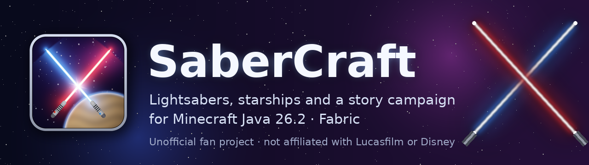
</p>

<p align="center">
  
  
  
  
  
  <a href="LICENSE"></a>
</p>

<p align="center">
  <b>English</b> · <a href="README.de.md">Deutsch</a>
</p>

**SaberCraft** is a Fabric mod for Minecraft Java 26.2 about lightsabers and everything around them. Any sword can become a film-style lightsaber that ignites, glows, hums and retracts. Around the sabers there are fighting styles and Force abilities, film characters, blasters, droid companions, flyable starships, planet skies, original music and a story campaign: **Chapter 1, "Nightshade"**, six missions aboard an Imperial Star Destroyer.

> [!NOTE]
> SaberCraft is an **unofficial fan project**. It is not affiliated with, endorsed by or connected to Lucasfilm, Disney, Mojang or Microsoft. Star Wars and all related names are trademarks of their owners. The mod contains **no film music, no film sounds and no film artwork**: every model, texture, sound and piece of music in it was made for this project (see [Legal](#legal)).

## Contents

- [At a glance](#at-a-glance)
- [Story mode: Chapter 1, "Nightshade"](#story-mode-chapter-1-nightshade)
- [Features](#features)
- [Screenshots](#screenshots)
- [Requirements](#requirements)
- [Installation](#installation)
- [Controls](#controls)
- [Commands](#commands)
- [Configuration](#configuration)
- [Known issues and limitations](#known-issues-and-limitations)
- [Downloads and links](#downloads-and-links)
- [Support the project](#support-the-project)
- [Building from source](#building-from-source)
- [Contributing](#contributing)
- [Legal](#legal)

## At a glance

- **Lightsabers** with ignition and retraction, layered glow, hum and swing sounds: 14 hilts, 6 blade colors, 15 fighting styles, guard, parry, dodges and four Force abilities.
- **A story campaign** with stealth, disguise, dialogs with choices, two droid helpers, short cutscenes, a boss duel and an escape, in German and English. The story's characters speak to you by your own Minecraft name.
- **11 film characters** and 5 neutral outfits, **9 blasters** that use arrows as ammunition, **8 droid companions**, **5 starships** (two of them you can walk through), **6 planet skies**.
- **30 original pieces of music**, composed by script, that follow what happens in the story and in the open world.
- Works in single player and on servers. All settings in an in-game menu (key **I**).

## Story mode: Chapter 1, "Nightshade"

For three weeks Kestrel, an agent hidden aboard the Star Destroyer *Tenebris*, sent data to the Rebellion. Then one last message: *"Nightshade is not a ship. It is a hunt."* You are smuggled aboard to find her and to learn what Nightshade is.

Start the story in the SaberCraft menu (key **I**, first tab **Story**). Your own items, position and droids are put aside while you play and come back when you leave.

**Missions**

1. **In the Shadow of the Tenebris**: the briefing aboard the Millennium Falcon, the jump, sneaking aboard.
2. **Kestrel**: meet your contact in her hideout and help her with a dangerous errand.
3. **Clothes Make the Trooper**: get hold of a disguise and a way into the guarded areas.
4. **Heart of Fire**: down to the reactor.
5. **Discovery**: when things go wrong.
6. **Nightshade**: the lab under the reactor, an escape through a failing ship and a lightsaber duel.

**How it plays**

- **Stealth.** The crew notices you in stages (calm, suspicious, alerted, detected), shown by a small eye on screen. Darkness, lamps, cover, sneaking and crawling matter. Seen, troopers chase you, call for help and search where they last saw you.
- **Disguise.** Stormtrooper armour fools the troops while you behave like one; officers look closer.
- **Dialogs with choices.** Portraits, names and answers; one decision changes later missions.
- **Droid helpers.** The mouse droid M-31 makes a noise where you look and fits through small hatches; the astromech R2-V7 opens locks.
- **Silent takedowns** from behind an unaware stormtrooper, **crawl ways** with marked hatches, consoles, terminals and lockers to use.
- **Short cutscenes** at key moments (skip with **Space** or **Esc**).
- **The finale.** A fight through the reactor level and the corridors to the hangar, with troopers who fire as soon as they see you, then a duel in phases against the *Shadowblade*, a fighter with a spinning ring saber. In the story the **Focus** (key **G**) slows your enemies for a few seconds.
- **Checkpoints.** Being caught takes you back to the last checkpoint with everything as it was there. You can leave the story at any time, continue later or replay a mission you have reached.
- **Three difficulties** (Easy, Normal, Hard), chosen before the story begins and changeable in the story menu.
- **Your name in the story.** Wherever the characters speak to you or name you, they use your Minecraft name; on a server everyone reads their own.
- **Music** of its own: 18 original story pieces for sneaking, suspicion, alarm, special places, the cutscenes and the duel, with smooth crossfades.
- Own **language setting** (Auto, German, English) for all SaberCraft texts and a **Story brightness** setting for the dark scenes.

The end of the chapter gives you a lightsaber to keep.

## Features

Status labels: ✅ **stable** (built, covered by automated tests and played) · 🧪 **experimental** (built and covered by automated tests, but little played by hand and not balanced with real players).

### ⚔️ Lightsabers ✅

- **Ignition and retraction** with per-hilt timing, easing and flash; a looping hum that reacts to movement; four swing sound variants.
- **14 hilts** as 3D models: standard, guardian, dark lord, sentinel, Kenobi, Skywalker, Anakin, Yoda, Dooku, Tano, crossguard, Rey, Ezra and a double-bladed hilt.
- **6 blade colors**: red, blue, green, purple, yellow and white. Core, bloom, halo, length, thickness, brightness and flicker of each color can be edited.
- **Hilts that play differently** (can be switched off): damage, guard and parry window differ per hilt; the crossguard ignites with a stutter, the double blade lights one side after the other.
- **Only the swords you choose** become lightsabers: press **I** with a sword in hand and click **Make lightsaber** (or `/sabercraft convert`). **Normal sword** turns it back exactly as it was. Servers can limit which swords may become sabers.
- Works with **Iris shader packs**: the blade has its own render path for shader packs.

### 🥋 Combat ✅

- **15 fighting styles** with their own moves, among them two for the double blade.
- **Guard, parry and counter**, guard breaks, deflecting projectiles, **dodges** (roll, side step, back step, lunge, flip) and a **spin attack**.
- **Force abilities**: push, grip, pull and jump, with cooldowns and stamina decided by the server.
- **Blade trails, sparks and clashes** at the contact point, glowing hit marks and a finisher with a short slow motion in single player.

### 🎭 Characters and outfits ✅

- **11 film characters**: Darth Vader, Obi-Wan Kenobi, Darth Maul, Luke Skywalker, Anakin Skywalker, Yoda, Count Dooku, Ahsoka Tano, Kylo Ren, Rey and Ezra Bridger. Each brings an original pixel skin, a matching saber and fighting style.
- **5 neutral outfits** (Keeper's robe, Shadow robe, Sentinel armor, Scout gear, Twilight armor) and **your own profiles** from JSON files.
- Other players see your character when they have SaberCraft and the server runs it too.

### 🔫 Blasters 🧪

- **9 blasters** with their own models, sounds and values: DL-44, E-11, DC-15A, SE-14C, Bowcaster, A280, repeating blaster, rebel blaster and Ezra's blaster.
- A bow becomes a blaster in the blaster menu or with `/sabercraft blaster`. Damage, heat, overheating, muzzle flash and recoil; Ezra's blaster stuns.
- **Arrows are the ammunition**: each shot costs one plain arrow. Infinity keeps the arrow if the server allows it, creative mode needs none, and servers can switch ammunition off.

### 🤖 Droids 🧪

- **8 droid companions**: R2-D2, C-3PO, BB-8, Chopper, a mouse droid, a probe droid, B1 and K-2SO, each with moving parts, a wordless synthesized voice and one ability.
- Call, call back, stay, follow and send home from the droid menu or with `/sabercraft droid`. Look at one of your droids and press **N** for its ability or **U** to let it wait or follow.
- The server sets a limit per player (2 by default) and every droid's cooldown, range and damage. Droids come back after a restart.

### 🚀 Starships 🧪

- A **flyable X-Wing** with S-foils, banking turns, wing-tip lasers, engine sound, a flight HUD and a chase camera; a **TIE Fighter** and a **TIE Interceptor**, each with its own model, sounds and handling.
- A **Millennium Falcon** and a **Star Destroyer** (about 80 blocks long) that you can fly and **walk through**: cockpit, seats, doors, lights, consoles and the Falcon's gun turrets.
- Ships have a **hull** and **flight energy**: hits wear the hull down, it mends slowly, and at zero the ship explodes; its owner waits a minute for a new one (configurable). Crashes make smoke and sparks but break no blocks.
- Only the owner can fly their ship. Logging out in the cockpit puts you back in it when you log in.

### 🌌 Skies and planets ✅

- A **space sky** with stars, nebulae and galaxies over the Overworld's night sky and in the End.
- **6 planet skies**: Tatooine (two suns), Coruscant, Endor, Hoth, Mustafar and Naboo, each with its own horizon, sun, moon, particles and ambient sound. Planets **only change the sky and sound, never the terrain**.

### 🎵 Music and sound ✅

- **30 original pieces**: 12 for exploration, night, combat, flight and events in the open world, and 18 for the story. Crossfades between them, never two at once.
- A **"Star Wars" music mode** that plays **only files you add yourself** (`.ogg` or `.wav`), chosen by situation, planet and character ([guide](docs/eigene-musik.md), German). SaberCraft ships no film music.

### ⚔️ Duels ✅

- **Voluntary** lightsaber duels with `/sabercraft duel <player>`: accept or decline in chat, a 3-2-1 countdown, best of three; a lethal hit only ends the round. Players can ignore challenges and servers can switch duels off.

### 🏆 Advancements ✅

- **11 advancements** in their own tab, from the first ignited saber and blaster shot to the first flight.

## Screenshots

All screenshots are taken in the game itself by the automated client tests (a virtual display with software rendering at 1280×720), without editing. Your game may look sharper.

**Story mode**

| | |
| :---: | :---: |
| 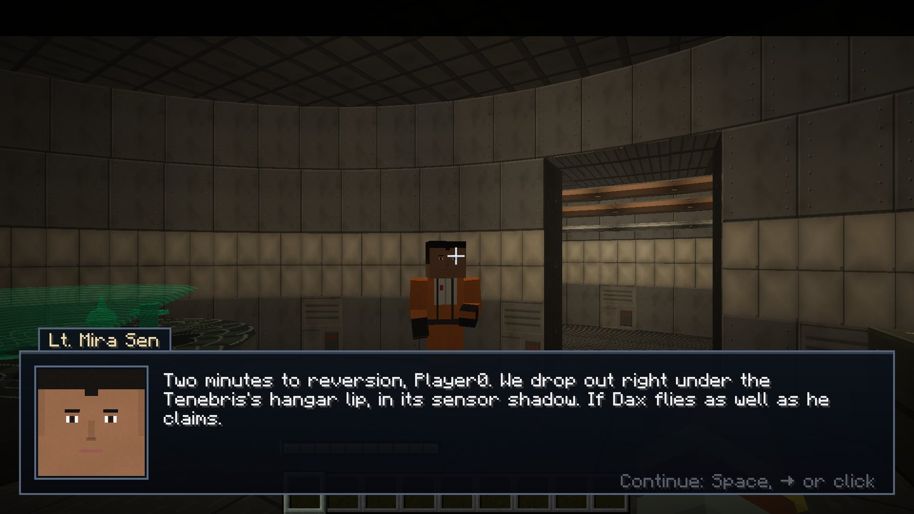 | 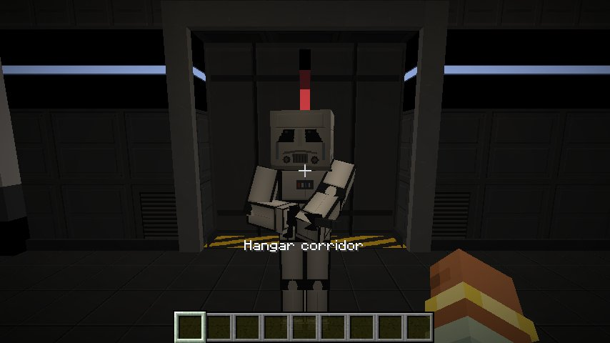 |
| **Dialogs and radio use your Minecraft name** (here the test account's, "Player0") | **A stormtrooper on patrol** |
| 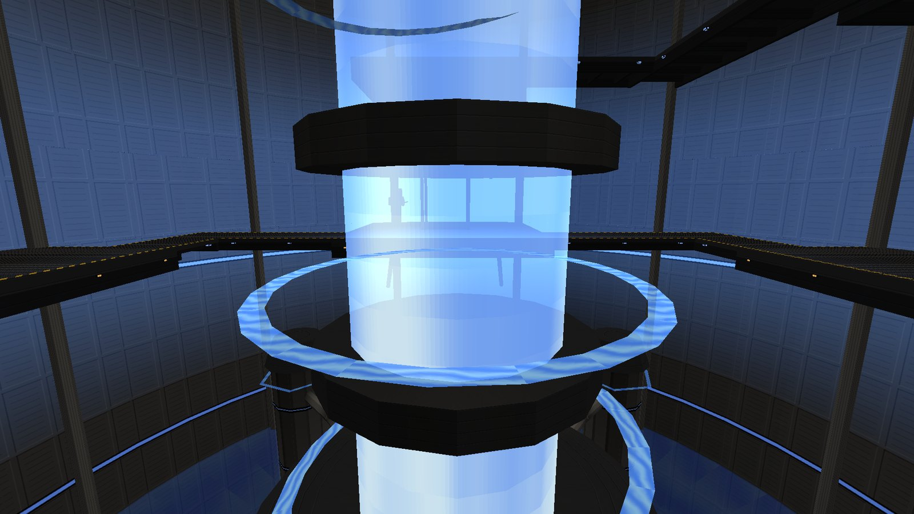 | 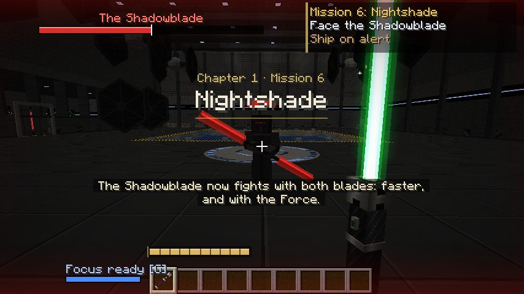 |
| **The reactor** | **The duel against the Shadowblade** |

**Sandbox**

| | |
| :---: | :---: |
| 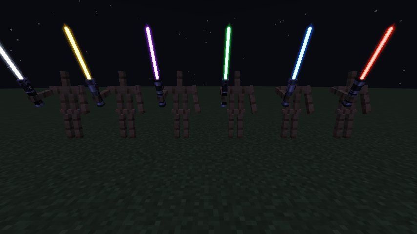 | 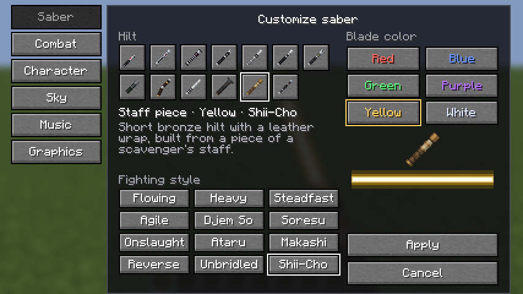 |
| **Six blade colors** | **Saber menu (I)** |
| 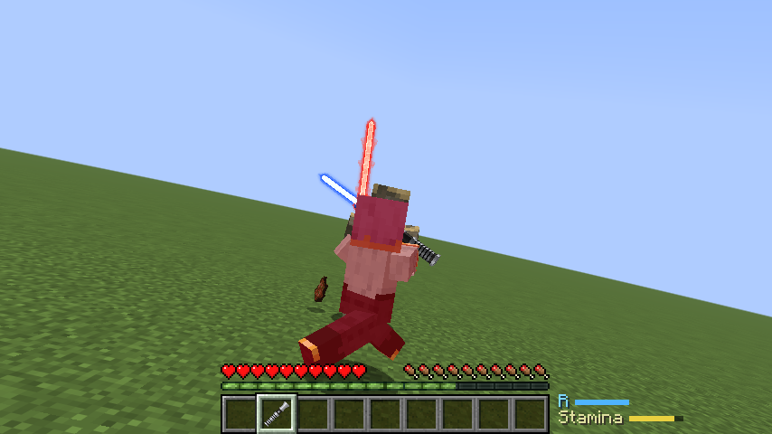 | 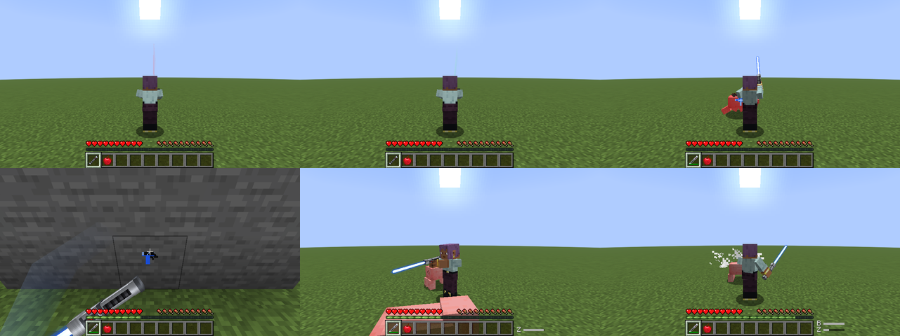 |
| **Clash at the contact point** | **Abilities, trails and sparks** |
| 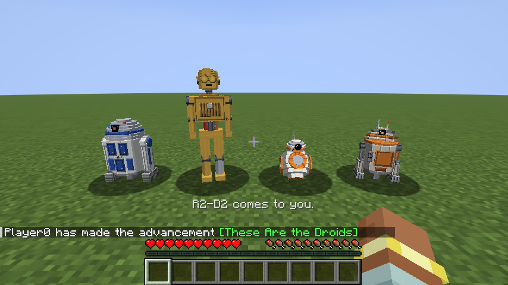 | 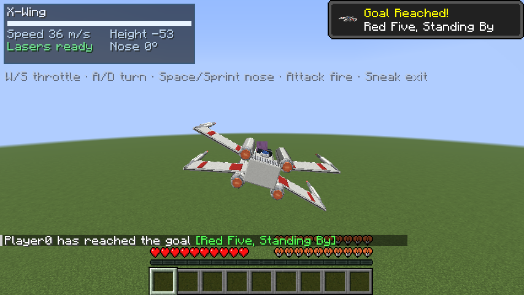 |
| **Droid companions** | **X-Wing with flight HUD** |
| 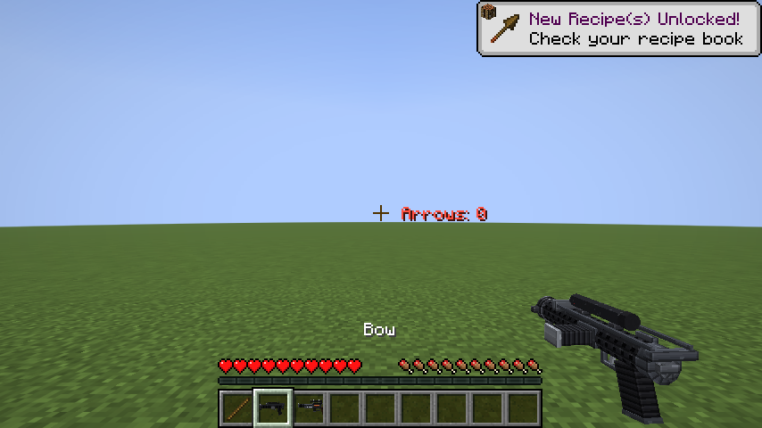 | 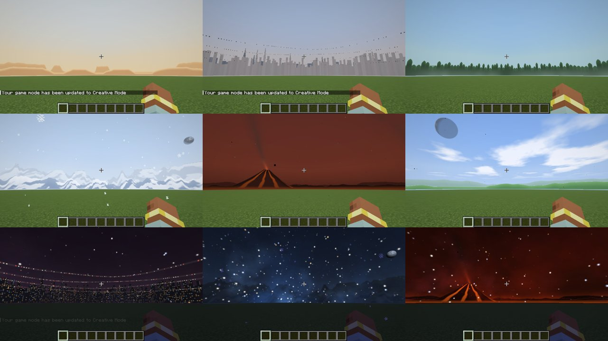 |
| **Blaster with arrow counter** | **Planet skies by day and night** |

<details>
<summary><b>Characters</b></summary>

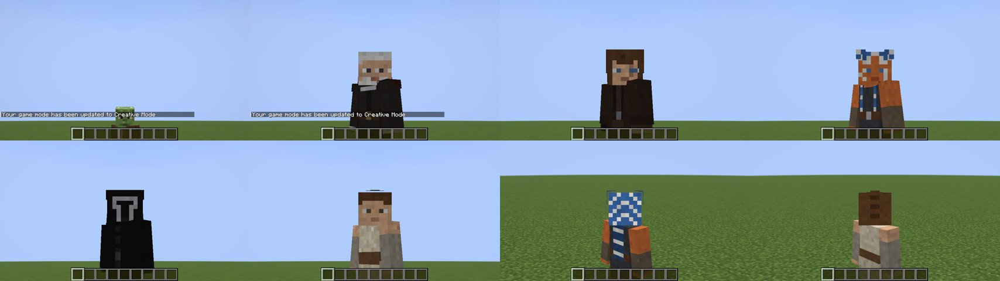

</details>

More images: [`docs/media/`](docs/media/) and [`docs/images/`](docs/images/).

## Requirements

| Component | Version | Notes |
| --- | --- | --- |
| Minecraft Java Edition | **26.2** | other versions are not supported |
| Fabric Loader | **0.19.5** or newer | [Fabric installer](https://fabricmc.net/use/installer/) |
| Fabric API | **0.161.0+26.2** or newer for 26.2 | required; the version SaberCraft is built and tested with |
| Java | **25** | the Minecraft launcher brings its own Java |

No other mods are needed. Forge, NeoForge and Quilt are not supported. [Iris](https://modrinth.com/mod/iris) and [Sodium](https://modrinth.com/mod/sodium) are optional (tested in an earlier version: Iris 1.11.4, Sodium 0.9.2).

## Installation

1. Install **Fabric Loader** for Minecraft 26.2 with the [Fabric installer](https://fabricmc.net/use/installer/).
2. Put **Fabric API** for 26.2 into the `mods` folder of your Minecraft installation:
   - Windows: `%APPDATA%\.minecraft\mods`
   - macOS: `~/Library/Application Support/minecraft/mods`
   - Linux: `~/.minecraft/mods`
3. Put the SaberCraft JAR (`sabercraft-<version>.jar`, not the `-sources.jar`) into the same `mods` folder and remove older SaberCraft JARs.
4. Start the **Fabric** profile in the launcher.
5. Try it: take a sword into your hand, press **I** and click **Make lightsaber**. The story is in the same menu, first tab.

**On a server**, put SaberCraft and Fabric API into the server's `mods` folder as well. Every player who wants to see and hear the sabers, ships and droids needs SaberCraft on their client too.

| Feature | Client only | Needs SaberCraft on the server too |
| --- | :---: | :---: |
| Blade look, ignition, hum, combat animations, trails, sparks | ✔ | |
| Sky, planets, music, menu | ✔ | |
| Your own outfit or character (only you see it without the server) | ✔ | |
| Guard, parry, Force abilities, stamina, deflecting | | ✔ |
| Story mode | | ✔ (in single player always there) |
| `/sabercraft` commands, blasters, droids, starships, duels, advancements | | ✔ |

In single player everything works with the mod installed once.

## Controls

All keys are in **Options → Controls → Key Binds → SaberCraft** and can be changed there.

| Default key | Action |
| --- | --- |
| **I** | SaberCraft menu (story, saber, blasters, droids, ships, combat, character, sky, music, graphics) |
| Left mouse button | Attack; the move depends on the fighting style |
| **R** (hold) | Guard; right after raising it, a parry |
| **Z** | Spin attack (blade whirl with the double blade) |
| **B** / **H** (hold) / **J** / **K** | Force push / grip / pull / jump |
| **Left Alt** | Dodge or lunge, direction from W/A/S/D |
| **N** | Ability of the droid you look at (in the story: M-31's or R2-V7's ability) |
| **U** | The droid you look at waits or follows |
| Right mouse button (blaster) | Fire; costs one arrow |

**In the story**

| Key | Action |
| --- | --- |
| Right mouse button on a person or thing | Speak to them, use a console, locker or terminal |
| Sneak in front of an open hatch | Crawl in |
| Sneak + right mouse button behind an unaware stormtrooper | Silent takedown (a hint explains when it is possible) |
| **Enter** / **Space** / click, **1**–**4**, arrow keys | Dialogs: go on, choose an answer, page back |
| **Space** / **Esc** | Skip a cutscene |
| **G** | The Focus (once you have the lightsaber) |

**Starships** (they use your movement keys): **W / S** throttle and brake, **A / D** turn, **Jump / Sprint** nose up and down, **Attack** lasers, **Sneak** climb out. Walk aboard the Falcon with the hangar button **Walk aboard**.

If a key is used twice, Minecraft marks it red in the Controls screen; click the binding and press a new key to change it.

## Commands

| Command | Effect |
| --- | --- |
| `/sabercraft convert [color] [hilt]` | The sword in your hand becomes a lightsaber |
| `/sabercraft revert` | Turns a converted sword or blaster back into exactly the item it was |
| `/sabercraft blaster [type]` | The bow in your hand becomes a blaster: `dl44`, `e11`, `dc15a`, `se14c`, `bowcaster`, `a280`, `repeater`, `rebel`, `ezra` |
| `/sabercraft blaster revert` | Blaster back to bow |
| `/sabercraft duel <player>` | Challenge a player; `accept`, `decline`, `leave`, `ignore` |
| `/sabercraft droid <droid>` | Call a droid; `recall`, `stay`, `ability`, `dismiss <droid>` |
| `/sabercraft ship call\|board\|dismiss [ship]` | Call, board or send away your ship: `xwing` (default), `tie_fighter`, `tie_interceptor` |

`convert`, `revert` and `blaster` are open to everyone by default; with `commands_for_everyone: false` only operators may use them.

## Configuration

Almost everything can be set in the in-game menu (**I**). The menu writes JSON files to `config/sabercraft/` in your Minecraft folder; a broken file is reported in the log and left untouched.

| File / folder | Side | What it holds |
| --- | --- | --- |
| `abilities.json` | server | abilities, cooldowns, stamina, hilt traits, duels, blasters and ammunition, droids, ships, command permissions |
| `combat_client.json` | client | combat animations, trails, particles, ability HUD, camera motion, shader blade, hit marks |
| `immersion_client.json` | client | sky, planet, music and Star Wars mode, ship camera and HUD, language, story brightness |
| `character_client.json` | client | chosen character, outfit or profile |
| `blade_styles.json` | client | colors, length, thickness, glow and flicker of every blade color |
| `profiles/*.json` | client | your own character profiles ([guide](docs/custom-profiles.md), German) |
| `music/<mood>/`, `starwars_music/` | client | your own music files ([guide](docs/eigene-musik.md), German) |

Every key with its default value: [docs/configuration.md](docs/configuration.md).

## Known issues and limitations

- **Minecraft 26.2 with Fabric only.** Other Minecraft versions and other mod loaders are not supported.
- **How it was tested.** About 50 automated test classes start a real Minecraft client, press keys, click menus and check the results, in a virtual display with software rendering at 1280×720. The story mode has been played through by the author many times. Blasters, droids and starships (🧪) have been played little by hand and are not balanced with real players. Real graphics cards and other screen sizes have not been tested systematically.
- **Multiplayer:** a server with several real players at once has not been tested, nor a client without SaberCraft joining a server that runs it.
- **Story mode:** only Chapter 1 exists. Its texts are in German and English only. On a server each player plays their own copy of the story; it is not a co-op mode.
- **Shader packs:** with Complementary Reimagined the planet skies stay pale; with BSL raise `SKYBOX_OPACITY` and turn off `SKY_DESATURATION`. Other packs are untested, and blasters, droids, starships and character skins have not been checked with a shader pack.
- **Starships** have a hull but no shields. The hyperspace jump exists only in the story's scenes.
- **Blasters:** a converted bow keeps the name "Bow" in the hotbar.
- **Duels:** no arena border, spectator view or ranking.

Found a bug? Please open an [issue](https://github.com/Phiro4241/SaberCraft/issues/new?template=bug_report.yml) with your Minecraft, Fabric Loader, Fabric API and SaberCraft versions and the log.

## Downloads and links

- **Source code and issues:** this repository.
- **Download:** the JAR is attached to the releases on the [Releases page](https://github.com/Phiro4241/SaberCraft/releases) once a version is published; until then you can [build it yourself](#building-from-source).
- **Modrinth and ModDB:** pages are being prepared; their links will be added here when they are online.

## Support the project

SaberCraft is free and will stay free. If you would like to support its development, you can do so voluntarily on Patreon (creator: **Phiro**). Support unlocks nothing in the mod; every feature is available to everyone.

<!-- PATREON LINK PLACEHOLDER (Phiro): insert the verified Patreon page URL here before publishing, e.g. [Support Phiro on Patreon](https://www.patreon.com/...) -->
> **Patreon:** *placeholder, the link to the Patreon page will be added here.*

## Building from source

Requirements: **JDK 25** and Git. Gradle comes with the wrapper.

```bash
git clone https://github.com/Phiro4241/SaberCraft.git
cd SaberCraft
./gradlew build            # Windows: gradlew.bat build
```

The mod is then at `build/libs/sabercraft-<version>.jar`. `./gradlew runClient` starts Minecraft with the mod, `./gradlew runClientGameTest` runs the automated client tests (a full run takes about one and a half hours). The Python generators for models, textures, sounds and music are in [`tools/`](tools/). More for contributors, including the project layout: [CONTRIBUTING.md](CONTRIBUTING.md).

## Contributing

Bug reports, ideas and pull requests are welcome. Please read [CONTRIBUTING.md](CONTRIBUTING.md) first.

- 🐞 **Bug?** Open a [bug report](https://github.com/Phiro4241/SaberCraft/issues/new?template=bug_report.yml).
- 💡 **Idea?** Open a [feature request](https://github.com/Phiro4241/SaberCraft/issues/new?template=feature_request.yml).
- 🔒 **Security issue?** Please do not open a public issue; see [SECURITY.md](SECURITY.md).

## Legal

- **License:** SaberCraft's source code and its original assets (the generated models, textures, sounds, music, icon and banner) are released under the [MIT License](LICENSE), © 2026 Phiro4241.
- **What the MIT License does not cover:** it only grants rights the author holds. It grants **no rights to Star Wars** or any other trademark, name, character, design or likeness owned by Lucasfilm Ltd. or The Walt Disney Company. Names like Star Wars, Darth Vader, R2-D2, X-Wing or DL-44, and character looks modelled after film characters, stay subject to those rights. If you reuse SaberCraft, especially publicly or commercially, you are responsible for those rights yourself. The license also does not cover Minecraft itself or Mojang's textures visible in screenshots.
- **Fan project:** SaberCraft is an unofficial fan project, free to download and play, not affiliated with, endorsed by or sponsored by Lucasfilm Ltd., The Walt Disney Company or Mojang Studios / Microsoft. Names of characters, droids, ships and planets are used only to describe what the mod is about. The story, its characters (apart from the named film characters of the sandbox) and its dialogs are original.
- **Original assets:** all sounds are synthesized by [`tools/synth_sounds.py`](tools/synth_sounds.py), all music is composed by [`tools/synth_music.py`](tools/synth_music.py), and hilts, blasters, droids, ships, outfits, the icon and the banner are generated by the other scripts in [`tools/`](tools/). The mod contains no film recordings, samples, music or artwork. The Star Wars music mode only plays files the player adds on their own computer.
- **Not an official Minecraft product.** Not approved by or associated with Mojang or Microsoft.
