<p align="center">
  
</p>

<p align="center">
  
  
  
  
  <a href="LICENSE"></a>
</p>

<p align="center">
  <b>English</b> · <a href="README.de.md">Deutsch</a>
</p>

**SaberCraft brings the lightsaber to Minecraft, and builds a galaxy around it.** Ignite a blade that hums, glows and clashes like in the films, fight with fifteen styles and the Force, call your droids, climb into an X-Wing or walk the corridors of a Star Destroyer. And when you are ready, slip aboard the *Tenebris* in **"Nightshade"**, a six-mission stealth story that ends with a lightsaber duel.

<table>
  <tr>
    <td width="50%">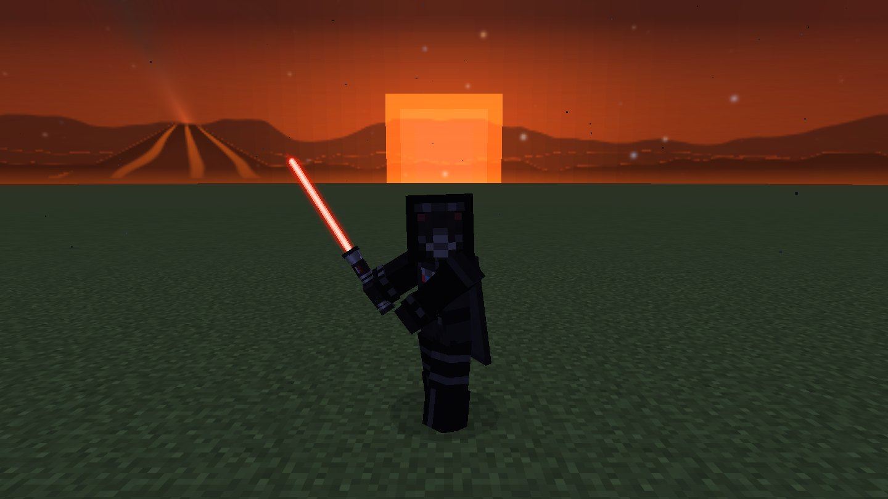</td>
    <td width="50%">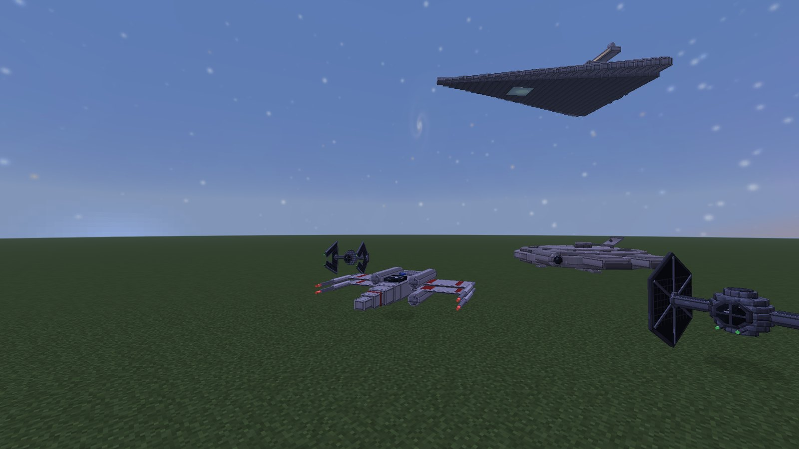</td>
  </tr>
  <tr>
    <td width="50%"></td>
    <td width="50%">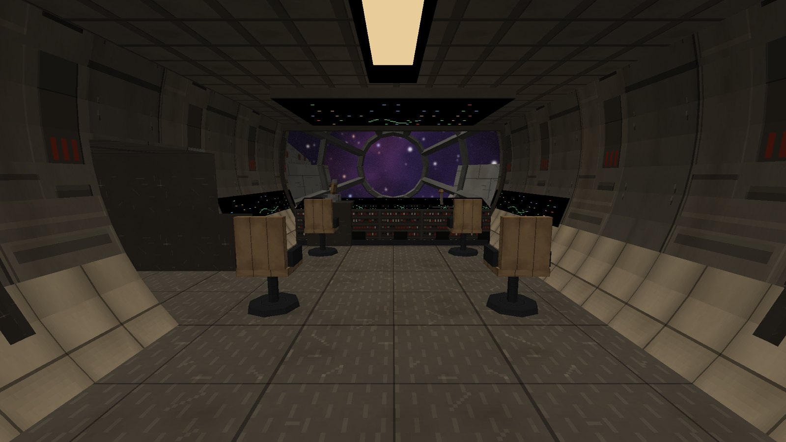</td>
  </tr>
</table>

> [!NOTE]
> SaberCraft is an **unofficial, free fan project**, not affiliated with or endorsed by Lucasfilm, Disney, Mojang or Microsoft. It contains **no film music, film sounds or film artwork**: every model, texture, sound and piece of music was made for this mod.

## Contents

[Lightsabers and combat](#lightsabers-and-combat) · [The story: "Nightshade"](#the-story-nightshade) · [Starships](#starships) · [Droids and blasters](#droids-and-blasters) · [Characters](#characters) · [Skies and music](#skies-and-music) · [Playing together](#playing-together) · [Gallery](#gallery) · [Getting started](#getting-started) · [Controls](#controls) · [Good to know](#good-to-know) · [Support](#support) · [License and legal](#license-and-legal)

## Lightsabers and combat

Pick up a sword, open the SaberCraft menu with **I** and turn it into a lightsaber. Every saber ignites with its own rhythm, hums louder as you move, leaves a trail through the air and throws sparks where blades meet. Change your mind, and it turns back into exactly the sword it was.

- **14 hilts and 6 blade colors**, from the classic single blade to a crossguard and a double-bladed staff. Each color's core, glow, length and flicker can be tuned.
- **15 fighting styles** with their own swings, and a defence that rewards timing: hold your **guard**, **parry** at the right moment, **dodge**, roll and lunge, unleash a **spin attack**, and turn blaster bolts back with your blade.
- **The Force**: push, grip, pull and jump, with cooldowns and stamina.
- Hilts can play differently (damage, guard and parry window), and the blade has its own render path for **Iris shader packs**.

<table>
  <tr>
    <td width="50%"></td>
    <td width="50%"></td>
  </tr>
</table>

## The story: "Nightshade"

*For three weeks Kestrel, an agent hidden aboard the Star Destroyer* Tenebris, *sent data to the Rebellion. Then one last message: "Nightshade is not a ship. It is a hunt." You are smuggled aboard to find her, and to learn what Nightshade is.*

Chapter 1 is a complete story of six missions, from a briefing on the Millennium Falcon to an escape from a ship that is tearing itself apart. Start it from the first tab of the menu (**I**); your own items and droids wait for you until you come back.

1. **In the Shadow of the Tenebris**: the briefing, the jump, sneaking aboard.
2. **Kestrel**: find your contact in her hideout and help her with a dangerous errand.
3. **Clothes Make the Trooper**: a disguise, and a way into the guarded decks.
4. **Heart of Fire**: down to the reactor.
5. **Discovery**: when things go wrong.
6. **Nightshade**: the lab under the reactor, the fight to the hangar and a duel.

**How it plays.** Stay in the dark and out of sight: the crew notices you in stages, from a wary glance to a full alarm, and troopers chase you, call for help and search where they last saw you. Crawl through ventilation shafts, take down an unaware guard from behind, send the mouse droid M-31 to make a noise or let the astromech R2-V7 open a lock. In stormtrooper armour you can walk among the troops, as long as you act like one. Characters speak to you by your own Minecraft name, a choice you make changes what comes later, and the finale throws you against troopers who open fire the moment they see you, and then against the *Shadowblade* and her spinning ring saber.

Checkpoints, three difficulties (Easy, Normal, Hard), skippable cutscenes, its own music for every situation, and German and English texts. At the end of the chapter you keep a lightsaber.

<table>
  <tr>
    <td width="50%"><br><sub>The briefing: everyone knows your name (here the test account's, "Player0").</sub></td>
    <td width="50%"><br><sub>In disguise among the troops.</sub></td>
  </tr>
  <tr>
    <td width="50%"><br><sub>The reactor of the <i>Tenebris</i>.</sub></td>
    <td width="50%">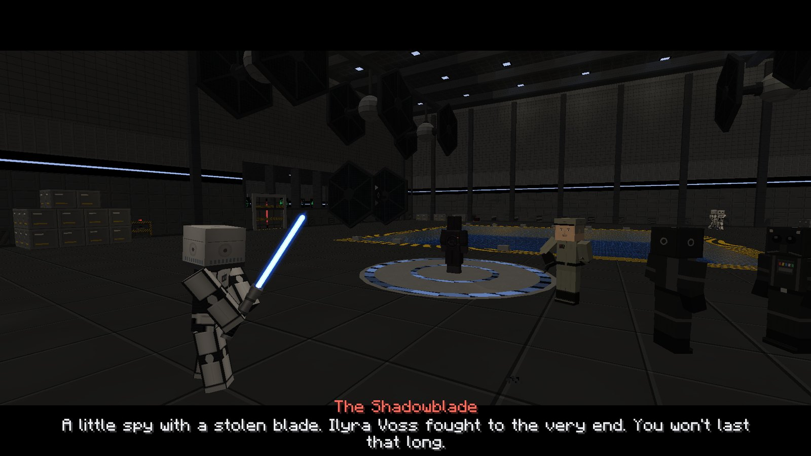<br><sub>The Shadowblade waits in the hangar.</sub></td>
  </tr>
  <tr>
    <td width="50%"><br><sub>The fight to the hangar.</sub></td>
    <td width="50%">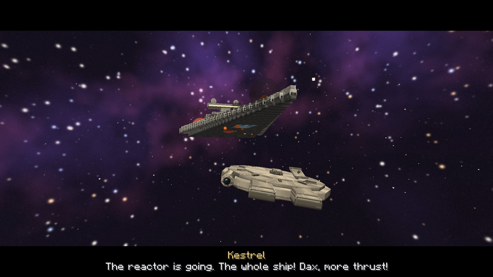<br><sub>The escape.</sub></td>
  </tr>
</table>

## Starships

Five ships, each with its own model, sounds and handling. Call one from the menu, climb in and take off: the chase camera follows, a flight HUD shows speed, hull and energy, and the lasers fire with your attack key.

- **X-Wing**, **TIE Fighter** and **TIE Interceptor**: fast fighters with lasers.
- **Millennium Falcon**: fly it, or walk aboard. The cockpit, the lounge, the corridors and the gun turrets are all there to explore.
- **Star Destroyer**: about 80 blocks of Imperial steel, slow and steady in the air, with a bridge, corridors, a hangar and a reactor inside, and a crew at work.
- Ships take damage and run on flight energy; a destroyed ship comes back after a short wait. Crashes make smoke and sparks but break no blocks, and only you can fly your own ship.

<table>
  <tr>
    <td width="50%"></td>
    <td width="50%"></td>
  </tr>
  <tr>
    <td width="50%">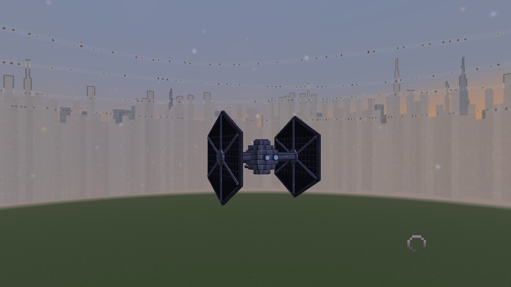</td>
    <td width="50%"></td>
  </tr>
  <tr>
    <td width="50%"></td>
    <td width="50%"></td>
  </tr>
</table>

## Droids and blasters

**Eight droid companions** follow you around: R2-D2, C-3PO, BB-8, Chopper, a mouse droid, a probe droid, a B1 battle droid and K-2SO. Each has moving parts, a wordless synthesized voice and an ability of its own; look at one and press **N** to use it, or **U** to let it wait.

**Nine blasters**, from the DL-44 to the bowcaster, turn a bow into a blaster with its own model, sound, heat and recoil. They fire plain arrows as ammunition, so survival stays survival.

<table>
  <tr>
    <td width="50%">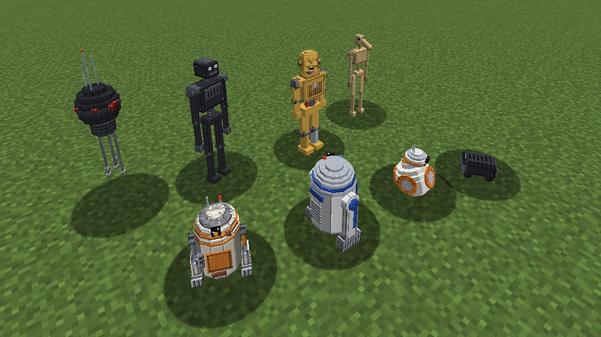</td>
    <td width="50%">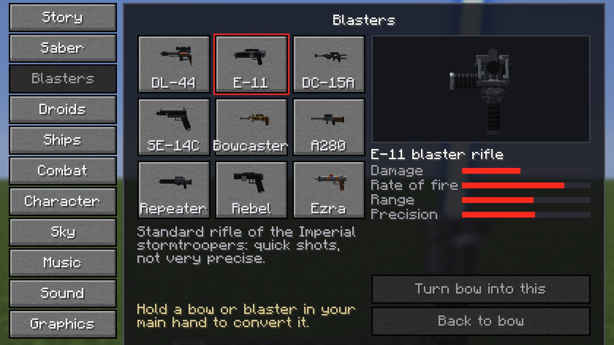</td>
  </tr>
</table>

## Characters

Play as one of **11 film characters**, among them Darth Vader, Obi-Wan Kenobi, Ahsoka Tano and Ezra Bridger, each with an original pixel skin, a matching saber and fighting style. Or wear one of **5 neutral outfits**, or a profile of your own. Capes move, and armor you wear stays useful under the look you chose.

<table>
  <tr>
    <td width="50%">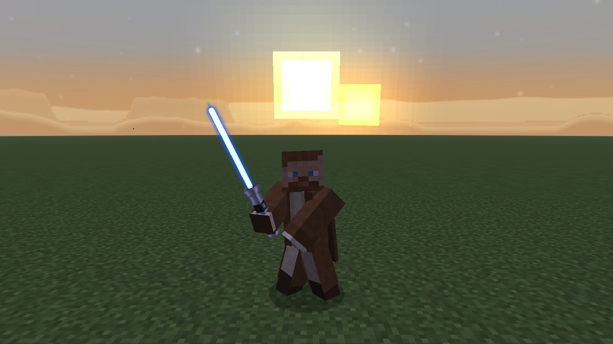</td>
    <td width="50%"></td>
  </tr>
</table>

## Skies and music

At night a **space sky** of stars, nebulae and galaxies rises over the Overworld. Choose one of **6 planets** (Tatooine, Coruscant, Endor, Hoth, Mustafar or Naboo) and the sky, sun, moon and sounds change to match; the terrain itself stays yours.

**30 original pieces of music** follow what happens: exploration and night, combat and flight in the open world, and a score of their own for every part of the story, from sneaking to the final duel, always crossfaded and never two at once. A separate **music mode** plays music files you add yourself, chosen by situation, planet and character.

<table>
  <tr>
    <td width="50%">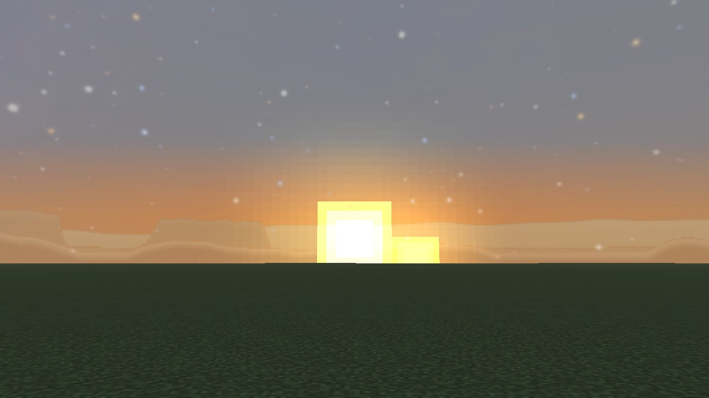</td>
    <td width="50%">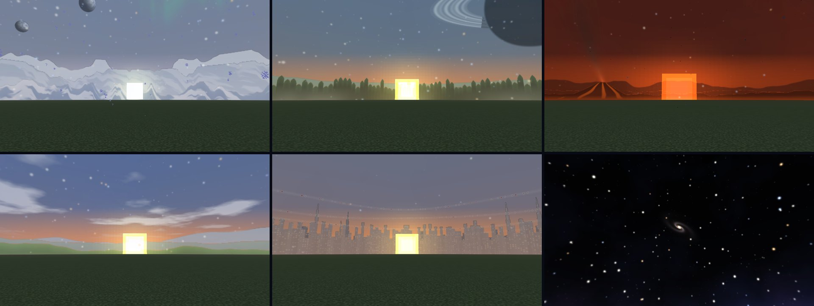</td>
  </tr>
</table>

## Playing together

SaberCraft works in single player and on servers. Challenge another player with `/sabercraft duel <player>` to a voluntary best-of-three lightsaber duel, collect **11 advancements**, and let the server decide what is allowed: abilities, cooldowns, blasters and ammunition, droids, ships and who may convert swords. On a server each player plays their own copy of the story.

## Gallery

<table>
  <tr>
    <td width="33%">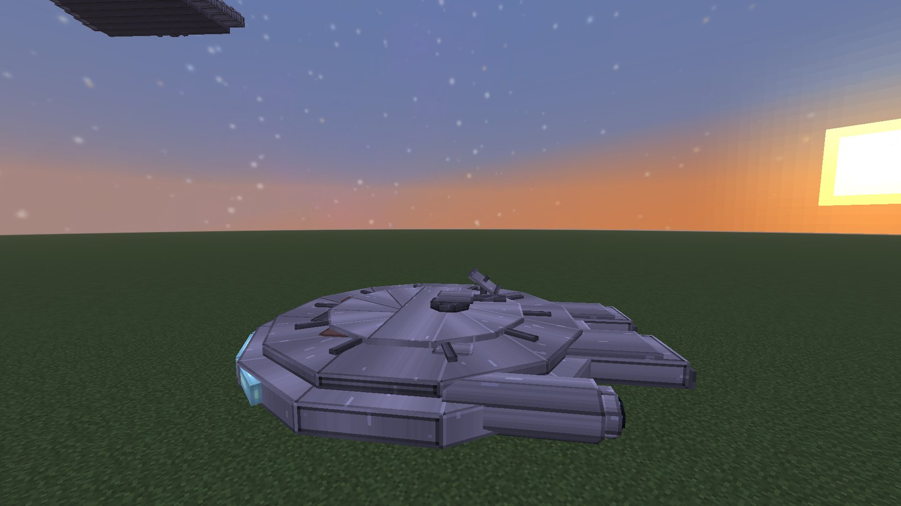</td>
    <td width="33%">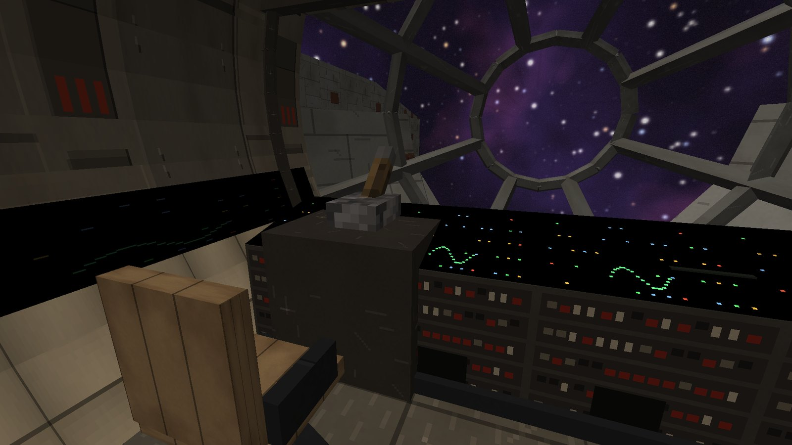</td>
    <td width="33%">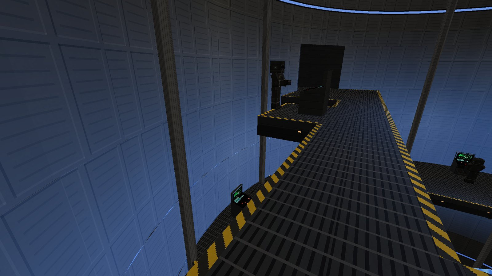</td>
  </tr>
  <tr>
    <td width="33%">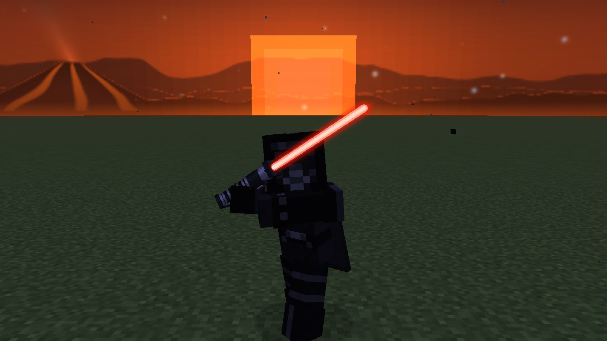</td>
    <td width="33%">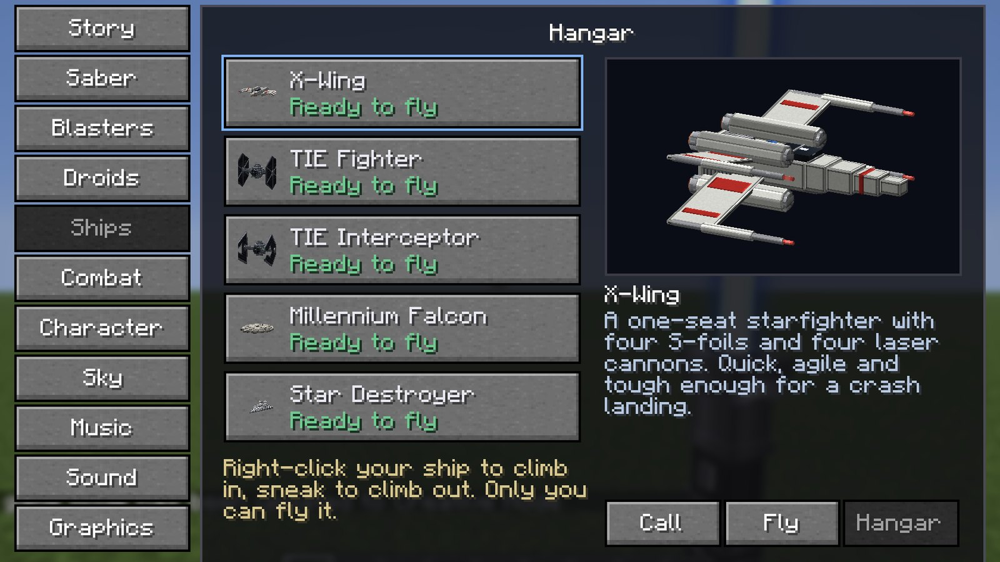</td>
    <td width="33%"></td>
  </tr>
</table>

<sub>All pictures are taken in the game with SaberCraft, at 1920×1080 with software rendering; with a graphics card the game looks a little sharper.</sub>

## Getting started

**You need** Minecraft Java Edition **26.2**, **Fabric Loader 0.19.5** or newer and **Fabric API** (built and tested with 0.161.0+26.2). The launcher brings the right Java.

1. Install Fabric Loader for 26.2 with the [Fabric installer](https://fabricmc.net/use/installer/).
2. Put **Fabric API** and the **SaberCraft** JAR into your `mods` folder (Windows `%APPDATA%\.minecraft\mods`, macOS `~/Library/Application Support/minecraft/mods`, Linux `~/.minecraft/mods`). Use `sabercraft-<version>.jar`, not the `-sources.jar`, and remove older SaberCraft JARs.
3. Start the **Fabric** profile, take a sword in your hand, press **I** and click **Make lightsaber**. The story is the first tab of the same menu.

**On a server**, install SaberCraft and Fabric API on the server and on every client. A player without the mod on a SaberCraft server, or with the mod on a plain server, only gets part of it:

| | Mod on the client only | Mod on client and server |
| --- | :---: | :---: |
| Blade look and sounds, combat animations, skies, music, the menu | ✔ | ✔ |
| Guard, parry, Force abilities, story, blasters, droids, ships, duels, advancements, commands | | ✔ |

In single player everything is there with the mod installed once.

## Controls

All keys can be changed under **Options → Controls → Key Binds → SaberCraft**.

| Key | Action |
| --- | --- |
| **I** | SaberCraft menu: story, saber, blasters, droids, ships, combat, character, sky, music, graphics |
| Left mouse button | Attack; the move depends on your fighting style |
| **R** (hold) | Guard; right after raising it, a parry |
| **Z** | Spin attack |
| **B** · **H** (hold) · **J** · **K** | Force push · grip · pull · jump |
| **Left Alt** | Dodge or lunge, direction from W/A/S/D |
| **N** · **U** | Ability of the droid you look at · let it wait or follow |
| Right mouse button (blaster) | Fire (costs one arrow) |

<details>
<summary><b>In the story and in a ship</b></summary>

| Key | Action |
| --- | --- |
| Right mouse button on a person or thing | Talk, use a console, locker or terminal |
| Sneak in front of an open hatch | Crawl in |
| Sneak + right mouse button behind an unaware trooper | Silent takedown |
| **Enter** / **Space** / click, **1**–**4**, arrow keys | Dialogs: go on, choose an answer, page back |
| **Space** / **Esc** | Skip a cutscene |
| **G** | The Focus: slows your enemies for a moment (once you have the lightsaber) |
| **W / S**, **A / D** | Ship: throttle and brake, turn |
| **Jump / Sprint** | Ship: nose up and down |
| **Attack** · **Sneak** | Ship: lasers · climb out |

</details>

<details>
<summary><b>Commands</b></summary>

| Command | Effect |
| --- | --- |
| `/sabercraft convert [color] [hilt]` | The sword in your hand becomes a lightsaber |
| `/sabercraft revert` | Turns a converted sword or blaster back into exactly the item it was |
| `/sabercraft blaster [type]` | The bow in your hand becomes a blaster: `dl44`, `e11`, `dc15a`, `se14c`, `bowcaster`, `a280`, `repeater`, `rebel`, `ezra` |
| `/sabercraft duel <player>` | Challenge a player; `accept`, `decline`, `leave`, `ignore` |
| `/sabercraft droid <droid>` | Call a droid; `recall`, `stay`, `ability`, `dismiss <droid>` |
| `/sabercraft ship call\|board\|dismiss [ship]` | Call, board or send away a fighter: `xwing`, `tie_fighter`, `tie_interceptor` (the Falcon and the Star Destroyer are in the menu) |

`convert`, `revert` and `blaster` are open to everyone unless the server sets `commands_for_everyone` to `false`.

</details>

<details>
<summary><b>Settings</b></summary>

Almost everything can be set in the menu (**I**), which saves JSON files in `config/sabercraft/`: server rules in `abilities.json`, and on your own computer the combat effects, sky, music, language, story brightness, your character and every blade color. Every setting with its default: [docs/configuration.md](docs/configuration.md). Guides (in German) for [your own music](docs/eigene-musik.md) and [your own character profiles](docs/custom-profiles.md).

</details>

## Good to know

- SaberCraft runs on **Minecraft 26.2 with Fabric** only; there is no Forge, NeoForge or Quilt version.
- The story's **Chapter 1** is complete; there are no further chapters yet. Texts are in English and German.
- **Starships, droids and blasters** are the newest parts of the mod and have not been balanced with many players yet. Starships have a hull but no shields; hyperspace jumps happen only in the story.
- A server full of real players at once has not been tried yet. If something goes wrong there, please tell us.
- With shader packs the blades work; with some packs the planet skies look paler (with BSL, raise `SKYBOX_OPACITY` and turn off `SKY_DESATURATION`).
- A bow turned into a blaster keeps the name "Bow" in the hotbar.

Found a bug? Please open an [issue](https://github.com/Phiro4241/SaberCraft/issues/new?template=bug_report.yml) with your Minecraft, Fabric Loader, Fabric API and SaberCraft versions and the log.

## Support

SaberCraft is free and stays free; every feature is for everyone. If you would like to support its development, you can do so voluntarily on Patreon (creator: **Phiro**).

<!-- PATREON LINK PLACEHOLDER (Phiro): insert the verified Patreon page URL here before publishing, e.g. [Support Phiro on Patreon](https://www.patreon.com/...) -->
> **Patreon:** *the link will be added here.*

**Downloads** will be on the [Releases page](https://github.com/Phiro4241/SaberCraft/releases) and on Modrinth once the first version is published. Until then you can build the mod yourself:

```bash
git clone https://github.com/Phiro4241/SaberCraft.git
cd SaberCraft
./gradlew build            # needs JDK 25; on Windows: gradlew.bat build
```

The JAR is then in `build/libs/`. Ideas, bug reports and pull requests are welcome: see [CONTRIBUTING.md](CONTRIBUTING.md) and, for security issues, [SECURITY.md](SECURITY.md).

## License and legal

- SaberCraft's code and its own assets (models, textures, sounds, music, icon and banner, all generated by the scripts in [`tools/`](tools/)) are released under the [MIT License](LICENSE), © 2026 Phiro4241.
- The license grants **no rights to Star Wars** or any other trademark, name, character or design owned by Lucasfilm Ltd. or The Walt Disney Company. Names such as Star Wars, Darth Vader, R2-D2 or X-Wing and character looks modelled after the films are used only to describe what the mod is about and remain subject to those rights. The story *Nightshade*, its characters and dialogs are original.
- SaberCraft contains no film recordings, samples, music or artwork. The music mode only plays files the player adds on their own computer.
- Not an official Minecraft product. Not approved by or associated with Mojang or Microsoft. Screenshots show Minecraft's own textures, which the MIT License does not cover.
