<p align="center">
  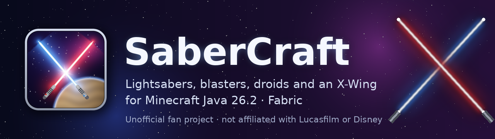
</p>

<p align="center">
  
  
  
  
  
  <a href="LICENSE"></a>
</p>

<p align="center">
  <b>English</b> · <a href="README.de.md">Deutsch</a>
</p>

**SaberCraft** is a Fabric mod for Minecraft Java 26.2 that turns swords into film-style lightsabers: the blade ignites with a smooth animation, glows in its color, hums while it is lit and retracts when you put it away. Around the sabers it adds fighting styles, Force abilities, film characters, planet skies, music, blasters that use arrows as ammunition, droid companions and a flyable X-Wing.

> [!NOTE]
> SaberCraft is an **unofficial fan project**. It is not affiliated with, endorsed by or connected to Lucasfilm, Disney or Mojang. Star Wars and all related names are trademarks of their owners. The mod ships **no film music, no film sound and no film artwork**; every model, texture and sound in it is original (see [Legal](#legal)).

## Contents

- [About](#about)
- [Features](#features)
- [Screenshots](#screenshots)
- [Installation](#installation)
- [Controls](#controls)
- [Commands](#commands)
- [Configuration and your own content](#configuration-and-your-own-content)
- [Building from source](#building-from-source)
- [Project status and known limitations](#project-status-and-known-limitations)
- [Contributing](#contributing)
- [Legal](#legal)

## About

Pick up a netherite sword and the hilt comes up, the blade shoots out with an ignition sound and starts to hum. Put it away and it retracts first. The goal of SaberCraft is the most cinematic lightsaber you can have in Minecraft: layered glow (white core, colored bloom, soft halo), hilts that ignite differently, swing sounds that follow your movement, and fights with parries, counters and sparks where the blades meet.

What makes it different:

- **Everything is original.** Sounds are synthesized from sine waves and noise, music is composed by script, models and textures are generated by the Python tools in [`tools/`](tools/). Nothing is ripped from the films.
- **Vanilla-friendly multiplayer.** Saber looks travel in the vanilla `minecraft:custom_model_data` field. Droids, starships and blaster bolts use vanilla entity types on the network, so players without the mod can still join a server running it.
- **Heavily tested.** 27 Fabric client game test classes start a real Minecraft client, press real keys and take screenshots (see [Tests](#tests)).

## Features

Status labels: ✅ **finished** (built and covered by automated tests) · 🧪 **experimental** (built and tested by script, but not yet played by hand or not tested in every setup) · 🗺️ **planned** (not built).

### ⚔️ Lightsabers ✅

- **Ignition and retraction** with per-hilt timing, easing and flash; a looping hum that reacts to movement; four swing sound variants.
- **14 hilts** (standard, guardian, dark lord, sentinel, Kenobi, Skywalker, Anakin, Yoda, Dooku, Tano, crossguard, Rey, Ezra, double-bladed) as 3D models.
- **6 blade colors**: red, blue, green, purple, yellow, white. Core, bloom, halo, length, thickness, brightness and flicker of every color are editable.
- **Hilts that play differently** (can be switched off): damage, guard and parry window differ per hilt; the crossguard ignites with a stutter, the double blade lights one side after the other.
- **Every sword can be a lightsaber**: the netherite sword is one by default, `/sabercraft convert` turns wooden to diamond swords into sabers and `/sabercraft revert` turns them back exactly as they were.
- Works with **Iris shader packs**: the blade has its own render path for shader packs (tested with Complementary Reimagined r5.9.3 and BSL v10.1.8).

### 🥋 Combat ✅

- **15 fighting styles** with their own keyframed moves (Flowing, Heavy, Steadfast, Agile, Djem So, Soresu, Onslaught, Ataru, Makashi, Reverse, Unbridled, Shii-Cho, Improvised, plus Staff and Juyo for the double blade).
- **Guard, parry and counter**, guard breaks, deflecting projectiles, **dodges** (roll, side step, back step, lunge, flip) and a **spin attack** / blade whirl.
- **Force abilities**: push, grip, pull and jump, with cooldowns and stamina decided by the server.
- **Blade trails, sparks, clashes** at the contact point in both colors, glowing **hit marks** and a **finisher** with a short slow motion in single player.

### 🎭 Characters and outfits ✅

- **11 film characters**: Darth Vader, Obi-Wan Kenobi, Darth Maul, Luke Skywalker, Anakin Skywalker, Yoda, Count Dooku, Ahsoka Tano, Kylo Ren, Rey and Ezra Bridger. Each brings an original pixel skin, a matching saber and fighting style.
- **5 neutral outfits** (Wanderer, Shadow, Sentinel, Scout, Twilight) and **custom profiles** from JSON files.
- Characters replace the player skin completely (both skin layers, no cape). Other players who have SaberCraft see your character when the server runs SaberCraft too.

### 🔫 Blasters 🧪

- **9 blasters** with their own 3D models, sounds and stats: DL-44, E-11, DC-15A, SE-14C, Bowcaster, A280, repeating blaster, rebel blaster and Ezra's blaster.
- A bow becomes a blaster via the blaster menu or `/sabercraft blaster`. Bolts come from the server: damage, heat, overheating, muzzle flash and recoil; Ezra's blaster stuns.
- **Arrows are ammunition**: every shot costs one plain arrow (off hand first). Infinity keeps the arrow if the server allows it, creative mode needs none, and the server can switch ammunition off.
- Draw and holster animation with sounds.

### 🤖 Droids 🧪

- **8 droid companions**: R2-D2, C-3PO, BB-8, Chopper, Mouse Droid, Probe Droid, B1 and K-2SO, each with moving parts, a wordless synthesized voice and one ability.
- Call, call back, stay, follow and send home from the droid menu or with `/sabercraft droid`. The server enforces a per-player limit, and droids come back after a restart.

### 🚀 Starships 🧪

- A **flyable X-Wing** with S-foils that open in flight, banking in turns, four wing-tip laser cannons, engine sound, a flight HUD and a chase camera. Crashes make smoke and sparks but break no blocks.
- Only the owner can fly their ship. Logging out in the cockpit puts you back in it when you log in.
- 🗺️ TIE Fighter, TIE Interceptor, Millennium Falcon and Star Destroyer are **planned** and shown as locked in the hangar ([plan](docs/phase-11-starships.md), German).

### 🌌 Skies and planets ✅

- A **space sky** with stars, nebulae and galaxies over the night sky of the Overworld and in the End.
- **6 planet skies**: Tatooine (with two suns), Coruscant, Endor, Hoth, Mustafar and Naboo, with their own horizon, sun, moon, particles and ambient sound. Planets **only change the sky and sound, never the terrain**.

### 🎵 Music and sound ✅

- Built-in **SaberCraft music**: six original pieces for exploration, night, combat and events, plus a victory fanfare and a defeat lament, with crossfades.
- A **"Star Wars" music mode** that plays **only files you add yourself** (`.ogg` or `.wav`), chosen by situation, planet and character ([guide](docs/eigene-musik.md), German).

### ⚔️ Duels ✅

- **Voluntary** lightsaber duels with `/sabercraft duel <player>`: accept or decline in chat, a 3-2-1 countdown, best of three; a lethal hit only ends the round. Players can ignore challenges, and servers can switch duels off.

### 🏆 Advancements ✅

- **11 advancements** in their own tab, from the first ignited saber and blaster shot to "Red Five, Standing By" for the first flight.

### 🗺️ Planned, not built

Force energy as its own resource, ground vehicles, more starships, ship armor and destruction, an arena and ranking for duels. Plans (German): [docs/folgephasen.md](docs/folgephasen.md), [docs/phase-11-starships.md](docs/phase-11-starships.md).

## Screenshots

All screenshots are taken by the automated client game tests (software rendering in a virtual display). Some show placeholder textures where the test environment lacks vanilla assets; in a normal game those look as usual.

| | |
| :---: | :---: |
| 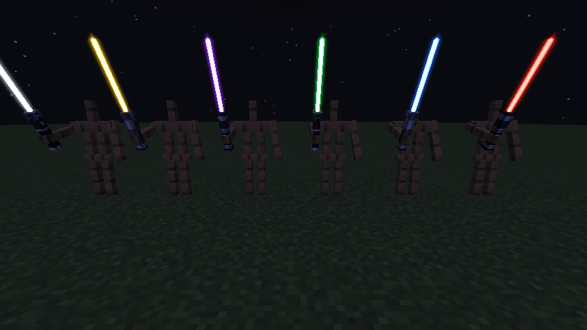 | 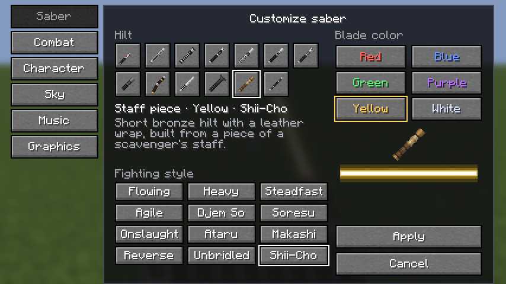 |
| **Six blade colors** | **Saber menu (V)** |
| 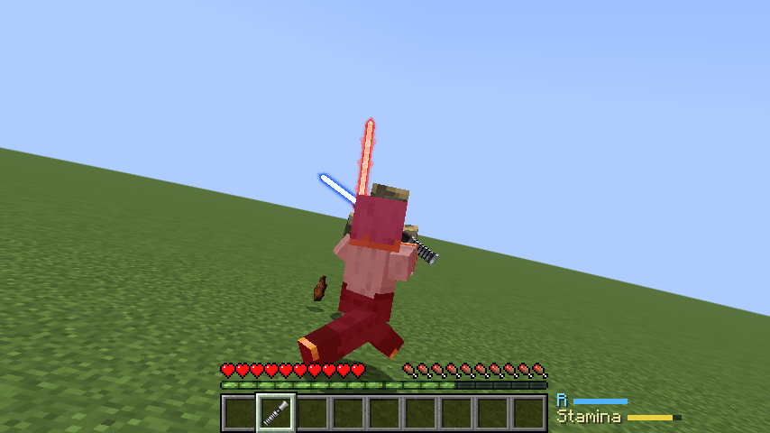 | 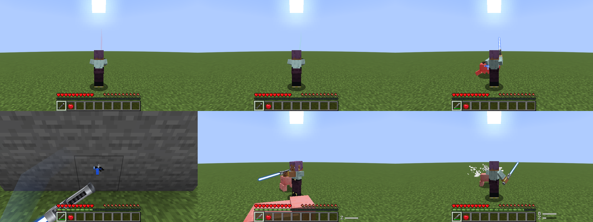 |
| **Clash at the contact point** | **Abilities, trails and sparks** |
| 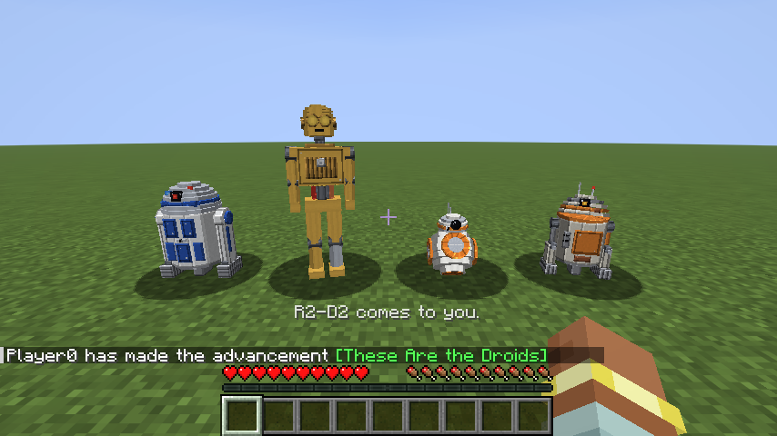 | 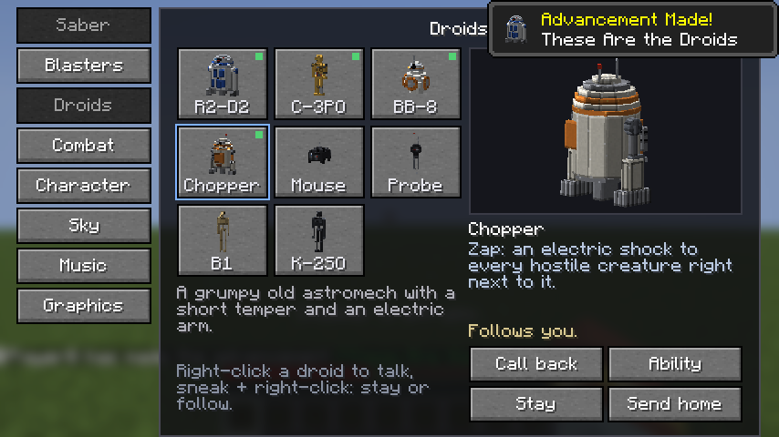 |
| **Droid companions** | **Droid menu** |
| 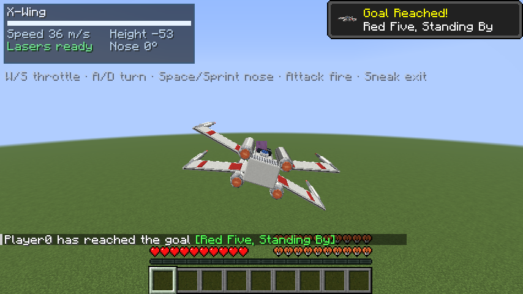 | 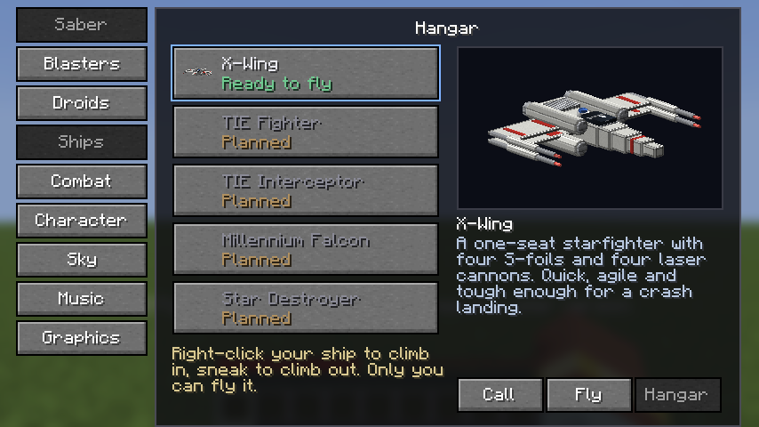 |
| **X-Wing with flight HUD** | **Hangar** |
| 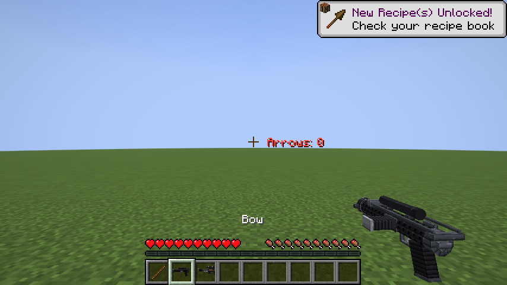 | 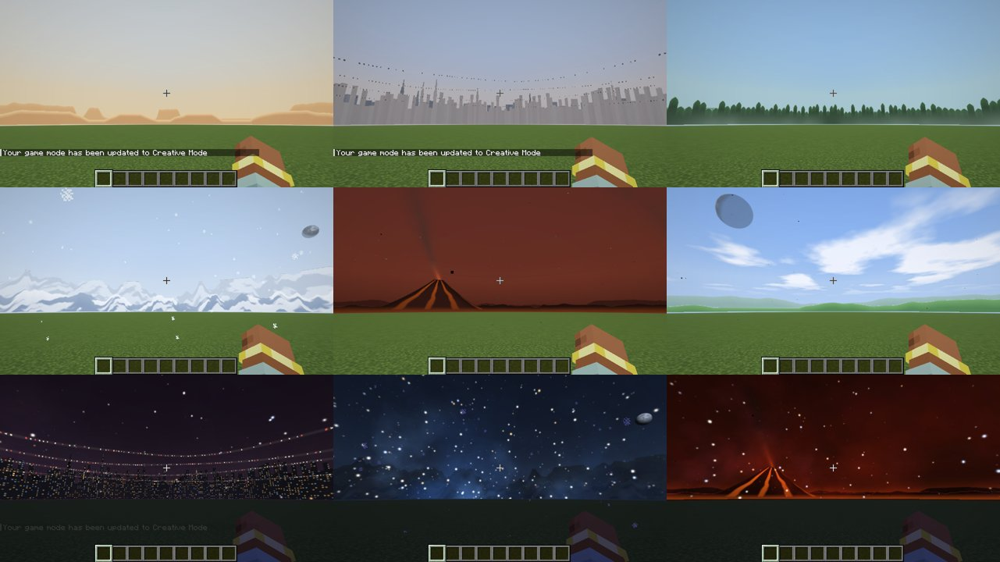 |
| **Blaster with arrow counter** | **Planet skies by day and night** |

<details>
<summary><b>Characters</b></summary>

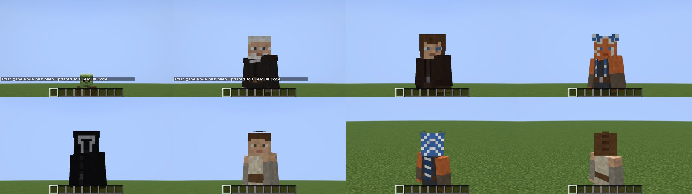

</details>

More images live in [`docs/images/`](docs/images/) and [`docs/media/`](docs/media/). How to add your own: [docs/media/README.md](docs/media/README.md).

## Installation

There is **no published release yet**. Until there is one, build the JAR yourself (see [Building from source](#building-from-source)).

### Requirements

| Component | Version | Notes |
| --- | --- | --- |
| Minecraft Java Edition | **26.2** | `fabric.mod.json` accepts `~26.2` |
| Fabric Loader | **0.19.5** or newer | [Fabric installer](https://fabricmc.net/use/installer/) |
| Fabric API | **0.161.0+26.2** | the version SaberCraft is built and tested against; [Modrinth](https://modrinth.com/mod/fabric-api) |
| Java | **25** | the Minecraft launcher brings its own Java |

No other mods are required. [Iris](https://modrinth.com/mod/iris) and [Sodium](https://modrinth.com/mod/sodium) are optional (tested: Iris 1.11.4, Sodium 0.9.2).

### Steps

1. Install **Fabric Loader** for Minecraft 26.2 with the Fabric installer.
2. Put **Fabric API** for 26.2 into the `mods` folder of your Minecraft installation:
   - Windows: `%APPDATA%\.minecraft\mods`
   - macOS: `~/Library/Application Support/minecraft/mods`
   - Linux: `~/.minecraft/mods`
3. Put `sabercraft-<version>.jar` into the same `mods` folder (not the `-sources.jar`). Remove older SaberCraft JARs.
4. Start the **Fabric** profile in the launcher.
5. Try it: take a netherite sword into your hand and watch it ignite, then press **V** for the SaberCraft menu.

### Client, server or both?

| Feature | Client only | Needs SaberCraft on the server |
| --- | :---: | :---: |
| Blade look, ignition, hum, combat animations, trails, sparks | ✔ | |
| Sky, planets, music, menu | ✔ | |
| Your own outfit/character (only you see it without the server) | ✔ | |
| Guard, parry, Force abilities, stamina, deflecting | | ✔ |
| Changing hilt or color in survival on a server | | ✔ |
| Sharing outfits with other players | | ✔ |
| `/sabercraft` commands, blasters, droids, starships, duels, advancements | | ✔ |

In single player everything works. Other players only see and hear your lightsaber if they have SaberCraft installed too.

## Controls

All keys are in **Options → Controls → Key Binds → SaberCraft** and can be changed there.

| Default key | Action |
| --- | --- |
| **V** | Open the SaberCraft menu (saber, blasters, droids, ships, combat, character, sky, music, graphics) |
| Left mouse button | Attack; the move depends on the fighting style (a stab while sprinting) |
| **R** (hold) | Defensive stance; right after raising it, a parry |
| **Z** | Spin attack; blade whirl with the double blade |
| **B** | Force push |
| **Left Alt** | Dodge or lunge; direction from W/A/S/D and the fighting style |
| **H** (hold) | Force grip |
| **J** | Force pull |
| **K** | Force jump |
| Right mouse button (blaster) | Fire; costs one arrow |

**X-Wing** (fixed keys, they reuse your movement keys):

| Key | Action |
| --- | --- |
| W / S | Throttle / brake |
| A / D | Turn |
| Jump / Sprint | Nose up / nose down |
| Attack | Lasers |
| Sneak | Climb out (slow falling in the air) |

**Key conflicts:** Minecraft marks a key that is used twice in red in the Controls screen. Left Alt and Z are not used by vanilla, but other mods may use them. Click the binding and press a new key to change it, or use **Reset** to go back to the default. Bindings are stored in Minecraft's own `options.txt`.

## Commands

| Command | Effect |
| --- | --- |
| `/sabercraft convert [color] [hilt]` | The sword in your hand (wood to netherite) becomes a lightsaber |
| `/sabercraft revert` | Turns a converted sword or blaster back into exactly the item it was |
| `/sabercraft blaster [type]` | The bow in your hand becomes a blaster: `dl44`, `e11`, `dc15a`, `se14c`, `bowcaster`, `a280`, `repeater`, `rebel`, `ezra` |
| `/sabercraft blaster revert` | Blaster back to bow |
| `/sabercraft duel <player>` | Challenge a player; `accept`, `decline`, `leave`, `ignore` |
| `/sabercraft droid <droid>` | Call a droid; `recall`, `stay`, `ability`, `dismiss <droid>` |
| `/sabercraft ship call\|board\|dismiss [ship]` | Call, board or send away your ship (default `xwing`) |

`convert`, `revert` and `blaster` are open to everyone by default; with `commands_for_everyone: false` only operators may use them.

## Configuration and your own content

Almost everything can be set in the in-game menu (**V**). The menu writes JSON files to `config/sabercraft/` in your Minecraft folder; a file always lists every setting with its current value, and a broken file is reported in the log and left untouched.

| File / folder | Side | What it holds |
| --- | --- | --- |
| `abilities.json` | server | abilities, cooldowns, stamina, hilt traits, duels, blasters and ammunition, droids, ships, command permissions |
| `combat_client.json` | client | combat animations, trails, particles, ability HUD, camera motion, shader blade, hit marks, finisher effects |
| `immersion_client.json` | client | space sky and quality, planet, planet sun/moon/horizon/ambient, music and Star Wars mode, ship camera and HUD, blaster draw, menu transitions |
| `character_client.json` | client | chosen character, outfit or profile; show other players' outfits; character size |
| `blade_styles.json` | client | colors, length, thickness, glow and flicker of every blade color |
| `profiles/*.json` | client | your own character profiles ([guide](docs/custom-profiles.md), German) |
| `characters/`, `outfits/` | client | your own skin files for the built-in characters and outfits |
| `music/<mood>/` | client | your own files for the built-in music mode |
| `starwars_music/` + `mapping.json` | client | your own files for the Star Wars music mode ([guide](docs/eigene-musik.md), German) |

A full list of every key with its default value is in [docs/configuration.md](docs/configuration.md).

## Building from source

Requirements: **JDK 25** and Git. Gradle comes with the wrapper.

```bash
git clone https://github.com/Phiro4241/SaberCraft.git
cd SaberCraft
./gradlew build            # Windows: gradlew.bat build
```

The mod is then at `build/libs/sabercraft-<version>.jar`.

| Task | What it does |
| --- | --- |
| `./gradlew build` | Compiles and packs the mod JAR |
| `./gradlew runClient` | Starts Minecraft with the mod in development mode |
| `./gradlew runServer` | Starts a dedicated server with the mod |
| `./gradlew genSources` | Decompiles Minecraft for reading in your IDE |
| `./gradlew runClientGameTest` | Runs all client game tests (see below) |

### Tests

The tests are Fabric client game tests (from the Fabric API test framework): a real Minecraft client starts, creates a world, presses keys and clicks menus, checks the results and takes screenshots. 27 test classes cover the blade, animation, variants, combat, abilities, Force powers, sky, planets, music, characters, skin layers, blasters and ammunition, droids, the X-Wing, duels, advancements and settings, several of them also on a real dedicated server.

```bash
xvfb-run -a -s "-screen 0 1280x720x24" ./gradlew runClientGameTest   # Linux without a display
./gradlew runClientGameTest                                          # opens a normal game window
```

A full run takes around 30 to 40 minutes. Screenshots land in `build/run/clientGameTest/screenshots/`. Python generators for models, textures, sounds and music are in [`tools/`](tools/) (they need `numpy`, `Pillow` and partly `ffmpeg`).

More for contributors, including the project layout: [CONTRIBUTING.md](CONTRIBUTING.md).

## Project status and known limitations

SaberCraft is at version **0.1.0** and under active development (development notes per phase are in [`docs/`](docs/), in German).

**How it is tested.** The automated suite runs in a virtual display with software rendering (llvmpipe) at 1280×720. The last full local run was green. Features marked 🧪 above are built and pass their scripted tests, but **have not been played by hand yet**, so flight feel, blaster balance and sound mix are not tuned with real players.

**Known limitations**

- **Shader packs:** with Complementary Reimagined the planet sky stays pale (the pack overrides custom sky colors); with BSL, raise `SKYBOX_OPACITY` and turn off `SKY_DESATURATION` for better planet skies. Other packs and Iris versions are untested. Blasters, droids, the X-Wing and character skins have not been checked with an active shader pack.
- **Starships:** only the X-Wing exists. Ships have no armor and cannot be destroyed.
- **Blasters:** a converted bow keeps the name "Bow" in the hotbar.
- **Duels:** no arena border, spectator view or ranking yet.
- **Not tested:** multiplayer with several real players (droids and ships of two players, ship lasers against another player), a vanilla client joining a SaberCraft server (built for it, never tried), real graphics cards, screen sizes other than 1280×720, other Minecraft versions than 26.2.
- Hilt traits are deliberately small and not balanced with real players; `hilt_traits: false` turns them off.

## Contributing

Bug reports, ideas and pull requests are welcome. Please read [CONTRIBUTING.md](CONTRIBUTING.md) first.

- 🐞 **Bug?** Open a [bug report](https://github.com/Phiro4241/SaberCraft/issues/new?template=bug_report.yml) with your Minecraft, Fabric Loader, Fabric API and SaberCraft versions and the log.
- 💡 **Idea?** Open a [feature request](https://github.com/Phiro4241/SaberCraft/issues/new?template=feature_request.yml).
- 🔒 **Security issue?** Please do not open a public issue; see [SECURITY.md](SECURITY.md).

## Legal

- **License:** SaberCraft's source code and its original assets (the generated models, textures, sounds, music, icon and banner) are released under the [MIT License](LICENSE), © 2026 Phiro4241. `fabric.mod.json` declares the same (`"license": "MIT"`).
- **What the MIT License does not cover:** It only grants rights the author holds. It grants **no rights to Star Wars** or any other trademark, name, character, design or likeness owned by Lucasfilm Ltd. or The Walt Disney Company. Names like Star Wars, Darth Vader, R2-D2, X-Wing or DL-44, and the character looks that are modelled after film characters, stay subject to those rights, no matter what the license says. If you reuse SaberCraft, especially in a public or commercial project, you are responsible for those rights yourself. The license also does not cover Minecraft itself or Mojang's textures visible in screenshots.
- **Fan project:** SaberCraft is an unofficial, non-commercial fan project. It is not affiliated with, endorsed by or sponsored by Lucasfilm Ltd., The Walt Disney Company or Mojang Studios / Microsoft. Star Wars, the names of characters, droids, ships and planets are trademarks of their respective owners and are used here only to describe what the mod is about.
- **Original assets:** All sounds are synthesized by [`tools/synth_sounds.py`](tools/synth_sounds.py), all music is composed by [`tools/synth_music.py`](tools/synth_music.py), hilts, blasters, droids, ships, outfits, the icon and the banner are generated by the other scripts in [`tools/`](tools/). Planet skies are painted at runtime from numbers. The mod contains no film recordings, samples, music or artwork. The Star Wars music mode only plays files the player adds on their own computer.
- **Not an official Minecraft product.** Not approved by or associated with Mojang or Microsoft.
