# Phase 19: the story mode "Nachtschatten" and fewer invisible walls

Branch `claude/project-thread-vvs0eu`, built on Phase 18 (the head of PR #23, 004460e, not yet merged into `main` when this was written). No release, nothing merged.

Phiro's goals for this phase: first the collisions in both ships (the Falcon's upper turret, far fewer barriers in the Star Destroyer, no invisible walls round people), then a story mode with missions, stealth, a disguise, droids to recruit, real dialogs in German and English, a finale with a lightsaber, and saving, checkpoints and replaying. Quality of the story, the atmosphere and the mechanics before speed.

As in every phase so far: the server decides everything, built from vanilla blocks and entities. **No new blocks, items or entity types are registered**, so a vanilla client can still join (it sees no story people and no dialogs, but gets the comlink lines and hints in the chat and the sounds).

## 1. Collisions (19.1)

- **The Falcon's upper turret:** the ladder and the collars of the gun well no longer let one look into a model while climbing; the lounge ring sits off the block faces (106 pairs of flickering surfaces gone); the table, the couch and the gun controls collide as drawn.
- **The Star Destroyer:** nobody of the crew collides any more (walking through a person is better than an invisible wall round them). Catwalk and bridge railings, the converters, the conference table and the pit consoles collide as drawn.
- **The root cause of many invisible walls:** the client pushed the player out of any cell holding a shaped barrier, because a barrier counts as a full, suffocating block. Shaped barriers in the interiors no longer count as suffocating, so one can stand right next to what is drawn.
- **The reactor:** all four lifts work both ways (one of them could not be reached from the catwalk); walking up to the catwalk railing and the conference table is checked by the test.

## 2. The story mode (19.2)

### Starting, leaving, continuing

The SaberCraft menu (**V**) has a new first tab, **Story**:

- **Start** (or **Continue** once there is a save), **Restart** (asks twice), a choice of the missions reached so far with **Play**, the **Journal** (datapads and recordings found, newest first) and **Leave story**.
- Below: the **language** of SaberCraft's texts (Auto, German, English), how fast the dialog texts appear (at once, normal, slow) and the objectives' marker on or off.
- With `ship_interior_detail` off, the story's people are not drawn; the page says so and offers a button to switch the detail on.

Entering puts away what the player had: the inventory (in a file in the world folder, `sabercraft/story/<uuid>.stash.dat`), the place, the game mode and their own droids. In the story the player is in adventure mode, in a Falcon and a Star Destroyer of their own (separate plots, never their real ships). **Leaving** at any moment brings everything back; after the chapter's end, the reward (Ilyra Voss's green lightsaber) is given once.

**Saving:** every step of a mission is a checkpoint. What is known and done is written to `sabercraft/story/<uuid>.json` at each one. Logging out keeps the story; logging in again continues at the last checkpoint. Nobody dies in the story: dying counts as being caught.

### Dialogs

A dialog shows who speaks (name plate and a painted portrait; the comlink as a blue hologram), the words appearing letter by letter with a soft voice sound, and up to four answers. Keys: Enter, Space or a click show the whole line or go on; 1–4, the arrow keys and Tab choose; the mouse works too. The world keeps running (nothing pauses), so dialogs happen where one stands. Answers can depend on what one knows (the password heard from the pilots, the access card in hand), and some change the rest of the story.

### Stealth

Everyone of the Empire watches with their own eyes: how far depends on who they are (troopers far, officers less, busy people less), in front of them clearly, at the side only close by, never behind and never through walls. Four stages, shown by a small eye on screen (only while someone notices the player):

1. **Calm** – nothing.
2. **Suspicious** – they stop and look (a short sound).
3. **Alerted** – they come to look where they saw something.
4. **Detected** – the alarm: red lights, they chase the player and call others; out of sight for ten seconds, they search; after a while, calm again.

What helps: **the dark** (the maintenance room, the ship after the download: there one is seen far only in a **lamp's cone**, and the lamps are drawn as cones of light), **cover**, **sneaking** (half the distance) and **crawling** (less than half), the **crawl ways**. Being caught means a moment of black and back to the step's checkpoint, with a word over the comlink; never a dead end. A few sections must be done unseen (the download); being seen there fails the section at once.

### The disguise

From Mission 3 on, stormtrooper armour from the armory (drawn as an outfit over the player). The troops do not notice a "trooper" who moves like one; sprinting, sneaking, crawling or jumping is noticed. Officers look twice from close by, the security bureau (black uniforms) very closely. In forbidden places (the lab, the detention block without the card) the armour does not help. After Mission 4 the armour is known ("burned") and helps little.

### Droids

- **M-31** (mouse droid, recruited in Mission 1): with the droid key (**N**) a noise where the player looks; those nearby go to see. In the story it can also open the bolted crawl-way hatch from the other side and switch off a cell's force field.
- **R2-V7** (astromech, recruited in Mission 5): opens a lock within a few blocks (it takes three seconds, and someone close by hears it beep); elsewhere, a scan shows everyone around for a few seconds.

In the story one need not look at the droid: R2-V7 is chosen when a lock is near, otherwise M-31.

### Language

SaberCraft has its own language setting, independent of Minecraft's: Auto (as Minecraft), German or English. It covers all of the mod's texts (story, menus, hints, the crew's lines). Switching changes everything on screen at once, an open dialog too. Minecraft's own texts stay in Minecraft's language. Every story text exists in both languages (the test checks every key).

### Music and sound

Four new pieces, composed by script like all SaberCraft music: **sneaking** (low, sparse), **the hideout** (calm), **the alarm** (fast, driving) and **the duel** (a slow opening, then fast). The story chooses the piece; during an alarm the calm pieces give way to the alarm piece. New sounds: the comlink, the scan, the dialog voice, someone suspicious, detected, caught, an objective done, a mission done, a force field off, the alarm. All synthesized, nothing from the films.

### Built to grow, ready for more players

A chapter is a list of missions, a mission a list of steps (each a checkpoint with a place to start, an objective, a marker), optional objectives and things to use; dialogs are written as small graphs with the words in the language files. Later chapters can add their own. Each player has their own session, story ships and save, so several players can play the story on one server, each alone in their own ships. Playing it together is not built.

## 3. Chapter 1: "Nachtschatten" (19.3)

The player is **Funke**, a rebel spy, brought by Dax Orren's Falcon (with Lt. Mira Sen and the mechanic Rorrak) to the Star Destroyer **Tenebris**. Aboard waits **Kestrel**, a spy hidden for months in a forgotten room. The question: what is "Project Nachtschatten"?

1. **Im Schatten der Tenebris** – the briefing in the Falcon, the jump, the ramp into a forgotten airlock, the dark maintenance room with a trooper and his lamp, M-31 stuck behind crates, Kestrel's sign and the crawl way into the hideout.
2. **Turmfalke** – Kestrel, her terminal (map, diary), a dead drop in the hangar; near two pilots one may overhear the password of the week and a name. The data stick holds a list of names.
3. **Kleider machen Sturmtruppen** – the armory: the security desk while nobody looks, armour, the access card. Then **Lt. Corvan Hale** of the security bureau speaks to "the trooper": he knows. He offers help. **Trust him or not** – this changes Missions 4 and 5.
4. **Herz aus Feuer** – past the reactor checkpoint in disguise (card), down to the reactor floor, the technician (the password, a bluff or a refusal: three ways), the data copied at the main console while an officer comes to look. Optional: sabotage a coolant valve (fewer enemies in the finale).
5. **Die Entdeckung** – the alarm. Kestrel's recording: she was taken. With Hale's trust one walks into his trap and M-31 switches off the cell's field; without it, the terminal shows his message about the trap, M-31 opens the bolted hatch and the crawl way leads into the detention block. R2-V7 is freed, opens Kestrel's cell (and, optionally, a prisoner's).
6. **Nachtschatten** – the lab under the reactor, a Jedi's message, her lightsaber in a containment field. Taking it starts the fight: troopers on the way to the lift and the hangar, then **the Shadowblade**, a masked fighter with a red blade, in the hangar. The Falcon at the force field, the jump, and in the lounge the cliffhanger: the device is a tracker, and it has locked onto the player.

Secrets and side ways: the maintenance log on a datapad, the overheard password, a second set of armour for Kestrel (fewer enemies in the finale), the coolant valve, the prisoner Tamsin Rhee (she appears in the epilogue), the crawl ways.

## 4. Tests

Run locally in the cloud container (software rendering, one test client), 2026-11-16. GitHub Actions run on the pull request; see there.

**The whole suite** (all 37 classes in `fabric.mod.json`, `StoryGameTest` added as the last):

- `./gradlew build gametestClasses` (as in CI): green.
- **Run 1, the whole suite:** the first 28 classes (`BladeScreenshotGameTest` to `Phase12GameTest`) green, 1 498 checks logged. The run was then stopped by the 30-minute limit of my own background command while `Phase13GameTest` was running, not by a failure.
- **Run 2, the rest:** `Phase13GameTest`, `Phase14GameTest`, `ShipBoardingGameTest`, `InteriorDesignGameTest`, `Phase16GameTest`, `Phase17GameTest`, `Phase18GameTest`, `Phase19GameTest` and `StoryGameTest`: all green, 527 checks logged plus the story's, in 21 minutes. The Falcon walk audit: 183 744 places walked, 0 in a wall, 38 invisible stops (as in Phase 18).
- **Runs 3 and 4:** after the last small changes (overheard lines, the mission selector, the camera of three pictures) `StoryGameTest` twice more: green both times, 84 dialog lines, one capture, no check failed. The pictures below are from run 4.

**`StoryGameTest`** plays the chapter through as a player would, twice:

- **First way (trusting Hale):** into the story from the menu's Start button (own things put away, adventure mode, the story's own ships), all six missions and their steps with real right clicks on people and things, real keys in the dialogs (Enter, the number keys), the droid key for M-31 and R2-V7, the attack key with the saber. 84 dialog lines were shown; one capture (the deliberate one, below).
- **Second way (Mission 3 chosen again in the menu, refusing Hale):** the bluff at the technician, his suspicion rising while one copies at the console, M-31's noise sending him away, the terminal telling of Hale's trap, M-31 opening the bolted hatch, the crawl way into the detention block, Kestrel's other line, leaving the story.
- **Saving:** leaving midway and continuing from the menu (same step, same knowledge, M-31 back), the reward when leaving after the chapter's end.
- **Being seen** (filmed): a trooper's suspicion rising (`?`, alerted, `!`), the alarm, the chase, caught, back at the step's checkpoint with what was learnt since forgotten and Kestrel's word over the comlink.
- **The dark:** seen in a lamp's cone (suspicion fills at 1.14 a second), not beside it (0), never from behind (0).
- **The disguise:** in armour before a trooper, walking 0, sprinting 0.70 a second.
- **Doors and fields:** the armory locked until the security console, the cells' force fields (on, off by M-31, off by R2-V7), the bolted hatch.
- **Music** in each part: the Falcon, sneaking, the hideout, the alarm, the duel.
- **Languages:** all 320 dialog and story keys exist in German and English; the same open dialog changes language when SaberCraft's language setting changes; screenshots in both.
- **The finale:** troopers struck down with two strokes each; the duel (a stroke into her guard is parried, open she is hit, at the end she breaks off); the jump; the epilogue.

Walking from place to place is done by teleporting (the ways themselves are covered by the Phase 16 to 19 walk tests). While walking the story through, the test keeps the player unseen, except where seeing is tested.

**Found by playing it through and fixed** (each was a real problem a player would have met):

- A right click on the maintenance sign, M-31 or R2-V7 sometimes found nothing: the server and the client did not agree on the size of a droid or a sitting person.
- An open dialog kept its old language when the language was switched.
- The client was not told that the chapter was finished (the menu still offered "Continue").
- After being freed, Kestrel stopped at the crawl way by the detention block and stayed there: Mission 6 began in the hideout without her. She now climbs out of the hideout's hatch behind the player.
- After the bluff, the technician kept working at the main console, standing where one has to stand to copy the data. He now steps back and watches.
- His suspicion kept rising while one read the console's text, and the copy did not finish on the bluff way. It now pauses while a dialog is open.
- The disguise and alarm lines stayed on screen in the Falcon; "Detected! hide!" stayed on screen after being caught; the objective marker hovered over the Shadowblade during the duel.
- The menu: on/off in SaberCraft's language, shorter labels for the language and text speed, only the mission's name on the mission selector.
- Overheard lines (the trooper in the maintenance room, the pilots in the hangar) were shown as comlink holograms with the comlink's click; they now show the speaker's face, with a soft voice sound.
- The hidden room was very dark for a hideout: two brighter lamps and the glow of Kestrel's desk (it is still a dim store room; its walls are dark panels).

## 5. Pictures and short films

All from the test client (software rendering, 854×480): [`docs/images/phase19`](../images/phase19).

| | |
|---|---|
| The briefing in the Falcon 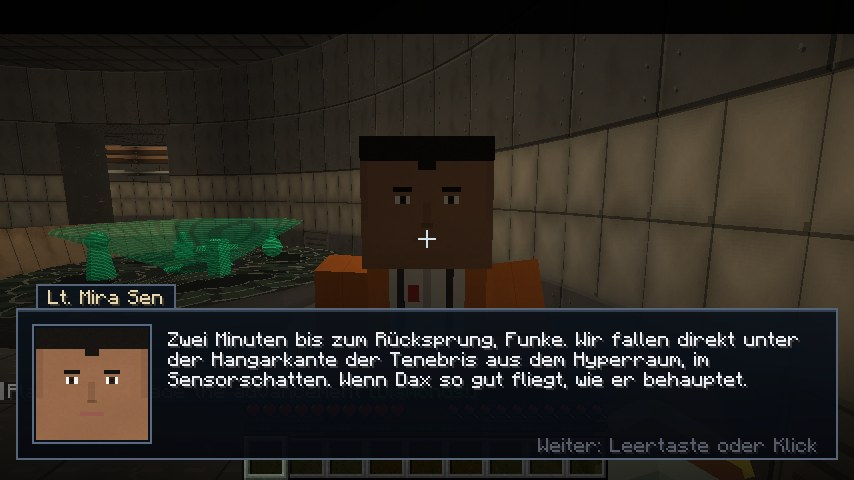 | The same line in English 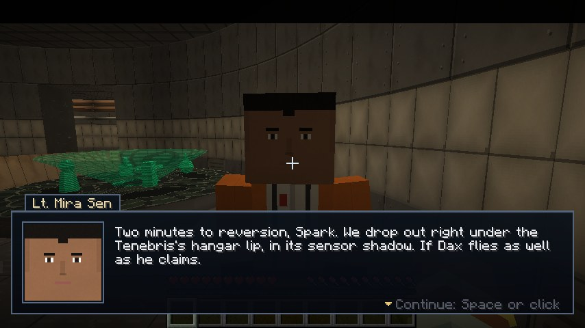 |
| Answers 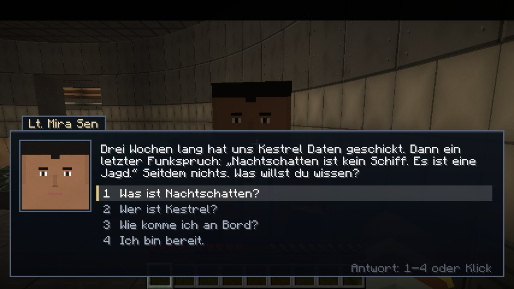 | The trooper with the lamp in the dark 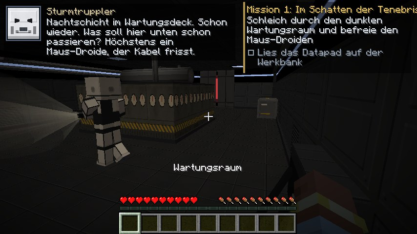 |
| In disguise 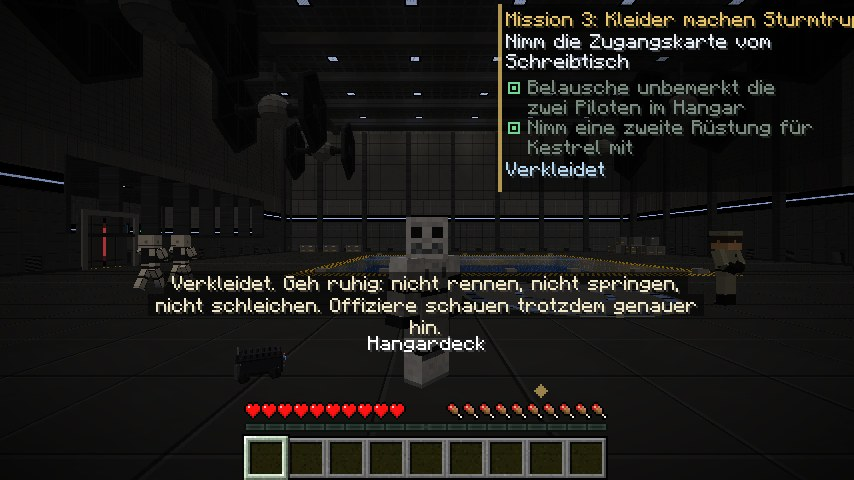 | Lt. Corvan Hale 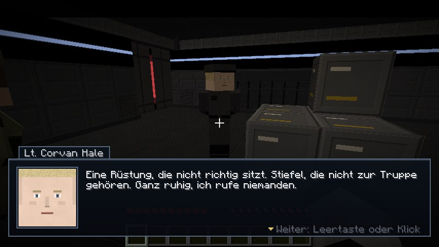 |
| The alarm 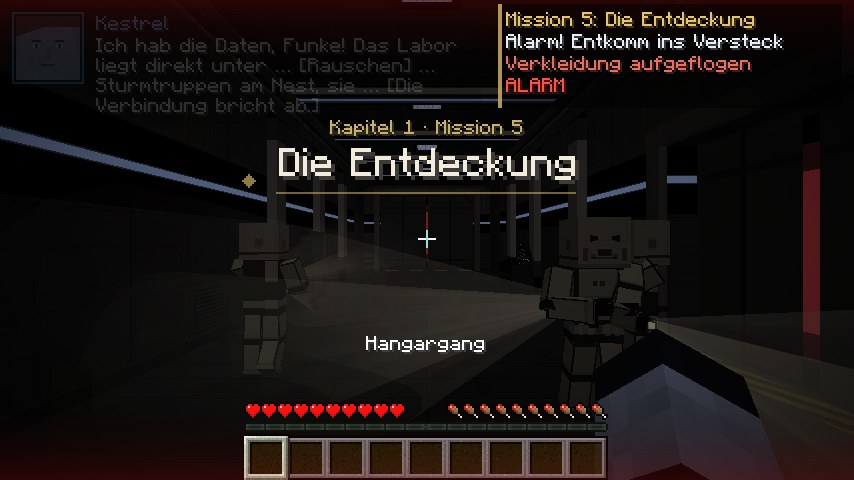 | In Hale's trap 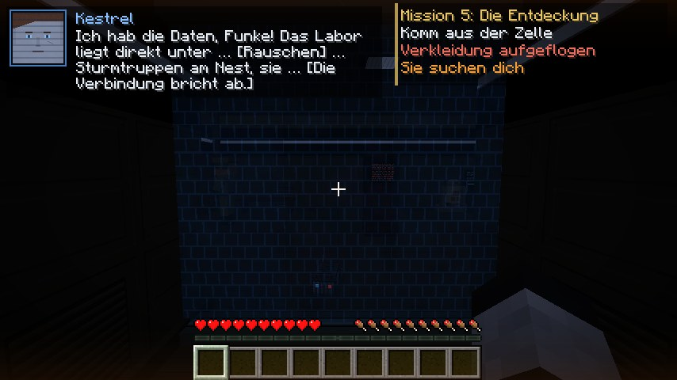 |
| The duel 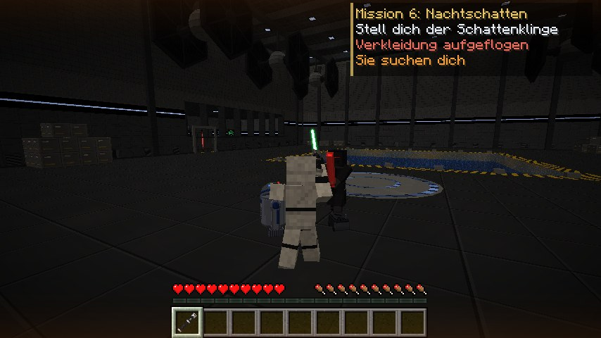 | The jump 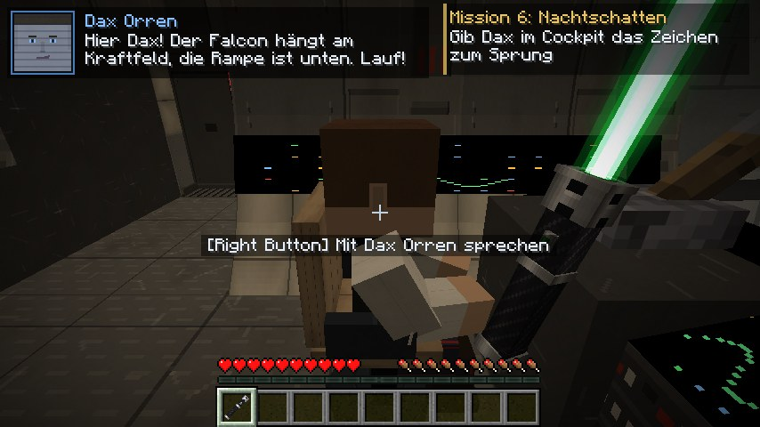 |
| The epilogue 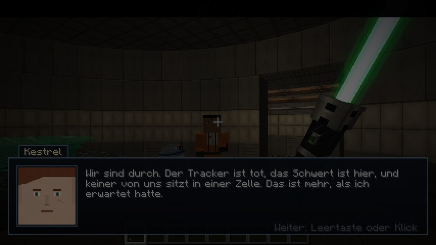 | The menu's Story tab 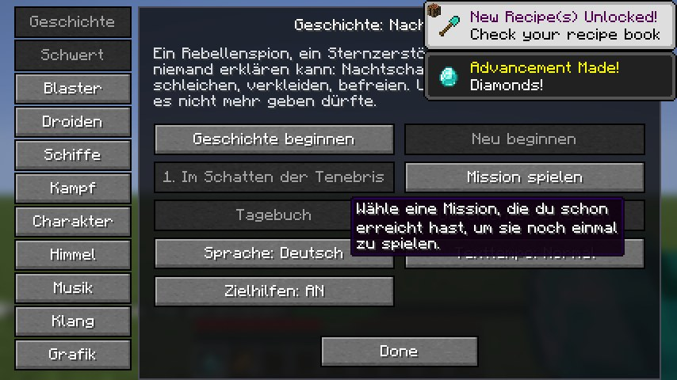 |

Short films (GIF; MP4 beside them):

- Seen, chased, caught: 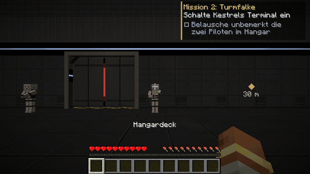
- A dialog appearing: 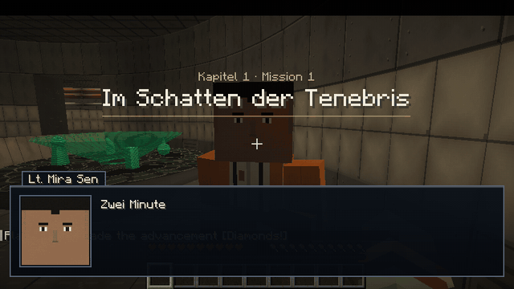
- The duel: 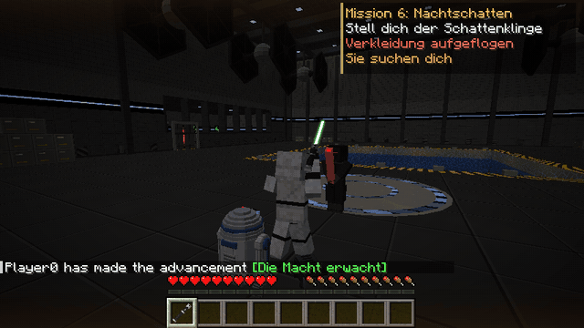

## 6. Deviations from the plan, limitations, not tested

- **The finale's enemies are story figures, not entities.** The plan named vanilla mannequins; the server-run story figures (the same as the crew) were simpler and steadier: they shoot real blaster bolts (which the saber can send back) and are struck by the saber's stroke. They are not Minecraft entities, so other mods and vanilla weapons do not see them.
- **Without `ship_interior_detail` the story's people are invisible.** The menu warns and offers to switch it on.
- **Multiplayer:** several players can each play their own story at the same time; playing together is not built. Tested only with one player.
- **Vanilla clients** joining a server get hints and comlink lines in the chat, but no dialogs, no people and no HUD; the story is not meant to be played without the mod.
- **Not tested by hand:** the whole chapter has been played by script only. The timing and difficulty of stealth sections (how fast suspicion rises, the lamp cones, the chase) and of the duel are tuned by reasoning and by the test, not by a human playing it; expect to adjust them.
- **Not tested:** real graphics cards and shader packs (the tests use software rendering), a dedicated server with real players, a vanilla client joining during a story, two players in their own stories at once.
- **The game test suite is longer:** `StoryGameTest` adds about four to five minutes. The last GitHub run of the whole suite (Phase 18) took about 45 minutes of the 60 allowed for the test step.
