# Phase 22: graphics, surroundings, interface and story interactions

Built on `main` after Phase 20 and 21 (PR #25, #26) were merged. No release, nothing merged. As before, the server decides everything from vanilla blocks and entities: **no new blocks, items or entity types are registered**. Everything that worked stays as it was; this phase fixes what Phiro found while playing Phase 21, and adds the HUD, the droid and the dialogs he asked for.

## 1. Doors, terminals and vent hatches: flicker and jitter

**The doors trembled.** Root cause: `InteriorClient` kept each door's last frame time (`System.nanoTime()`) in a `float[]`. A float holds only about 7 digits, so on a PC that has been running for a few days the stored time is off by 16 to 67 ms; the time step between two frames then jumps, or turns negative, and the door slides back and forth a little every frame. The test client in the container never saw it (it has been up only minutes). Now each door has a small `DoorState` with the time as a `long` and a clamped step; doors move smoothly, and **the collision follows the door**: the barrier blocks of a door are taken away only when the drawn door is open far enough to pass, and come back before it is drawn closed.

**Flickering surfaces** ("z-fighting": two surfaces in the same plane, the graphics card shows one, then the other). A new audit (`MeshAudit.decals`) checks every lit surface (screens, lamps, glowing panels) and every moving part against the solid surfaces of the ship: none may lie in the same plane. It found **212** such pairs on the Star Destroyer (terminal screens, the guard terminal, the armoury panel, the lab consoles, the arch lamps, desk screens, the cell emitters, door frames) and several on the Falcon (the engineering station, the gun control screen, the ring lamps). Each one is now a few millimetres in front of its wall (enough for the depth buffer at any distance in a room). After: **0 on both ships**, checked by the test.

**Vent hatches:** the closed plate lay exactly in the plane of the frame's back, and the open grille was as wide as the opening; the plate now sits between the frame's faces and the grille is a little narrower, so their edges no longer fight.

**Screens** dimmed in hard steps (full, then 35 %), which looked like flicker; they now dim softly.

## 2. Lab corridor and prison door

- **The corridor to the lab** could not be walked normally: at its sides were empty cells behind the drawn walls, so the player could step half into a wall and stick there, and the next step pushed him back. These cells are now closed with the ship's invisible collision blocks (only where the drawn wall stands). The test walks the corridor and measures normal speed (8.4 blocks in 2 seconds with sprinting; 6.5 is the test's limit), and checks that no spot along it is inside a wall, at the eyes or blocked by something unseen.
- **The detention door** stood in a corner, half in the wall. It is now two blocks wide, away from the corner, with a proper door frame on both sides (version 9 of the Star Destroyer interior; an old ship is rebuilt once when entered).

## 3. Cell doors

R2-V7's hack chose the **last** lock within six blocks, not the one the player looked at, so in the corridor where two cells are close it could open the wrong one. Now it takes the lock the player **looks at** (within a cone, the nearest along the look); looking at none, R2-V7 beeps: "Look at the lock he should open." The story test opens cell 3 while looking at it and checks that cell 1 stays closed, also after a second press.

## 4. Seated people

- People who sit (Dax and Kestrel in the cockpit, the pilots of the Star Destroyer) **stay seated** when they talk or look round; before, every mode except their routine stood them up.
- **After the chapter** Dax sits in the pilot's seat and Kestrel in the co-pilot's, both turned to the window.
- **No two in one seat:** a seat a person sits in is not free to the player (and the other way round). The test tries to sit on Dax's seat and checks that the player does not.
- **Idle pose with a saber:** while standing still with a drawn saber, the player now breathes lightly (the arm moves a little), instead of standing like a statue.

## 5. R2-V7, its own droid

R2-V7 was the mod's R2-D2 with another name. It now has **its own model** (generated by `tools/gen_droids.py`): a worn bone-white barrel with copper panels and a teal stripe, a gunmetal dome with a copper band, one big round amber eye, an antenna, and a scorched mark where the restraining bolt sat. Same build and joints as the astromech, so it moves the same way. The name tag and the droid HUD say "R2-V7" with its abilities ("Schloss knacken · Scannen" / "Slice locks · Scan"), M-31 says "Ablenken" / "Distract"; German and English.

## 6. Normal SaberCraft functions locked in the story

While a story mission runs, the mod's normal functions are **locked on the server** (so no key, shortcut or command gets round it) and on the client (so the player is told at once): the SaberCraft menu, the character/outfit choice, the saber choice and colour, blaster settings, the droid menu and normal droid commands, starships (call, board, spawn), and the mod's commands that change these. Trying one says: "Not available during a story mission. You can leave the story in the story menu (V)." The story's own keys (story menu V, droids N/U, Focus G, guard, dash) work as before. Outside the story everything is unlocked again (checked by the test).

## 7. The story HUD

- **Hunger, experience and armour are not drawn** while a story runs (they mean nothing there).
- **The hearts give way to a slim "condition" bar** (Verfassung / Condition) in the style of the story's panels: amber segments, orange below 60 %, red and a slowly pulsing frame below 30 %; a lighter band shows for a moment what a hit took. Its name shows only while hurt.
- **No hints to the boss:** the duel's hint lines only say what happens ("He catches your strokes and strikes back", "He grows faster and reaches for the Force"), not how to beat him.
- Outside the story every vanilla element is drawn as Minecraft draws it.

## 8. After the chapter

- When the chapter ends, a flag `chapter.done` is saved with the story (save format 3; older saves are read as before). The mission display then shows **"Chapter 1 · Nightshade – Completed"** with the hint that missions can be replayed in the story menu, and the goal line "Chapter 1 completed. The Falcon is on its way to the fleet."
- **New dialogs after the end** for Dax, Kestrel, Mira, Rorrak and Tamsin (depending on what the player did: Hale trusted or not, the second armour, Tamsin freed). Before, they repeated their mission lines (Kestrel still said where the goal was).
- **Continue** after the end goes straight to the Falcon's lounge, Dax and Kestrel in the cockpit; the epilogue is not played again.
- **A new run** (Restart) clears the flag and everything else as before.

## 9. Textures and models

- **Falcon, engine room:** the ceiling ended 5 cm short of the outer wall over the machines, so one saw a thin line of sky. Found on the picture, confirmed with a ray probe (`MeshAudit.probe`), closed with a ceiling strip. A second audit (`MeshAudit.leaks`) looks from every reachable spot of both ships for rays that leave the ship; besides the open ramp and the cockpit window it finds none. (It is coarse: it missed this gap at first, so the test now also checks the two views of this gap with the probe.)
- **New skins** for the troopers (helmet with brow, visor and breathing grille, shaded armour plates, belt) and the reactor technicians (cap, overalls, own arm and leg tile). **Origin:** painted pixel by pixel in code by `tools/gen_interior_textures.py` (deterministic, regenerates `atlas.png`); no external pictures, no downloaded assets.

## 10. Troopers in a fight

- **Four saber strokes** to fell a trooper (before: two), about like a skeleton. Each hit is seen: he is driven back a step, his aim is lost for a moment, sparks; a slim bar over his head shows what is left. Right after a hit he only takes glancing blows for a moment (as a mob's protection after damage), so hammering the attack key does not fell him faster.
- **Bolts sent back:** a bolt the saber deflects while the player **faces its shooter** (within 50°) now flies back to him and hits (two such hits fell him). A bolt deflected elsewhere flies on as before.

## 11. Tests

### Automated (client game tests, run locally)

New: `Phase22GameTest`:

- `surfaces`: no lit or moving surface in the plane of a solid one on either ship (`decals == 0`); the Falcon leak audit finds only the ramp and the cockpit window; the two views into the engine room gap find no leak; pictures of the engine room.
- `labWay`: the corridor to the lab walked: no spot in a wall, at the eyes or blocked unseen, normal speed; pictures of the corridor, the detention door, the two new skins.
- `inStory`: in Mission 6 the story HUD replaces the vanilla one, the bar follows the player's health (set to 40 %), German and English pictures; the SaberCraft menu is locked on client and server; R2-V7 carries its own model and name; outside the story nothing is locked and the vanilla HUD is back.
- `afterTheChapter`: a finished save is continued: the flag stays, the goal is "chapter completed", Dax and Kestrel sit in their seats, the player cannot take Dax's seat, Dax, Kestrel and Mira speak their new lines; picture of the cockpit; Restart clears the flag.

Changed: `StoryGameTest`: the cell door the player looks at is opened, the other stays closed (also after a second press); a trooper needs four strokes and is not down after one; after the epilogue the chapter is marked completed.

### Local results (2026-11-17)

All in the cloud container (Xvfb, software rendering), **not CI**: see the pull request for the results of the whole suite.

### By hand (not covered by the automated tests)

- **Door jitter on a real PC:** the cause (float time after a long uptime) cannot occur in the container, which has a short uptime; the fix is checked by reasoning and in code, but the smooth movement must be seen on a PC that has been running for days.
- **Bolts back to the shooter:** the code is in place and counted (`Finale.returned`), but no automated test deflects a real bolt with the right timing; to try by hand in Mission 6 (guard up, facing the trooper who fires).
- **Flicker at long distances and with other graphics cards / shader packs (Iris):** the audit checks the geometry, not every driver's depth precision.
- **How it feels:** four strokes per trooper, the reel-back, the HUD bar's colours, R2-V7's look in daylight on the planet.
- **Leak audit** is coarse (rays on a grid): a gap smaller than its spacing can still be missed.
- Dedicated server.

## 12. Pictures

All from the test client (software rendering, 854×480): [`docs/images/phase22`](images/phase22).

| | |
|---|---|
| Falcon engine room, the machines 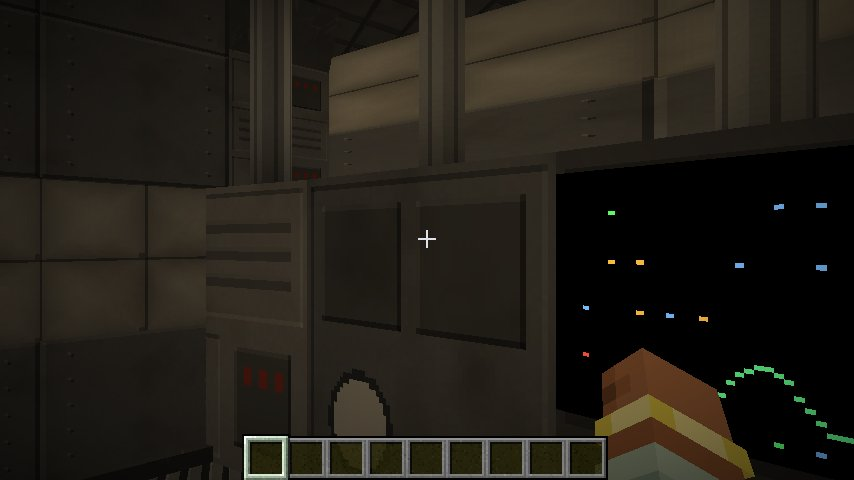 | Its ceiling, closed over the machines 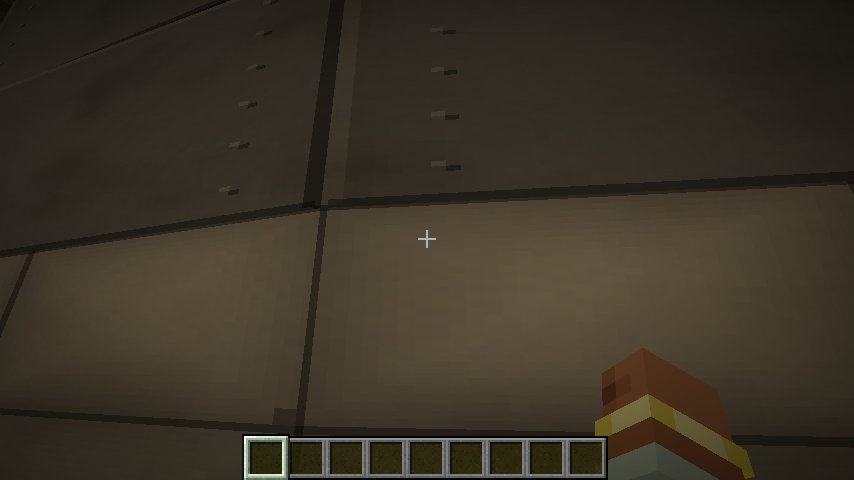 |
| The corridor to the lab 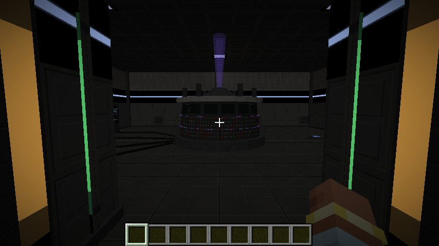 | The detention door, out of the corner, with a frame 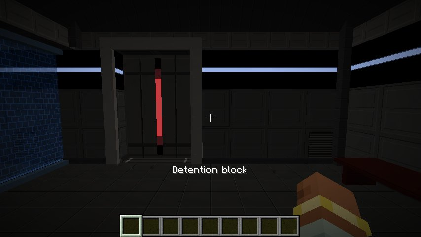 |
| New trooper skin 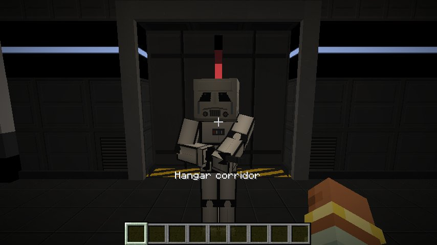 | New technician skin 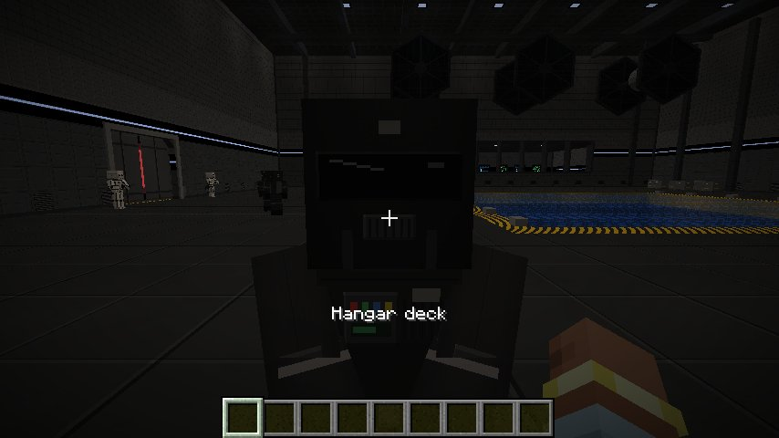 |
| Story HUD (German) 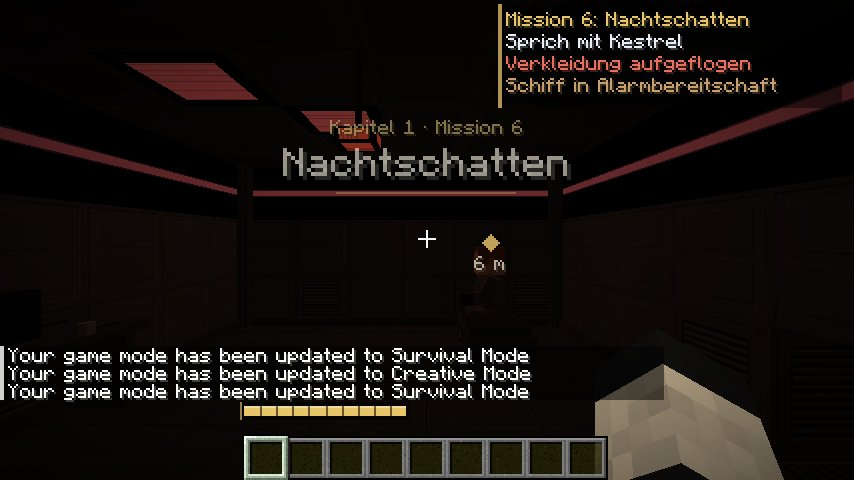 | Hurt: the condition bar 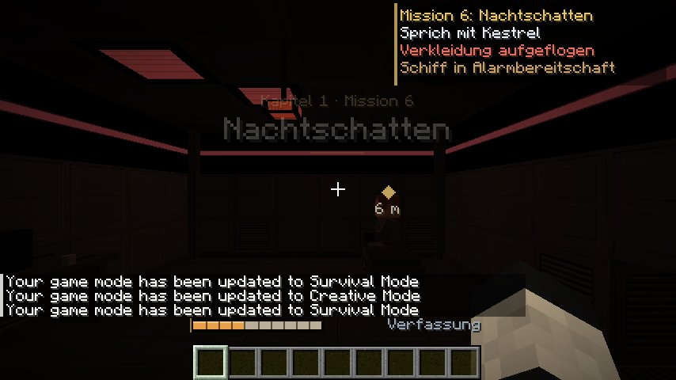 |
| Story HUD (English) 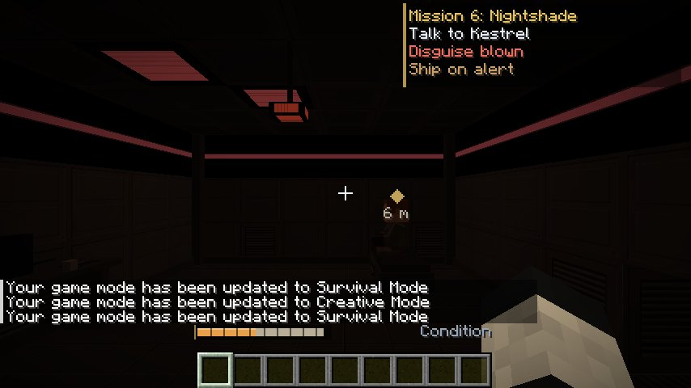 | R2-V7 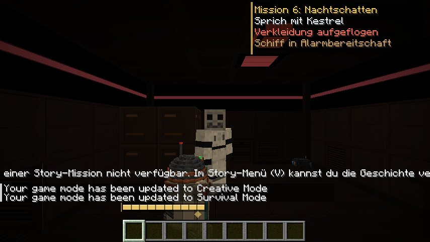 |
| Outside the story: Minecraft's HUD 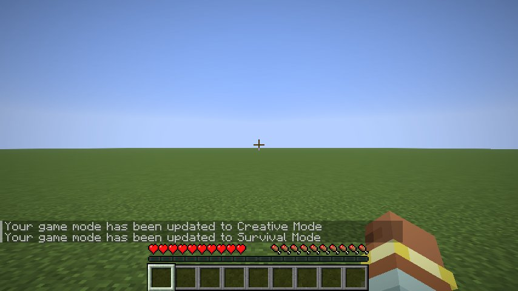 | After the chapter: Dax and Kestrel in the cockpit 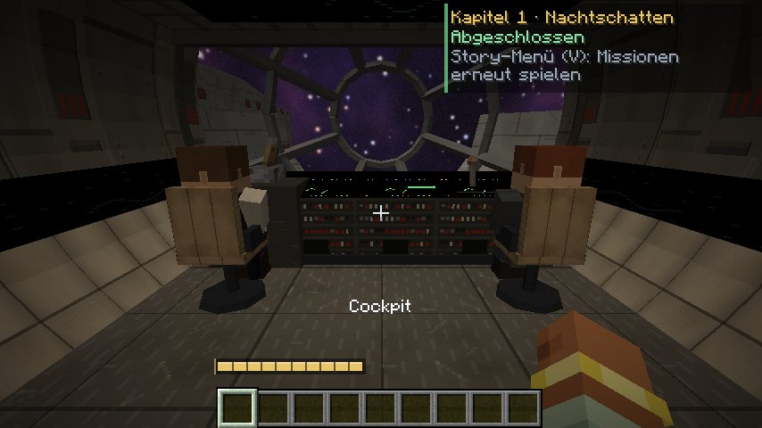 |
