# Phase 23: story rework, enemy behaviour and cinematic fights

Built on `main` after Phase 22 (PR #27). No release, nothing merged. As before, the server decides everything from vanilla blocks and entities: **no new blocks, items or entity types are registered**. Saved stories stay readable (the save format is unchanged; old Phase 19 files are still read, checked by `StoryGameTest`), and no mission was removed. This phase fixes what Phiro found while playing Phase 22 and reworks the reactor and the duel.

## 1. Skins in the story

- **Before the disguise the player wears their plain Minecraft skin.** When a story starts (and at every checkpoint) the server puts a "plain" outfit (`sabercraft:plain`) over the player's choice; a chosen SaberCraft character or a skin file of one's own does not carry into the story.
- **The disguise is the troopers' own armour.** The stolen uniform's texture is no longer painted on its own: `tools/paint_outfits.py` cuts every face from the same tiles the client draws the trooper figures with (`tools/gen_interior_textures.py`), at their full detail (512 x 512, eight times a normal skin, same layout). The player in armour and the troopers around them look alike.
- **Leaving the story brings the choice back.** The story's outfit only lies over the choice; a choice sent during the story (the client sends it by itself on joining) is remembered quietly and comes back when the story ends.
- **Everyone sees the same.** The server tells every client what a player wears (plain, armour, or their choice); the story's armour is always shown to others, even when they turned off other players' outfits (it is part of the game, not a look someone chose). The story's people react to the disguise flag on the server, so NPCs and players agree.

## 2. The saber at rest

Standing still with a lit saber, several fighting styles held it over the head (Agile, Soresu, Onslaught). Their rest poses (third person and first person) now hold the hilt at chest or belly height, the blade leaning back over the shoulder or up and a little forward, the free hand before the body. The attacks are worked out from the new rest poses as before (`tools/gen_moves.py` regenerates `moves.json`), so walking, standing, attacking and blocking blend into each other as before. The raised guards stay in the attacks and in the block.

## 3. Every enemy fights when a fight begins

The cause of the bug Phiro found: troopers who had seen the player in the reactor stayed in their old chase or search when the saber was taken; the new troopers fought, the old ones neither shot properly nor could be hit (only enemies marked as fighters are). Now:

- **When a fight begins** (the saber taken, a section of the escape, the duel's end), everyone who was hunting the player (gave chase, raised or answered the alarm, went to where the player was last seen, came as help, search patrols) **joins the fight at once and in the same way** (`Combat.engage`): fighter, shooting, hit by the saber like the others. Soldiers who see the fight from close by join too (at most six fighters).
- This runs every tick of a fight, so nobody stays behind in an old chase, also after a film or a checkpoint.
- **Nobody vanishes when the step changes in the fight:** taking the saber ends the lab's step and starts the escape; on that change those drawn into the fight (also crew of the reactor floor who hunted the player) were dropped with the old step's people. Now they stay as fighters into the next step while the fight goes on (and go only when a step without a fight follows).
- **The lab's guard no longer vanishes** when the player goes on into the lab while he hunts them: he follows, and fights when the saber is taken.

## 4. The officer defends himself

An officer who sees the player (the quartermaster in the armory, the officers on the reactor floor) **shouts, steps back calling for help over his comlink** (a hand at his ear; two troopers come from the nearest door a few seconds later, the alarm sounds), **then draws his pistol and fights** like the troops: he shoots (his pistol comes up quicker than a rifle), keeps his distance (too close, he steps back and shoots from there) and moves to a better spot. Calling is something he does as well, not all he does.

## 5. Ways through rooms and doors

- **Doors are ways, not walls.** A closed sliding door is a row of barriers until someone comes near, so the way search ran into it like into a wall: chasers came as close as they could on their side and walked into the wall beside the door. Now a door the story does not keep shut counts as open in the search (it opens as they come). A door the story keeps shut (the lab before R2-V7 opens it, the armory, the detention block) is a wall, and they look for another way.
- **Further and higher:** the search covers several rooms (56 blocks, 7000 cells), steps up and down, and remembers what it looked at during one search.
- **No walking into walls:** when no way reaches the player (a locked door, the broken bridge), they stop where they came nearest and watch, instead of walking on into the wall.
- **The troopers of the escape** (the fight after the saber) found no way at all before: out of sight they walked straight at the player, also into a wall with a door beside it (what Phiro saw). They now use the same way search.
- **Spread out:** several chasers going to one place each take their own spot round it (only spots they can stand on with a clear line to the player), and keep that spot from tick to tick.

## 6. Hits that are felt

- **Light and heavy strokes:** a stroke after a pause is a full, heavy swing. A light hit makes a trooper flinch and step back; a heavy hit throws him back with his arms out (he slides a good step, then needs a moment to find his balance); several quick hits in a row throw him off balance too; the last one knocks him over (he falls, then lies still). While he reels he neither aims nor shoots.
- **Knockback never through walls** or off a ledge (a hit never throws anyone off a bridge).
- **Sounds and sparks** per kind of hit (armour hit, heavy hit, body fall), a short camera jolt on heavy hits.
- **When the player is hurt:** the screen jolts and a marker on the HUD shows from where the hit came.
- The small health bar over a trooper stays, as extra information only.

## 7. The ISB officer's scene

The armory is **empty** when the scene begins: the security desk pages the quartermaster to the hangar first (nobody walks past the player). Hale waits outside meanwhile, beside the door (out of the quartermaster's way to the hangar: standing in it, the two blocked each other), and then **comes in himself, alone, through the door**, and bolts it. On his way in he does not stop at the sight of the player (he knows whom he comes to see). Nobody else is in the room or walks through it while they talk; an undisguised player is never ignored by an officer passing by.

## 8. The reactor

**Level design.** Inspired by the films' Imperial reactor shafts (a bottomless, open shaft with narrow catwalks and small platforms in the middle of it; no assets or maps copied):

- A **deep, open round shaft** (its floor 10 blocks below the working level, drawn 30 blocks deep), the reactor core in the middle, four tall energy converters standing in the depth, glow bands, haze rings and a glowing pool far below.
- **Small steel platforms** at two heights, joined by **narrow steel bridges without railings**: on the working level the lift's platform (west), the lab's platform (south, at the lab door), the east platform (consoles, caf, wall comm) and a north platform; on the deck level the gallery from the lobby side, the deck bridge and the platform round the lift's top. Every bridge has a grate deck, girders, hazard edge and lamps on its open edges; struts carry the platforms from the wall.
- **Energy:** rings rising in the shaft, jagged energy arcs from the converters to the core ring.
- **Fair:** a fall into the shaft is never the end: a repulsor safety field catches the player and sets them back, unhurt, where they last stood ("A repulsor safety field catches you and sets you back."), always with the middle of their feet on the steel (not on the very edge they slipped off). Droids that fall are brought back to their owner. Creative and spectator players are not caught.
- **Collides as drawn:** the ribs up the shaft wall, the wall's curve beside them, the sides of the gallery's way through the wall and the coolant valve (now on the lab's platform by the wall) all collide where they are drawn; the walk test finds nothing on the platforms and bridges one walks into or through.

**The escape.** The long bridge from the lab's platform to the lift's is the one that breaks:

1. Stepping on it during the escape, it **creaks** under the troopers' fire: a groaning sound, sparks, the camera trembles, the bridge trembles visibly, and a hint says "The bridge groans under the fire! Get across, quick!"
2. It breaks **only once the player is over**, on the lift's platform, never under them. With a snap and a crash the bridge **falls in pieces into the depth** (each piece tumbles, sparks and smoke along it, flames and a blast at both ends, a strong camera shake and flash).
3. A trooper on it **falls with it** (he shouts, then is gone). The others shout "The bridge is gone! We can't get across!" and **stay on their side**: they have no way over any more (the way search finds none), so they walk to its edge and shoot from there. Kestrel radios "The bridge is gone, they can't get to you any more! To the lift, quick!".
4. The lab's side is now cut off from the lift; the lift's platform has the lift up. At the escape's checkpoint the bridge is whole again (so a retry plays it again); after the escape it stays broken.

## 9. The detention door and the lift

The turbolift no longer stands at the end of the lobby beside the detention door: it stands back in **a bay of its own behind the lobby** (as wide as the lift, three deep, its lit floor in it; its frame inside the bay collides as drawn). The detention door keeps its own place in the lobby's west wall, two blocks wide with its frame; the corridor's arch that stood right in front of it is gone. The lift from the bridge lets one out in the lobby, facing the corridor. (Star Destroyer interior version 10: an old ship is rebuilt once when entered.)

## 10. The duel with the Schattenklinge

- **Exactly two phases.** The first is the normal fight; the second begins with a **blade lock**: the blades meet and lock, sparks and crackling at the contact, both press against each other (pressing the attack key ends it sooner), then a burst throws both apart. In the second phase she attacks more often and with longer, mixed combos, reacts quicker and adds a leap and a Force push. No other sub-phases.
- **Timing over hammering:** each of her blows can be seen coming (the wind-up shows which); the guard raised just before it lands is a **perfect parry** (she reels: a longer opening); a blocked blow **never hurts the player** (the bug where one was hurt although the block was shown is fixed); a dash steps aside. Her openings after a blocked combo are longer than before; hammering into her guard is answered with a thrust.
- **Clashes:** a stroke into her wind-up meets her blade: the blades clash with sparks, light, a sound and a camera jolt; nobody is hurt, both are thrown apart, then go on.
- **Hits are seen:** she is knocked back, staggers, reels on heavy hits, with sound and light; the boss bar is only extra information.
- **The end:** the last stroke **strikes the saber from her hand**: it flies off and lies on the floor, she stands disarmed, sees that she has lost, and the film of her defeat and flight plays. She is not killed.

## 11. Droids in crawl ways

- While the player crawls through a vent or a one-block gap, a droid **never jumps to them** (it would land in the vent in front of them): one already in the passage behind them follows on, one outside **waits outside**; it comes after once the player is out.
- Whenever a droid jumps to its owner, it lands **on their side of every wall** (before, behind the corridor's wall it could land in the locked armory and never come out), **behind or beside them, never in front** (not within about 60 degrees of where they look or go), never in a crawl way and **never within two blocks of the mouth** of one (a closed hatch is a barrier, so the cell right in front of it looked free before).
- This holds for every narrow passage, not only the vents of the story.

## 12. Tests

Automated tests run in the cloud container with a real client (Xvfb), not in CI. New: **`Phase23GameTest`**; extended: **`StoryGameTest`** (the ISB scene, hit reactions, the duel's clashes, perfect parry, blade lock and disarming), and the Phase 18, 19 and 20 tests followed the new reactor (their screenshot spots and the catwalk desk).

| # | Test case (Phiro's list) | Automated | What is checked | Still by hand |
|---|---|---|---|---|
| 1 | Story without a chosen mod skin | yes, `Phase23GameTest.skins` | the story's plain outfit on the server, the plain skin on the client, the others told "plain" | the look in the game |
| 2 | Story with a chosen mod skin | yes, `Phase23GameTest.skins` | Vader chosen: plain in the story, the choice still known to the server | – |
| 3 | Steal the uniform, new trooper skin | yes, `Phase23GameTest.skins` | the armour on the server, on the client and for the others; the texture is the troopers' own (512 x 512); pictures front and back | whether it looks right next to the troopers |
| 4 | Leave the story, skin choice back | yes, `Phase23GameTest.skins` | the story's outfit gone, the client draws Vader again, the others are told Vader | with a second real player (multiplayer) |
| 5 | Seen in the reactor, then a fight in the lab | yes, `Phase23GameTest.engage` | the guard hunts, help comes, he does not vanish when the player enters the lab; after the saber they shoot and come through the lab door | the feel of the fight |
| 6 | All existing enemies switch to the fight | yes, `Phase23GameTest.engage` | everyone who hunted is a fighter one tick after the saber is taken; nobody left in a chase or search | – |
| 7 | The officer defends himself and calls for help | yes, `Phase23GameTest.officer` | he comes for the player, calls over his comlink (it goes through, troopers come), shoots and moves | how convincing it looks |
| 8 | Chase through several rooms and doors | yes, `Phase23GameTest.ways` | ways through a closed door, from the hangar to the lobby, down the bridge's steps; troopers come round through the armory's door into the armory | longer chases over decks |
| 9 | No enemies against walls when a door is reachable | yes, `Phase23GameTest.ways` | the way into the armory leads through its door; a locked door is not a way; they do not crowd into one spot | – |
| 10 | The ISB scene without other officers | yes, `StoryGameTest` | the quartermaster paged out first, Hale outside until the armory is empty, then he alone speaks | – |
| 11 | Play the new reactor through | partly, `Phase23GameTest` + `StoryGameTest` | the player's walk over every platform and bridge (nothing collides that is not drawn), the fall caught unhurt, nobody of the story standing in the air, the story's reactor steps in `StoryGameTest`; pictures | the whole mission by hand, the look, depth and lighting |
| 12 | The collapse, player and enemies react | yes, `Phase23GameTest.collapse` | creak on the bridge (server and client), it holds under the player, breaks once they are over, its blocks gone, a trooper on it falls and is gone, no way over for the pursuer, he stays on his side and on his feet; whole again at the checkpoint, gone after it; pictures | the animation and sounds in motion |
| 13 | Detention door and lift, new position | yes, `Phase23GameTest.layout` + `Phase19GameTest` (every lift with real input) | the lift in its own bay behind the lobby, the door apart from it in its own wall, the lift lets one out facing the corridor; nothing collides there that is not drawn; pictures | the sight lines by hand |
| 14 | The boss fight, both phases | yes, `StoryGameTest.duel` | the film, guard, wind-ups, openings, Focus, the blade lock leading into the second phase, the client knows the phase | the difficulty by hand |
| 15 | Block, dodge, clashes, hit reactions | yes, `StoryGameTest` | heavy hit throws a trooper back, light ones make him flinch; a clash hurts nobody and jolts the camera; a perfect parry leaves her open; a blocked blow never hurts | timing feel |
| 16 | The end with the disarming | yes, `StoryGameTest.duel` | her saber struck from her hand (it lies on the floor, the client draws it), she stands disarmed and is not killed, the film plays, she is gone after it | the film's look |
| 17 | Vents with and without droids | yes, `Phase23GameTest.droids` | crawling in the vent: the droid does not jump in or before its mouth and cannot be put beside the player; out of the vent it lands behind or beside them (12 tries) | crawling through all vents of the story by hand |

Old saves: `StoryGameTest` continues Phase 19 files (mission and step by number) and checks they are read and put the player on free ground.

**Results (2026-11-18, local, not CI).** The whole client suite (41 classes) ran green on the final code in two parts: `StoryGameTest`, `Phase21GameTest`, `Phase22GameTest`, `Phase23GameTest`, `DroidGameTest`, `Phase14GameTest`, `Phase16GameTest`, `Phase17GameTest`, `InteriorDesignGameTest` and `CharacterGameTest` in one run; the other 37 classes in their usual order (from `BladeScreenshotGameTest` to `Phase20GameTest`, including the dedicated server part of `Phase13GameTest`) in a second run, 47 minutes, 0 failures. `./gradlew build gametestClasses` builds without errors. `SkinLayerGameTest` depends on the order of the classes (it toggles the HUD relative to what the tests before it left): it failed once in a run with a changed order and is green in the committed order.

**Fixed after the first CI run of the pull request:** `Phase12GameTest` (droid voices, unchanged in this phase) failed now and then with no sound heard at all; Phase 22 saw it once too. The cause: the test's `Droids.resetCooldowns()` also forgets when the droids last spoke, so R2-D2 could chatter idly in the wait right before the check, and the three voices of the check all fell within its voice gap. The test now stops the idle chatter for the check (the game itself is unchanged). Forcing the chatter reproduces the CI result (no sound heard); with the fix the check passes.

**Not tested automatically:** how it plays by hand (the feel of fights, the duel's difficulty, the timing of block and parry, animations and sounds in motion, light and depth in the reactor), a second real player (others' view of the skins is checked through what the server sends), Iris and shader packs, other graphics cards.

## 13. Pictures

All from the test client (software rendering, 854×480): [`docs/images/phase23`](../images/phase23).

| | |
|---|---|
| The disguise from the front: the troopers' own armour 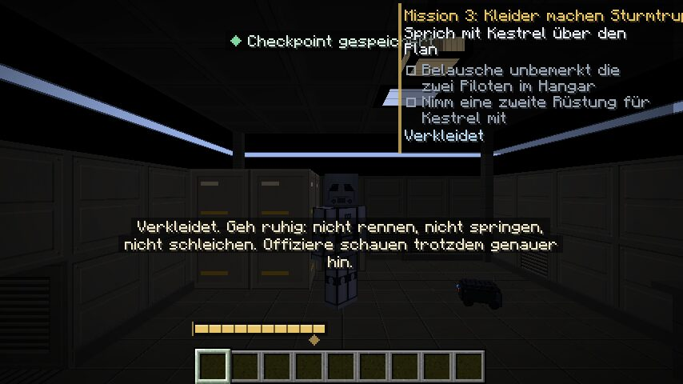 | And from behind 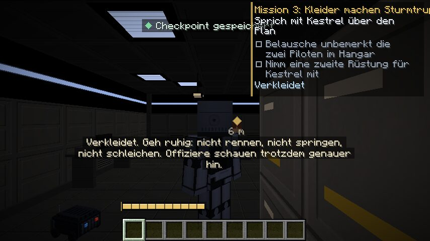 |
| The officer, seen, fights back and calls for troopers 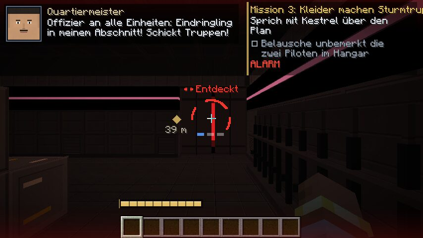 | Troopers coming through the armory's door 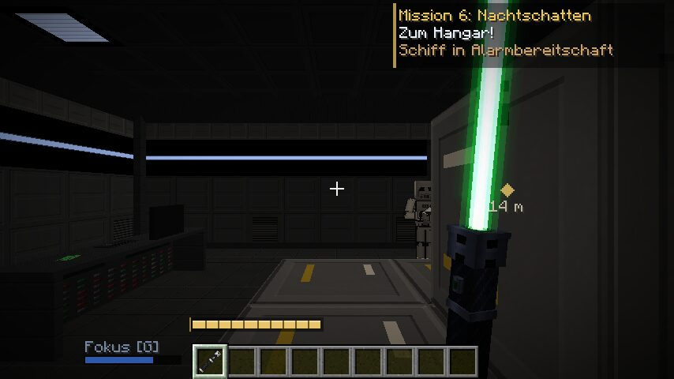 |
| The reactor from the gallery: down onto a platform, edges marked 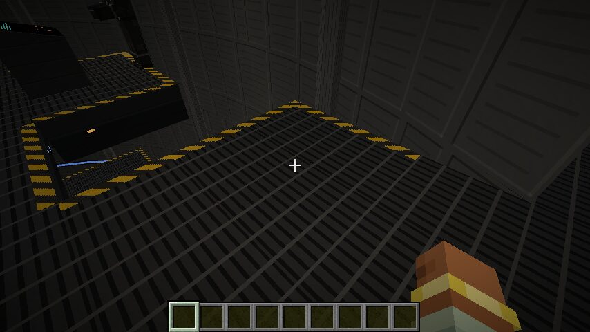 | The core and its rings over the open shaft 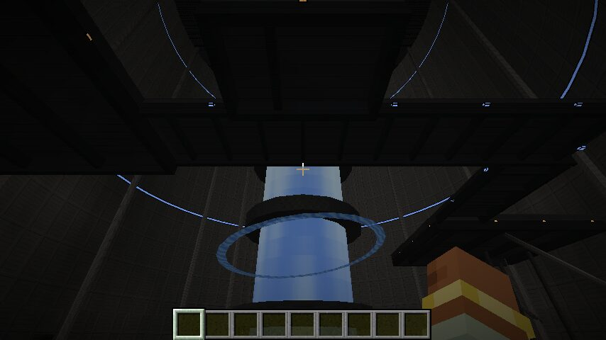 |
| Platforms round the core, seen from the lab's side 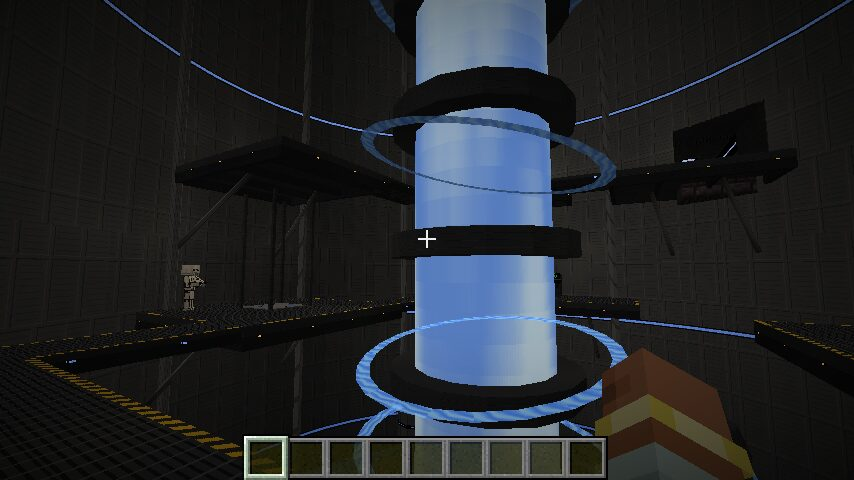 | Off the lift onto its platform 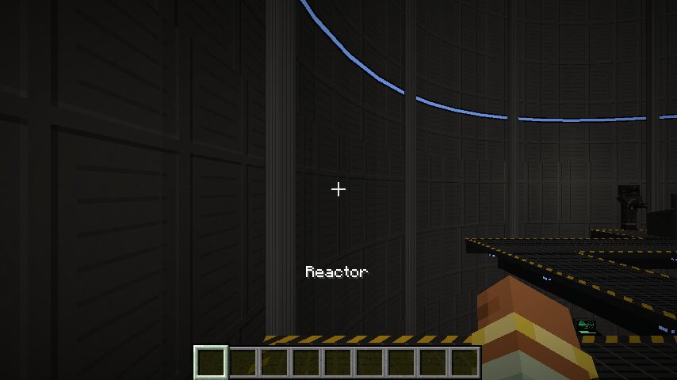 |
| The bridge creaks under fire 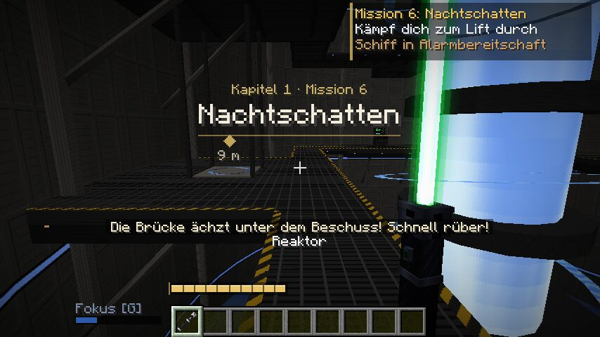 | It breaks behind the player 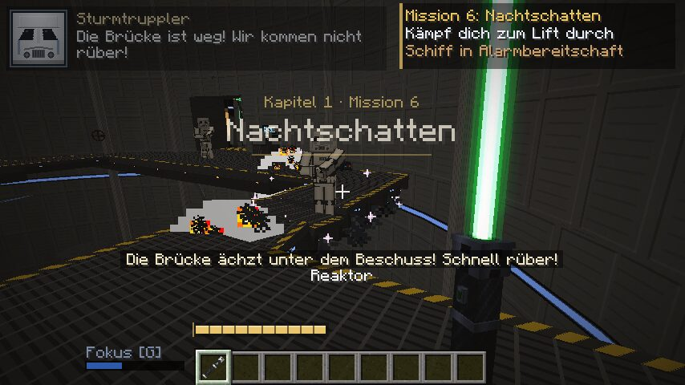 |
| Gone: the pursuers stay on their side 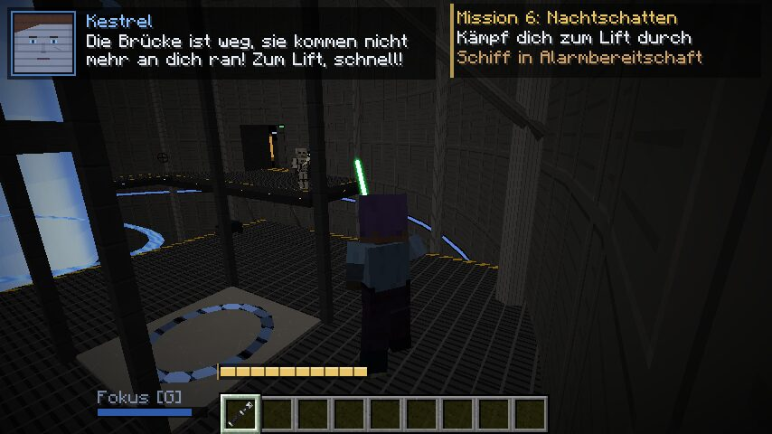 | Platforms and a narrow bridge without railing, from above 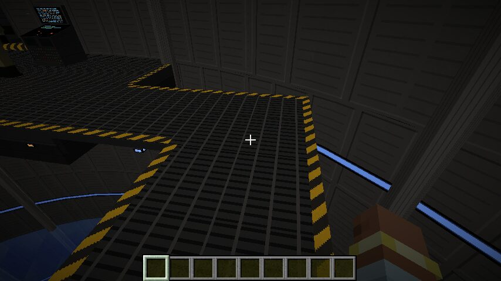 |
| The lift in its own bay behind the lobby 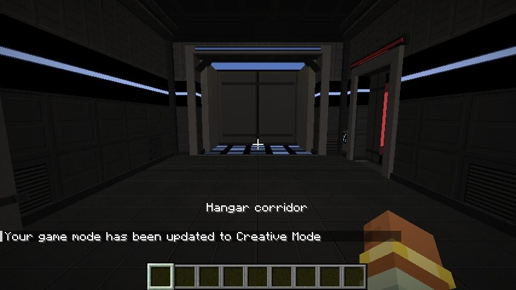 | The detention door, apart from the lift 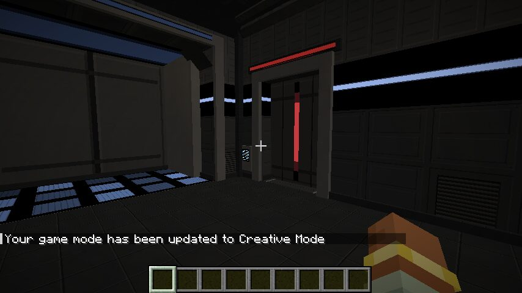 |
| Out of the vent: the droid waits outside, behind the player 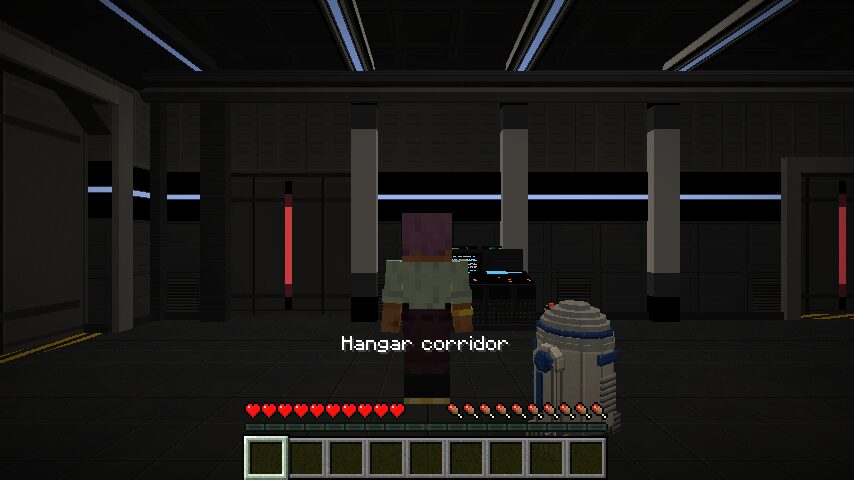 | |
