# Phase 24: calmer pursuit, the escape as a film, and a title screen of its own

Built on `main` after Phase 23 (PR #28). No release, nothing merged. As before, the server decides everything from vanilla blocks and entities: **no new blocks, items or entity types are registered**. Saved stories stay readable (the save format is unchanged: the new marks are ordinary story flags, and the ones that only live during a fight start with `tmp.` and are never saved), no mission was removed, and the Phase 23 systems (skins, the fight for everyone, ways through doors, hit reactions, the reactor and its bridge, the two-phase duel) are unchanged where this phase does not name them. This phase fixes what Phiro found while playing Phase 23.

## 1. No small talk during an alarm or a fight

The talks one has with people in passing (crew on the decks, technicians, the quartermaster's chat; no step of the story waits for them) are not offered while an alarm is on or anyone near is shooting: no talk prompt, no reply to right-click, no idle chat between the crew (`Chapter.talksNow`, `CrewTalk`). The story's own dialogs (the ones a step waits for) are unchanged.

## 2. Music that follows the danger

The story's music now has moods: **calm sneaking** (two pieces taking turns), **tension** (someone near grows suspicious), the **chase**, the **search** after it, and a short **calming** piece after the danger, plus pieces of their own for the escape and the finale. Rising danger cuts in quickly; calming down fades out slowly (crossfades, no hard cuts). A short scene without music of its own keeps the piece playing. **Seven new pieces** (infiltration, corridors, tension, search, aftermath, escape, finale) are original, synthesized by `tools/synth_music.py` (no film or game music used).

## 3. The shouts in the top left corner

- **On the server:** many troopers seeing the player at once no longer each shout; their shouts are thinned out (`StorySession.shoutsHeldBack`).
- **On the client:** a line that is already showing or waiting is not queued again; at most three overheard lines wait (the oldest go first), an overheard line not shown within a few seconds is dropped as old news, and the story's own comlink lines go before overheard ones.
- **Cleared:** when the section changes, the alarm ends or the player is captured (after the black), every shout still waiting is dropped: no "Halt!" in the cell after the capture.

## 4. No escape through hatches while hunted

While the player is chased (someone gives chase, calls the alarm or fights), the **crawl-way hatches, the vents and the detention door** do not open; the screen says **"Du kannst das gerade nicht machen. Du wurdest entdeckt! Häng deine Verfolger erst ab."** Once the pursuers are shaken off (or down), they work again. Hale's trap (the ISB scene) also only starts once nobody is after the player, and the help that came for the alarm goes first.

## 5. The detention block's guard

- **His post:** by the east end of the block, between the door and the bench, where he sees the door, the corridor, the cells and the crawl way's hatch by turning his head (before he stood facing the wall beside the door). He looks to the door most of the time and now and then turns and looks over the room; what he sees and hears he reacts to as anyone (a noise: he goes to look, then back to his post).
- **Overpowering him:** once the player is out of the cell, a story point "Wache überwältigen" appears at him. From close behind (2.4 blocks), while he looks away and nobody hunts the player: a short scene seen from outside (a grab, a blow, he goes down) and he stays down, also after later checkpoints. From the front or the side he sees it coming and raises the alarm; from too far one is told to come closer. The scene can be skipped like every film.

## 6. Droids in the story

- **M-31's key (N) always reaches the story's droid**, even when it is not the droid one looks at or is far away.
- **A droid left behind** (stuck on a lift, behind a closed door, more than 22 blocks away, or gone with a checkpoint) comes back to the player by itself, and its key always fetches it; while it waits the screen says so ("... wartet, wo du ihn zurückgelassen hast").
- **Never onto a turbolift's pad** (one got stuck on the reactor's lift): droids are never put on or right at a lift.
- **R2-V7 keeps out of the way:** the bigger droid is never put in a narrow passage or by a crawl way's mouth, where it stood in the way of the player coming out.

## 7. The lightsaber stays with the player

In the story the saber cannot be dropped: thrown with Q, dragged out of the inventory or left on the cursor when the inventory closes, it goes straight back into the hand (or the inventory), and the screen says "Das Lichtschwert bleibt bei dir. Du wirst es noch brauchen." The lockers and crates of a story's ship do not open, so nothing of the story can be put away in them. Outside the story nothing changes.

## 8. From the reactor to the lab

The crossing to the lab had become too hard (the guard right before the lab's door, the officer at his console by the lab's walkway, and the droid's beeping at the lock heard far around). Now:

- the lab's guard stands **a few steps east of the door**, watching the shaft and the east walkway: one gets past him with care, or lures him off;
- the officer **oversees the technician on the east platform** instead of standing by the lab's walkway;
- the droid at the lab's lock is a **quiet lock**: its beeping is heard only right beside it (4.5 blocks).

## 9. The guards in the corridor of the finale

Before, one trooper was put into the narrow corridor from the reactor to the lobby only when the player came up (and he left it at once to chase), so the corridor often stood empty. Now **two troopers guard it** (one more than before), and they are **at their posts from the start of the escape** (one by its far end, one half way, a little apart, both facing the way one comes, unseen from the reactor below). They hold their posts until they see the player, then shout and fight like the others. The rest of the finale's fighters are unchanged.

## 10. The roof of the bridge

Phiro reached the top of the bridge's area in the finale. This was examined in two ways:

1. **A walk analysis of both ships** (`Phase24GameTest.roofs`): from every start of the story (hangar, corridors, reactor, lab, detention block, command deck, bridge) every cell one can walk to, with **every door and hatch open** and **running jumps over gaps of two and three blocks** counted in (generous on purpose). 6,379 cells in the Star Destroyer, 518 in the Falcon. Result: every one of them stands in a room at its floor's height (the bridge's feet are at 147 to 151, its ceiling at 161); **no place on a roof or a wall's top is reachable on foot**. The only standable top near a reachable place is a one-block step by a vent (part of the room). The way Phiro took could not be reproduced: likely candidates are being thrown (a Force push, a hit's knockback near a wall) or a gap that Phase 23's geometry still had.
2. **A safety net without any visible barrier** (`InteriorPlan.onRoof`, `ShipInteriors.walk`): whoever stands on top of a room in a ship's interior (outside every room, over the ceiling of one or right beside it on its walls, up to four blocks above it) is set back at once where they last stood in a room, without damage. It works the same way as Phase 23's repulsor field under the reactor, for any roof of either ship, and is skipped for creative and spectator players. The walk test checks that **no place one may walk to counts as a roof** (each reachable cell and the edges of the body), and that a player put on the bridge's roof is set back (from y 162 to the bridge's floor at 151).

If Phiro still finds a way up, a screenshot with the coordinates (F3) would show where the geometry has a gap.

## 11. The blade lock as a scene

At half of the Schattenklinge's strength the blade lock now plays as a **short film (7.5 seconds)**: the camera leaves the player's eyes to the side (both and the crossed blades in the picture), circles low round them, comes close on her over the player's shoulder, goes wide as the burst throws them apart, low on her as **the second blade of her staff comes out**, and glides back into the player's eyes, the player turned to face her. Meanwhile the fight waits (nobody strikes, nobody is hurt). Then the second phase begins with a hint ("Die Schattenklinge kämpft jetzt mit beiden Klingen: schneller, und mit der Macht."). The scene can be skipped (the second phase begins at once), and it is **played only once per fight** (a hit that brings her back over half and under it again does not play it twice).

## 12. The reactor fails, her TIE, and the escape seen from outside

- **The reactor fails.** The containment field around the saber drew on the reactor's core: when the saber is torn out, a blast comes out of the field's emitter, arcs leap from the core and the ship shudders. From then on it gets **worse section by section**: shudders come more often and harder, fires and sparks burn along the way out (the reactor, the corridor, the hangar), the lights flicker with short dark dips and a red alarm glow pulses at the edges of the screen, the intercom calls "Warnung: Reaktorkern instabil!" and then "An alle Decks: Reaktor kritisch! Sofort evakuieren!". In the Falcon the Tenebris shakes it where it lies.
- **Her flight in a TIE.** At the end of the duel (disarmed, her saber on the floor, she sees she has lost) she no longer just runs out of the door: she runs to **a TIE fighter parked west of the field** (it stands there for the whole duel), round its wing to the front of the ball, leaps up into it in one jump; it lifts off its wings, glides over the field and drops through it; a short look from outside shows it screaming off into space with a blast on the hull behind it, then the film returns to the player as Dax calls over the comlink. The parked TIE's wings collide where they are drawn (one walks under the ball between them, not through a wing).
- **The escape from outside** ("DAS ENDE DER TENEBRIS", 22 seconds, four shots): the Falcon drops out of the hangar under the bow, engines flaring, the first blasts breaking out of the hull; the chase, looking back past the Falcon at the Tenebris, blast after blast along its back and the reactor's fire breaking through; the end: a chain of blasts, then the core: a white flash, a fireball as large as the ship, a ring of fire racing out; the jump: beside the Falcon as the ring comes, it stretches into a line of light and is gone a moment before the ring sweeps through. Dax, Kestrel and Mira speak over it, with the mod's ship sounds (thrust, blasts, the core, the hyperspace jump) and a white flash on screen at the core. The Tenebris goes up only once the Falcon is far away, and the ring of the blast sweeps through where the Falcon was a moment after it jumped. **The hyperspace jump inside the Falcon begins exactly as it jumps in the film** and goes on after it; then the epilogue as before. Skipping goes straight to the jump inside the Falcon (no story state is lost).

All three are drawn from the mod's own models (the Star Destroyer interior and starship models of earlier phases); no film footage, game assets or copied models are used.

## 13. SaberCraft's title screen

- **A background of its own:** a starfield with a nebula, a ringed planet and a large capital ship, drawn by `tools/make_title_background.py` (procedural, no copied images; `textures/gui/title/background.png`, 1600 x 900). On screen it drifts and zooms very slowly, and stars twinkle over it; soft gradients at the top and bottom keep the text readable.
- **Buttons in the mod's style:** cut corners, a steel edge that turns into a glowing cyan blade on hover (eased in and out), a small bar at the left, marks along the edge. Only on the title screen; the other menus keep Minecraft's buttons.
- **The logo** stays (Minecraft's own); under it "SABERCRAFT" between a blue and a red blade. **Instead of the yellow splash** one of 24 sayings of the mod in German or English, in blade colours, never the same twice in a row. The version line reads "SaberCraft 0.1.0" above Minecraft's own.
- **Everything works as before:** singleplayer, multiplayer, options, realms and quit are Minecraft's own buttons (only drawn differently). `title_screen: false` in `config/sabercraft/immersion_client.json` gives Minecraft's own title screen back (no menu row: the graphics menu has no free row).

## 14. Tests

Automated tests run in the cloud container with a real client (Xvfb, software rendering), **not in CI**. New: **`Phase24GameTest`**; extended: **`StoryGameTest`** (the blade lock's scene played through, her flight to the TIE, the escape film from outside, the music in the hidden room). A green automated test shows that the logic works; it does **not** replace playing it: the films, animations, music, sounds and effects need Phiro's eyes and ears in the real game.

| # | Test case (Phiro's list) | Automated | What is checked | Still by hand |
|---|---|---|---|---|
| 1 | Seen in the reactor, then talk to the technician | yes, `Phase24GameTest.talks` | while troopers hunt the player, the technician offers no talk and right-click opens no dialog | – |
| 2 | No normal dialogs during a fight | yes, `Phase24GameTest.talks` | the danger counts (alarm or someone shooting); no dialog opens | – |
| 3 | Talks work again after the alarm | yes, `Phase24GameTest.talks` | after the alarm ends, the technician talks again | – |
| 4 | Walk past several troopers: messages limited | yes, `Phase24GameTest.shouts` | the same shout is queued once, at most three wait, some are dropped, none left after 13 seconds; several troopers seeing the player at once: at most three wait | how it reads while playing |
| 5 | Die, respawn at a checkpoint: old messages gone | no | (the client drops everything waiting when the section changes or after a capture; not driven through a death in a test) | **yes** |
| 6 | Mission change and films: no stale messages | partly (`shouts`: old ones expire) | lines older than a few seconds are dropped | **yes** (mission change, films) |
| 7 | Seen in the corridor: detention door stays shut while hunted | yes, `Phase24GameTest.pursuit` | the door is locked and a crawl-way hatch is refused while hunted (the hint in the picture); the door opens again after the alarm | – |
| 8 | Pursuers do not get into the detention block uncontrolled | partly | the door stays locked while hunted, and a locked door is a wall for the troopers' way search (Phase 23) | **yes**, with real pursuers |
| 9 | The guard's behaviour | yes, `Phase24GameTest.takedown` | he stands at his post, looks to the door and turns to look over the room | how alert he feels |
| 10 | Overpowering the guard | yes, `Phase24GameTest.takedown` | from the front it fails; from behind the scene plays, he is down afterwards, no alarm is raised; pictures | the scene's look, and that he sees one coming from the front |
| 11 | The prison scene's normal course afterwards | yes, `StoryGameTest` (mission 5) + `Phase24GameTest.oldFiles` | the detention steps play as before; files at every step of mission 5 load | the whole mission by hand |
| 12 | M-31 out of a vent or a narrow passage | partly, `StoryGameTest` (M-31's noise lures the guard) | the noise works in mission 1; the key reaching the story's droid everywhere is in the code | **yes**, from inside a vent |
| 13 | The N action several times | partly, `StoryGameTest` | as 12 | **yes** |
| 14 | The reactor lift several times: M-31 on a valid spot | yes, `Phase24GameTest.droids` | a droid on a lift's pad is moved off it; a droid sent to the other end of the ship comes back | **yes**, riding the lift several times |
| 15 | R2-V7 blocks no vent exits or narrow passages | partly | where droids may be put excludes narrow passages and crawl-way mouths (code; Phase 23's `Phase23GameTest.droids` still green) | **yes** |
| 16 | Drop the saber with the key and from the inventory | partly, `Phase24GameTest.saberKept` | thrown with the drop key: it stays in the inventory and no saber lies on the floor | **yes**: dragging it out of the inventory screen |
| 17 | Reactor to lab: slightly easier | partly, `StoryGameTest` (mission 4/6 steps) | the guard's and officer's new places are used by the story | **yes**: whether it feels right |
| 18 | The corridor after the reactor in the finale | yes, `Phase24GameTest.corridorGuards` | two guards stand there at once and hold their posts until provoked | the fight there by hand |
| 19 | Try to get onto the bridge's roof | yes, `Phase24GameTest.roofs` | walk analysis of both ships (doors open, running jumps): no roof or wall top reachable, no walkable place taken for a roof; a player put on the roof is set back | **yes**: Phiro's own way up (please send coordinates if it still works) |
| 20 | The boss fight up to 50 % | yes, `StoryGameTest.duel` + `Phase24GameTest.bossSkipped` | the scene starts at half her strength | the fight's feel |
| 21 | The new scene from different situations | partly | played through (`StoryGameTest`) and skipped (`Phase24GameTest`); the player is not hurt in it; it never plays twice in one fight | **yes**: from different spots and moments |
| 22 | The second phase starts correctly | yes, both | second phase on server and client, her second blade out, after the scene and after a skip | – |
| 23 | Disarming her and her flight to the TIE | yes, `StoryGameTest.duel` | disarmed, saber on the floor, she runs to the TIE, the film's moments (pictures 1 to 9) | the film's look |
| 24 | Watch the TIE flight completely | pictures only | `StoryGameTest` and `Phase24GameTest` take pictures at set moments | **yes** |
| 25 | Watch the final Falcon film completely | pictures only | six pictures in `StoryGameTest`, five in `Phase24GameTest` | **yes** |
| 26 | The Tenebris' end and the hyperspace jump | yes, `StoryGameTest` | the film begins with the jump, the jump inside the Falcon follows, the epilogue | the look and sound |
| 27 | Skipping the film | yes, `Phase24GameTest.escapeSkipped` + `bossSkipped` | skipped: the story goes on to the epilogue (or the second phase), nothing waits | – |
| 28 | Start the title screen several times: random sayings | partly, `Phase24GameTest.title` | a saying of the mod is shown and all 24 have a text (the test client is English) | **yes**: several starts, the German texts |
| 29 | All buttons | partly, `Phase24GameTest.title` | hover glow (picture), singleplayer, multiplayer and options open their screens; the vanilla screen comes back with the option off | Realms, quit, language and accessibility buttons by hand |
| 30 | Singleplayer, multiplayer, options | yes, `Phase24GameTest.title` | each opens its screen; a world is created and played afterwards in the same test | joining a real server by hand |

**Old saves.** `Phase24GameTest.oldFiles` loads files saved at every step of missions 5 and 6, and `StoryGameTest` still continues Phase 19 files (mission and step by number). No save format change.

**Results (2026-11-18, local, not CI).**

- **Part A** (`StoryGameTest`, `Phase21GameTest`, `Phase22GameTest`, `Phase23GameTest`, `DroidGameTest`, `Phase14GameTest`, `Phase16GameTest`, `Phase17GameTest`, `InteriorDesignGameTest`, `CharacterGameTest`, `Phase24GameTest`): green, 30 minutes.
- After that, the escape film, the TIE's wings and her way to it were corrected (see "Found and fixed by the tests"); **`StoryGameTest` and `Phase24GameTest` ran green again** on that code (13 minutes). The other classes of part A do not touch it.
- **Part B** (the other 31 classes in their usual order, from `BladeScreenshotGameTest` to `Phase20GameTest`, including the dedicated server parts): green, 36 minutes.
- `./gradlew build` builds without errors (the JAR for the manual test).

**Found and fixed by the tests in this phase:**

1. **The escape film crashed the game** at the core's blast ("too many vertices"): the film's fire, smoke and ring were cut into one-block tiles like the ship's walls, millions of them for a fireball the size of the ship. They are single polygons now (also much lighter for the graphics card).
2. **Music:** in the hidden room the tense piece held on from the suspicion just before; the hideout's calm piece now takes over at once.
3. **The parked TIE:** its wings were drawn north and south of the ball, but collided east and west, and her way to it ran through a wing. Now the collision follows the drawing, she goes round the wing to the front of the ball, and the camera looks at her from the front (before, a wing filled the picture, or the camera looked at the ceiling once she was in the ball).
4. **The escape film's look:** the blast's ring was a flat band overhead (now tilted through the Falcon's path: a line of light that sweeps past), a flat blue "exhaust" behind the Falcon is gone, and the jump's flash is a short white flash instead of a grey disc.
5. **The roof safety net** took the floor of the Falcon's hold for a roof (feet at 6.9999 instead of 7); fixed before it was ever committed.
6. **The blade lock's scene could play twice** in one fight (her health back over half and under it again); now once.

**Not tested automatically:** how everything plays by hand (the films' camera, timing and sound in motion, the music's moods while playing, the guard's alertness, the difficulty from the reactor to the lab and in the corridor), a death and checkpoint in the middle of shouts, the droid key from inside a vent, Phiro's own way onto the bridge's roof, a second real player, Iris and shader packs, other graphics cards.

**Known issues:**

- The bridge's roof: no way up was found on foot; the safety net sets anyone back who gets there anyway. If there is still a way, coordinates (F3) would show the gap.
- In the blade lock's scene a companion droid can stand in the camera's way for a moment (they follow the player and are not moved for the film).
- The title screen has no row in the graphics menu (no free row); it is switched off in `immersion_client.json`.
- `SkinLayerGameTest` depends on the order of the test classes (as in Phase 23); the committed order is unchanged.

## 15. Pictures

All from the test client (software rendering, 854×480, English texts): [`docs/images/phase24`](../images/phase24).

| | |
|---|---|
| The title screen: starfield, ship, subtitle, a saying 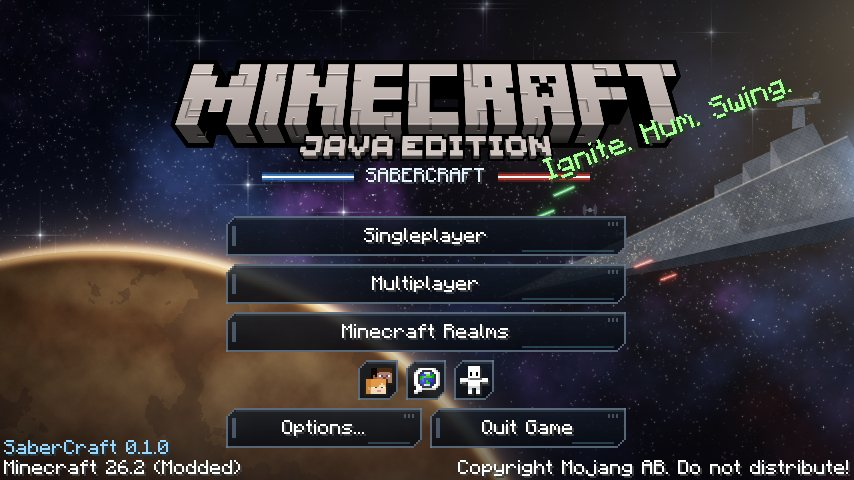 | A button under the mouse 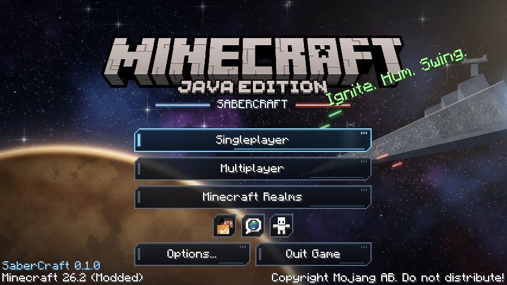 |
| With `title_screen: false`: Minecraft's own 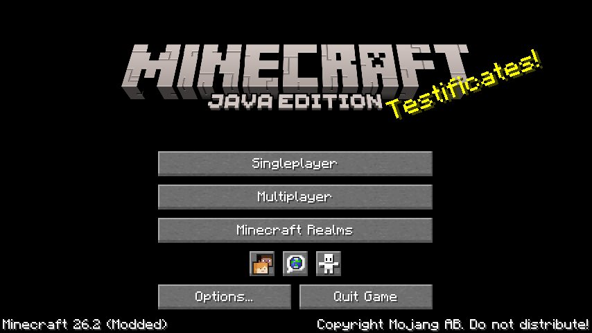 | Hunted: the hatch stays shut 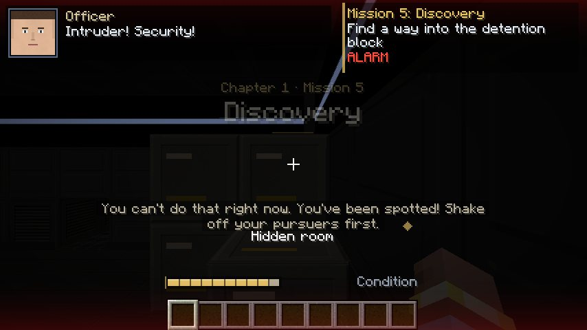 |
| The guard overpowered from behind 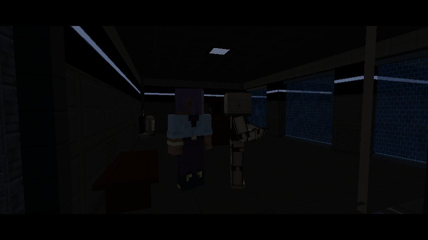 | He stays down 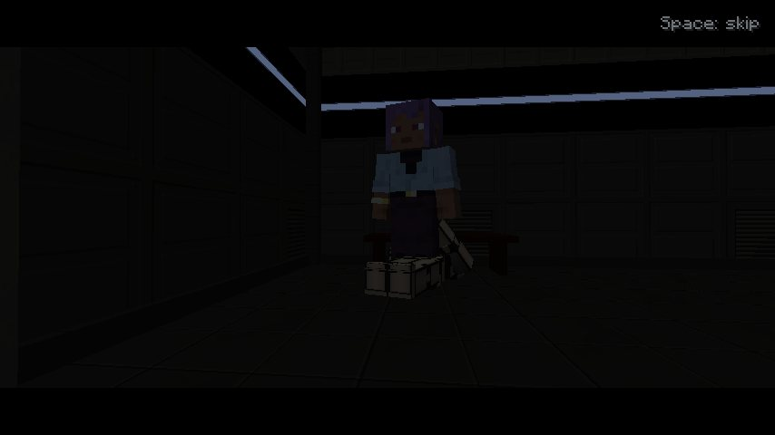 |
| The corridor out of the reactor, guarded 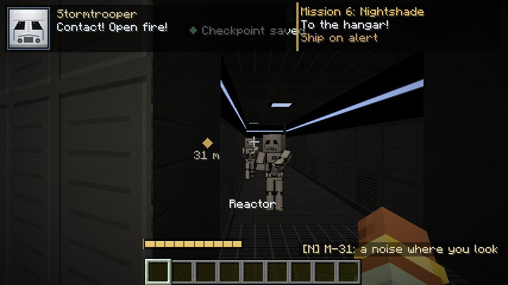 | The reactor failing: flicker and the red edge 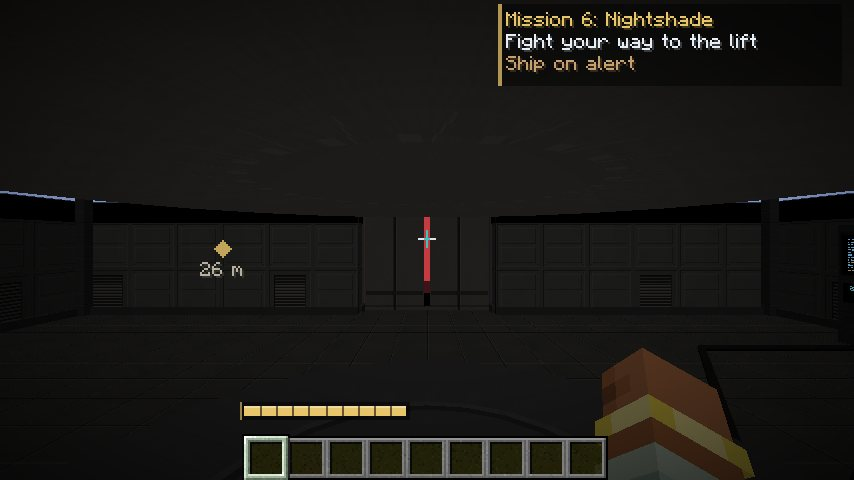 |
| The blade lock's scene: her second blade 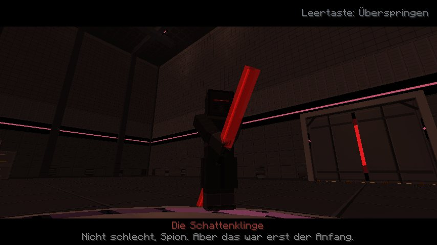 | The second phase begins 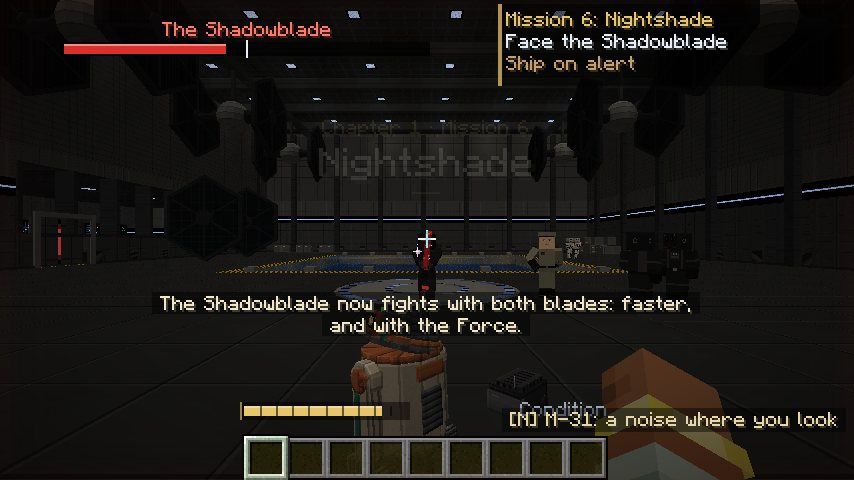 |
| Her TIE, from the front, before she leaps in 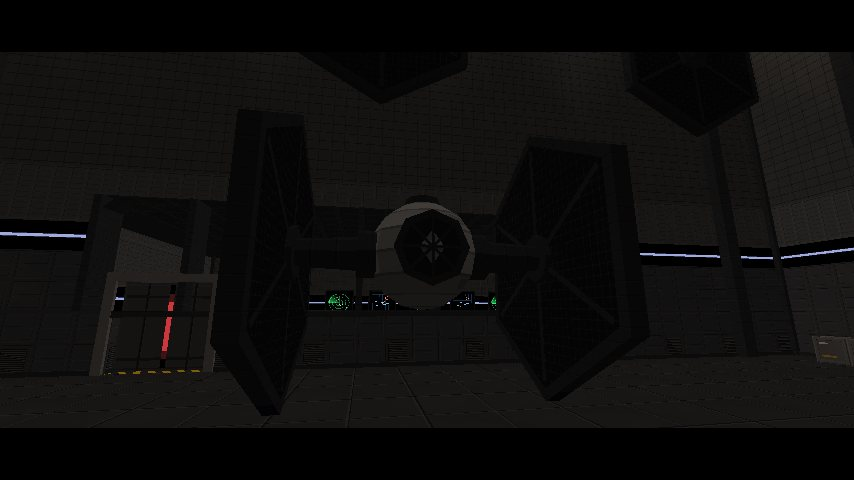 | It lifts off over the field 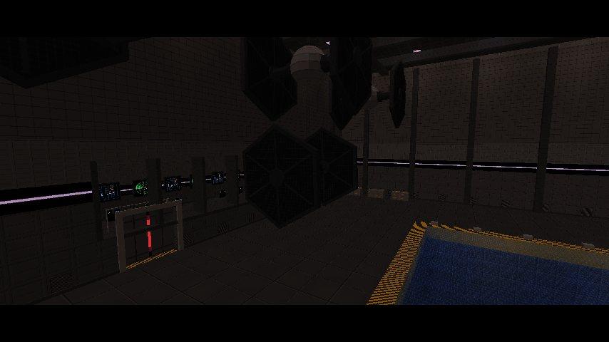 |
| Her TIE leaving the Tenebris 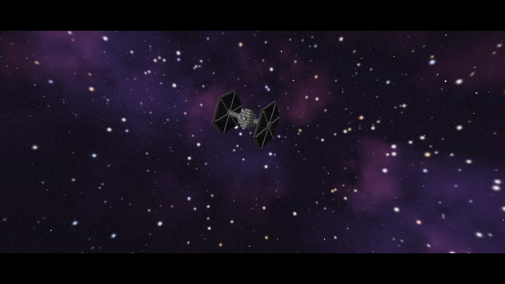 | The Falcon drops out of the hangar 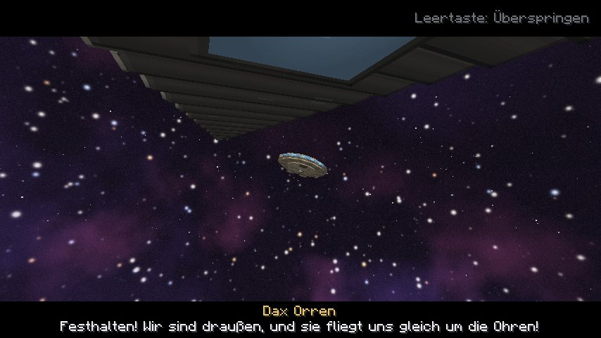 |
| The chase, the Tenebris burning 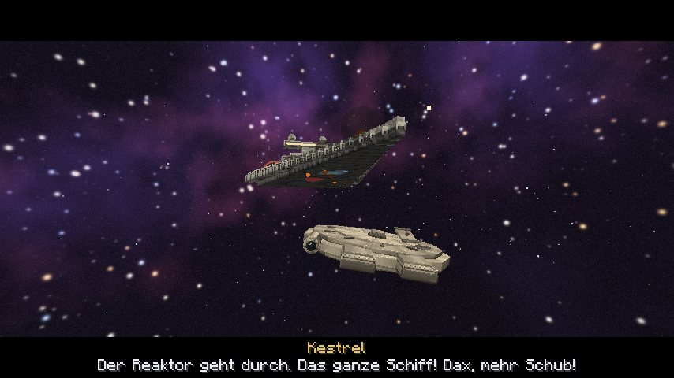 | The core goes 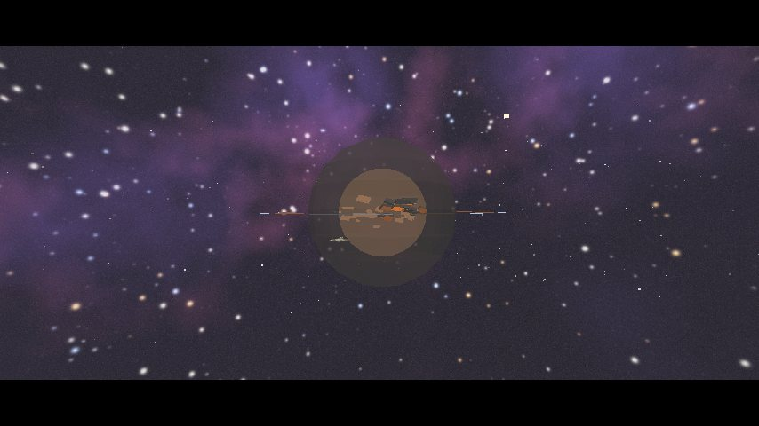 |
| Beside the Falcon as the ring comes 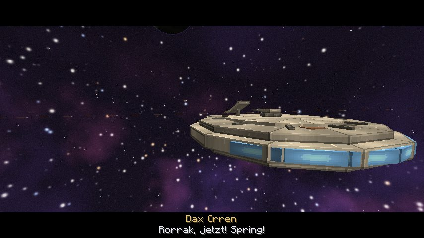 | The jump: a line of light 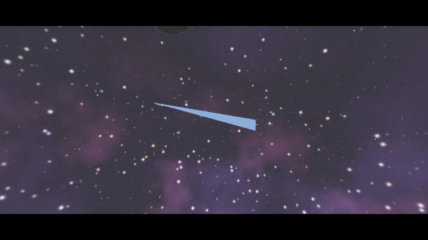 |
