# Phase 25: Hale's scene, the escape by the maintenance way, the saber staff, and light

Built on `main` after Phase 24 (PR #29). No release, nothing merged. As before, the server decides everything from vanilla blocks and entities: **no new blocks, items or entity types are registered**. Saved stories stay readable: the save format is unchanged, the new marks are ordinary story flags (`service.open`, `service.locked`, `service.lit`), and the ones that only live during a scene or a fight start with `tmp.` and are never saved. No mission was removed. The Phase 24 films (the blade lock, her flight in the TIE, the Falcon's escape and the end of the Tenebris), the enemy AI, the way search through doors, the music moods and the notifications, and the duel's two phases are kept; where this phase changes something in them, it says so below.

The Star Destroyer's interior plan is now version 11 (the maintenance way out of the reactor). As with every earlier version, a world saved before is rebuilt to it the next time nobody is aboard; the story's progress is not touched by that.

## 1. Hale comes in as a short scene

Before, Hale only came after the card was taken while the player could still move; whoever left the armory quickly before he arrived could miss the talk, and the story waited for it. Now, **as soon as the card is taken**, a short scene (6.5 seconds) plays where it happens:

1. inside the armory, by the racks: the door slides open, Hale steps in;
2. low in the room: he walks up to the player ("Nicht so eilig. Bleib, wo du bist.");
3. from the side of the room: he stands before the player, the door shuts behind him and **the bolt goes home** (sound);
4. over his shoulder onto the player; then the talk begins in the player's eyes.

- **It always starts:** the quartermaster is paged out first (his desk is empty), the player is put in the room facing the door, and nothing waits for where the player stands. While the scene runs nobody sees the player and the player cannot move, so running off changes nothing.
- **Skipped** (Space): Hale stands before the player, the door is bolted, the talk begins at once.
- **Death or loading in the middle of it:** the story goes back to its checkpoint before the card (`m3.console`), the scene is not shown any more, and it plays once (not twice) when the card is taken again. A file saved at the scene's own step plays it once from the start.
- The door opens for Hale whatever else holds it (a file of that moment may not know the armory was opened; it is marked open as the scene starts, so nobody is shut in later).

## 2. Out of the reactor by the maintenance way

After the copy at the main console the alarm goes off. Instead of running round until the pursuers forget the player, there is now **a way out that takes an action**:

- **The maintenance walkway** runs from the east platform north along the shaft's wall to a **maintenance door** in the wall. Its guide lamps light up with the alarm, and Kestrel names the way over the comlink ("Vom Ostpodest führt ein Wartungssteg nach Norden, den gelben Lampen nach. Am Ende eine Wartungstür, die Notentriegelung ist links daneben."). After a capture the screen repeats it as a hint.
- **The emergency release** ("Notentriegelung ziehen") has to be pulled by hand: about two seconds standing beside it (a progress display; stepping away pauses it). Then the door opens.
- **The panel inside** bolts the door behind the player (not while someone stands in the doorway). The chamber behind it has the hatch of a crawl way into the ventilation.
- **Crawling in** starts a short scene (7.5 seconds): the troopers reach the bolted door, hammer on it, call it in ("Zentrale, Ziel im Wartungsbereich verloren. Durchsucht die ganze Ebene!") and spread out to search; the camera follows the crawl way into black, and the player comes out in the hideout.
- **The pursuers do not forget:** with the door bolted they go to it and search the places round it; the alarm goes on as a search, then the crew stays wary (Phase 21's levels).
- **M-31 is optional:** a guard walks the north platform across the gap from the maintenance door (on his way east he sees the walkway and the door, on his way back his back is to them). He cannot get over the gap, only see and shoot. One can wait for him to turn, or lure him off to the north bridge with M-31's noise.
- **A fair number of troopers:** one to three chase the player at the start, and reinforcements come down the lift once, always at the same moment (11 seconds after the alarm); the crawl way's scene shows two of them at the door. After a capture the same number come again (the alarm no longer calls more troops each time; in the test 4 figures hunt both times).
- The old way back to the hideout still counts.

## 3. Her saber staff

- **No blade in her body.** Every pose of the staff is now checked against her body (the real size of her model): **186,000 poses** (every attack and its swing, every reaction, the spin in eighths, the second blade coming out) are computed by `MeshAudit.staffInBody`, and **none** has the staff or a blade inside her. Where a pose would put it in her, the staff is moved outwards from her body until it is clear. Before the fix 28,051 poses (mostly the spins) went through her.
- **The second blade comes out** at the start of the second phase: the staff moves from the single blade's hold to the staff's, and the second blade grows out of the hilt's other end (after the Phase 24 blade lock scene, or at once when it is skipped).
- **Spins:** in the second phase her combos include a spin (both blades round her). Its wind-up is longer than a stroke's (one second: the staff twirls in her hand, to be seen coming) and it reaches a little further (3.5 blocks). It is blocked or dodged like any blow.
- **The throw:** from 4 to 12 blocks away (so keeping away is no longer safe) she draws the staff back over her shoulder, twirling (just over a second: a sound, the staff spinning, the first time a hint "Sie holt mit dem Doppelstab zum Wurf aus! Weich zur Seite aus (Ausweichen) oder halte die Deckung zu ihr. Er kommt zurück!"), then throws it past the player (never through a wall) and it **comes back to her hand**. It can hurt on the way out and on the way back (3 damage each, once each). A dash goes under it, a guard raised towards it turns it aside (sparks, clash, Focus). While her staff is away she cannot parry: a stroke at her then hits. She throws at most every 13 seconds and not right after her leap or push.
- **Still two phases:** the first with one blade, the second (from 50 %) with both blades, spins and throws; the blade lock scene in between and the disarm ending are Phase 24's.

## 4. Troopers on the way to the hangar

Phase 24 put two troopers into the corridor from the reactor to the lobby. Now **the lobby and the hangar corridor are held too**: one in the lobby facing the corridor one comes out of, one before the hangar's door facing the lobby. With the corridor's two that is four at most, met one or two at a time. They hold their posts until they see the player (before, they ran at the player from wherever they were).

## 5. The Shadowblade and her TIE are there before the door opens

She waits on the hangar's landing circle and her TIE stands parked west of it **while the player is still fighting their way there**, so when the hangar's door opens both are in sight (before, she appeared when the duel began and the TIE was set down in plain sight). She does not attack before the encounter: she is not hostile, and no fight starts until the duel does.

## 6. The lab's guard

The guard by the lab now stands **a few steps east of the lab's door** on the platform, watching the shaft and the east bridge. Phase 24's place (48.4/35.6) turned out to be **past the shaft's curved wall**, inside the wall: he could not see anything from there. Now:

- he sees a player crossing the east bridge, but not one coming along the platform behind him or standing at the lab's door: **one gets past him with care**;
- **M-31's noise lures him off**: he goes to look (only he, not every trooper near), then back to his post.

## 7. Taking the saber, and more short scenes

**Taking Ilyra's saber** is a scene of its own (10 seconds): behind the player at the containment field; close by the holder as the hand closes on the hilt; wide over the lab as the field dies, the lights flicker and sparks fly from the panels; out through the door to the shaft as the core flares and the first tremor runs through the ship (camera shake); back over the player's shoulder and into their eyes. Then the fight begins as in Phase 24. Skipped: the saber is in the hand at once and the fight begins.

The short scenes of this phase (Hale, the crawl way, the saber) share one system (`Scenes` on the server, `SceneFilm` on the client): each does what it shows at fixed moments, and all of it at once when skipped, so the story is the same either way. Caught in the middle of one (a death), the player is back at the checkpoint and the scene stops on the client too. While the camera is close to the player's eyes (gliding out of them or back in), the player's own body is not drawn, so one never looks at the inside of one's own head.

## 8. Millennium Falcon

- **The boarding hatch:** a slit under the lamp strip above the hatch showed the stars outside; the hatch's frame now reaches up to the wall. The lamp over it is only the tile's lit middle (its dark edges looked like a slot round the lamp). In the corner of the ramp hall by the hatch the engine grille's lower lip showed as a dark sliver; it is no longer drawn there.
- **The round wall at the gun well:** the inner collars round the turret domes ended half a block below the outer collar's rim, so over them one looked through the back of the outer collar into the hull. They now reach the rim (1.2 blocks above and below the domes) and are closed at the rim.
- The windows and the cockpit's view are unchanged.

## 9. Music in the finale

- **After the duel**, while the ship is still breaking apart: a new piece, **triumphant but tense** (bright brass, a warning figure every fourth bar).
- **Aboard the Falcon** before the jump: a new piece, **tense** (a heartbeat under it), not the calm one.
- **Calm only once the Falcon is in hyperspace** (the hideout's piece). The escape film keeps its own piece.

Both new pieces are original, synthesized by `tools/synth_music.py` like Phase 24's. Changes between pieces go through the Phase 24 crossfades.

## 10. Light in the reactor and the lab

New is a **thrown light**: a layer drawn added to what lies under it (it brightens and tints a surface; black adds nothing) and without writing depth, so it never hides a lamp, a screen or a hologram. It uses Minecraft's own entity shader (no shader pack needed).

- **The reactor:** the core's pulsing blue light lies on the platforms and bridges round it, strongest near the core, gone 11 blocks out; a dim blue wash on the shaft's wall at the working level, fading up and down. Toned down after the first pictures (it was too bright and even).
- **The lab:** what glows lights the floor round it: the saber's field green, the tracker magenta (only a weak flicker once it fails), the message's figure blue.
- **The hologram:** the figure in the lab's message is light now: a faint glow round her, brighter bands running up through her, and now and then the whole picture jumps.
- Not in the hangar or elsewhere: the test checks that the core's light does not reach the hangar.

## 11. Tests

Automated tests run in the cloud container with a real client (Xvfb, software rendering), **not in CI**. New: **`Phase25GameTest`**; extended: **`StoryGameTest`** (taking the saber plays its scene, Hale's scene in the second run). A green automated test shows that the logic works; it does **not** replace playing it: the scenes, the duel, the music and the light need Phiro's eyes and ears in the real game.

| # | Test case (Phiro's list) | Automated | What is checked | Still by hand |
|---|---|---|---|---|
| 1 | Take the stormtrooper uniform | yes, `StoryGameTest` (mission 3) | the armour is worn and kept | – |
| 2 | Take the access card | yes, `StoryGameTest` + `Phase25GameTest.hale` | the card is taken; a file of that moment starts the scene | – |
| 3 | The ISB scene starts reliably | yes, `Phase25GameTest.hale` + `StoryGameTest` | the scene starts once as the card is taken, the client shows it, the quartermaster is away; **Hale walks in through the door during the scene** (he is at his place before it ends) | the scene's look and timing |
| 4 | Run away as early as possible | yes, `Phase25GameTest.hale` | the player is put out of the armory during the scene: the talk begins all the same, the player is before Hale, the door bolted, the scene not twice | trying it with the real controls (they are locked during the scene) |
| 5 | Skip the scene | yes, `Phase25GameTest.hale` | skipped: the talk begins at once, Hale in the room, the door bolted, the scene not again | – |
| 6 | The talk begins correctly anyway | yes, `Phase25GameTest.hale` | Hale's first line comes after the scene, after running off and after skipping | – |
| 7 | Death and reloading | yes, `Phase25GameTest.hale` | caught in the middle of it (the story's capture is what a death does): back at the checkpoint before the card, the scene stopped on the client too, and it plays exactly once more; a file saved at the scene's step plays it once | a real death, and quitting and loading the world in the middle of the scene |
| 8 | Discovered in the reactor the first time | yes, `Phase25GameTest.escape` | after the download one to three troopers hunt the player, the way is lit, the release can be used, the door is shut before it; nobody stands in a wall | being seen naturally while playing |
| 9 | The escape without M-31 | yes, `Phase25GameTest.escapeRun` | **a real-time run without any grace**: walking the way, pulling the release, through the door, bolting it, into the crawl way: not caught, the scene begins | **yes**: by hand |
| 10 | The escape with M-31 | partly | M-31's noise sends one figure to look (`labGuard`, `StoryGameTest`); not run against the north platform's guard | **yes** |
| 11 | The maintenance way and the crawl way | yes, `Phase25GameTest.escape` | the release opens the door (once), the panel inside bolts it, the crawl way starts the scene, the player comes out in the hideout | – |
| 12 | Closing the shaft behind oneself | yes, `Phase25GameTest.escape` + `escapeSkipped` | bolted by hand: the door is locked; not bolted: it is shut behind the player as the scene begins | – |
| 13 | How the enemies react afterwards | yes, `Phase25GameTest.escape` | after the bolt they search at the door the player vanished through; after the scene the alarm goes on and someone searches the reactor; reaching the hideout the old way they lose the player too (`StoryGameTest` goes on through the detention door, which stays shut while one is chased) | watching it |
| 14 | Retry after a death, compare the enemy count | yes, `Phase25GameTest.escapeAgain` + `StoryGameTest` | the same troopers before and after a capture (4 and 4, the same two reinforcements); after the capture no chaser is at hand and nobody catches the player in the first seconds | – |
| 15 | The escape reliably possible in normal play | partly, `Phase25GameTest.escapeRun` | the real-time run above, the first time and after a capture | **yes**: by hand, several times |
| 16 | The second blade at the start of phase 2 | yes, `Phase25GameTest.staff` + `Phase24GameTest` + `StoryGameTest` | phase 2 on server and client, the second blade out (after the scene and after a skip); pictures | the ignition's look |
| 17 | All animations of the staff | partly | 186,000 poses computed (below); pictures of both blades, the spin and the throw | **yes**: in motion |
| 18 | No blade inside her body | yes, `Phase25GameTest.staffPoses` | `MeshAudit.staffInBody`: 186,000 poses, none with the staff or a blade in her body | – |
| 19 | The new spins | yes, `Phase25GameTest.staff` | a spin begins with its long wind-up; picture | the feel |
| 20 | The throw and the return | yes, `Phase25GameTest.staff` | thrown from 6.5 blocks: out on server and client, back in her hand, the outcome counted (hit, blocked or dodged), the pause before the next throw | dodging and blocking it by hand |
| 21 | Hit reactions and damage | partly | the throw's hits are counted and hurt; Phase 23's hit reactions (`Phase23GameTest`) unchanged | **yes** |
| 22 | The whole fight, both phases | partly, `StoryGameTest` | the duel is played to her disarming and flight (with test shortcuts) | **yes** |
| 23 | The corridor from the reactor to the boss | yes, `Phase25GameTest.hangar` + `Phase24GameTest` | three to four troopers on the way (corridor, lobby, before the hangar door), they hold their posts; nobody in a wall | the fight there |
| 24 | The lab guard and M-31's distraction | yes, `Phase25GameTest.labGuard` | he sees a player on the east bridge, not one behind him or at the lab's door; M-31's noise: only he goes to look and leaves his post | sneaking past by hand |
| 25 | Open the hangar door: boss and TIE visible | yes, `Phase25GameTest.hangar` | she stands on the landing circle and her TIE is parked (server and client) before the door opens; picture from the door; she is not hostile and no duel has begun | the moment the door opens |
| 26 | Taking the saber and its scene | yes, `Phase25GameTest.saber` + `StoryGameTest` | the scene plays (pictures at five moments), the saber is not in the hand before and is after, the ship trembles, the fight begins; skipped: the same at once | the scene's look and sound |
| 27 | All new scenes whole, and skipping | yes (played and skipped), pictures | Hale's, the crawl way's and the saber's scenes, each played through and skipped; the scenes were also looked at frame by frame (every 8 to 10 ticks, see "Found and fixed") | **yes**: watching them |
| 28 | The boarding hatch from different angles | yes, `Phase25GameTest.falcon` | looks from inside at a grid over the hatch's wall all meet a surface (no gap); the slanted corners checked; pictures | other angles by hand |
| 29 | No stars through slits | yes, `Phase25GameTest.falcon` | as 28 | **yes**: looking around |
| 30 | The round wall at the gun well | yes, `Phase25GameTest.falcon` | looks at the collar from inside at three heights meet it; picture | – |
| 31 | The wall high enough, nothing behind it visible | yes, `Phase25GameTest.falcon` | as 30 | **yes** |
| 32 | Windows and view ports still work | no | (only the hatch's frame, its lamp and the collars changed; the Falcon's tests of Phases 14 to 17 still pass) | **yes** |
| 33 | The music after the boss fight | partly, `Phase25GameTest.music` | after the duel, on the way to the Falcon: the new triumphant piece | **yes**: listening |
| 34 | The music entering the Falcon | partly, `Phase25GameTest.music` | aboard before the jump: the new tense piece | **yes** |
| 35 | From the hold to the cockpit | no | (the same step, the same piece) | **yes** |
| 36 | The music during the start, the escape, the explosion | no | (the escape film keeps its own piece; calm after the jump) | **yes** |
| 37 | No abrupt or unfitting changes | no | (crossfades as in Phase 24) | **yes** |
| 38 | Reactors and holograms in normal Minecraft | yes, `Phase25GameTest.light` | the core's light on the east and south platforms, none in the hangar; on the shaft's wall all round; pictures of the shaft, its floor and the lab | **yes**: the mood |
| 39 | With a shader pack | **no** | the test client has no shader pack | **yes** (Iris + a shader pack) |

**Old saves.** The save format is unchanged. `StoryGameTest` still continues files saved by earlier phases (mission and step by number), `Phase24GameTest.oldFiles` loads files at every step of missions 5 and 6, and `Phase25GameTest` starts from files at the steps it tests (`m3.hale`, `m3.console`, `m5.escape`, `m6.saber`, `m6.escape2`, `m6.falcon`, `m6.jump`). A file saved in the middle of Hale's scene plays it once from the start; one saved after it does not play it again.

**Results (2026-11-18, local, not CI).**

All **43** client test classes ran green on the final code, in the cloud container (Xvfb, software rendering), in four runs (a run stops at the first class that fails):

- `Phase23GameTest` and the new `Phase25GameTest` (with `Phase24GameTest` after them, which found fix 10 below);
- `Phase24GameTest` (after fix 10), `DroidGameTest`, `Phase14GameTest`, `Phase16GameTest` to `Phase19GameTest` (19 minutes), and `Phase20GameTest`, which failed there once on its crawl-way check (M-31, put into the hangar corridor's hatch, had walked out of it after 11 seconds, so the hatch shut); nothing in this phase touches droids or that hatch, and it passed when run again;
- `Phase20GameTest`, `InteriorDesignGameTest`, `CharacterGameTest`, `Phase22GameTest` (6 minutes);
- the other 28 classes in their committed order, then `StoryGameTest` and `Phase21GameTest` again (40 minutes).

`./gradlew build` is green. The escape's real-time run: the door open with the nearest chaser 22.7 blocks away the first time and 22.5 after a capture, no stun hit, no capture. **CI:** the first run on the pull request (run 44411251496, 53 minutes) failed in `StoryGameTest`'s saber strokes (see "Tests changed to fit this phase"); locally it passed twice before the change and twice after it. The second run is on the corrected test.

**Found and fixed by the tests in this phase:**

1. **Her staff went through her body** in 28,051 of 186,000 poses (mostly the spins: the staff was only pushed forward, not away from her body all round). Now 0.
2. **Hale stood still at the armory's door for the whole scene** when the story was loaded at that moment (the door was still locked for a file that did not know the armory had been opened); at the scene's end he was put in his place, so the talk worked, but the scene showed a shut door. Found by looking at the scene frame by frame. Now the door opens for him whatever else holds it, and he walks in.
3. **Hale's scene:** the third shot stood so close to him that his head filled half the picture, and the last shot glided through his head into the player's eyes. Now the third shot looks from the side of the room (him, the door shutting behind him), the last over his shoulder onto the player.
4. **The saber's scene** began and ended inside the player's own head (the camera glides out of the eyes and back in, and the player's body was drawn). Now the player's own body is not drawn while the camera is within 1.4 blocks of their eyes (all films); the shot of the hand taking the saber looks from the side, far enough away for the arm to be drawn, and the last shot looks over the player's shoulder at the empty holder.
5. **A scene caught in the middle** (a capture) went on on the client while the story was already back at the checkpoint. The capture's fade now ends it.
6. **Escaping the old way** (through the crawl ways, not the maintenance door) left the hunt running: the detention door then stayed shut as if one were still chased. Now reaching the hideout that way also loses the pursuers (the alarm goes on as a search).
7. **The core's light did not reach the platforms**: the platforms and bridges are steel models, not floor blocks, so the light drawn on floor blocks never showed there. It is drawn on their grating now, over the hazard bands at their edges (the first try lay too close to the bands, which the flicker audit of Phase 22 caught).
8. **The lab's guard stood inside the shaft's wall** (Phase 24's place); see section 6.
9. **The maintenance way's frame stood in the way:** the west post of the striped frame round its mouth stood half a block out in the shaft, where one walks along the wall, and came up to the eyes there (Phase 23's walk audit). The frame now stands in the round wall's cut, and the release's handle reaches no further into the way than one's body passes.
10. **Walking from the reactor to the lobby would have set the player back:** the maintenance chamber lies right under that corridor, and Phase 24's safety net against walking on roofs took the corridor for the chamber's roof. Found by Phase 24's roof test. A room right under another floor has no roof now (the maintenance chamber and its crawl way).

**Tests changed to fit this phase** (what they check is the same): Phase 23's fight in the armory now takes the troopers off their posts before they are set down in the corridor (since this phase the lobby's and the hangar corridor's troopers hold their posts until they notice the player, so none of them would come); `StoryGameTest`'s look at the `m5.escape` checkpoint no longer expects nobody to be suspicious there (the chase begins at once on purpose) but that no chaser is within 6 blocks and nobody catches the player. `StoryGameTest`'s saber strokes at a trooper: the troopers now hold their fire while the strokes are counted. In the first CI run on the pull request the lab's guard (who now stands out on the platform, in the troopers' line of fire) was already down after a heavy and a light stroke; besides the strokes, the only thing that hurts a trooper there is a bolt turned by the saber (a swing turns bolts coming from the front, Phase 22). The test now also checks that no turned bolt hit anyone during the strokes, and names the hits counted so far if a stroke misses.

**Not tested automatically:** how everything plays by hand (the scenes' camera, timing and sound in motion, the duel's feel, dodging and blocking the throw, the escape with real pursuers and with M-31 against the north platform's guard, the music while playing), a real death in the middle of a scene, quitting and loading a world in the middle of a scene, a second real player, Iris and shader packs, other graphics cards.

**Known issues:**

- **The escape may now feel easy.** In the real-time run without any grace the nearest chaser was still about 23 blocks away when the door opened (22.7 and 22.5 in the last run), and nobody got a shot at the player (the first time and after a capture). That was the point of Phiro's request (it was far too hard), but if it is too easy now, the chaser who starts by the lift can start nearer.
- **The throw can hit twice** (on the way out and on the way back, 3 each) if one neither dodges nor blocks. That is deliberate (it comes back), but it is worth feeling out.
- **Shader packs:** the new light is drawn like glowing parts of entities; with a shader pack it may look stronger or weaker. Not tested (case 39).
- **As the camera glides back into the player's eyes**, the player's hand appears a moment before the film ends (their body is hidden that close).
- **Right after a cut in a film** the first frame or two can miss parts of the room that the camera's old place did not see (Minecraft works out what is visible in the background, so a jump of the camera shows for a moment before it catches up; the same happens after a teleport). In the test pictures this shows as dark or empty patches on the first frame after a cut; the pictures are taken a little after the cuts. A possible fix (waiting for that work at a cut) touches Minecraft's renderer and was not done in this phase.
- **Companion droids** follow the player and are not moved for a scene; they can stand in a shot for a moment (as in Phase 24).
- `SkinLayerGameTest` depends on the order of the test classes (as in Phases 23 and 24); the committed order is unchanged.

## 12. CI

The test step took 68 of its 75 minutes with Phase 24. The limits are now **95 minutes** for the test step and **110 minutes** for the job (`docs/ci.md`). The build's artifact is **only the mod's JAR** (no sources JAR), kept **5 days**. Screenshots and the audio recording are still only uploaded when a run fails or is started by hand (3 days).

## 13. Pictures

All from the test client (software rendering, 854×480, English texts, no shader pack): [`docs/images/phase25`](../images/phase25).

| | |
|---|---|
| Hale's scene: the armory's door opens 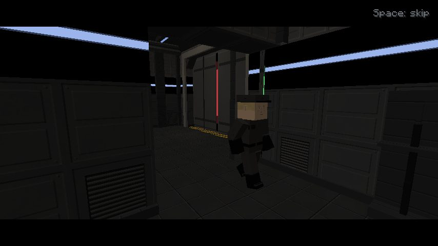 | He walks up to the player 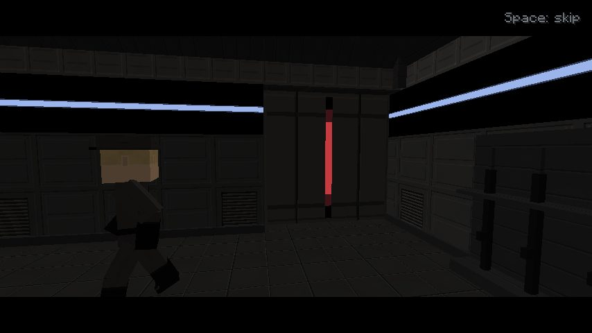 |
| The maintenance walkway, lit with the alarm 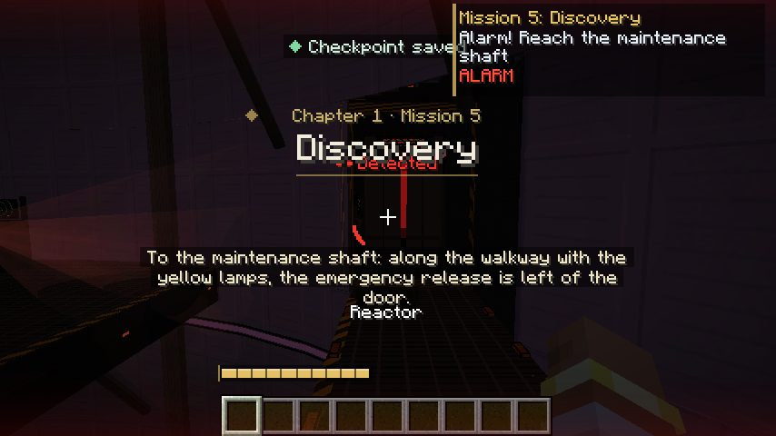 | Inside, the door bolted, the crawl way ahead 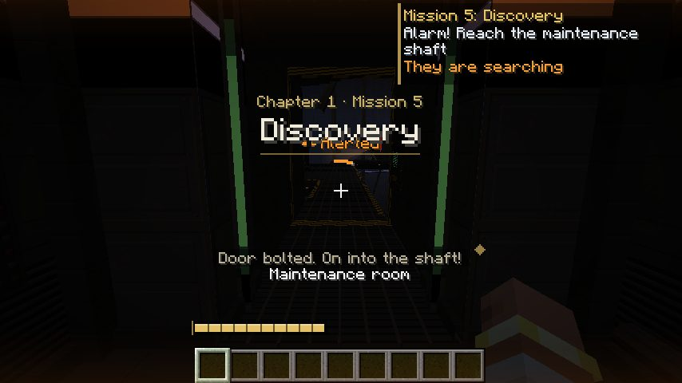 |
| The crawl way's scene: they reach the bolted door 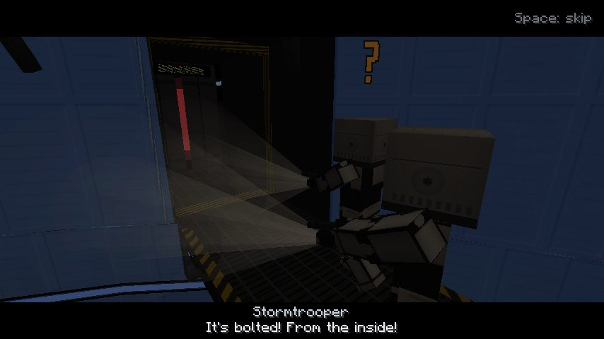 | They spread out to search 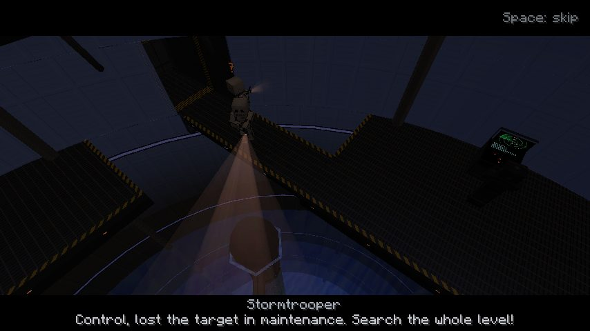 |
| The lab's guard at his new place by the lab's door 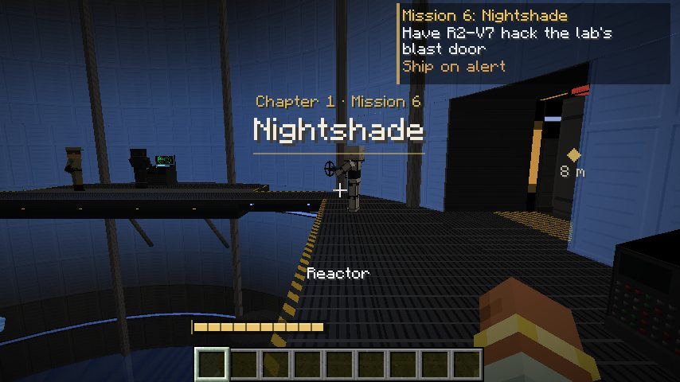 | The hangar corridor, before the door 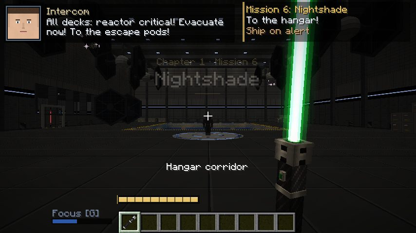 |
| The saber's scene: the hand takes it 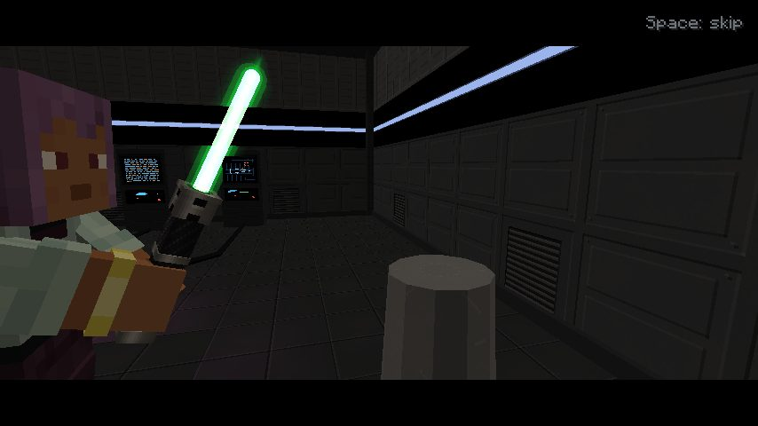 | The field dies, sparks 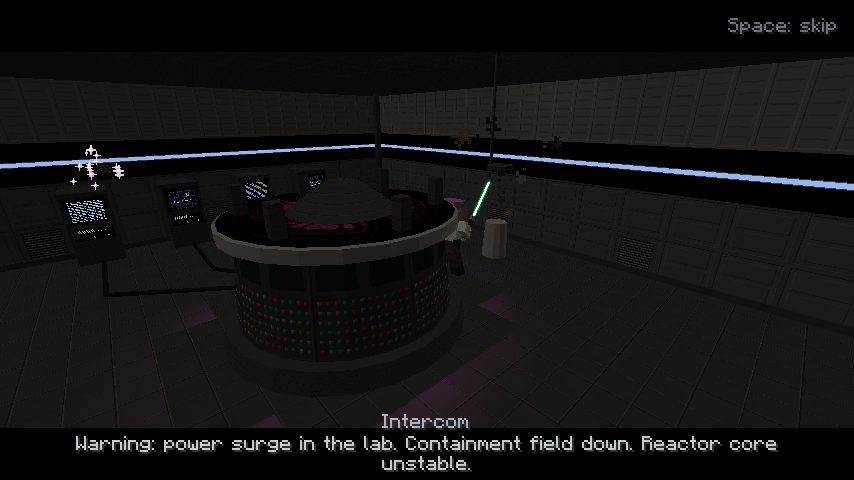 |
| Back over the player's shoulder 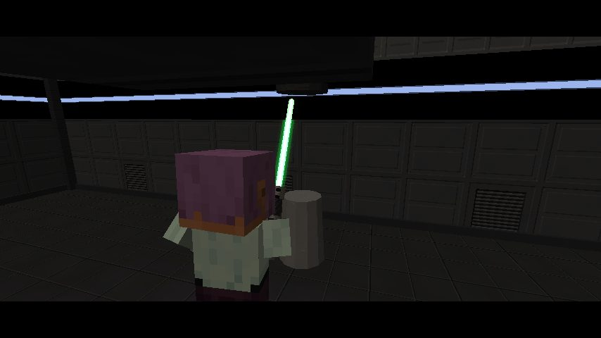 | Her staff with both blades 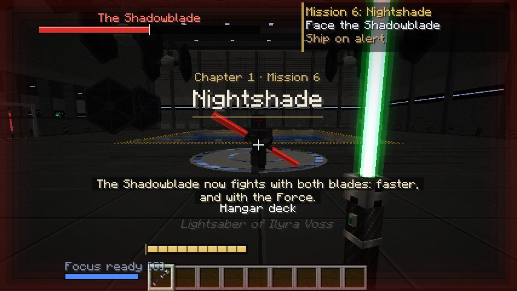 |
| The spin 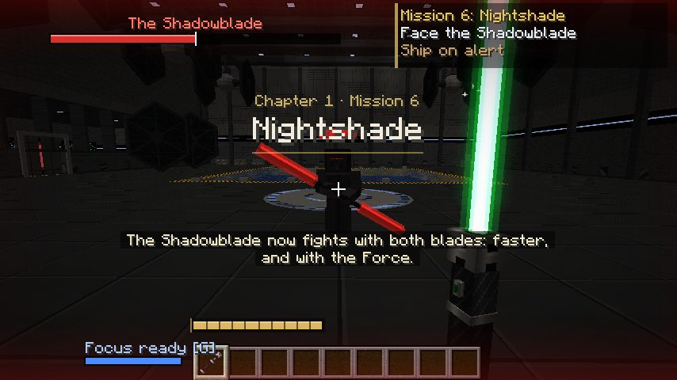 | The throw, on its way out 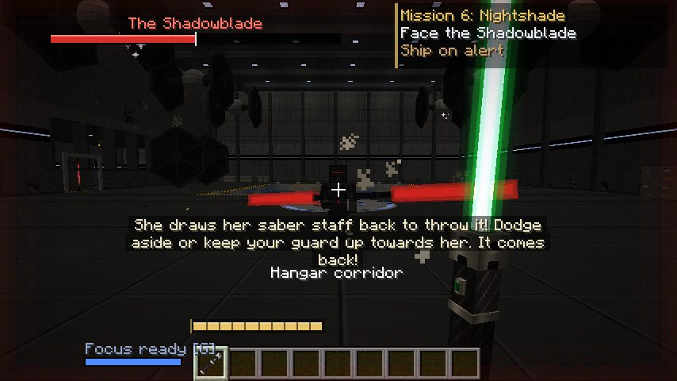 |
| Back in her hand 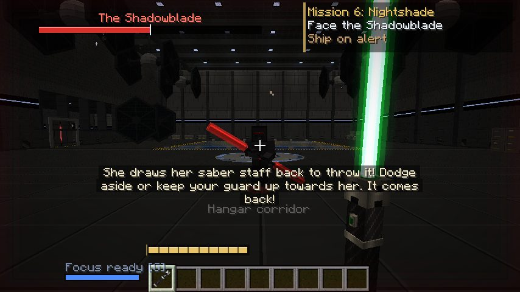 | The core's light on the platform and the shaft's wall 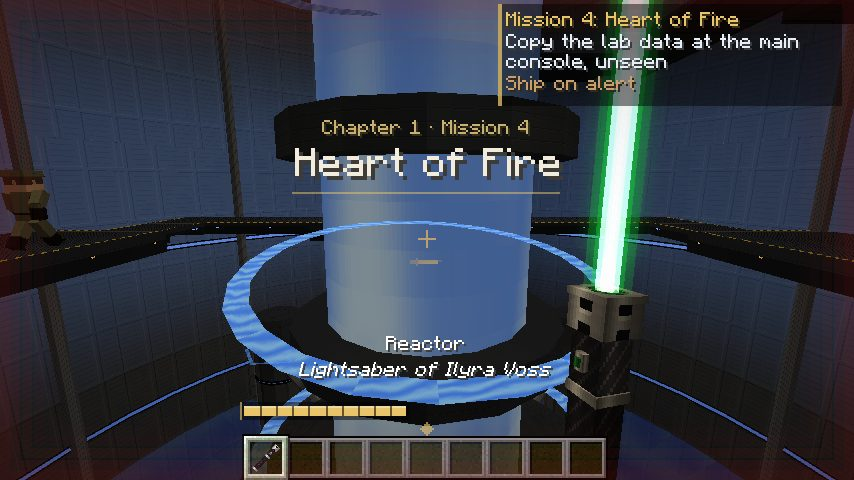 |
| The lab, lit by what glows in it 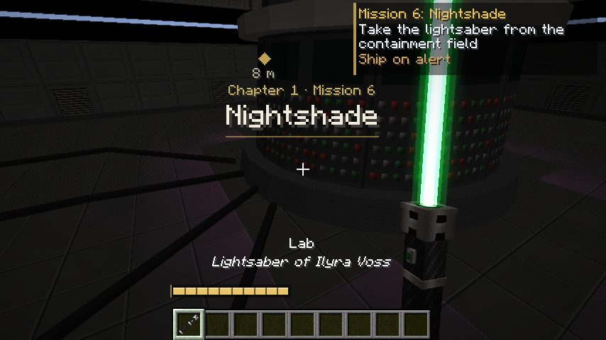 | The Falcon's boarding hatch: no slit over it 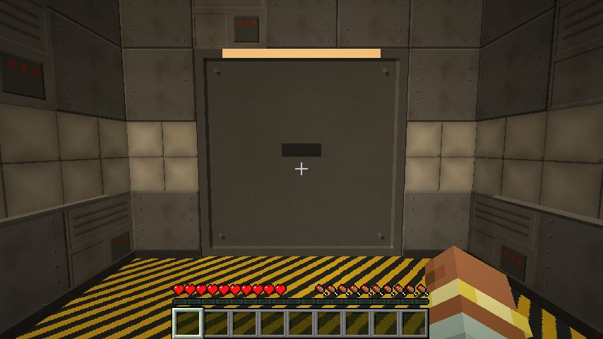 |
| The upper gun well: the collar up to the rim 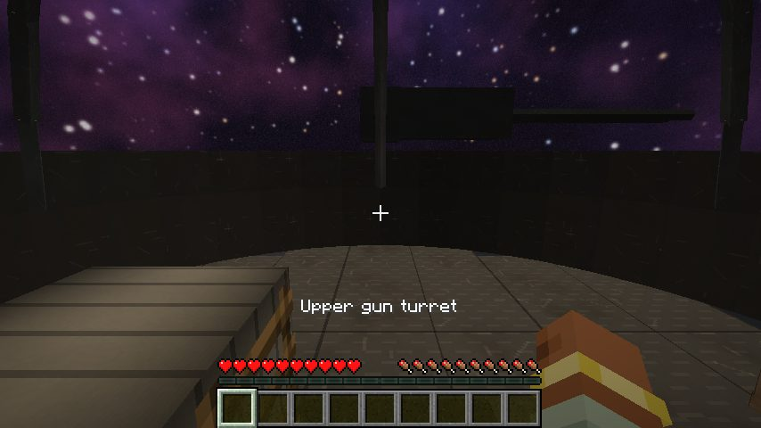 | |
