# Phase 26: playtest fixes, the ring saber, the lab's guard, music and the random buttons

Built on `main` after Phase 25 (PR #30). No release, nothing merged. As before, the server decides everything from vanilla blocks and entities: **no new blocks, items or entity types are registered**. Saved stories stay readable: the save format is unchanged; the one new lasting mark is an ordinary story flag (`lab_guard.down`), and the marks that only live during a fight or a scene start with `tmp.` and are never saved. No mission was removed. The films and short scenes of Phases 21 to 25, the enemy AI, the checkpoints and the duel's two phases are kept; where this phase changes something in them, it says so below.

The Star Destroyer's interior plan is now **version 12** (the security desk moved, section 2). As with every earlier version, a world saved before is rebuilt to it the next time nobody is aboard; the story's progress is not touched by that.

## 1. Crawl-way hatches and doors

**A hatch shut from close by opened again.** The cause: when the use key shuts a hatch, the mod takes the click before Minecraft does, and so Minecraft's own pause between two uses (4 ticks) was skipped. With the key still held, the next use came one tick later, went to Minecraft, and Minecraft opened the hatch it was looking at again. Now:

- the mod keeps Minecraft's pause after every use it takes;
- after shutting a hatch, the key does nothing more on that hatch **until it is let go** (pressed again, it opens as before);
- the server refuses to reopen a hatch within 6 ticks of shutting it by hand (a second safety, for lag).

**The escape's crawl way while hunted.** Phase 24 shut every hatch to a player who is being chased (one could otherwise always crawl away). The crawl way in the reactor's maintenance chamber (Phase 25) is the escape that is meant to be used while chased, so **only that hatch, only in that step** (`m5.escape`) opens while hunted. Every other hatch is still refused while chased (the test tries the hideout's hatch).

**Automatic doors.** A door opened for anyone within 2.6 blocks of its frame, even walking past it. Now a door opens only for someone who really comes to it:

- within **2.15 blocks** along its way (not sideways past the frame), and
- either **moving towards it** or standing in the doorway (0.9 blocks for the player, 0.6 for a figure);
- patrols that walk past or turn away before it do not open it; a door, once open, stays open at least 0.8 seconds so it does not flap;
- a player who appears in front of it (teleport, loading) opens it; a figure that appears does not.

Fewer door sounds come from that alone (a door only sounds when it moves).

## 2. The console in the corridor, and droids on the props

**The flickering console** in the middle corridor (top right on screen): the security desk and the panel on the wall behind it overlapped the post of the corridor's arch, so two surfaces lay in the same plane and flickered. The desk and its panel moved half a block along the corridor (to z = −9.25), clear of the post; the desk's collision moved with it (plan version 12).

**Droids on pedestals.** A companion droid could climb onto the saber's holder (and other props). Now the important props are **kept clear**: the saber's holder and field, the lab's hologram, the tracker, the cell's console, the catwalk's desk and the reactor's consoles. For droids:

- their way finding treats those places as blocked, so they walk round them;
- they are never set down there (when a droid catches up by teleport, or when it picks a spot to wait at);
- M-31's noise is never sent there;
- a droid that is on one anyway (put there by hand, or pushed) steps off by itself, and after 1.5 seconds is put down beside it.

## 3. The cell: no solution given away, M-31 at work

- **No hint gives the solution any more.** The hint outside the cell only says "Draußen bei der Bank wartet M-31 und fiept leise vor sich hin." The maintenance log no longer says he bites cables ("…weil er sich ständig an Leitungen zu schaffen macht"), and **"durchbeißen" is gone** from all texts (the test checks it).
- **The droid key in the cell starts a sequence** instead of switching the field off at once:
  1. M-31 chirps and **rolls to the field generator's panel** beside the cell (up to 5 seconds);
  2. he **works on it** (2.8 seconds): his work animation, sparks, a quiet working sound; **the field stutters** (bands drop out, it tears sideways, blinks, pales; a stuttering sound);
  3. then it dies: sparks, smoke, the field's off sound, "M-31 macht sich am Feldgenerator zu schaffen. Das Kraftfeld erlischt."
- The cell's checkpoint and the rest of the escape are unchanged.

## 4. Kestrel

- **After the prison break** she no longer stands in front of the crawl way's mouth but **beside it** (26.45 / 4.55), out of the way in.
- **Sitting:** figures only sit (or work at a console) **at their place**. Kestrel played the sitting pose while walking when she was spoken to on the way. Now: at her seat she sits (talking or not); away from it, spoken to, she stands and **talks with gestures**; quiet, she just stands. This applies to every figure with a seat or a work place; troopers, guards and droids do not gesture.
- **After the finale** she wore her stormtrooper armour in the Falcon's cockpit. The armour now belongs only aboard the Star Destroyer before the chapter ends; on the Falcon and after the end she is in her own clothes.

## 5. The lab's guard, and the troopers' fire in the finale

**The guard by the lab vanished** when one came up behind him and right-clicked. The cause: the figures of a mission step were listed per step, and the right-click opened the lab's door, which moved the story on a step (`m6.door` → `m6.lab`), where he was not listed any more. Now:

- **he stays** in every step until the saber is taken (and as a fighter after it, as in Phase 25);
- **he guards**: he watches the east bridge (7.5 s), turns (1.2 s) and looks down into the shaft (3.5 s), then turns back. Whoever crosses his view is seen; behind his back one gets by;
- **a takedown from behind** ("Wache ausschalten", right-click close behind him while he does not see you) plays the takedown film of the detention guard (Phase 21), and he **stays down**, lying there, for the rest of the mission (also after loading: `lab_guard.down`). From the front he notices the player instead.

**The troopers in the finale fire more often, but fairly.** Before, each fired every 2 to 4 seconds. Now:

- each fires every **1.1 to 2.2 seconds**, sometimes (30 %) twice in a row (0.35 s apart);
- two troopers never fire within 0.35 seconds of each other, so several of them do not hit at once;
- the rifle still comes up half a second before each shot (to be seen coming), and one out of sight does not shoot.

In the test the troopers at the reactor fired 38 bolts in 16 seconds, never two within 7 ticks.

## 6. The boss: strength, attacks, openings, the ring saber, the 50 % scene

**More strength.** A light hit now takes 5.2 % of her strength (was 6.5 %), a heavy one 8 % (was 10 %): about **25 % more** hits to win.

**More variety.**

- First phase: two more combos (thrust–overhead, overhead–sweep–thrust) and a **lunge**: from 3.4 to 5.8 blocks away she comes in fast with a thrust (at most every 6 seconds), so keeping just out of reach is no longer safe.
- Second phase: **the ring's rush**: the ring spins up (0.9 seconds, with a rising whirr and the spin to be seen), then she drives at the player behind the spinning blades. Dodging it or blocking it leaves her **open** (stumbling after a perfect block); a hit hurts. At most every 11.5 seconds.
- **Her last quarter**: the ring flares and whirls once round the grip (a sound, sparks, a short shake), and from then on she fights harder (longer combos with spins, shorter pauses, more rushes).
- **Clear openings:** when a combo ends (dodged or blocked), after a perfect block (longer, she stumbles) and after a rush that missed she stands open for a moment; struck from behind (except mid-leap) she always takes the hit.

**No attack texts.** All on-screen announcements of her attacks are gone: the hints (`duel_start`, `duel_riposte`, `duel_clash`, `duel_perfect`, `duel_phase2`, `duel_phase3`, `duel_throw`, and the Force push hint) and the names of her moves under her strength bar ("Hieb von oben", "Seitlicher Hieb", "Stoß", "Sprungangriff", "Machtstoß", "Er taumelt"). Her name, her strength and the phase marks stay. She is read by what is seen and heard: the wind-ups, the ring spinning up, its whirr, the flare.

**The ring saber.** Her weapon is now an Inquisitor's spinning ring saber, not a staff:

- a **long central grip** (bands, pommel) held in her hand(s); round it a **large ring** on a hub with two spokes; **two blades** come out of shrouded emitters at opposite points of the ring;
- **the ring turns mechanically round the grip** while the grip stays in her hand: it spins up for the rush and for spins, slows down and settles with the blades level when she fights with one blade's strokes; it twitches on a parry. It is not a staff spun in the arm;
- when it spins fast the blades blur into a **glowing disc**;
- **light like the other sabers**: a white core, a coloured blade, two layers of glow facing the camera, and **red light on the floor** round her (larger with both blades lit and when spinning);
- **in her hand without clipping:** 746,496 poses (every attack and swing, every reaction, eight steps of a spin, the second blade coming out, spinning and still, eight ring angles) are computed by `MeshAudit.ringInBody`; **none** has the grip, the ring or a blade inside her (where one would be, the saber is moved out, at most 1.3 blocks);
- thrown (Phase 25's throw) it flies spinning flat and comes back; on her back when not drawn; lying flat when she is disarmed.

The official reference pages (the Star Wars databank and lightsaber sites) **could not be reached from the cloud container** (the network blocks them). The design follows Phiro's description (Grand Inquisitor in *Rebels* and *Obi-Wan Kenobi*) and the summaries a web search gave; it is worth a look in the game.

**The 50 % scene is deterministic.** Before, what the player was doing at that moment (running, striking, blocking) carried into the scene: the player could be anywhere, turned away, with the guard up. Now, when her strength falls to half:

1. everything is stopped: the player's item use, guard, dash and spin, both of their movements;
2. both are set up: she stands **1.45 blocks in front of the player** (or the player in front of her if she has no room), both face each other;
3. the player is **held in place** while the scene runs (except during the lock's burst, which throws them apart as before);
4. then the camera and the film (Phase 24's blade lock) run as before;
5. at the end, or when skipped, the player faces her again, nothing from before is still running, and her next stroke waits a moment.

The test plays it three times (running past her, striking, blocking): the same distance, both facing each other (0° off), no guard in the scene, the player still.

## 7. The Millennium Falcon and the bridge

- **The Falcon waits below the hangar** from the moment the saber is taken until the player boards it (`m6.escape1`, `m6.escape2`, `m6.duel`, `m6.falcon`): it hovers under the open landing field with a gentle bob, engines glowing, running lights blinking, seen from the hangar through the field. It is drawn with the Star Destroyer's interior (no entity, nothing to load), so **it is there from the first frame** of those steps: it does not pop in when one enters the hangar. The test checks that it is drawn while the player is still at the reactor. It is not there before (mission 5) or after the jump.
- **The lift to the bridge is locked in the finale only:** in mission 6, from the plan on (`m6.plan` to `m6.falcon`), the lift refuses to go up ("Der Aufzug zur Brücke ist gesperrt. Die Brücke ist abgeriegelt.", a lock sound) and the player stays below. Going down always works. Before mission 6 and after the chapter's end the lift works as before (the test rides it in mission 4). The lift is the only way up (all crawl ways are on the hangar deck or in the bridge's pit).

## 8. Music and sounds

**Crossfades.** Changes between story pieces were abrupt (a gap, then the new piece at full volume). Now:

- fades follow an **equal-power curve** (no dip in the middle);
- the old piece keeps playing until the new one has really started (at most 0.6 s), so there is **no gap**;
- a change to a more tense piece takes at least 0.8 s, any other change at least 1.5 s, a change to a calmer piece at least 2 s;
- **before the duel** (while she speaks) a quiet tense bed plays instead of silence, and fades into the duel's music (4 seconds in the test).

**New sounds** (original, synthesized by `tools/synth_sounds.py --phase26`, quiet, several variants each so they do not repeat):

- **steps on the deck plates** aboard (6 variants, a dull thud and the plate's short ring) instead of stone steps, for the player;
- **crawling** in the crawl ways (5 variants, a knee on thin sheet metal);
- **air in the corridors**, a faint hum and hiss at four places (main corridor, the cells, the reactor by the lab, the bridge deck);
- **consoles click** and **lockers latch** when used (not for an action that is refused because someone watches);
- **M-31 working** and **the field stuttering** (section 3), **the ring spinning up** (section 6), **the astromech's hack** (it was played before but missing in `sounds.json`, so it was silent).

## 9. The random buttons

- **Character menu:** a **"Zufall"** button at the end of the tab row. On the film characters' tab it picks one of the film characters, on the own outfits' tab one of those, **never the one worn now**, and **puts it on at once** (the menu shows "Zufällig gewählt: …"). Holding a saber, it also takes that character's saber (hilt, colour, style), as choosing a character always did.
- **Saber menu** (the saber's own page): a **"Zufall"** button. It picks a hilt, a colour and **a fighting style that fits the hilt** (a valid combination), never the same as now, and **applies it to the saber in hand at once**; the menu stays open to roll again.
- **Story restrictions are kept:** while a story runs, both menus' character and saber pages are locked as before, and both random functions do nothing there (the test calls them directly in the story: nothing changes). The music page stays open as before.
- Found by the test: quick presses of the random button could leave the server on the previous character (it takes a new choice at most every half second). The client now sends the last choice again once that time has passed, so the server always ends on what the player sees.

## 10. The hack droid's head

The astromech's (and Chopper's) dome tilted up to 35° when it looked at something above it, so it seemed to look far up. It now tilts at most **6°**; turning round is unchanged. A new short work jolt plays while a droid works (M-31 at the field).

## 11. Tests

Automated tests run in the cloud container with a real client (Xvfb, software rendering), **not in CI**. New: **`Phase26GameTest`**, with one part for each of Phiro's 15 cases. A green automated test shows that the logic works; it does **not** replace playing it: the duel, the ring saber in motion, the scenes, the music and the sounds need Phiro's eyes and ears in the real game.

| # | Test case (Phiro's list) | Automated | What is checked | Still by hand |
|---|---|---|---|---|
| 1 | A hatch shut from close by stays shut | yes, `Phase26GameTest.hatch` + `Phase20GameTest` | shut with the use key **held down for 24 ticks**: it stays shut, it was shut exactly once; let go and pressed again it opens; crawling in plays the crawl sound | trying it by hand, with lag |
| 2 | The escape's crawl way despite the alarm | yes, `Phase26GameTest.escapeHatch` + `Phase25GameTest` | hunted at `m5.escape`: the maintenance chamber's hatch opens, the hideout's hatch is still refused | – |
| 3 | Patrols and automatic doors | yes, `Phase26GameTest.doorLogic` + `Phase16/17GameTest` | 13 cases on a door: walking past (player and figure) does not open it, coming towards it or standing in it does, turning away before it does not, a figure appearing does not, a player appearing does; held open a moment | watching patrols pass doors |
| 4 | The cell with M-31 | yes, `Phase26GameTest.cell` + `StoryGameTest` | the droid key starts it; the field is still up while M-31 rolls; he works at the panel (0.5 blocks from it) for most of the 2.8 s; the client shows the stutter; then the field is gone and the cell open; pictures; no "durchbei" in the texts | the look and sound of it |
| 5 | Kestrel's place and her poses in talk | yes, `Phase26GameTest.kestrel` | after the prison: beside the crawl way's mouth, not in its way, not in a wall; poses: at her seat sitting (quiet and talking), off it talking, then standing | – |
| 6 | The lab's guard | yes, `Phase26GameTest.labGuard` + `Phase23GameTest` | there at `m6.lab` and `m6.saber`; turns between bridge and shaft; a takedown from the front is refused and he notices; from behind the film plays, he is down, still down 5 s later and in the next step | sneaking up by hand |
| 7 | Droids on the props | yes, `Phase26GameTest.droids` | the holder is kept clear, the floor before it is not; two droids put on the holder step off; none left on it | – |
| 8 | The troopers' fire in the finale | yes, `Phase26GameTest.shots` | 16 s at the reactor with every trooper hunting: shots 1.1 to 2.2 s apart per trooper, never two within 7 ticks | **yes**: whether it feels fair |
| 9 | The boss fight with the ring saber | partly, `Phase26GameTest.boss` + `ringPoses` + `StoryGameTest` | she is stronger; the lunge; the ring's rush begins, ends, is counted; her last quarter (the flare on the client); 746,496 poses without the saber in her body; pictures | **yes**: the fight, the ring in motion |
| 10 | The 50 % scene from different moves | yes, `Phase26GameTest.halfScene` (three times) | running, striking, blocking: the scene begins once, both 1.45 apart and facing each other, no guard, the player held still, facing her afterwards | trying it several times by hand |
| 11 | The Falcon in the hangar, the bridge locked | yes, `Phase26GameTest.falcon` + `lift` | the Falcon is not there in mission 5, is there (server and client) and drawn while still at the reactor in mission 6; pictures from the hangar; the lift refuses to go up in mission 6, works in mission 4 | how it looks from the hangar |
| 12 | Kestrel after the finale | yes, `Phase26GameTest.kestrelArmour` | in armour aboard the Destroyer, not on the Falcon, not after the chapter's end | a look in the cockpit |
| 13 | Music and sounds through the story | partly, `Phase26GameTest.boss` + `hatch` + `texts` | before the duel the tense bed, then a crossfade (not a cut) to the duel; deck steps and crawl sounds play; every new sound is registered | **yes**: listening through the story |
| 14 | Random choice outside the story | yes, `Phase26GameTest.randomCharacter` + `randomSaber` | 4 characters: each new, worn at once, known to the server; two quick presses end on the second; a film character brings its saber; 6 sabers: each new, valid, in the hand at once, the menu stays open | – |
| 15 | Story restrictions still hold | yes, `Phase26GameTest.restrictions` + `CharacterGameTest` | in the story the character and saber pages are locked, music is not; both random functions change nothing | – |

**Results (2026-11-19, local, not CI).**

All **44** client test classes ran **green on the first try** on commit `7e9bf9e` (the code of this phase), in the cloud container (Xvfb, software rendering), in four runs of the committed order's groups (75 minutes in all):

- `StoryGameTest`, `Phase21GameTest` to `Phase26GameTest` (27 minutes);
- `ShipBoardingGameTest`, `InteriorDesignGameTest`, `Phase16GameTest` to `Phase20GameTest` (15 minutes);
- the first 15 classes, `BladeScreenshotGameTest` to `SkinLayerGameTest` (20 minutes);
- the other 15, `ArsenalGameTest` to `Phase14GameTest` (14 minutes).

No earlier test had to be changed for this phase. Before that full run, `Phase26GameTest` was brought to green alone (the findings below). `./gradlew build` is green. **CI** has not run on this code yet: it starts with the pull request.

**Found and fixed by the tests in this phase:**

1. **The hatch could not be opened again** after it had been shut with the key held: the mark that ignores the held key (section 1) was only cleared when the player looked at another hatch, not when the key was let go. Now it is cleared on release.
2. **The server missed quick character choices:** it takes a new choice at most every half second, so after two quick presses of the random button the client showed one character and the server knew the other (other players and the story saw the wrong one). The client now sends its last choice again once the half second has passed.
3. **No deck steps were heard:** the steps were only replaced on barrier blocks, but the decks are drawn over real floor blocks. Now every floor aboard steps like a deck plate (in water, Minecraft's own sounds stay).
4. **Her moves were still named on screen:** besides the hints, the strength bar showed the name of each attack as she wound up ("Hieb von oben", "Stoß", "Sprungangriff", …) and "Er taumelt" when she was open. Seen on the test's pictures; removed (section 6), and the test now checks that these texts are gone.

**Tests that needed fixing themselves** (what they check stayed the same): the duel begins on her last line, whose dialog stays open until the player reads on, so the test now closes it before it uses the keys (with it open, the guard and strokes never reached the game); the lunge is checked from a moment where she is ready to go in; the player's view after the 50 % scene is measured as the camera comes back (16° off her two ticks later, as she already moves); the fierce last quarter is reached by a real stroke, not by setting her strength.

**Not tested automatically:** how everything plays by hand (the duel's feel, the ring saber in motion, the rush and the lunge, the openings, whether the troopers' fire is fair), the music and the sounds while playing, sneaking up on the lab's guard, the Falcon's look from different places in the hangar, Iris and shader packs, other graphics cards, a second real player.

**Known issues:**

- **The ring saber's design** follows Phiro's description and search summaries, not the official pages (they could not be reached, section 6).
- **The 50 % scene holds the player in place.** One cannot move during it; that is the point, but a player pressing keys may feel it as a short freeze before the film's camera takes over (a few ticks).
- **Steps:** only the player's own steps (and those of other players) sound like deck plates; the story's figures have no step sounds, as before.
- **The corridor air** plays at four places only; elsewhere the ship's hum of Phase 15 is unchanged.
- `SkinLayerGameTest` depends on the order of the test classes (as in Phases 23 to 25); the committed order is unchanged and `Phase26GameTest` comes last.

## 12. CI

Unchanged from Phase 25 (test step 95 minutes, job 110 minutes, `docs/ci.md`). `Phase26GameTest` takes about four minutes locally.

## 13. Pictures

All from the test client (software rendering, 854×480, English texts, no shader pack): [`docs/images/phase26`](../images/phase26).

| | |
|---|---|
| The random character, put on at once 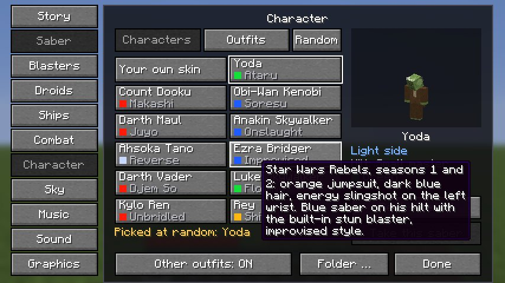 | The random saber, on the saber at once 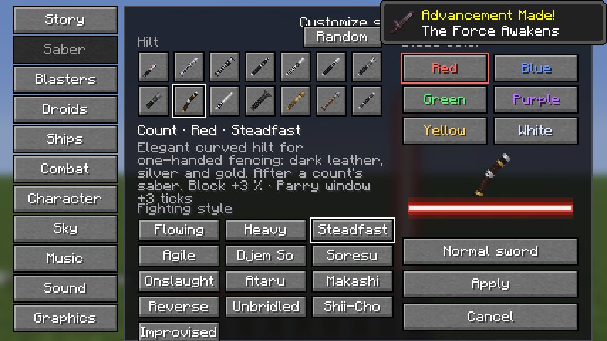 |
| The takedown of the lab's guard from behind 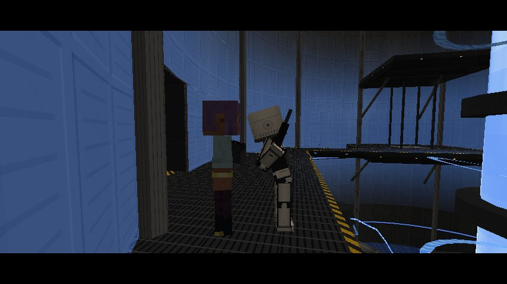 | He stays down (front, by the platform's edge) 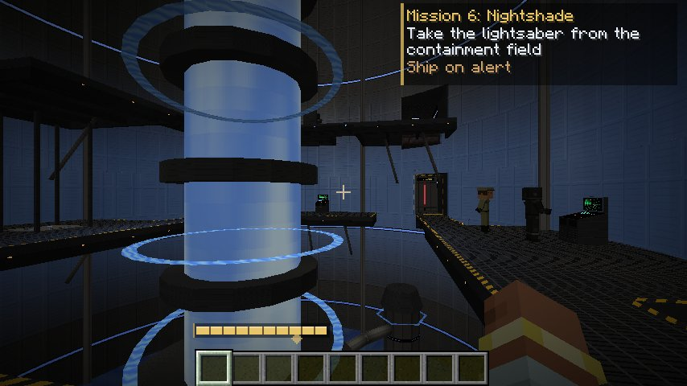 |
| Droids put on the saber's holder have stepped off 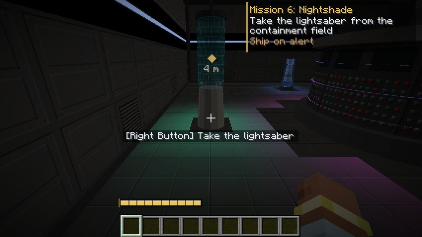 | The lift to the bridge locked in the finale 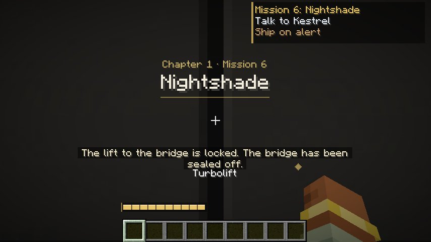 |
| The Falcon waiting under the hangar's field 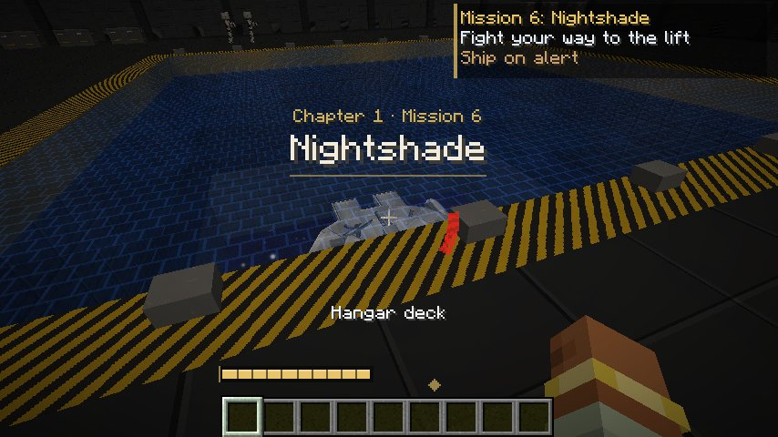 | Looking down through the field 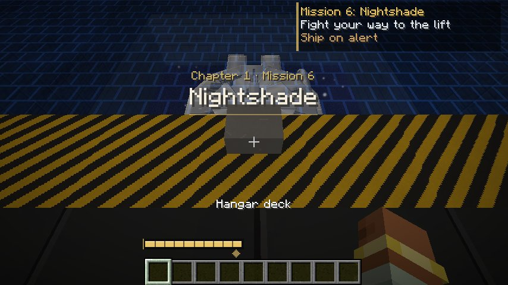 |
| The ring spinning up before her rush 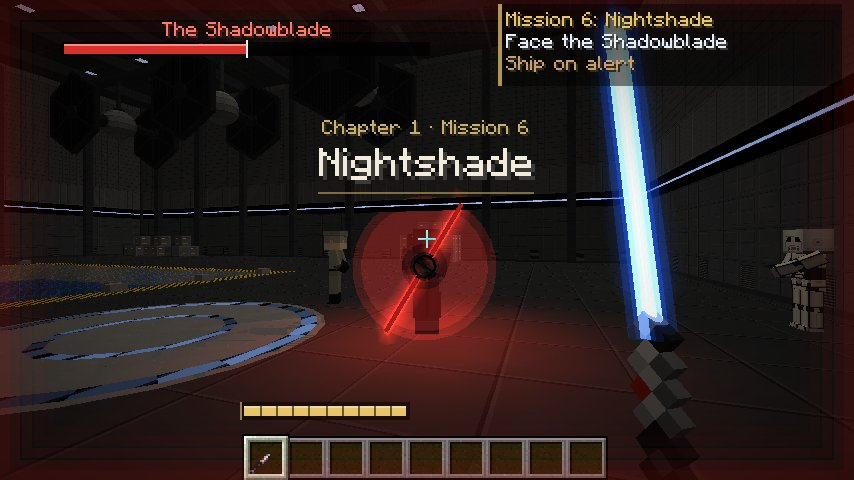 | The rush, close up (the blades a glowing disc) 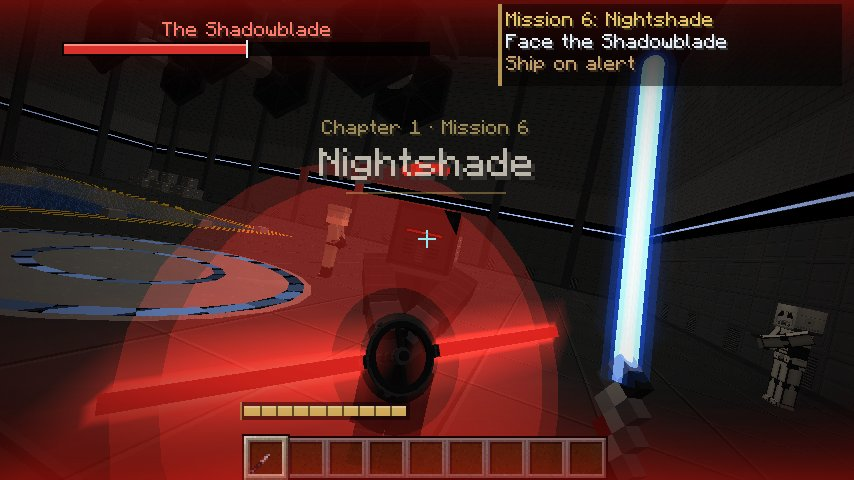 |
| Her last quarter: the ring flares (no text under her bar) 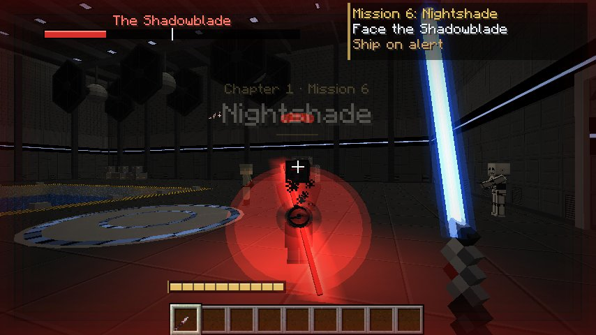 | The 50 % scene, set up after running past her 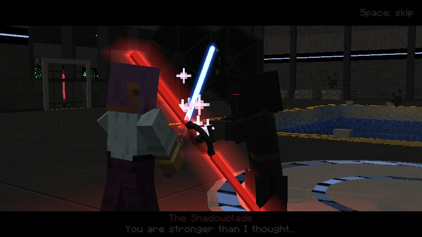 |

## 14. Manuelle Testliste (für Phiro)

Was die automatischen Tests nicht ersetzen können, im echten Spiel mit der JAR aus diesem PR. Am einfachsten über **Story → Kapitel 1** und die Checkpoints; in Klammern, worauf zu achten ist.

**Lüftung, Türen, Gefängnis (Mission 2 bis 5)**

1. Eine Lüftungsklappe aus nächster Nähe mit gehaltener rechter Maustaste schließen (sie bleibt zu; loslassen und erneut drücken öffnet sie).
2. In der Lüftung kriechen und an Deck laufen (leises Blech-Knien bzw. Deckplatten-Schritte statt Steinschritten; nicht aufdringlich, keine hörbare Wiederholung).
3. Patrouillen an automatischen Türen vorbeigehen lassen (Türen öffnen nur, wenn jemand wirklich hindurch will; keine unnötigen Türgeräusche).
4. Die Konsole im mittleren Hauptkorridor (Sicherheitspult) aus mehreren Winkeln ansehen (kein Flackern oben rechts, nichts steckt in der Wand).
5. Zelle: ohne Hinweis auf die Lösung herausfinden, dass M-31 hilft (Droidentaste N); die Sequenz ansehen und anhören (M-31 fährt zum Feldgenerator, werkelt, das Feld flackert und erlischt verzögert).
6. Kestrel nach dem Ausbruch (steht neben dem Lüftungseingang, nicht davor) und beim Ansprechen unterwegs (steht und gestikuliert, sitzt nur auf ihrem Platz).

**Reaktor und Labor (Mission 5 und 6)**

7. Flucht aus dem Reaktor mit Alarm: die Lüftung in der Wartungskammer ist trotz Verfolgung benutzbar, andere Lüftungen nicht.
8. Die Wache am Labor: sie dreht sich zwischen Brücke und Schacht; von vorn bemerkt sie dich, von hinten „Wache ausschalten“ (Film, sie bleibt liegen, auch nach Neuladen).
9. Droiden im Labor neben dem Lichtschwert-Halter herumführen (kein Droide steigt auf den Halter oder andere wichtige Stellen).

**Finale (Mission 6)**

10. Sturmtruppen im Finale (feuern spürbar häufiger, aber nie mehrere gleichzeitig; fair?).
11. Lift zur Brücke im Finale (gesperrt, Meldung und Geräusch; in früheren Missionen fährt er normal).
12. Den Hangar betreten: Falcon unter dem Hangar sichtbar, von Anfang an, ohne Aufploppen; aus mehreren Stellen im Hangar hinuntersehen.
13. Bosskampf: mehr Lebenspunkte, Ausfallstoß aus Distanz, Ring-Ansturm in Phase 2, letztes Viertel härter; keine Texte, die Angriffe ankündigen (auch nicht unter ihrer Lebensleiste); Öffnungen nach Kombos, nach perfektem Block und nach verfehltem Ansturm erkennbar?
14. Ringschwert ansehen (Griff in der Hand, Ring dreht sich mechanisch um den Griff, zwei Klingen, Leuchten und Licht auf dem Boden, nichts steckt im Körper; auch beim Wurf und beim Entwaffnen).
15. Die 50-%-Szene mehrmals auslösen: beim Rennen, beim Schlagen, beim Blocken (immer gleich: beide voreinander, kein Block in der Szene, danach Blick auf sie).
16. Musik: Übergänge vor und im Duell, nach dem Duell, in die Falcon (weich, keine Lücke, nichts bricht abrupt ab).
17. Kestrel im Cockpit der Falcon nach dem Finale (normale Kleidung, keine Rüstung).

**Menüs (außerhalb der Story)**

18. Charaktermenü → „Zufall“ mehrmals, auch schnell hintereinander (sofort übernommen, nie derselbe, mit Lichtschwert in der Hand kommt dessen Schwert mit; auch im Mehrspieler sehen andere den richtigen Charakter).
19. Lichtschwert-Anpassen → „Zufall“ mehrmals (sofort auf das Schwert in der Hand, gültige Kombination, Menü bleibt offen).
20. In der Story: Charakter- und Lichtschwert-Seiten sind gesperrt, „Zufall“ ist dort nicht erreichbar; Musik-Seite geht weiter.

**Allgemein**

21. Ein alter Spielstand aus Phase 25 (in Mission 5 oder 6) weiterspielen (lädt, das Innere wird auf Version 12 umgebaut, wenn niemand an Bord ist).
22. Mit Shaderpack (Iris), falls genutzt: Ringschwert-Leuchten und die Falcon unter dem Hangar.
