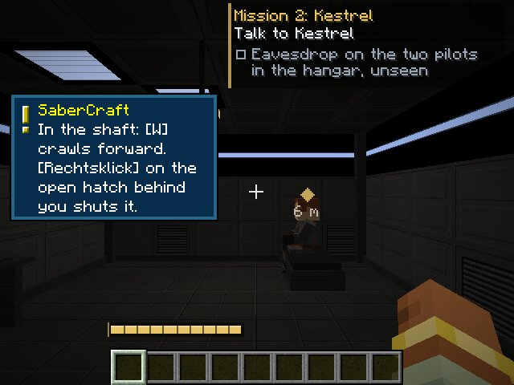
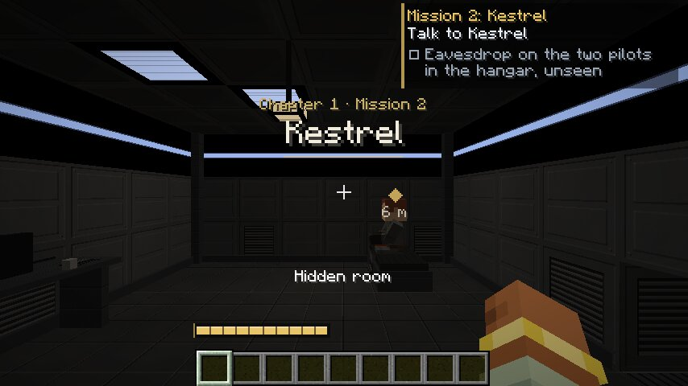
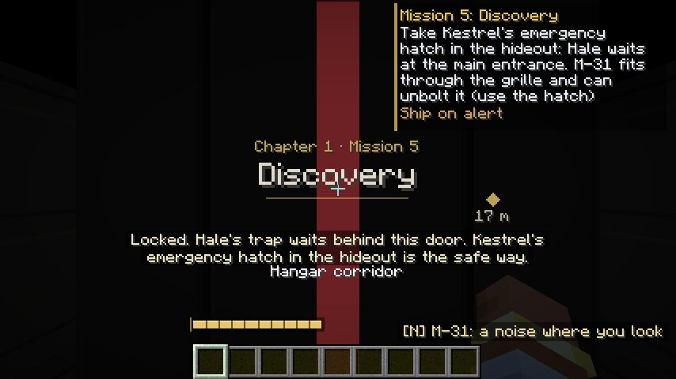
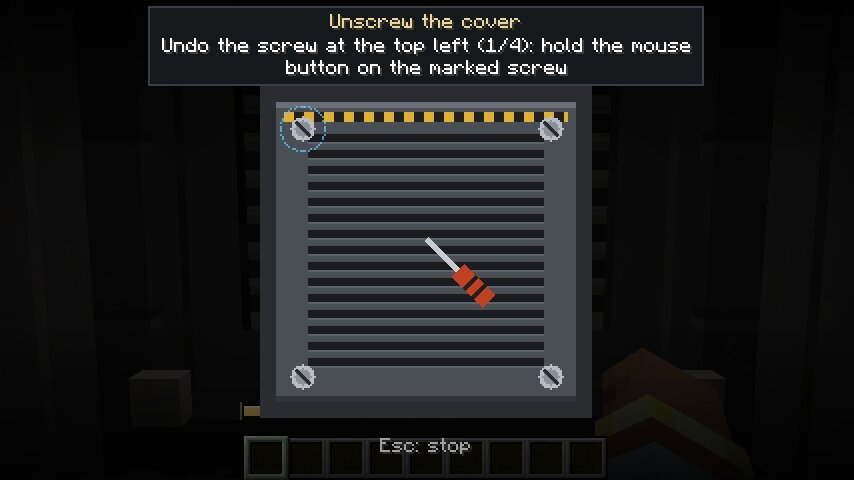
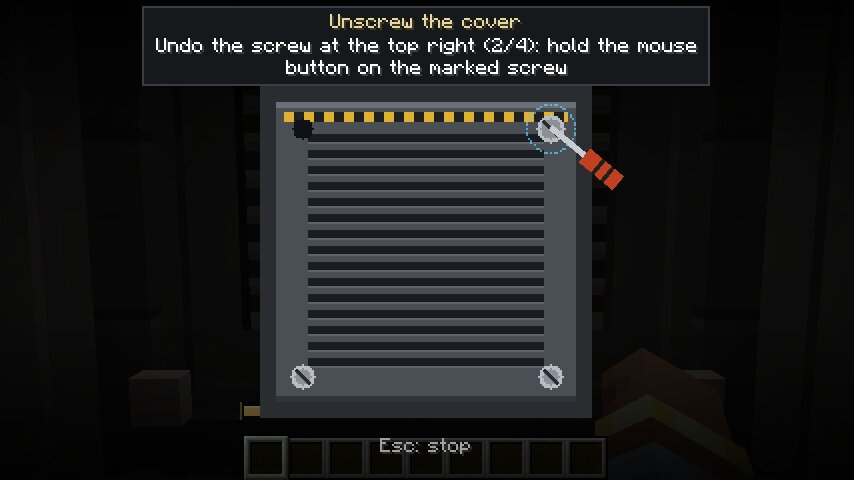
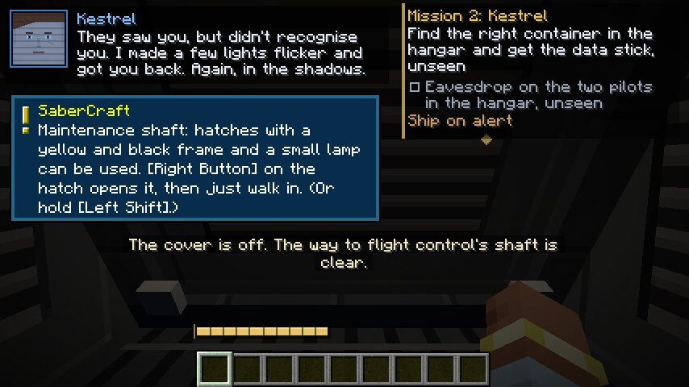
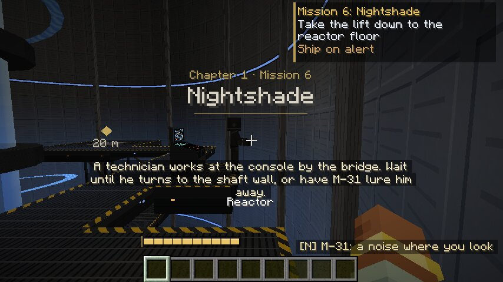
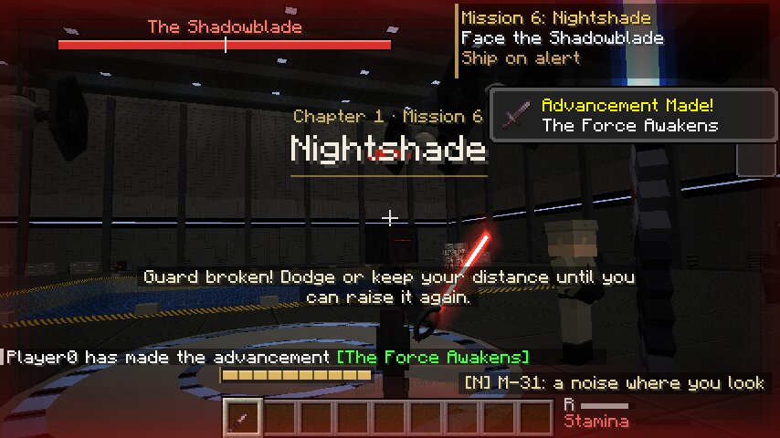
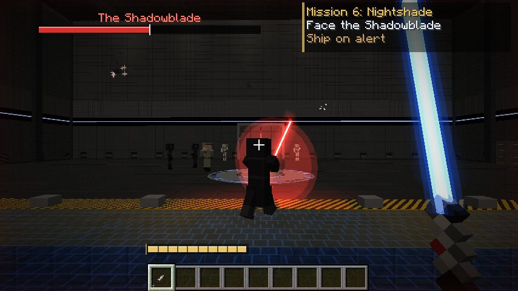
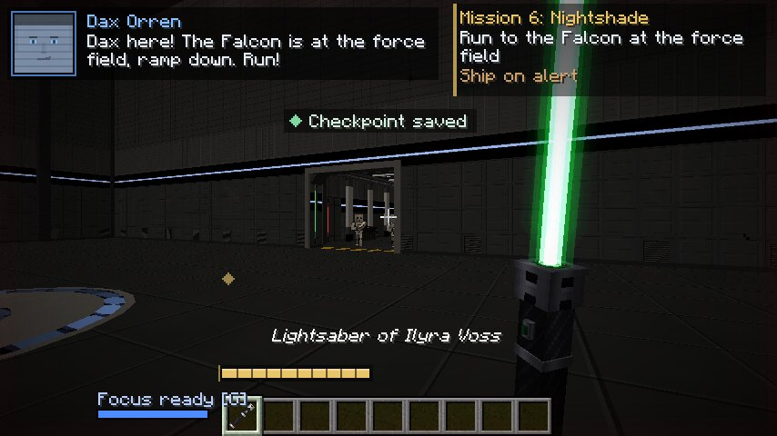

# Phase 28: the last polish of chapter 1 — hints, the detention block without Hale, Mission 2's cover, the reactor, the boss

Built on `main` after Phase 27 (PR #32, merge commit `7ccf514`). No release, nothing merged. Only small, targeted fixes from Phiro's Phase 27 playtest; what already worked stays as it was. As before, the server decides everything from vanilla blocks and entities: **no new blocks, items or entity types are registered**, and no graphics or UI from other games or mods are used (the hint card uses Minecraft's own toast background, everything else is drawn from plain fills and the game's font).

**Saves.** Old stories load as before. The save gets **no new field**; two new marks are kept as ordinary story flags: `item.driver` (the screwdriver taken) and `vent.cover_open` (the cover in Mission 2's side way off). A save from before Phase 28 has neither: the cover is shut and the screwdriver lies in its toolbox. Marks that live only during a scene start with `tmp.` and are never saved, as before.

**The Star Destroyer's interior plan stays at version 13.** The cover and the toolbox are story-only barriers placed in the player's own story ship (like the bridge barrier of Phase 27), not part of the plan, so nothing is rebuilt.

## 1. Hint boxes no longer over the mission panel

The one-time hints (menu key, crawl ways) used Minecraft's toast at the top right, right over the story's mission panel. Now:

- They show on a **card of their own at the left** (same look: Minecraft's toast background, yellow title, white text, ten seconds, sliding in and out). It stands below the comlink line's place (and further down while a comlink line shows), above the hotbar and chat, and its right edge always stays left of the mission panel: on a narrow screen its text wraps narrower instead of reaching under the panel. Several hints come one after another; while a screen, a film or a **mission's title card** shows, the card waits.
- **Minecraft's own toasts** (advancements, recipes, tutorials) and the **status effect icons** at the top right move down below the mission panel while it shows, instead of covering it.
- **The mission's title card** ("Kapitel 1 · Mission 2 / Kestrel") reached under the mission panel on narrow screens; there it now stands just below the panel.
- **"Checkpoint gespeichert"** (top middle) lay under the comlink line's box on narrow screens (found in the test pictures); where it would touch that box or the mission panel it now stands below them.
- **A comlink line during the cover's close-up** (point 4) drew over the close-up's heading; it now waits until the close-up is closed (one already showing goes on afterwards, a new one comes after it).

Checked in the test at screens from 320×240 to 960×540 (GUI pixels) and drawn for real at 854×480 (GUI scale 1 and 2) and 640×480 (GUI scale 2): never over the panel, never off the screen, always at least 100 pixels wide; the checkpoint notice at the same sizes with a two-line comlink line shown: under neither.

## 2. The reactor's small lift

In fights it went up and down by itself: whoever stepped onto it for a moment was carried off. Now (only this lift; the others are as they were):

- It goes only after **standing still on it for 1.5 seconds**. Moving on it (more than a few centimetres a tick) counts the time down again, so fighting or running across it does not start it.
- After a ride it waits **4 seconds** before it goes again.
- As it starts to count, a soft sound and the line "Wartungslift: stillstehen, gleich geht's los …".

Stairs were considered and not built: they would join the two levels for every pursuer and change the escape's balance (the bridge that breaks behind the player).

## 3. The detention block without trusting Hale

Phiro found the main door to the detention block shut for good and the marker on a hatch in Kestrel's hideout that would not open, with nothing saying either was meant so. That is the branch's design (the door is Hale's trap, the hatch is Kestrel's emergency way that M-31 unbolts), but the story did not say it, and the hatch opened only with the droid key. Now:

- **The objective says the way** once the intercept on Kestrel's terminal is read: "Nimm Kestrels Notklappe im Versteck: Hale lauert am Haupteingang. M-31 passt durchs Gitter und kann sie entriegeln (Klappe benutzen)"; once it is unbolted: "Kriech durch Kestrels Schacht zum Arrestblock".
- **The main door** stays shut (it is the trap), and the player at it is told why and where the safe way is.
- **A click on the bolted hatch** sends M-31 through its grille if he is within 14 blocks; 1.7 seconds later it is unbolted (the droid key still works too). Without him near, the hatch says to fetch him.
- **The marker** leads to the terminal, then to the hatch, and in the crawl way on to its end at the detention block (it pointed back at the hatch behind the player).
- **The terminal's intercept** is offered to everyone who did not trust Hale (it needed the refusal of Mission 3 before, so a player who said yes there and no here could not read it and got stuck).

The other choices are unchanged: trusting Hale, the main door opens (his trap, as before). The test plays the branch end to end: objective, door, hint, marker, hatch click without and with M-31, crawl way, its end at R2-V7's step without the trap.

## 4. Mission 2: the side way's cover and the screwdriver

Phase 27's side way from the hangar's west wall made the way in too easy (one could turn right into it and skip flight control). Now:

- **On the way in** the side way is shut at its west end, where it meets the crawl way from flight control, by a **screwed-on cover** (a grille with a fan behind it). From that side: "Eine Abdeckung, von der anderen Seite fest verschraubt." No spoiler.
- **The screwdriver** lies in an open technicians' toolbox (a red box on a pallet, the screwdriver on top) in the hangar, by the containers, east of K-7. A click takes it (a short line, a sound, a journal entry; the box shows its lid open and only a spanner left). It is **kept at once**: a capture, death and the next missions keep it. It is only a story mark: nothing in the inventory, nothing outside the story.
- **On the way back**, from the hangar's side: without the screwdriver "Vier Schrauben halten die Abdeckung. Ohne Werkzeug geht da nichts." With it, a **close-up** opens (the view comes closer, the game keeps running): the plate with four screws, the next one marked; **hold the left mouse button on it** to turn it out (it clicks each quarter turn; Space or Enter work too), in the order top left, top right, bottom right, bottom left. Then the plate tilts away, and in the world it tips down off the opening. Escape or walking off stops; screws already out stay out. The server checks the result again (cover shut, screwdriver kept, player in the side way on the hangar's side, close to it).
- The cover **stays off** (kept at once, like the screwdriver).
- **No softlock:** the way through flight control is always open; the toolbox is there in every mission until the screwdriver is taken. Replaying Mission 2 from the menu begins as the mission began (cover shut, screwdriver in the box, unless it was taken in an earlier mission).
- **Kestrel's radio** about the side way says what fits: that the cover needs a tool and the technicians leave theirs by the containers, that the player has the screwdriver, or only where the hatch is once the cover is off.
- **The marker** in the shut side way leads to the cover with the screwdriver, otherwise back out of the hatch (the way there leads nowhere yet).

## 5. The technician on the reactor's catwalk (last mission)

The worker one must pass on the way down to the reactor stood at his console facing the bridge, the only way to the lift, and heard M-31 only from the bridge itself (then took one step and stood again). Now:

- **He works a round at his post:** about 8.5 seconds at the console (facing the bridge), then 7 seconds turned to the readings on the shaft wall, **his back to the bridge**: one can slip past then. A hint the first time one comes onto the gallery's landing says so.
- **He hears further** (10.5 blocks), so M-31's noise from the gallery's landing reaches him; a lure takes him **off his post a while** (over the walkways if the straight line crosses the open shaft), he searches on past the noise and then goes back to his round.
- A walking patrol of his own was not added: on the one narrow bridge it would only block the way.

## 6. Blocking the boss: strain on the guard

A guard held up took any number of her blows for free. Now each of her blows taken on the guard **costs stamina** (the saber's existing stamina, with its bar by the hotbar; none comes back while the guard is up, also when blocking with the right mouse button):

- **A single block always holds**, from a fresh guard several in a row.
- **Below about a third** of the stamina the guard **shakes** (lower clash, a red flash, pushed back further, no perfect parry any more, a hint once a fight).
- **Out of stamina, the guard breaks:** the blow comes through weakened (60 %), the player is thrown back and slowed a moment, and the guard cannot be raised again for 1.5 to 2.75 seconds (by difficulty). Then it recovers as usual.
- Heavier blows cost more (the second phase's blows, the spin, the ring's rush, the thrown staff); a perfect parry costs little.
- **By difficulty:** a fresh guard holds 9 of her first phase's blows on Leicht, 6 on Normal, 5 on Schwer before it breaks.
- With **stamina turned off** in the SaberCraft settings, blocks stay free (as the settings say).

## 7. The music at the end

After her defeat and through her flight the music stays **tense** (the tense bed from before the duel; it was the triumphant piece). The run to the Falcon keeps the **escape's driving piece**. The **triumphant piece** comes only once the Falcon really escapes (from the jump on); the epilogue in the lounge is calm. All changes crossfade as before.

## 8. The droids during the boss fight

They followed the player round the arena and stood in her films' shots. Now, while the duel lasts, they **wait in the corridor behind the hangar's door**, one by each wall, facing the hangar; one called back is put back there. Once she has fled (the run to the Falcon), they follow again. Back at the duel's checkpoint they wait there again.

## 9. Her saber on the floor

Her struck saber stayed lying where it fell after her flight, and lay there again after a restart. Now it goes **when her flight's film ends**, and nothing of an earlier duel is left on a mission's start, a restart, a death, a load, leaving the story or a skipped film. Other sabers are not touched.

## 10. Her throw

She threw her staff almost never (her push and leap took every chance, and the player was usually too close). Now the throw is a moment of the fight: **once or twice a fight**, in the second phase. When it is due she backs off to throwing distance and throws from there (with the wind-up as before: the staff drawn back, the ring spinning up, heard and seen), the staff flies out and comes back to her hand. In her last quarter a second throw comes soon if one is left. Never more than two.

**Found while testing (not on Phiro's list, but it would have stopped the fight):** when the player was out of her sight round a corner or through a door, she walked straight at the wall between and stood there for the rest of the fight (she never looked for a way round; the troopers do since Phase 23). Now, out of sight or blocked, she comes **the way round** with the troopers' path finding; in sight everything is as before. The test puts her in the passage north of the hangar and the player in the hangar beside its door: she comes to the player in 7 to 8.5 seconds; with the old code she never did (the test was run against both).

## 11. Her ring

The Inquisitor's ring spun up and down with every move. Now it has **a state of its own**: set going by her first ring move of the second phase (the spin, the rush, the throw, her last quarter), it **keeps turning steadily** (at a cruising speed, faster during a ring move) and stops only at a calm moment long after the last ring move (at least 20 seconds), at the blade lock, at her defeat and at a new fight.

## 12. Tests

New: `Phase28GameTest` (in the real game with a client), its parts can be run alone with `PHASE28_ONLY`:

| Point | Part | What it checks |
|---|---|---|
| 1 | `hints` | the card's place at eight screen sizes against the mission panel; the card waits for a mission's title; drawn for real at three window sizes and GUI scales |
| 3 | `refuse` | trusting Hale: his door opens; without: objective, door shut with its hint, marker to the hatch, click without M-31 (fetch him), with M-31 (unbolted), objective on, click opens, marker in the crawl way, its end reaches R2-V7's step without the trap |
| 4 | `cover` | (also: a comlink line waits during the close-up, and goes on after it) the cover shut from the west (hint, no close-up, no way through) and from the east without the tool (hint, no way through, the server refuses); the screwdriver taken with a click (kept at once, journal, box empty), kept through a capture; the close-up with a click, the four screws turned out with the mouse in their order, the cover off and kept, the way free, still off after a capture |
| 4 | `coverAgain` | Mission 2 played again: cover shut, screwdriver back; the marker in the shut side way without and with the screwdriver; twice more round the loop (too far away is refused); Mission 3 with the screwdriver never taken: still in its box |
| 2 | `lift` | moving on the lift for 4 s: no ride; standing still: a ride after 1.5 s; at once onto the other end: not before its pause, then it goes |
| 5 | `catwalk` | his post and hearing, the hint, both looks of his round, not seeing the bridge when turned away, M-31's lure (off his post, how long), back to his round |
| 6 | `strain` | blows on a held guard: the first holds, it shakes, it breaks (not before the fifth); broken it cannot be raised, a blow comes through, it recovers; the client feels it; the difficulties compared |
| 7–11 | `boss` | the droids waiting aside; the ring still in the first phase and the lock; 70 s of her second phase as it comes: her throws (once or twice), the ring on (and turning on the client), she never stands still for long; round a corner she comes the way round; her defeat: the ring stops, the music tense, after her flight no saber on the floor, the escape's music, the droids following again; no saber after a restart |
| 7 | `jump` | before the jump the tense piece, after the Falcon has jumped the triumphant one |

Changed tests: `Phase19GameTest.lifts` waits for the reactor's lift (standing still, its pause); `Phase25GameTest.music` expects the escape's piece on the way to the Falcon; `Phase27GameTest.mission2` takes the side way's cover off before its part (the cover is `Phase28GameTest`'s).

### Results (20 November 2026, local, real game with a client, software rendering)

- **The whole suite: all 46 client test classes in one run (`runClientGameTest`, 76 minutes): green.** That run had the final code except one small change made while it ran (a comlink line waits while the cover's close-up is open); after that change `Phase28GameTest` ran again on its own: green (4 minutes). The change acts only while the close-up is open, and only Phase 28's test opens it.
- `./gradlew build gametestClasses` (as in CI): green.
- **Measured** in `Phase28GameTest`:
  - Reactor lift: up after standing still 29 ticks (1.5 s); at once onto the other end it went again only 105 ticks later (its 4 s pause, then standing still).
  - Catwalk technician: at his console he notices the player on the bridge, turned to the shaft wall not at all; M-31's lure takes him 6.5 blocks off his post within 5 s (8.6 at most), for 17 s, then he goes back to his round.
  - Guard on Normal, blow after blow from a fresh guard: held, held, held, held, shaking, shaking, broken. Blows a fresh guard holds before it breaks: Leicht 9, Normal 6, Schwer 5.
  - 70 s of her second phase with a player only standing there (put back near her every 10 s): **2 throws** (at 12 and 26 s; in the other runs 8/23, 9/22, 13/27 s), never a third; her ring on in every sample (122 of 122), never off, turning on the client in 121 of 121; she never stood still longer than 2.5 s; round the corner she came to the player in 7 to 8.5 s.
- **Found and fixed while testing** (not on the list): the boss standing at a wall when the player was round a corner (section 10); "Checkpoint gespeichert" under the comlink line's box, and a comlink line over the cover's close-up (section 1). Both seen in the test's pictures and checked in the test since.
- **Not tested:** by hand in the game (nobody played it; that is the manual list below); on a dedicated server; with Iris and a shader pack; on a real graphics card (software rendering only); the music by ear (the test checks which piece plays, not how it sounds); two players at once.
- **CI** runs on the pull request; its result is in the PR, not here.

## 13. CI

Unchanged from Phase 25 (test step 95 minutes, job 110 minutes, `docs/ci.md`).

## 14. Manuelle Testliste (für Phiro)

Was die automatischen Tests nicht ersetzen können, im echten Spiel mit der JAR aus diesem PR. Am einfachsten über **Story → Kapitel 1** und die Checkpoints; in Klammern, worauf zu achten ist.

**Hinweise und HUD**

1. Neue Welt: der Hinweis zum Menü erscheint links als eigene Karte, nicht über dem Missionspanel oben rechts. In einer Lüftung der Kriech-Hinweis ebenso. Mit verschiedenen Fenstergrößen und GUI-Skalierungen ausprobieren (Karte immer lesbar, nie unter dem Panel, nie über Hotbar oder Chat).
2. Eine Errungenschaft oder ein Rezept-Toast während der Story: erscheint unter dem Missionspanel. Statuseffekte (z. B. Langsamkeit) ebenso.
3. Missionsstart bei kleinem Fenster: der Missionstitel steht unter dem Panel, eine Hinweiskarte wartet, bis der Titel weg ist. „Checkpoint gespeichert“ liegt nie unter einem Funkspruch oder dem Panel.

**Mission 2 (Abdeckung und Schraubendreher)**

4. Auf dem Hinweg in der Lüftung von der Flugleitung: rechts die verschraubte Abdeckung (Gitter, Lüfter dahinter); Rechtsklick sagt nur „von der anderen Seite verschraubt“, kein Durchkommen.
5. Werkzeugkasten bei den Containern (östlich von K-7): Rechtsklick nimmt den Schraubendreher (Zeile, Geräusch, Tagebuch); der Kasten ist danach offen und leer. Danach gefangen werden: der Schraubendreher bleibt.
6. Rückweg durch die Luke in der Hangar-Westwand: an der Abdeckung ohne Werkzeug Hinweis „Ohne Werkzeug geht da nichts“; mit Werkzeug die Nahansicht: Maustaste auf der markierten Schraube gedrückt halten, vier Schrauben in der Reihenfolge oben links, oben rechts, unten rechts, unten links; danach kippt die Abdeckung weg (auch in der Welt sichtbar), der Weg ist frei. Esc oder Weggehen bricht ab, gelöste Schrauben bleiben gelöst. Ein Funkspruch während der Nahansicht wartet und kommt danach.
7. Danach gefangen werden oder Mission 3 beginnen: die Abdeckung bleibt offen. Mission 2 neu spielen: wieder zu, Schraubendreher wieder im Kasten.
8. Kestrels Funkspruch nach dem Datenstick passt zum Stand (Werkzeug fehlt / Werkzeug dabei / Abdeckung schon offen).

**Mission 5 (Arrestblock ohne Hale)**

9. Hale nicht vertrauen, am Terminal den abgefangenen Funkspruch lesen: das Ziel nennt Kestrels Notklappe und M-31. An der Haupttür zum Arrestblock: Hinweis, warum sie zu bleibt.
10. Notklappe im Versteck anklicken: ohne M-31 in der Nähe „Hol ihn her“, mit M-31 zwängt er sich durchs Gitter und entriegelt sie nach kurzer Zeit; Wegpunkt im Schacht führt zum Arrestblock.
11. Gegenprobe: Hale vertrauen, die Haupttür geht auf (seine Falle, wie bisher).

**Mission 6 (Reaktor und Boss)**

12. Reaktorlift im Kampf: kurz drauftreten oder darüber laufen löst ihn nicht aus; stillstehen fährt nach etwa 1,5 s; direkt danach nicht sofort wieder.
13. Techniker am Laufsteg: dreht sich regelmäßig zur Schachtwand (Rücken zur Brücke), dann kommt man vorbei; mit M-31 vom Galerie-Absatz ablenken: er geht weg, sucht, kommt nach einer Weile zurück.
14. Bosskampf: Dauerblocken hält nicht ewig (Ausdauerbalken, Wanken, dann Deckung durchbrochen); einzelne Blocks halten zuverlässig; auf Leicht/Normal/Schwer vergleichen.
15. Sie wirft ihren Stab ein- bis zweimal pro Kampf (mit Ausholen, ausweichen oder blocken möglich), nicht öfter. Hinter einer Ecke oder Tür verstecken: sie kommt außen herum, statt an der Wand stehen zu bleiben.
16. Ihr Ring dreht sich in Phase 2 dauerhaft gleichmäßig, kein ständiges An und Aus; steht beim Klingen-Patt und nach ihrer Niederlage.
17. M-31 und R2-V7 warten während des Kampfes im Gang hinter der Hangartür, nicht in der Arena oder in den Filmszenen; danach folgen sie wieder.
18. Nach ihrer Flucht liegt kein Lichtschwert mehr am Boden, auch nicht nach Neustart, Tod oder Laden.
19. Musik: nach ihrer Niederlage und während ihrer Flucht weiter angespannt, auf dem Weg zur Falcon die Fluchtmusik, erst beim Sprung der Falcon der Triumph; weiche Übergänge.

**Allgemein**

20. Alter Spielstand aus Phase 27 weiterspielen (lädt; Abdeckung zu, Schraubendreher im Kasten).
21. Mehrspieler: jeder Spieler hat seinen eigenen Fortschritt, Schraubendreher und seine eigene Abdeckung.

## 15. Pictures

All from the test client (software rendering, 854×480 unless said, no shader pack): [`docs/images/phase28`](../images/phase28).

| | |
|---|---|
| The hint card at the left, clear of the mission panel (640×480, GUI scale 2)  | A mission's title on a narrow screen: below the panel  |
| Mission 5 without Hale: the detention block's main door stays shut and says why; the objective names Kestrel's hatch  | Mission 2: the cover's close-up, the first screw marked  |
| Turning out the second screw  | The cover off; the comlink line that waited comes now  |
| The reactor's catwalk: the technician at his console, the hint  | The guard broken in the boss fight (the advancement toast below the mission panel)  |
| Her ring turning in the second phase  | After her flight: no saber on the floor; "Checkpoint gespeichert" below the comlink line  |
