# Phase 20: "Nachtschatten" reworked after the first playtest

Branch `claude/phase-20-story`, built on Phase 19 (the head of PR #24, 4082404, tested and green, not yet merged into `main` when this was written). The pull request goes against PR #24's branch, so it shows only what Phase 20 changes. No release, nothing merged.

Phiro played chapter 1 (the way trusting Hale) and wrote down nine points. Each is listed below with what was done. The six missions, the plot and both of Hale's ways are kept; nothing was taken out, only reworked.

As before: the server decides everything, from vanilla blocks and entities. **No new blocks, items or entity types are registered.** The three new sounds (a crate lid, a door lock, a siren) are synthesised by `tools/synth_sounds.py`, like the others.

## 1. Out of hyperspace: a film of the arrival

Before, the Falcon came out of the tunnel of light and the player stood at the ramp. Now a short film plays (23 seconds, skippable after one second with Space, Enter or Esc):

1. **Out of hyperspace:** a white flash, the Falcon stretched out of the jump, the Tenebris ahead, small at first.
2. **Under the hull:** the camera low beside the Falcon as it dives under the Star Destroyer's flank; the title "TENEBRIS – Imperial Star Destroyer". Dax: "There she is. The Tenebris. A mile of bad temper."
3. **Along the flank:** the Falcon, tiny against the wall of the hull (the Star Destroyer is drawn at four times its normal size here, about 300 blocks long, so its size can be felt), banks and turns towards the airlock. Mira: "We're in their sensor shadow. Under the edge, Dax, the airlock's right there." Dax: "I see it. Rorrak, clamps out!"
4. **Docking:** close up from below, the Falcon slides in at the airlock, the docking collar extends, steam, the light turns green. Dax: "Docked. Like a mynock. Told you."

Then the camera is back with the player at the ramp, as before. The film is drawn by the client far away from both ships (in the interiors dimension, between plots), with letterbox bars, subtitles with the speaker's name in both languages, its own music and engine sounds; the HUD is hidden while it plays. Skipping tells the server, and the story goes on at once.

## 2. Less pure stealth, more variety

The missions stay the same; inside them there are now more ways to deal with a situation than hiding:

- **Mission 1:** the guard stands right in front of Kestrel's hatch; M-31's noise lures him a few steps away (see 8).
- **Mission 2:** at the dead drop, a wrong container is only freight, and its lid clatters (those near turn to look).
- **Mission 3:** the security desk can page the quartermaster away to the freight at the hangar's crates; or Hale sends him out himself (see 5).
- **Mission 4:** in armour on the reactor floor, an officer who grows suspicious calls the player over and asks questions. The right answer: he is satisfied and goes back to his round. A wrong one: he runs for the wall comm (see 3).
- **Being seen no longer means a long restart:** captures go back to the last checkpoint, and there are now checkpoints at safe places within the missions (see 4).

## 3. Detection, alarm and pursuit that make sense

- **Everyone finds their way round walls.** Chasers follow the player along a path (found anew every half second), not in a straight line into a wall. Someone getting no nearer for three seconds gives up that way. Searchers go to several places near where they lost the player.
- **Soldiers and the rest act differently.** A trooper who sees the player shouts, gives chase and has the alarm raised over his comlink. Anyone else (officers, technicians) calls out and runs to the nearest **wall comm** to raise the alarm there.
- **Reinforcements come from somewhere:** after an alarm two troopers come out of a door (or down the lift), run to where the player was seen, and go back out of their door once it is calm. Nobody appears or vanishes out of thin air.
- **The reactor's staff stay.** The technician on the reactor floor no longer vanishes when the alarm goes up.
- **Stages:** calm, suspicious, alerted, detected (chase), searching, then "ship on alert": calm again, but the crew of this mission stays **wary** (they see a little further) until the mission ends. The siren only sounds while they are after the player.
- **The emergency lights now have a reason:** the copy of the reactor data at the end of Mission 4 sets off the reactor's safety shutdown (the intercom says so as Mission 5 begins). From then until the saber is taken, the ship runs on emergency lights (dim, warm, red lamps, fading in and out). In them one is seen less far. When the alarm goes up, the main lights come back on ("they want to see whom they shoot at"), red and pulsing.

## 4. Checkpoints with the whole state

- **A checkpoint is the whole state at one moment:** mission and step, everything known and done, the journal, the droids, which doors are open. It is saved when the step begins and at **safe places** reached during a step: the maintenance room's corner by the crates, the armory once its master is gone, the crawl way at the detention block's hatch, the hideout, the detention corridor behind its guard.
- **After a capture** exactly that state comes back: the player at the checkpoint's safe place (free to stand, nobody watching), the hatches of the story's ships shut, the droids next to the player. What was done since is undone, nothing more.
- **Leaving the story** while all is calm keeps how far one got (at the step's safe place); in a chase the last checkpoint stays.
- **Old saves:** a save of Phase 19 holds the step's number only. Phase 20 saves the step's id; a file of Phase 19 is read by number and mapped to the right step (two steps are played a little differently now). The test continues files of Phase 19 at several points.

## 5. Hale's first talk is private

Hale comes into the armory; if the quartermaster is still there, Hale sends him out first and bolts the door while he talks. The test checks that nobody else is in the armory during the talk. Both of Hale's ways (trust him, refuse him) still work and are played through by the test.

## 6. The crawl ways and their hatches

- **Tight:** shut, the grille and a plate behind it fill the whole opening and the frame is drawn from all sides; nothing shows through at the edges, from the room or from the crawl way.
- **Reliable:** the use key on an open hatch shuts it again (from either side). By itself a hatch only shuts when nobody (no player, no droid) is in its opening: before, it could shut on M-31.
- **M-31 neither blocks nor pushes:** droids and players no longer push each other. In a crawl way one crawls past M-31 instead of shoving it ahead, and a droid never nudges its owner aside.
- At a checkpoint all hatches of the story's ships are shut, none stays open behind the player.

## 7. The detention block

- **The cell escape works however often one is caught.** The cause: the checkpoint in the cell was made before Hale's trap had run; after a capture the trap's state was reset but the trap did not run again, and M-31's special action fell back to a plain noise. The trap now runs whenever one walks into it, and the checkpoint is made once Hale and his trooper are out.
- **No droid in the cell:** M-31 waits outside by the bench, never in the cell, however often one was caught.
- **Fewer guards:** one guard at the entrance, watching the door.
- After a while in the cell, a hint says how to get out.

## 8. M-31's distraction, explained

- The journal tells what each droid can do (also for files from before).
- When M-31 makes its noise, a mark shows where, and a message says who went to see.
- Near guards, a tip shows how to lure them (until M-31 has been used a few times).
- In Mission 1, M-31 "rattled loose behind the crates" is what the trooper heard, so the first meeting explains the noise.

## 9. The reactor: the technician and the way to the lab

- **The technician on the catwalk** stood at the bare railing, looking at nothing. He now works at a console against the railing (it collides as drawn; nobody climbs onto it).
- **The way to the lab:** the shaft's round wall was drawn across the way to the lab's door, while the server left the way open: one walked through a wall that looked closed to find the door. A rib of the wall also stood in the doorway (solid too), and the wall's low light band ran across it. Now the wall and its band are open at the doorway, the way is lined, and the rib stands beside it.
- **The lab door** is plain to see: a lit frame round it, hazard stripes on the threshold, and a lamp over it (red and pulsing while locked, green once open).
- The test walks the way to the door and checks that the wall beside it is closed (11 points behind the drawn wall: all solid).

Other visual problems of the ships are left for the later visual-fix phase, as agreed.

## 10. Tests

Run locally in the cloud container (software rendering, one test client), 2026-11-16/17. GitHub Actions runs on the pull request; see there.

**The whole suite** (38 classes in `fabric.mod.json`, `Phase20GameTest` new, before `StoryGameTest`):

- **Run 1, the whole suite:** the first 35 classes (`BladeScreenshotGameTest` to `Phase18GameTest`) green, 1 965 checks logged; the Falcon walk audit as before (183 744 places walked, 0 in a wall, 38 invisible stops). Then `Phase19GameTest` failed one check: it walks up to the catwalk's railing exactly where the technician's new console stands now. The check now walks up a block east of the console (0.08 blocks to spare, it must be under 0.2). The run stopped there (46 minutes).
- **Run 2, the rest:** `Phase19GameTest` and `Phase20GameTest` green; `StoryGameTest` green except one check that read the film's camera in the very tick the film began, before a frame was drawn (2 blocks from the player instead of hundreds). The check now waits two ticks; it had passed in the run before.
- **Run 3:** `StoryGameTest` green.
- **Run 4, after the last change (two HUD overlaps seen on the pictures, see below):** `Phase20GameTest` and `StoryGameTest`: both green (87 dialog lines, 7 captures, the film drawn 1 176 frames and skipped), and the pictures show both overlaps gone.
- The whole suite takes about 54 minutes here (46 + 8); CI's test step limit is raised from 60 to 75 minutes (PR #24's run already took 50.6 of the 60).

**`StoryGameTest`** plays the chapter through twice, as in Phase 19, and now also:

- **The film:** after the jump the film starts, the camera is far out in the film's scene, the HUD is hidden, the film's music plays, its scene is drawn (about 1 000 frames), it ends, the HUD is back and the camera is at the player's eyes again; begun once more and skipped with Space: the story goes on at once at the ramp.
- **Checkpoints:** a capture is forced at four places of both ways (Mission 1 by the crates, the dead drop, the escape in Mission 5, the crawl way in Mission 5). Each time: back at the checkpoint, exactly what it kept is known (compared flag by flag), the place is free to stand on, the hatches shut, the droids with the player, nobody sees the player there in the first seconds. 7 captures in the first way.
- **The cell:** caught again and again out of Hale's cell: each time back in the cell, its field on, M-31 outside by the bench (never in the cell), and the way out works every time.
- **Chase and alarm:** in Mission 4 an officer who sees the player runs to the wall comm by the lift; two troopers come down the lift and run round the core to the player; when it is calm they go back up.
- **M-31's lure in Mission 1:** the guard in front of Kestrel's hatch keeps it shut; M-31's noise beside him sends him to look (mark and message shown), and the hatch is free.
- **Hale private:** in Hale's talk nobody else is in the armory, on both ways (quartermaster paged away / sent out by Hale).
- **Variety:** the wrong container in Mission 2 is only freight; the security desk pages the quartermaster away; on the other way he stays until Hale sends him.
- **Old saves:** files as Phase 19 wrote them (mission and step by number) continued at Mission 1 and Mission 5 land on the right steps; then left again.
- **Both languages:** all 357 dialog and story keys exist in German and English, the same dialog switches language.
- 87 dialog lines on the first way, both of Hale's ways to the end.

**`Phase20GameTest`** (new, about 1.5 minutes):

- **The film's shots:** twelve stills over the film (the camera far out, the HUD hidden, back to the player at the end).
- **The way to the lab:** walked from the shaft floor to the door with room for the whole body all the way; 11 points just behind the drawn wall beside it, all solid; the catwalk console collides; pictures of the way, the door and the console.
- **A crawl way both ways:** the hatch opened with the use key from the corridor; crawled in; M-31 put right where the player is: the player is not pushed (under 0.1 blocks in two seconds), M-31 is not pushed, the player crawls on past it; M-31 in the hatch's opening for eleven seconds, the player further in: the hatch stays open; looking back from inside, the use key shuts it, a second press opens it again; out into the corridor, standing; nobody near: the hatch shuts by itself.

**Found on the pictures and fixed:** with a large interface, the stage under the suspicion eye ("Suspicious") was drawn over a hint of several lines (the M-31 tip in Mission 1); it now moves above the crosshair when a hint reaches up to it. The finished copy's progress bar stood under Mission 5's title card for a moment; it now waits until the title is gone.

## 11. Pictures and the film

All from the test client (software rendering, 854×480): [`docs/images/phase20`](images/phase20).

The film of the arrival, as the story test saw it (frames about a third of a second apart, real time; MP4 beside it): 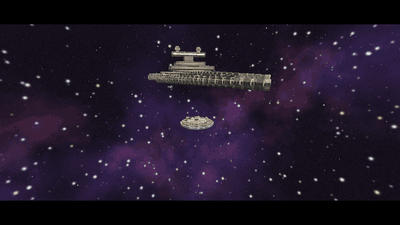

| | |
|---|---|
| Out of hyperspace 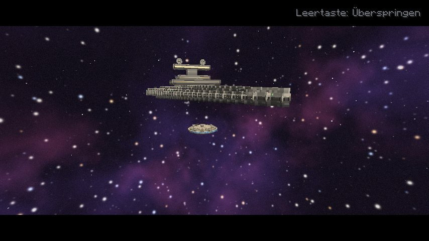 | Under the hull, the title 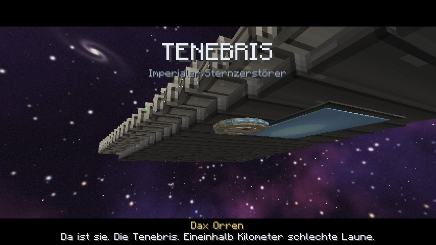 |
| Along the flank 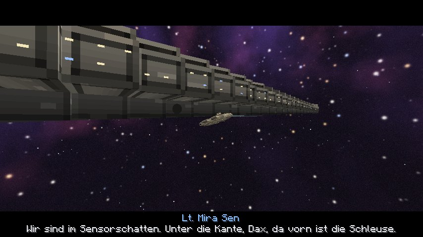 | Docked 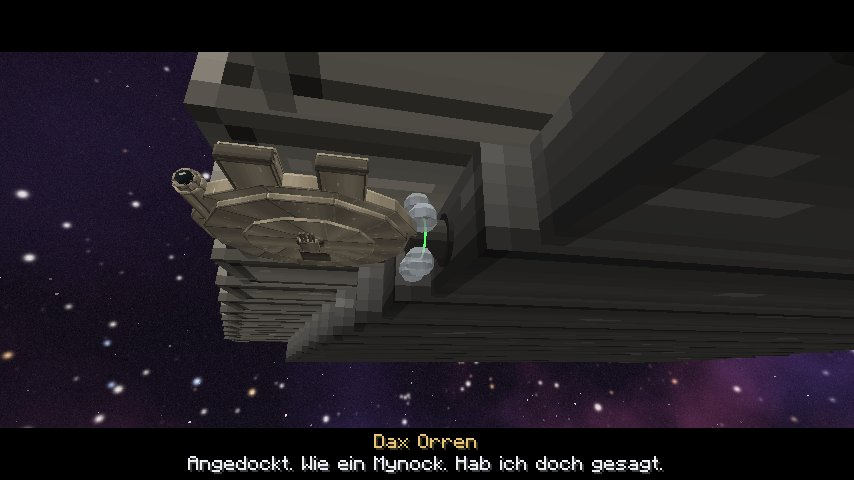 |
| Mission 1: luring the guard from the hatch 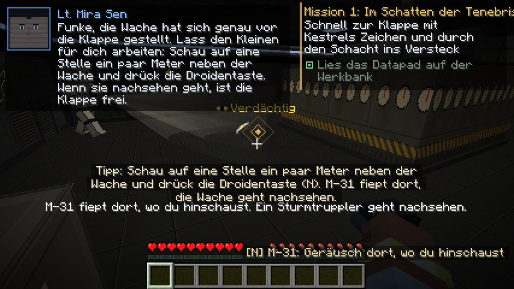 | Hale alone with the player, the door bolted 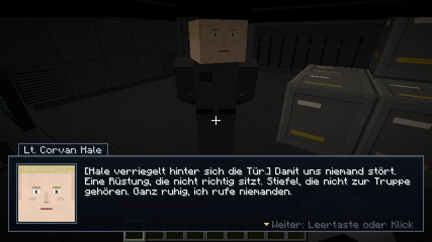 |
| Mission 4: the officer called it in 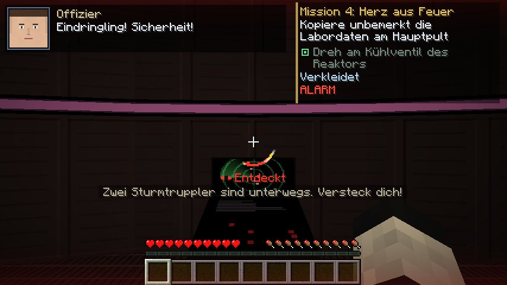 | Mission 5: the emergency lights 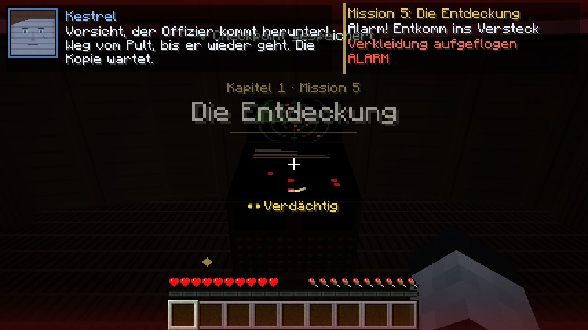 |
| The way to the lab 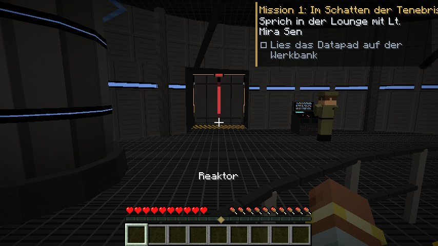 | The lab door, locked 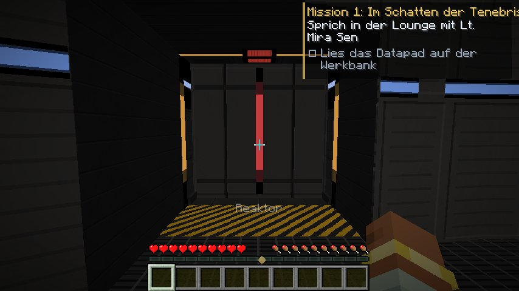 |
| The technician's console on the catwalk 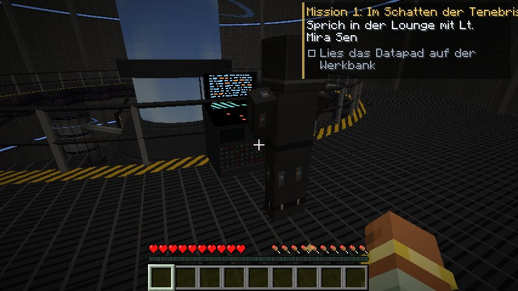 | A hatch, shut 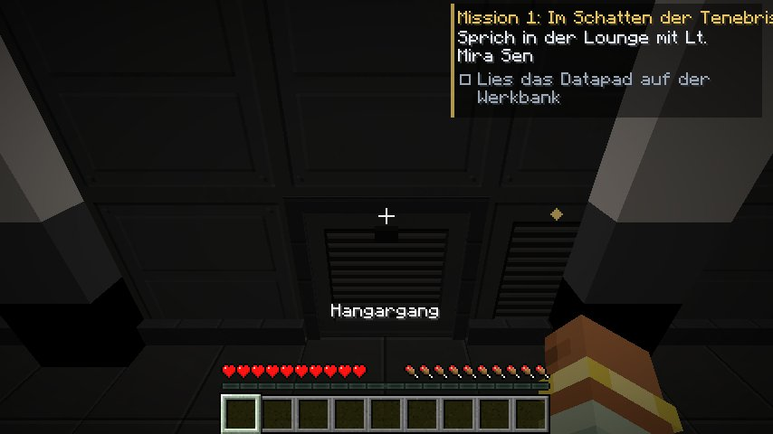 |
| The hatch, open 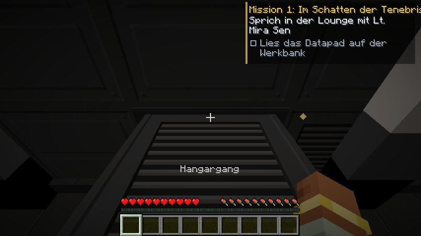 | Shut, seen from the crawl way 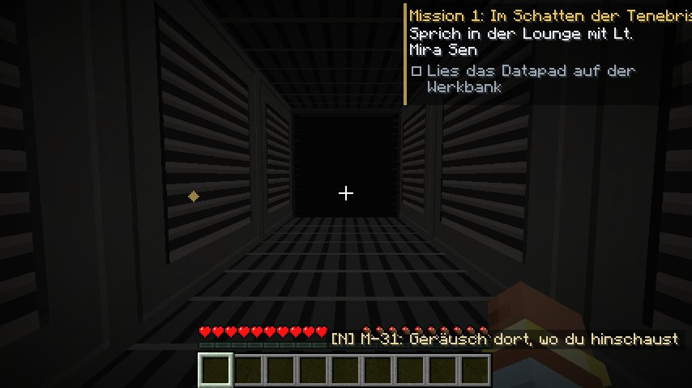 |

## 12. Not tested, limitations

- **Played by script only.** The whole chapter, the film and the new chases have been played by the test client, not by a human. How hard the stealth is, how fast the wary crew sees, how long the film feels and how the chase feels are tuned by reasoning and by the test; expect to adjust them after playing.
- **The film** was checked through stills and the test's frames in software rendering (854×480). Not seen on a real graphics card, in other resolutions, with shader packs or with very short render distances.
- **A small overlap left:** when a checkpoint is saved while someone speaks over the comlink, the short "Checkpoint saved" line at the top is partly under the speaker's box (seen at the start of Mission 5). Left for the visual-fix phase.
- **Not covered by a test check:** the officer's questions to the player in armour in Mission 4 (the right and the wrong answer), and that those near turn to look when the wrong container's lid clatters. Both are written and run in the game, but no check looks at them.
- **Multiplayer:** each player has their own story; two players in their own stories at once, a dedicated server with real players and a vanilla client joining are not tested.
- **Old saves:** files of Phase 19 written by the test (by mission and step number) are continued correctly; a real save from Phiro's own playtest has not been tried.
