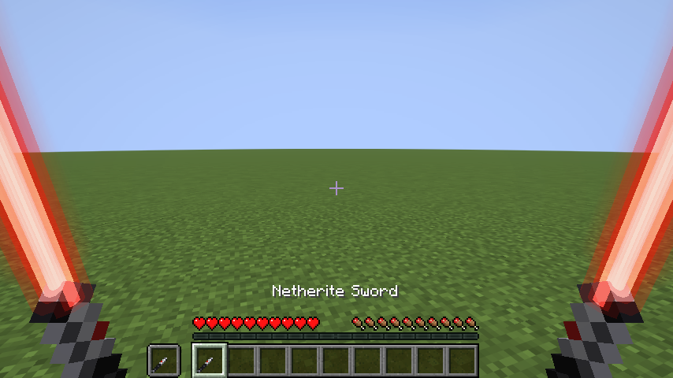
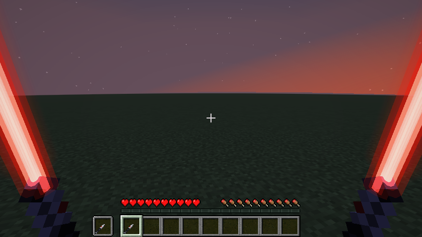
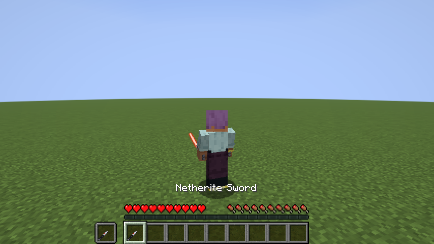
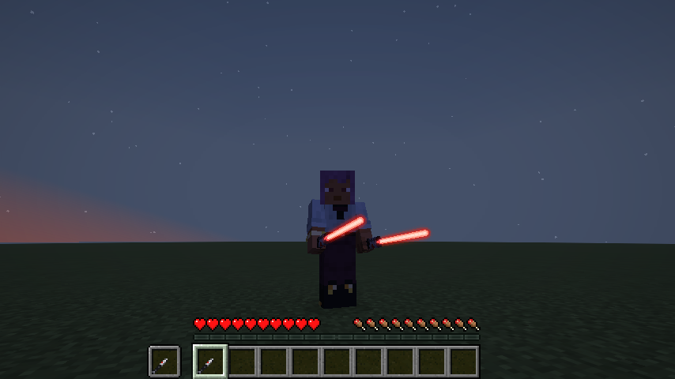

# Phase 3: Rote Lichtschwertklinge

Stand: 24.10.2026, Minecraft 26.2, Fabric Loader 0.19.5, Fabric API 0.161.0+26.2, Java 25.

## Ergebnis

Hält der Spieler ein Netherite-Schwert in der Hand, sieht er statt der normalen Klinge einen Metallgriff mit einer roten Energieklinge. Die Klinge hat einen fast weißen, unbeleuchteten Kern, einen hellen Bloom direkt am Kern und einen roten Schein, der nach außen weich ausläuft. Sie leuchtet auch in völliger Dunkelheit und flimmert ganz leicht. Im Inventar, auf dem Boden, im Rahmen und im Regal ist nur der Griff zu sehen, also ein ausgeschaltetes Lichtschwert.

| Ego-Perspektive, Tag | Ego-Perspektive, Nacht |
| --- | --- |
|  |  |

| Third Person, Tag | Third Person, Nacht |
| --- | --- |
|  |  |

Die Bilder stammen aus dem automatischen Client-Test (Software-Rendering ohne Kantenglättung). Auf einer echten Grafikkarte sehen die Kanten glatter aus.

## Was implementiert ist und erfolgreich kompiliert

| Funktion | Kompiliert | Im Spiel geprüft |
| --- | --- | --- |
| Rote Klinge mit weißem Kern, Bloom und weichem Farbschein | ja | ja, per Screenshot |
| Korrekte Darstellung in der Ego-Perspektive (rechte und linke Hand) | ja | ja, per Screenshot und Test |
| Korrekte Darstellung in Third Person (vorne und hinten) | ja | ja, per Screenshot und Test |
| Leuchtet unabhängig vom Licht (auch nachts voll hell) | ja | ja, per Screenshot |
| Leichtes Flimmern der Helligkeit | ja | nein, auf Standbildern nicht sichtbar |
| Eigene Griff-Textur (16x16) für Inventar und Hand | ja | ja, per Screenshot |
| Modulare Klingenstile (`BladeStyle`, `BladeStyles`) | ja | ja, rot ist als Stil registriert |
| Klinge per Item-Modell-JSON einsetzbar (`sabercraft:saber_blade`, mit `style`, optional `emitter` und `length`) | ja | ja, das Netherite-Schwert nutzt es |
| Automatischer Client-Test mit Screenshots (`runClientGameTest`) | ja | ja, läuft durch |

## Technische Umsetzung (geprüft gegen den dekompilierten Code von 26.2)

- **Item-Modell statt Mixin:** Minecraft 26.2 beschreibt Items über Dateien in `assets/<namespace>/items/`. Die Mod ersetzt `minecraft:netherite_sword` mit einem `minecraft:select` auf den Anzeigekontext. In der Hand ist es ein `minecraft:composite` aus Griffmodell und einem `minecraft:special`-Modell mit unserem Renderer. Dadurch folgt die Klinge automatisch allen Item-Transformationen: rechte und linke Hand, Ego und Third Person, Rüstungsständer, Mobs.
- **Renderer-Registrierung:** `SpecialModelRenderers.ID_MAPPER` ist durch die Fabric API öffentlich. Dort wird `sabercraft:saber_blade` beim Client-Start eingetragen.
- **Zeichnen mit dem neuen Submit-System:** Die Klinge wird über `SubmitNodeCollector.submitCustomGeometry` abgegeben, die 26.2-Nachfolge von `MultiBufferSource`.
- **Eigene Render-Pipelines** über `RenderPipeline.builder(RenderPipelines.DEBUG_FILLED_SNIPPET)` mit dem Shader `core/position_color` (kein Licht, keine Textur):
  - Kern: deckend, schreibt Tiefe.
  - Bloom: additiv (`BlendFunction.LIGHTNING`), schreibt keine Tiefe.
  - Schein: transparent (`BlendFunction.TRANSLUCENT`), damit Rot auch vor hellem Hintergrund rot bleibt. Additives Rot würde auf Gras gelb wirken.
  - Tiefentest `GREATER_THAN_OR_EQUAL`, weil 26.2 einen umgekehrten Tiefenpuffer nutzt.
- **Weicher Schein:** acht gekreuzte Flächen um die Klingenachse mit Farbverlauf zum Rand hin. Aus jedem Blickwinkel zeigen einige davon zur Kamera, das wirkt wie ein weiches Leuchten. Am Emitter und an der Spitze blendet der Schein sanft aus.

## Neue Farbe hinzufügen

In `BladeStyles.java` eine Zeile ergänzen, zum Beispiel:

```java
public static final BladeStyle BLUE = register(BladeStyle.of(SaberCraft.id("blue"), 0xEEF6FF, 0x1A5CFF));
```

Danach im Item-Modell `"style": "sabercraft:blue"` verwenden. Länge, Dicke, Leuchtstärke und Flimmern lassen sich pro Stil einstellen.

## Was noch fehlt (nächste Phasen)

- Ein- und Ausfahranimation. Die Klinge ist im Moment immer voll ausgefahren, sobald das Schwert in der Hand ist.
- Sounds: Zünden, Summen, Schwung, Treffer.
- Weitere Farben und Griffmodelle (blau, grün, Charakter-Varianten) und eine Möglichkeit, sie im Spiel auszuwählen. Im Moment wird jedes Netherite-Schwert rot.
- Konfiguration (YACL und Mod Menu): Farbe, Länge, Leuchtstärke, Flimmern.
- Lichtwurf der Klinge auf die Umgebung (z. B. über LambDynamicLights).
- Nicht getestet: Zusammenspiel mit Iris-Shadern und Sodium, Darstellung mit der Grafikstufe „Fabulous", Verhalten mit Ressourcenpaketen, die das Netherite-Schwert ebenfalls ändern.
