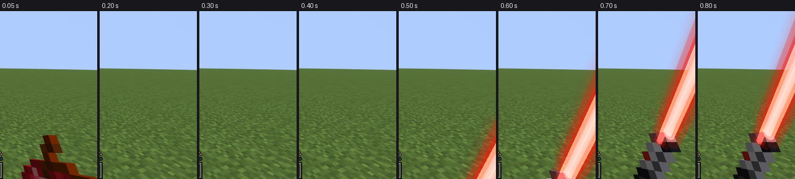
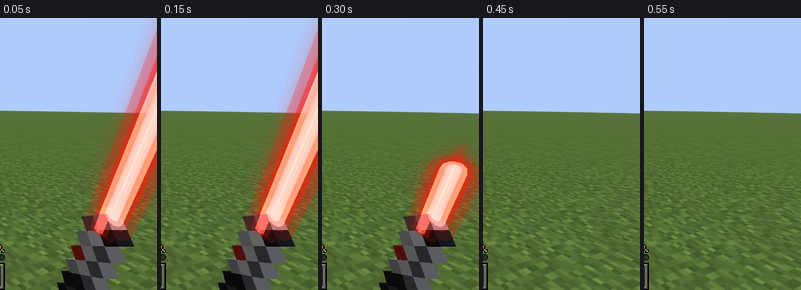
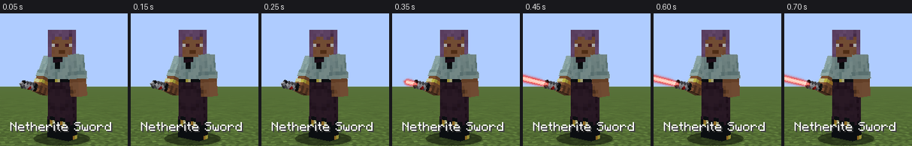
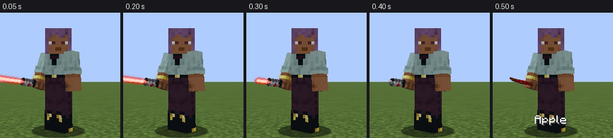

# Phase 4: Ein- und Ausfahranimation und Sounds

Stand: 24.10.2026, Minecraft 26.2, Fabric Loader 0.19.5, Fabric API 0.161.0+26.2, Java 25.

## Ergebnis

- **Ausfahren:** Wählst du das Netherite-Schwert aus, kommt zuerst der Griff hoch. Nach 0,3 Sekunden zündet die Klinge und wächst in 0,5 Sekunden aus dem Emitter heraus, erst schnell, dann sanft auslaufend. Dabei blitzt sie kurz heller auf. Auch der Lichtschein wächst mit, eine kurze Klinge hat also keinen riesigen Halo.
- **Einfahren:** Wechselst du auf ein anderes Item, wartet der Slotwechsel, bis die Klinge in 0,35 Sekunden gleichmäßig in den Griff zurückgefahren ist. Der Griff bleibt dabei in der Hand. Danach wird das neue Item ausgewählt. Scrollst du währenddessen weiter, landest du am Ende auf dem zuletzt gewählten Slot.
- **Sounds:** Zündgeräusch, Einfahrgeräusch, durchgehendes Summen und vier verschiedene Schwunggeräusche. Das Summen blendet mit der Klinge ein und aus, wird bei schnellen Bewegungen kurz lauter und etwas höher und hört nach dem Einfahren vollständig auf.
- **Mehrspieler:** Ohne eigene Netzwerkpakete. Mehr dazu unten.

### Ego-Perspektive

Ausfahren (die Hand kommt nach dem Itemwechsel erst hoch, dann zündet die Klinge):



Einfahren (die Klinge fährt in den Griff, danach wird das Item gewechselt):



### Third Person





Die Bilder stammen aus dem automatischen Client-Test (Software-Rendering). Zwischen zwei Bildern vergehen 2 bis 3 Spielticks, weil jeder Screenshot das Spiel kurz weiterlaufen lässt. Im Spiel selbst wird zwischen den Ticks interpoliert, die Bewegung ist also bei jeder Bildrate flüssig.

## Was getestet wurde

Alles unten lief automatisch in einem echten Minecraft-26.2-Client (`./gradlew runClientGameTest`), mit echtem Sound-System: OpenAL schreibt dabei statt auf Lautsprecher in eine Wave-Datei, die Tonspur wurde aufgezeichnet und ausgewertet. Auf GitHub läuft derselbe Test bei jedem Push, die Tonspur liegt dort unter **Artifacts → Audio**.

| Prüfung | Ergebnis |
| --- | --- |
| Projekt kompiliert (`./gradlew build gametestClasses`) | bestanden |
| Bisherige Klinge aus Phase 3: Ego- und Third-Person-Screenshots, Inventar zeigt nur den Griff | bestanden |
| Beim Auswählen ist die Klinge zuerst eingefahren, dann wächst sie über mehrere Ticks (nicht plötzlich) | bestanden |
| Klinge nach der Ausfahrzeit vollständig draußen | bestanden |
| Zündgeräusch genau einmal, Summen genau einmal gestartet und in 2 Sekunden nicht neu gestartet | bestanden |
| Beim Wegstecken bleibt der Slot gesperrt, die Klinge fährt sichtbar ein, danach wird der Slot gewechselt | bestanden |
| Einfahrgeräusch genau einmal, danach kein Summen mehr aktiv (auch im Sound-System selbst geprüft) | bestanden |
| Erneutes Auswählen zündet die Klinge wieder mit Animation | bestanden |
| Armschwung spielt einen Schwungsound, schnelle Drehung spielt einen Schwungsound, das Summen startet dabei nicht neu | bestanden |
| Wechsel zwischen zwei Netherite-Schwertern: keine Verzögerung, Klinge bleibt an | bestanden |
| Tod (mit `keepInventory`): Klinge fährt ein, Summen hört auf | bestanden |
| Respawn: Klinge zündet wieder, nur ein Summen läuft | bestanden |
| Zombie mit Netherite-Schwert: erscheint mit leuchtender Klinge, fährt ein, wenn man ihm das Schwert wegnimmt, zündet, wenn er wieder eins bekommt | bestanden |
| Echter Dedicated Server mit Netzwerkverbindung: Klinge zündet, Server sieht den Slotwechsel erst nach dem Einfahren, danach kein Summen mehr | bestanden |
| Aufgezeichnete Tonspur: nach jedem Einfahren und nach jedem Verlassen der Welt herrscht Stille | bestanden |

## Was du noch selbst im Spiel prüfen solltest

- **Wie es klingt.** Ich konnte die Tonspur messen, aber nicht anhören. [audio/phase4-hoerprobe.mp3](audio/phase4-hoerprobe.mp3) ist ein Zusammenschnitt der echten Mod-Sounds mit denselben Lautstärken und Überblendungen wie im Spiel: Zünden, Summen mit fünf Schwüngen, Einfahren. Sag mir, wenn dir etwas zu laut, zu leise oder zu künstlich klingt, das lässt sich im Skript `tools/synth_sounds.py` schnell ändern.
- **Wie flüssig es auf einer echten Grafikkarte wirkt**, besonders bei hoher Bildrate.
- **Zwei echte Spieler auf einem Server.** Der Test hat einen Dedicated Server und einen Zombie als „anderes Wesen" geprüft, aber keinen zweiten echten Spieler.
- **Schnelles Scrollen im Kampf.** Das Wegstecken dauert jetzt 0,35 Sekunden. Prüf bitte, ob sich das gut anfühlt oder ob es dich beim Wechsel auf Bogen oder Essen stört.
- **Zusammenspiel mit anderen Mods** (Iris, Sodium, Mods, die die Hotbar verändern) wurde nicht getestet.

## Wie es technisch funktioniert

### Animation

- **Eigenes Item-Modell `sabercraft:saber_blade`.** Minecraft 26.2 ruft für jedes gehaltene Item in jedem Bild das Item-Modell auf und übergibt dabei, wer das Item hält und in welcher Hand (`ItemOwner`, `ItemDisplayContext`). Das Modell fragt damit nach, wie weit die Klinge dieser Hand gerade draußen ist, und gibt das an den Klingen-Renderer weiter. Es ist aufgebaut wie Vanillas `minecraft:special`-Modell und wird über `ItemModels.ID_MAPPER` registriert (von der Fabric API freigegeben). Kein Mixin nötig.
- **Zustand pro Hand.** `SaberTracker` läuft einmal pro Tick und merkt sich für jede Hand jedes Wesens mit Lichtschwert, wie weit die Klinge draußen ist. Beim Zeichnen wird zwischen den letzten zwei Ticks interpoliert.
- **Verschiedene Modelle:** `SaberAnimation` beschreibt Verzögerung, Ausfahr- und Einfahrdauer, Bewegungskurve und Aufblitzen. Ein neues Lichtschwertmodell bekommt einfach eine eigene Animation in `SaberAnimations` und ein eigenes Profil in `SaberProfiles`. Kehrt die Richtung mitten in der Animation um, macht die Klinge keinen Sprung, sie läuft vom aktuellen Punkt aus weiter.
- **Wegstecken:** `HolsterController` hält den Hotbar-Wechsel am Anfang des Ticks zurück, bevor Minecraft ihn an den Server schickt. So sieht der Server und jeder andere Spieler das Lichtschwert genau so lange, bis die Klinge drin ist. Nur Hotbar-Wechsel werden verzögert. Tod, Fallenlassen, Handtausch (F) und Verschieben im Inventar wirken sofort.

### Sound

- **Eigene Sounds:** Alle sieben Sounds werden vom Skript `tools/synth_sounds.py` aus Sinuswellen, gefiltertem Rauschen und Hüllkurven berechnet. Keine Aufnahmen, keine Samples. Das Summen ist eine 3-Sekunden-Schleife, deren Frequenzen exakt hineinpassen, darum gibt es keinen Knacks an der Schleifenstelle.
- **Summen:** Pro leuchtender Klinge genau ein Sound (`SaberHumSoundInstance`), der einmal startet und sich selbst beendet, wenn die Klinge eingefahren ist, das Wesen verschwindet oder die Welt verlassen wird. Er wird nie pro Bild oder pro Tick neu gestartet. Höchstens acht Summen gleichzeitig, damit große Kämpfe nicht alle Soundkanäle belegen. Weiter als 32 Blöcke entfernte Lichtschwerter sind stumm.
- **Überblendung:** Das Summen folgt der sichtbaren Klingenlänge mit einer weichen S-Kurve, während das Zündgeräusch ausklingt. Beim Einfahren läuft es umgekehrt. Ein neues Summen blendet zusätzlich über 0,3 Sekunden ein, damit es nie hart einsetzt.
- **Schwünge:** Ein Armschwung (Angriff) oder eine schnelle Kopfdrehung mit leuchtender Klinge spielt einen von vier Schwunglauten mit leicht zufälliger Tonhöhe. Mindestens 0,25 Sekunden Abstand, damit nichts stottert.
- **Untertitel** auf Deutsch und Englisch.

### Mehrspieler

Die Mod schickt **keine eigenen Netzwerkpakete**. Minecraft teilt allen Spielern in der Nähe sowieso mit, was jeder in der Hand hält und wann er zuschlägt. Jeder Client mit SaberCraft leitet daraus Animation und Sounds ab. Darum:

- funktioniert es auf Servern ohne SaberCraft,
- sehen und hören andere Spieler mit SaberCraft dein Ausfahren, Einfahren, Summen und deine Schwünge,
- sehen Spieler ohne SaberCraft ein normales Netherite-Schwert.

Kleine Einschränkung: Ein Spieler, der gerade erst in Sichtweite kommt, erscheint direkt mit leuchtender Klinge (ohne Zünden), weil der Client nicht wissen kann, seit wann er sie hält. Und nur bei Spielern mit SaberCraft wartet der Slotwechsel aufs Einfahren. Bei Spielern ohne die Mod verschwindet die Klinge beim Wechseln zusammen mit dem Griff, nur das Einfahrgeräusch ist zu hören.

## Sounds neu erzeugen

```bash
python3 tools/synth_sounds.py
```

Braucht Python mit numpy und ffmpeg mit libvorbis. Schreibt die Dateien nach `src/client/resources/assets/sabercraft/sounds/saber/`.

## Bewusst nicht in dieser Phase

- Weitere Lichtschwertmodelle und Farben
- Konfigurationsmenü (Lautstärke, Geschwindigkeit, Wegsteck-Verzögerung ein/aus). Die Werte sind schon als Felder in `SaberAnimation` und `SaberSoundSet` angelegt, damit das Menü sie später nur noch setzen muss.
- Ein-/Ausschalten per Taste, ohne das Item zu wechseln
- Treffer- und Blockgeräusche, Lichtwurf auf die Umgebung
