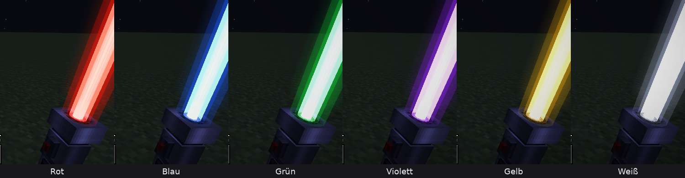
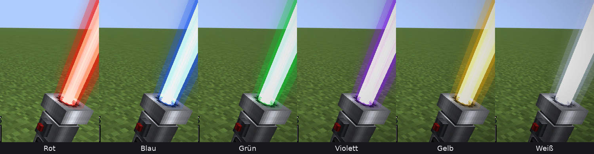
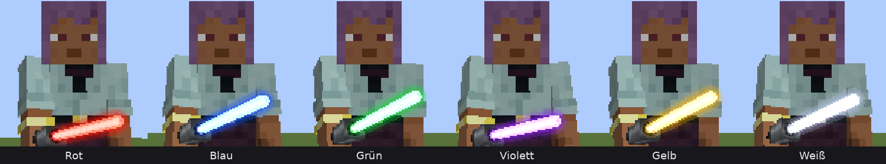
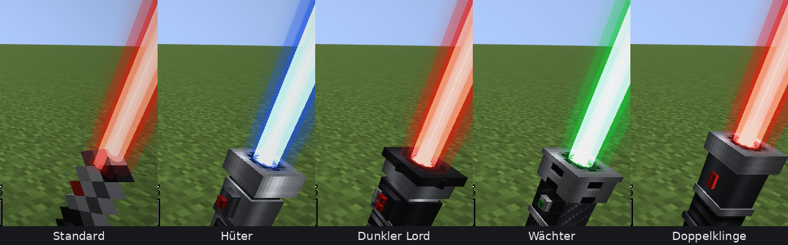
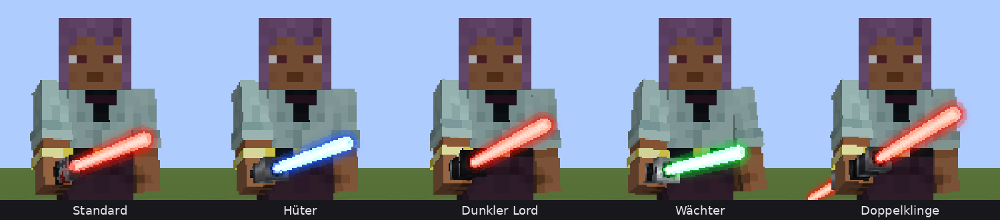
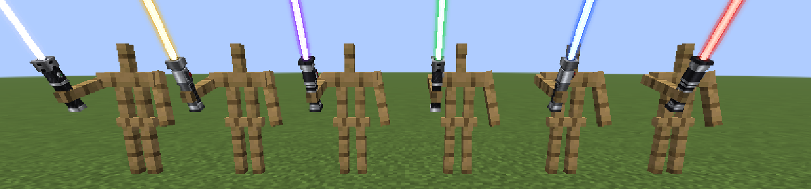
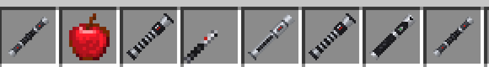
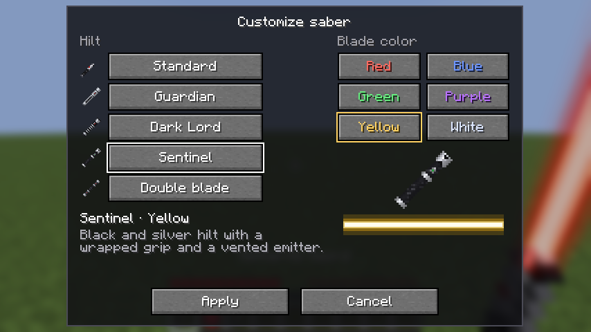
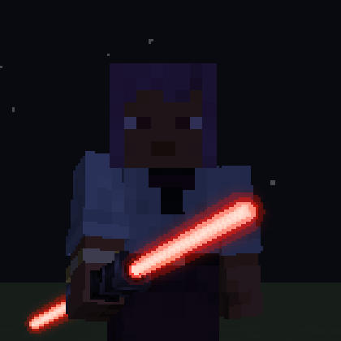

# Phase 5: Farben, Griffe und Variantenauswahl

Stand: 24.10.2026, Minecraft 26.2, Fabric Loader 0.19.5, Fabric API 0.161.0+26.2, Java 25.

## Ergebnis

- **Sechs Klingenfarben:** Rot, Blau, Grün, Violett, Gelb und Weiß. Jede Farbe hat ihren eigenen Energiekern, einen eigenen farbigen Bloom und einen eigenen weichen Lichtschein. Alle Werte lassen sich pro Farbe in einer Konfigdatei einstellen.
- **Vier neue 3D-Griffe** plus der bisherige Standardgriff: **Hüter** (klassisch silbern, Jedi-Stil), **Dunkler Lord** (schwarz mit Silberrippen und roten Knöpfen, Sith-Stil), **Wächter** (schwarz-silbern mit belüftetem Emitter) und eine experimentelle **Doppelklinge**. Modelle und Texturen sind selbst erstellt, per Skript erzeugt.
- **Jedes Schwert hat seine eigene Variante.** Taste **V** öffnet mit einem Netherite-Schwert in der Hand das Menü „Lichtschwert anpassen". Griff und Farbe werden am Item selbst gespeichert, andere Schwerter bleiben, wie sie sind.
- **Eigenes Soundprofil** für den dunklen Griff: tieferes, raueres Summen (74 statt 92 Hz), schwereres Zünden und eine etwas langsamere, härtere Ausfahranimation.
- **Bisheriges bleibt:** Ein Schwert ohne gespeicherte Variante sieht genauso aus wie in Phase 4 (flacher Griff, rote Klinge), mit derselben Animation und denselben Sounds. Alle Tests aus Phase 3 und 4 laufen unverändert weiter.


### Farben

Ego-Perspektive bei Nacht und bei Tag (Hüter-Griff):





Third Person:



### Griffe

Ego-Perspektive, jeder Griff in seiner Standardfarbe:



Third Person:



Griffe aus der Nähe (Rüstungsständer, bei Tag):



Inventar (Hotbar: Standard, Hüter, Dunkler Lord, Wächter, Doppelklinge ab dem vierten Platz):



### Auswahlmenü



Die Bilder stammen aus dem automatischen Client-Test (Software-Rendering, 854×480).

## Was getestet wurde

Alles unten lief automatisch in einem echten Minecraft-26.2-Client (`./gradlew runClientGameTest`), zusammen mit allen Tests aus Phase 3 und 4. Alle drei Testklassen bestanden in einem gemeinsamen Lauf.

| Prüfung | Ergebnis |
| --- | --- |
| Projekt kompiliert (`./gradlew build gametestClasses`) | bestanden |
| Alle Tests aus Phase 3 und 4 (Klinge, Animation, Sounds, Tod, Respawn, Zombie, Dedicated Server) | bestanden |
| Rote Standardklinge sieht aus wie vorher (Screenshot neben das Phase-3-Bild gelegt) | visuell gleich |
| Jede der 30 Kombinationen aus 5 Griffen und 6 Farben hat in allen vier Hand-Perspektiven eine Klinge | bestanden |
| Inventar-Icon jedes Griffs zeigt keine Klinge und passt in den Slot | bestanden |
| Jede Farbe bekommt eine eigene Modell-Identität (kein veralteter Render-Cache beim Farbwechsel) | bestanden |
| Die fünf Griffe haben unterschiedliche Formen | bestanden |
| Dunkler Griff nutzt eigenes Animations- und Soundprofil, die anderen das Standardprofil | bestanden |
| Menü per Taste V öffnen, Wächter und Gelb anklicken, Übernehmen: Variante liegt auf dem Server und im Client | bestanden |
| Zweites Schwert bekommt eine andere Variante, das erste behält seine | bestanden |
| Server ignoriert unbekannte Griffe, Anfragen für eine leere Hand und Nicht-Schwerter | bestanden |
| Kreativ-Weg (Vanilla-Paket des Kreativinventars) speichert die Variante | bestanden |
| Zombie mit dunklem, violettem Schwert: Client erkennt Griff und Farbe über die normale Ausrüstungs-Synchronisation | bestanden |
| Echter Dedicated Server: Auswahl wird gesendet, gespeichert und kommt zum Client zurück, anderes Schwert unverändert | bestanden |
| Pixelprüfung: jede Farbe erscheint auf dem Nacht-Screenshot tatsächlich in ihrem Farbton (5.000 bis 14.000 Pixel) | bestanden |

## Was du noch selbst im Spiel prüfen solltest

- **Wie die Griffe auf einer echten Grafikkarte wirken**, vor allem aus der Nähe in der Ego-Perspektive.
- **Der Klang des dunklen Griffs.** Ich konnte ihn messen (Grundton 74 Hz statt 92 Hz), aber nicht anhören. Hörprobe: [audio/phase5-dunkler-griff-hoerprobe.mp3](audio/phase5-dunkler-griff-hoerprobe.mp3) (Zünden, Summen mit Schwüngen, Einfahren).
- **Ein Server ohne SaberCraft.** Getestet wurde der Kreativ-Weg gegen einen Server mit SaberCraft. Dass das Menü auf einem Vanilla-Server im Überlebensmodus den Hinweis zeigt und sonst nichts tut, ist nur im Code abgesichert, nicht im Test.
- **Zwei echte Spieler.** Andere Wesen (Zombie) sehen die Variante, ein zweiter echter Spieler wurde nicht getestet.
- **Die Doppelklinge in der Ego-Perspektive.** Sie ist bewusst experimentell, siehe unten.
- **Tastenbelegung V.** Falls sie mit einer anderen Mod kollidiert, lässt sie sich unter Steuerung → SaberCraft ändern.

## Wie es technisch funktioniert

### Speicherung der Variante: warum `minecraft:custom_model_data`

Griff und Farbe stehen im Vanilla-Item-Feld `minecraft:custom_model_data` (`strings[0]` = Griff, `strings[1]` = Farbe), zum Beispiel:

```
/give @s minecraft:netherite_sword[minecraft:custom_model_data={strings:["sabercraft:dark_lord","sabercraft:red"]}]
```

Abgewogene Möglichkeiten:

| Ansatz | Pro | Contra |
| --- | --- | --- |
| Eine Einstellung pro Spieler (Client-Konfig) | einfach | jedes Schwert sähe gleich aus, andere Spieler sähen deine Wahl nicht |
| Eigene Datenkomponente `sabercraft:variant` | sauber benannt | Server **und** alle Clients bräuchten die Mod, Vanilla-Clients könnten den Server nicht mehr betreten |
| `minecraft:custom_data` | Vanilla-Feld | wird in 26.2 **nicht** an Clients geschickt (im Code geprüft), die Klinge wüsste ihre Farbe nicht |
| **`minecraft:custom_model_data`** (gewählt) | Vanilla-Feld, wird an alle Clients synchronisiert, das Item-Modell kann direkt danach auswählen, Resource Packs können es erweitern | ein Datapack, das dasselbe Feld an Netherite-Schwertern nutzt, könnte kollidieren (andere Werte im Feld bleiben erhalten) |

Die Folge: Jedes Schwert behält seine Variante beim Ablegen, Tauschen, in Truhen und nach dem Neustart. Andere Spieler mit SaberCraft sehen sie automatisch, Spieler ohne die Mod sehen ein normales Netherite-Schwert.

### Auswahl und Mehrspieler

Nur der Server darf Items verändern. Das Menü nimmt deshalb den passenden Weg:

1. **Server mit SaberCraft** (im Einzelspieler immer): Das einzige Paket der Mod, `sabercraft:select_variant`, geht an den Server. Er prüft, ob der Spieler lebt, ein Netherite-Schwert in genau dieser Hand hält und Griff und Farbe bekannt sind, und speichert die Variante.
2. **Server ohne SaberCraft, Kreativmodus:** Das Menü schickt das geänderte Schwert mit dem normalen Paket des Kreativinventars, wie beim Herausnehmen eines Items.
3. **Server ohne SaberCraft, Überlebensmodus:** Das Menü zeigt einen Hinweis. Die Variante lässt sich dann nicht ändern, vorhandene Varianten werden aber angezeigt.

Damit gilt weiter: **Auf dem Server musst du SaberCraft nicht installieren.** Nur wer dort im Überlebensmodus Varianten ändern will, braucht die Mod auch auf dem Server.

### Farben

- `BladeStyle` hat jetzt eigene Felder für Kern-, Bloom- und Halofarbe sowie Bloom- und Halostärke. Rot hat exakt die Werte aus Phase 3.
- Grün, Gelb und Weiß wirken für das Auge heller als Rot und Blau. Ihr Halo ist deshalb etwas schwächer eingestellt, damit sie auf hellem Himmel nicht ausbleichen. Weiß hat einen leicht kühlen Halo, damit es nach Licht aussieht und nicht nach einem weißen Stab.
- Die Farbe wird in jedem Bild nachgeschlagen. Geänderte Werte wirken also, ohne Modelle neu zu laden. Das spätere Konfigurationsmenü kann darauf aufbauen.

**Konfigdatei** `config/sabercraft/blade_styles.json` (wird beim ersten Start mit den Standardwerten angelegt):

```json
"sabercraft:blue": {
  "core_color": "#F2F7FF",
  "bloom_color": "#8CB8FF",
  "glow_color": "#1E5CFF",
  "length": 1.2,
  "core_radius": 0.022,
  "glow_radius": 0.12,
  "bloom_strength": 1.0,
  "glow_strength": 1.0,
  "shimmer": 0.04
}
```

Fehlende Einträge behalten ihren Standard, ungültige werden im Log gemeldet und ignoriert, Zahlen werden auf sinnvolle Bereiche begrenzt. Die Datei wird beim Start gelesen.

### Griffe

- Jeder Griff besteht aus Quadern entlang einer senkrechten Achse, die um 45 Grad auf die Diagonale gekippt werden, auf der Vanilla-Schwerter liegen. Dadurch gelten die normalen Vanilla-Transformationen für Ego-Perspektive, Third Person, Rahmen und Inventar, und die Klinge sitzt genau am Emitter. Minecraft 26.2 erlaubt beliebige Drehwinkel für Modellelemente, das wurde im Spielcode geprüft.
- Die Texturen (64×64) malt `tools/gen_hilts.py` selbst: gebürstetes Metall mit runder Schattierung, Griffrillen, Lüftungsschlitze, Wicklung, Knöpfe und ein Emitter mit leuchtendem Kern. Keine fremden Ressourcen.
- Im Inventar werden die Griffe mittig und etwas größer gezeichnet, damit die schlanken 3D-Griffe gut erkennbar sind.
- Neu erzeugen: `python3 tools/gen_hilts.py` (braucht numpy und Pillow). Das Skript schreibt auch `assets/minecraft/items/netherite_sword.json`.

### Sounds

`tools/synth_sounds.py` erzeugt jetzt zusätzlich das dunkle Profil unter `sounds/saber/dark/`. Die sieben Standardsounds kommen nach dem Umbau mit identischem Audio heraus (dekodierte Samples verglichen), die Dateien im Repo sind unverändert. Die Doppelklinge nutzt die Standardsounds mit etwas lauterem Summen.

## Doppelklinge: Stand und fehlende Schritte

**Schon da:**

- Der Klingen-Renderer zeichnet pro Eintrag im Item-Modell eine Klinge mit eigenem Emitter und eigener Richtung (`"angle"`). Ein Griff kann so beliebig viele Klingen tragen, ganz ohne Java-Änderung.
- Ein experimenteller Doppelklingen-Griff, mittig auf die Hand gesetzt, mit Klinge oben und unten. Beide Klingen fahren gemeinsam aus und ein, mit Summen und Schwunggeräuschen.
- Inventar-Icon, Auswahl im Menü, Speicherung und Mehrspieler funktionieren wie bei allen anderen Griffen.



**Noch offen:**

1. **Eigene Haltung.** Der Griff nutzt die einhändigen Vanilla-Transformationen. In der Ego-Perspektive zeigt die untere Klinge deshalb hinter die Kamera und ist nicht zu sehen. Nötig sind eigene Transformationen für Ego- und Third Person, eventuell eine beidhändige Haltung über ein Mixin in die Armpose.
2. **Klingen einzeln steuern.** Beide Klingen teilen sich einen Zustand. Für filmreifes Zünden nacheinander braucht `SaberHandState` einen Zustand pro Klinge und der Renderer einen Klingen-Index.
3. **Sound pro Klinge.** Statt eines lauteren Summens zwei leicht verstimmte Summen, die mit der Bewegung beider Enden schwingen.
4. **Kampf.** Reichweite und Schaden sind die des Netherite-Schwerts. Eigene Angriffsanimationen (Drehen des Stabs) fehlen.
5. **Weg ins Spiel.** Im Überlebensmodus bekommt man die Doppelklinge wie alle Varianten über das Menü. Ob sie ein eigenes Rezept oder Material kosten soll, ist eine Designfrage.

## Bewusst nicht in dieser Phase

- Konfigurationsmenü im Spiel (YACL). Die Werte liegen schon in der Konfigdatei bereit.
- Ein-/Ausschalten per Taste, Treffer- und Blockgeräusche, Lichtwurf auf die Umgebung.
- Eigene Soundprofile für Hüter und Wächter. Sie nutzen das Standardprofil.
