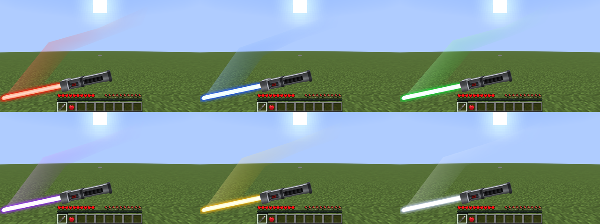
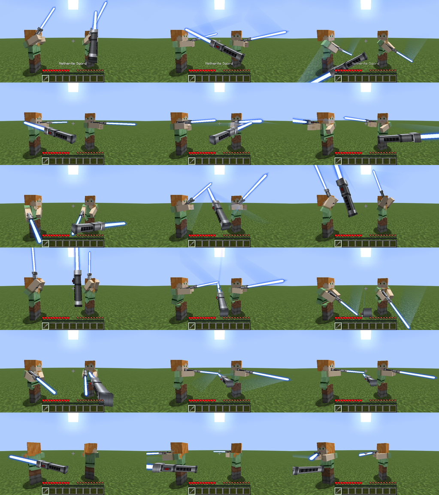
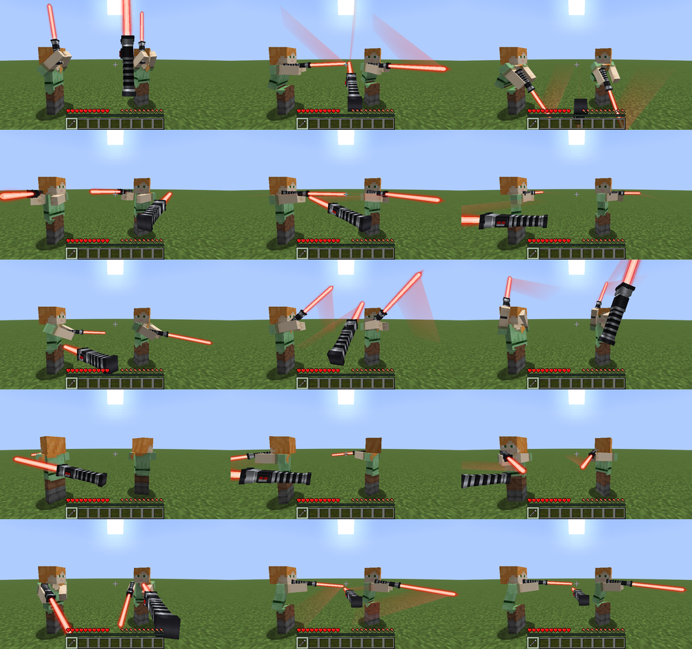
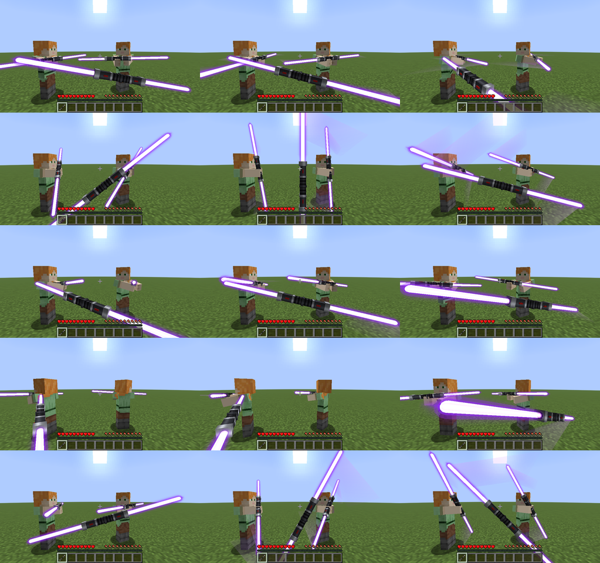
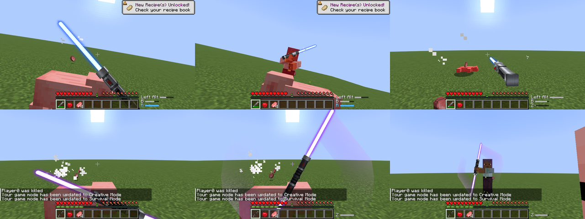
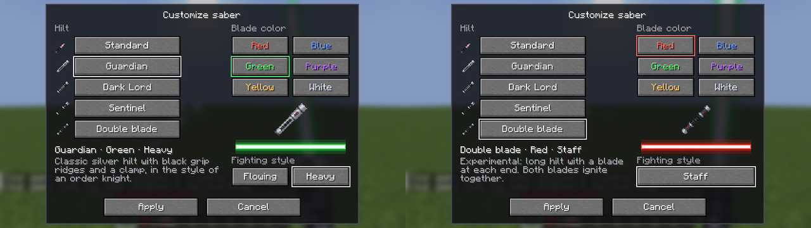

# Phase 6: Kampfanimationen und Immersion

Stand: 24.10.2026, Minecraft 26.2, Fabric Loader 0.19.5, Fabric API 0.161.0+26.2, Java 25. Keine neuen Abhängigkeiten.

## Ergebnis

- **Eigene Angriffsbewegungen statt des Vanilla-Schwungs**, in Ego-Perspektive und Third Person. 18 Bewegungen in drei Kampfstilen, mit Ausholen, Schlag, Durchschwung und weichem Übergang in die nächste Bewegung oder zurück in die Bereitschaftshaltung. Die Klinge folgt immer der Hand, das Schwunggeräusch kommt genau im Moment des Schlags.
- **Drei Kampfstile**, pro Schwert im V-Menü wählbar:
  - **Fließend** (Jedi-inspiriert, Standard für Standard, Hüter und Wächter): schnelle Kombination aus Diagonalschnitt, Rückhand, Aufwärtsschnitt und Überkopfschlag. Im Sprint ein Stich, im Fallen ein Überkopfschlag. Bereitschaftshaltung mit erhobener Klinge.
  - **Schwer** (Sith-inspiriert, Standard für den Dunklen Lord): langsamere, wuchtige Hiebe aus einer hohen Haltung, tieferes Schwunggeräusch, im Sprint ein Stoß. Die Klinge steht in Ruhe senkrecht vor der Brust.
  - **Stab** (fest für die Doppelklinge): weite Schwünge mit beiden Klingen, Drehung um den Körper und als Spezialaktion der **Klingenwirbel**, bei dem der Stab sichtbar vor dem Körper rotiert. Beide Klingen sind in beiden Perspektiven sichtbar, auch die untere in der Ego-Perspektive.
- **Vier Fähigkeiten**, vom Server entschieden (Schaden, Abklingzeit, Bewegung):
  - **Abwehrhaltung** (R halten): blockt 60 % frontaler Treffer, in den ersten 6 Ticks nach dem Hochnehmen eine **Parade** (100 %, Angreifer wird zurückgestoßen). Langsamer gehen, kein Angriff, höchstens 5 Sekunden am Stück, danach 1 Sekunde Pause. Treffer von hinten, Explosionen, Fall- und Feuerschaden werden nie geblockt.
  - **Drehangriff** (Z): eine volle Drehung, trifft bis zu zwei Gegner im Umkreis von 3 Blöcken mit 60 % des Angriffsschadens. 6 Sekunden Abklingzeit. Mit der Doppelklinge stattdessen der **Klingenwirbel**: trifft dreimal vor dem Körper (je 30 %), lenkt Pfeile und andere Geschosse von vorn ab, 8 Sekunden Abklingzeit.
  - **Machtstoß** (B): stößt Gegner in einem Kegel vor dir bis 6 Blöcke weit zurück und lenkt Geschosse um, ohne Schaden. 12 Sekunden Abklingzeit.
  - **Ausfallschritt** (linke Alt-Taste): kurzer Sprung nach vorn mit Stich (50 %). 5 Sekunden Abklingzeit.
  - Jede Fähigkeit kostet etwas Hunger (wie Springen). Eigene Haustiere, Teammitglieder und Spieler bei ausgeschaltetem PvP werden nie getroffen oder gestoßen. Eine kleine Anzeige neben der Hotbar zeigt die laufenden Abklingzeiten, solange du ein Lichtschwert hältst.
- **Effekte:** Lichtspuren der Klinge während eines Angriffs (in der Farbe der Klinge), etwas helleres Glühen im Schlag, farbige Funken bei Treffern, an Wänden und am Boden (mit kurzem Rauch), Funken beim Blocken und Parieren, ein paar Funken beim Zünden (für andere Spieler und in Third Person), Luftstoß beim Machtstoß, Staub beim Ausfallschritt. Der Vanilla-Schwungeffekt („Sweep") wird bei Lichtschwertern ausgeblendet.
- **Zehn neue Sounds**, wie alle anderen selbst synthetisiert: Drehung, Treffer (2 Varianten), Versengen, Abwehr, Klingenkontakt (2 Varianten), Parade, Machtstoß, Ausfallschritt. Das Profil des Dunklen Lords bleibt. Wand-Funken haben eine eigene Sperre, damit schnelle Schläge gegen eine Wand nicht dauerknistern.
- **Bisheriges bleibt:** Griffe, Farben, Bloom und Glühen, Zünden und Einfahren, Summen, V-Menü. Alle Tests aus Phase 3 bis 5 laufen weiter (eine Erwartung wurde angepasst: das Schwunggeräusch kommt jetzt im Schlag, also ein paar Ticks nach dem Klick).

### Bewegungen

Je Bewegung drei Momente (kurz vor dem Schlag, Schlag, Durchschwung). Jedes Bild zeigt die Bewegung dreimal: in deiner Ego-Perspektive, an einer Puppe von der Seite und an einer Puppe von vorn.

Fließend:

Schwer:

Stab (Doppelklinge):

### Effekte und Fähigkeiten

Third-Person-Spuren (Rot, Grün), Treffer-Funken, Funken an der Wand, Drehangriff, Machtstoß (mit Abklingzeit-Anzeige unten rechts):

Abwehrhaltung (Ego, Parade in Third Person), Ausfallschritt, Doppelklinge in Ruhe, Klingenwirbel in Ego und Third Person:

V-Menü mit Kampfstil (einzelne Klinge und Doppelklinge):

## Steuerung

Alle Tasten lassen sich unter **Optionen → Steuerung → SaberCraft** ändern.

| Taste | Aktion | Hinweis |
| --- | --- | --- |
| Linke Maustaste | Angriff | Bewegung je nach Stil; im Sprint Stich, im Fallen Überkopfschlag |
| **R** (halten) | Abwehrhaltung | Parade direkt nach dem Hochnehmen |
| **Z** | Drehangriff / Klingenwirbel | Klingenwirbel mit der Doppelklinge |
| **B** | Machtstoß | |
| **Linke Alt-Taste** | Ausfallschritt | |
| **V** | Lichtschwert anpassen | Griff, Farbe und jetzt auch Kampfstil |

Keine dieser Tasten ist in Vanilla 26.2 belegt. Der Plan sah G für den Drehangriff vor, aber G ist in 26.2 die neue Vanilla-Taste „Schnellaktionen", deshalb Z. Fähigkeiten gehen nur mit einem gezündeten Lichtschwert in der Haupthand.

## Was braucht die Mod wo?

| Teil | Nur Client | Mod auch auf dem Server nötig |
| --- | --- | --- |
| Angriffsbewegungen, Bereitschafts- und Abwehrhaltung (Darstellung) | ✓ | |
| Lichtspuren, Glühen, Funken, Sounds | ✓ | |
| Kampfstil anzeigen (steht im Item) | ✓ | |
| Kampfstil im Überlebensmodus ändern | | ✓ (wie Griff und Farbe in Phase 5; im Kreativmodus geht es auch ohne) |
| Fähigkeiten (Abwehr, Drehangriff, Machtstoß, Ausfallschritt) | | ✓ |

Die Angriffsbewegungen brauchen keine eigenen Pakete: Jeder Client sieht den Vanilla-Schwung der anderen Spieler und wählt daraus dieselbe Bewegung (Stil am Item, Zeit seit dem letzten Schlag, Sprint, Fallen). Fehlt die Mod auf dem Server, sagt ein Druck auf eine Fähigkeitstaste „Fähigkeiten brauchen SaberCraft auf dem Server", alles andere funktioniert.

## Einstellungen

- `config/sabercraft/abilities.json` (Server, im Einzelspieler die eigene Welt): jede Fähigkeit an oder aus, Abklingzeiten, Schaden als Anteil des Angriffsschadens, Reichweiten, Stärke des Machtstoßes, ob er Spieler trifft, Blockanteil und Paradefenster der Abwehr, Verlangsamung, Hungerkosten. Werte außerhalb sinnvoller Grenzen werden begrenzt.
- `config/sabercraft/combat_client.json` (Client): Kampfanimationen an/aus, Bereitschaftshaltung, Lichtspuren und deren Stärke, Partikelmenge (0 aus, 1 normal, 2 mehr), Vanilla-Sweep ausblenden, Abklingzeit-Anzeige.
- `assets/sabercraft/combat/moves.json` (im Mod, per Ressourcenpaket überschreibbar): alle Bewegungen und Stile als Keyframes. Neue Bewegungen oder Stile brauchen keinen Code.

## Technik in Kürze

- Ego-Perspektive: Mixin in `ItemInHandRenderer.submitArmWithItem`. Die Pose wird als Griffposition auf dem Bildschirm und Klingenrichtung beschrieben, nicht als Drehwinkel des Items, damit die Bewegungen leicht zu bauen sind. Das Abtauchen des Schwerts nach jedem Schlag (Vanilla-Angriffsabklingzeit) ist bei Lichtschwertern abgeschaltet, sonst würde es die Bewegung zerreißen.
- Third Person: Mixins in `HumanoidModel.setupAttackAnimation`, `ArmedEntityRenderState` (Daten pro Figur über die Fabric-Render-State-API) und `ItemInHandLayer` (Drehung der Klinge in der Hand). Gilt für Spieler, Puppen und alle Mobs mit menschlichem Modell.
- Lichtspuren: werden direkt mit der Klinge gezeichnet und speichern die letzten zwei Ticks der Klingenposition, in Third Person in Weltkoordinaten, in Ego-Perspektive im Blickraum. Ohne Angriff kosten sie nichts.
- Fähigkeiten: `SaberAbilities` auf dem Server, Blocken über einen Mixin in `LivingEntity.applyItemBlocking` (Fabric API hat kein Ereignis zum Ändern von Schaden). Die eigene Animation startet sofort beim Tastendruck, damit es sich auch mit Ping direkt anfühlt; der Server bestätigt und schickt die Abklingzeit.

## Tests

Automatisch in einem echten 26.2-Client (`./gradlew runClientGameTest`), alle 5 Testreihen bestanden, 131 Prüfungen:

- **Neue Testreihe `CombatAbilityGameTest`:** Lichtspuren in allen 6 Farben (Ego) und Third Person, Treffer-Funken und Treffer-Sound, Funken und Sound an einer Wand, Drehangriff (trifft vorn und hinten, Abklingzeit, kein zweiter Treffer während der Abklingzeit), Machtstoß (stößt zurück, kein Schaden), Ausfallschritt (bewegt nach vorn), Abwehr (Parade 100 %, später Teilblock, kein Block von hinten, Verlangsamung an und wieder aus), Waffenwechsel mitten im Schlag, Tod während der Abwehr und Respawn, Kreativmodus, Klingenwirbel der Doppelklinge, Kampfstil im V-Menü, und auf einem **echten Dedicated Server**: Drehangriff, Abklingzeit, Machtstoß (der Client sieht das Schwein am selben Ort wie der Server), Abwehr an und aus.
- **Neue Testreihe `CombatGalleryGameTest`:** Screenshots jeder Bewegung jedes Stils zu festen Zeitpunkten, in Ego-Perspektive, an zwei Puppen und von hinten.
- **Phase 3 bis 5:** alle bisherigen Tests (Klinge, Zünden und Einfahren, Sounds, Itemwechsel, Tod und Respawn, Mobs, alle Griffe und Farben, V-Menü, Dedicated Server).
- **Sounds** liefen über die echte Sound-Engine: OpenAL schreibt die Ausgabe in eine WAV-Datei (wie schon im GitHub-Workflow). Geprüft wurde, dass jeder neue Sound im richtigen Moment genau einmal abgespielt wird.

Ich habe mir alle Screenshots angesehen und danach nachjustiert: Bereitschaftshaltung der fließenden Klinge angehoben, Lichtspur dezenter (nur äußerer Teil der Klinge, schnelleres Ausblenden), Funken größer, V-Menü passt jetzt auch in kleine Fenster, Ausfallschritt in Ego-Perspektive näher am Körper.

## Nicht getestet und Grenzen

Ehrlich gesagt, was ich **nicht** selbst gesehen oder geprüft habe:

- **Bewegung in Echtzeit mit hoher Bildrate.** Die Testumgebung rendert etwa ein Bild pro Tick. Ich habe die Bewegungen als Einzelbilder gesehen, nicht flüssig mit 60 oder mehr FPS. Ob jede Bewegung sich im Spiel so gut anfühlt, wie sie auf den Bildern aussieht, musst du bitte selbst beurteilen. Die Bewegungen stehen alle in `moves.json` und lassen sich leicht nachjustieren.
- **Zwei echte Spieler gleichzeitig.** Getestet wurde ein Client am Dedicated Server. Dass andere Spieler deine Bewegungen sehen, ist über die Puppen im selben Client geprüft (gleicher Code wie für fremde Spieler), dass die Fähigkeits-Ereignisse bei einem zweiten Client ankommen, aber nicht.
- **Sounds angehört** hat niemand: Geprüft ist, dass sie abgespielt werden. Wie sie klingen, ist Geschmack.
- **Abwehr gegen echte Mob-Angriffe und Pfeile:** Getestet mit Nahkampfschaden über den `damage`-Befehl mit einem Mob als Quelle. Das Ablenken von Geschossen durch Machtstoß und Klingenwirbel ist nicht getestet.
- **Zombies und andere Mobs mit Lichtschwert** benutzen dieselben Bewegungen, das habe ich aber nur an Puppen angesehen, nicht an angreifenden Mobs.
- **Linkshänder** (Haupthand links), **Shader** (Iris) und andere Mods wurden nicht getestet.
- Der Server weiß nicht, ob deine Klinge gerade leuchtet (das ist reine Client-Animation). Er verlangt nur ein Netherite-Schwert in der Haupthand. Ein veränderter Client könnte Fähigkeiten also auch mit eingefahrener Klinge auslösen, mehr aber nicht: Abklingzeit, Schaden und Reichweite prüft der Server.
- Fähigkeiten gibt es nur für das Schwert in der Haupthand.
- Die Klingenposition für Funken an Wänden wird aus Blickrichtung und Reichweite geschätzt, nicht aus der exakten Klingengeometrie.
