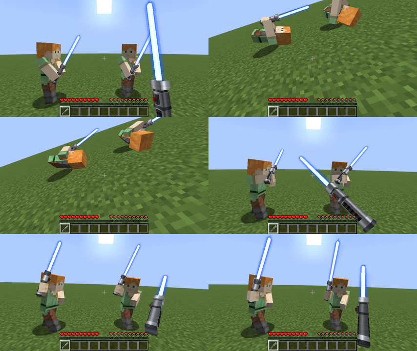
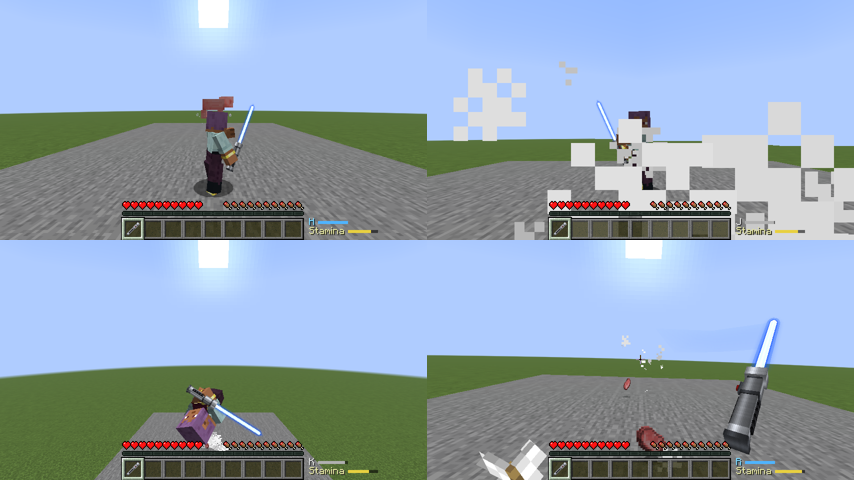
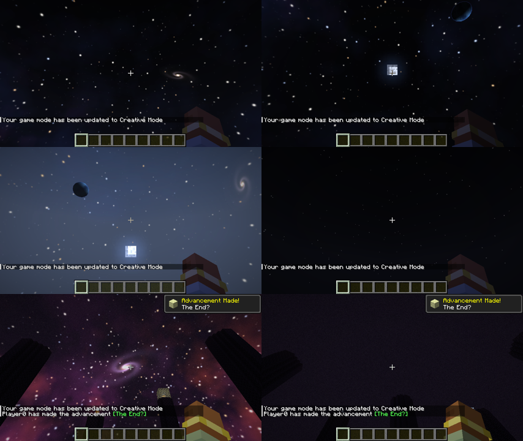
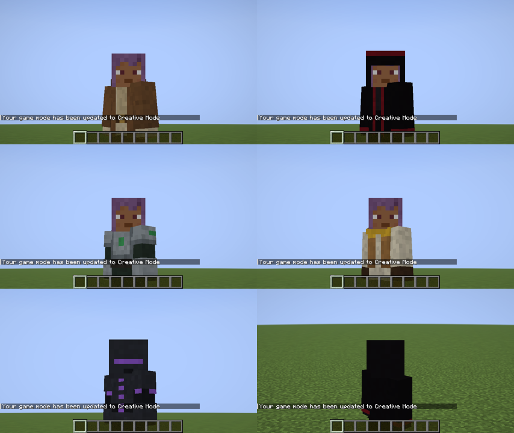
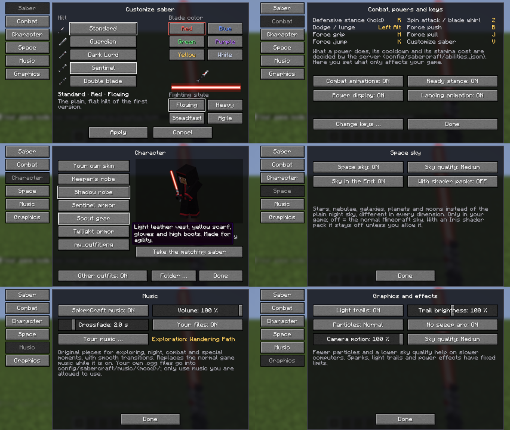
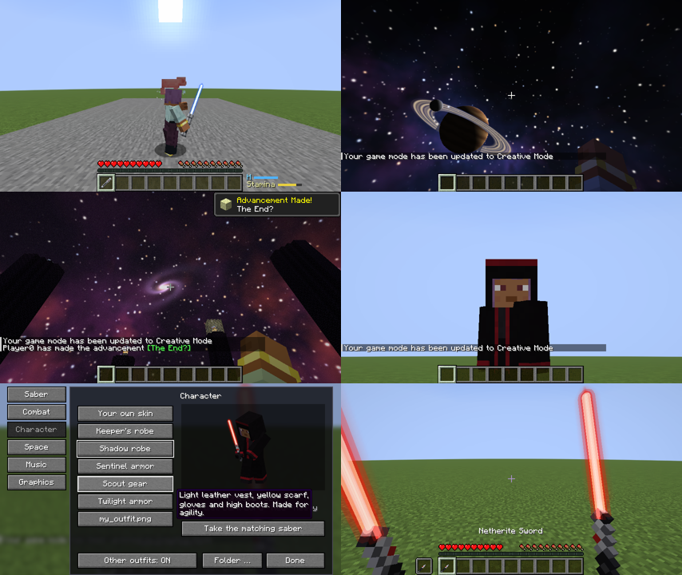

# Phase 7: Ultimate Immersion

Stand: 24.10.2026, Minecraft 26.2, Fabric Loader 0.19.5, Fabric API 0.161.0+26.2, Java 25. **Keine neuen Abhängigkeiten**: Himmel, Musik, Outfits und Menü nutzen nur Minecraft und die Fabric API. YACL wurde nicht nötig, das Menü ist mit Vanilla-Bausteinen gebaut.

Alles aus Phase 1 bis 6 bleibt: Griffe, Farben, Klinge, Zünden und Summen, Kampfbewegungen, Lichtspuren, Funken, Abwehr, Drehangriff, Machtstoß, Taste V.

## Ergebnis

### Ganzkörper-Animationen und Ausweichen

- Rollen, Seitschritte, Rückschritte, Ausfallschritte und Salto bewegen den ganzen Körper (Beine, Rumpf, Kopf) und bleiben am Boden. Welche Bewegung kommt, hängt vom Kampfstil und der gedrückten Laufrichtung (WASD) ab.
- Während einer Rolle weicht man Treffern aus (kurze Unverwundbarkeit gegen Nahkampf). Gegen eine Wand stoppt die Bewegung sauber.
- Landung nach höheren Sprüngen: ab etwa 3 Blöcken ein Abfedern, ab etwa 7 Blöcken eine schwere Landung (Staub schon ab 5).
- Die Kamera macht Rollen und Landungen in der Ego-Perspektive mit (im Menü abschwächbar).

### Abwehr, Parade, Konter, Ausdauer

- **Ausdauer** (Balken neben der Hotbar, nur sichtbar, wenn nicht voll): 100 Punkte, erholt sich nach 1 Sekunde Pause in etwa 5 Sekunden. Kosten: Haltung heben 5, geblockter Schaden 6 je Schadenspunkt (Anteil), Parade 4, Ausweichen 25, Drehangriff 30, Machtstoß 25, Machtgriff 15 plus 0,5 pro Tick, Machtzug 25, Machtsprung 30, Geschoss abwehren 6.
- **Parade** nur genau beim Heben der Haltung (6 Ticks, Stil kann das verlängern). Wer die Haltung dauernd hoch- und runternimmt, bekommt keine Parade (16 Ticks Sperre).
- **Konter:** Eine Parade bringt den Angreifer aus dem Gleichgewicht (Langsamkeit II und Schwäche, Sterne über dem Kopf, für alle sichtbar). Der nächste eigene Treffer innerhalb von 1,5 Sekunden macht 50 % mehr Schaden.
- **Haltung bricht:** Reicht die Ausdauer für einen Block nicht, bricht die Haltung. Der Treffer geht voll durch, man ist kurz verlangsamt und kann 2,5 Sekunden nicht abwehren. Eigene Animation und Klang.
- Verschiedene Animationen für Block, Parade und gebrochene Haltung.

### Kampfstile

Vier Stile für Einzelklingen, dazu der Stab für die Doppelklinge. Keine umbenannten Kopien: jeder Stil hat eigene Haltung, eigene Schläge, eigenes Ausweichen und eigene Werte.

| Stil | Gefühl | Ausweichen | Werte |
| --- | --- | --- | --- |
| Fließend | schnelle Kombinationen | Rollen | Mittelwerte |
| Schwer | wuchtige Hiebe aus hoher Haltung | Seitschritte, tiefer Ausfallschritt | Blocks etwas stärker, Ausweichen teurer und langsamer |
| **Standhaft** (neu) | tiefe, breite Haltung, kurze Schnitte nah am Körper | Ausfallschritt, Seitschritte, Rückschritt | längeres Paradefenster, Blocks halten 20 % mehr und kosten 40 % weniger, Ausweichen langsamer |
| **Wendig** (neu) | hoch getragene Klinge, federnde Schnitte, Drehungen, Sprünge | Drehschritt, Seitrollen, Rückwärtssalto | Ausweichen halb so oft gesperrt und 40 % billiger, Blocks schwächer |
| Stab | weite Schwünge mit beiden Klingen | Rollen | Klingenwirbel |

### Machtkräfte

| Kraft | Taste | Wirkung | Abklingzeit |
| --- | --- | --- | --- |
| Machtgriff | **H** halten | hebt ein Lebewesen vor dir bis 10 Blöcke weit an und hält es vor dir in der Luft; es folgt deinem Blick. Loslassen: es sinkt sanft zu Boden, ohne Fallschaden. Höchstens 4 Sekunden, kostet laufend Ausdauer | 10 s |
| Machtzug | **J** | zieht ein Lebewesen oder Item bis 12 Blöcke weit zu dir, nie durch Wände | 8 s |
| Machtsprung | **K** | Sprung über etwa 5 Blöcke, ohne Fallschaden bis zur Absprunghöhe, mit Salto | 5 s |
| Machtstoß (verbessert) | **B** | stößt jetzt auch Items, gezündetes TNT, Boote und Loren und schickt Geschosse gezielt zurück | 12 s |

- Bosse (Enderdrache, Wither, Wächter, Großer Wächter) und Rüstungsständer sind immun (Tag `sabercraft:force_immune`). Andere Spieler sind standardmäßig nicht betroffen (`force_players` in `abilities.json`).
- **Geschosse abwehren:** In der Abwehrhaltung, im Klingenwirbel und kurz nach einem Schlag fliegen Pfeile, Dreizacke, Schneebälle, Feuerbälle, Wither-Schädel, Shulker-Geschosse, Lama-Spucke und Windladungen von vorn zurück (Tag `sabercraft:deflectable`). Direkt nach dem Heben der Haltung oder genau im Schlag fliegen sie präzise in Blickrichtung und gehören dann dir; sonst prallen sie gestreut ab. Funken und Klang sehen und hören alle Spieler. Geschosse von hinten treffen.

### Weltraum-Himmel (optional, nur Client)

- Sterne in verschiedenen Farben und Größen, ein Milchstraßenband mit Nebeln und Staubbahnen, Spiralgalaxien, ein Gasriese mit Ring und Mond, ein blauer Planet. Das End hat einen eigenen, rot-violetten Himmel mit roter Riesensonne und zwei Galaxien. Jede andere Dimension (aus Datapacks oder Mods) bekommt aus ihrem Namen einen eigenen Himmel.
- Der Himmel dreht sich mit den Sternen, erscheint in der Dämmerung, verschwindet bei Tag und im Regen. Sonne und Mond bleiben.
- Er wird beim Betreten einer Dimension im Hintergrund gemalt (mittlere Qualität etwa 1 Sekunde) und dann einmal auf die Grafikkarte geladen. Bis dahin sieht man den normalen Himmel.
- Aus = exakt der normale Minecraft-Himmel, der Code läuft dann gar nicht.
- Läuft ein Iris-Shaderpack, bleibt der Himmel aus, solange man es im Menü nicht erlaubt (Shaderpacks malen ihren eigenen Himmel).

### Musik (optional, nur Client)

- Sechs eigene, mit `tools/synth_music.py` komponierte und berechnete Stücke, insgesamt etwa 5 Minuten:
  - Erkundung: „Weiter Horizont", „Wanderpfad"
  - Nacht: „Sternenstille"
  - Kampf: „Klingenduell", „Schattenangriff"
  - Besonderer Moment: „Aufbruch"
- **Stimmung** nach Lage: Boss in der Nähe → besonderer Moment; Kampf (Gegner nah bei gezogener Klinge, Treffer) → Kampf, hält 15 Sekunden nach; Nacht, Höhle, Nether und End → Nacht; sonst Erkundung.
- Ruhige Stücke spielen einmal, danach 30 bis 90 Sekunden Pause wie bei Vanilla. Kampf- und Eventmusik laufen in Schleife, solange die Lage anhält.
- Überblendung beim Stimmungswechsel (Länge einstellbar). Nie mehr als zwei Stücke gleichzeitig, nämlich nur während der Überblendung. Nie dasselbe Stück zweimal hintereinander, wenn es eine Wahl gibt.
- Eigener Lautstärkeregler, zusätzlich zum Musikregler von Minecraft. Solange die SaberCraft-Musik an ist, schweigt die normale Spielmusik. Im Titelbildschirm läuft die normale Musik. Aus = alles wie Vanilla.
- **Eigene Musik:** `.ogg`-Dateien in `config/sabercraft/music/exploration|night|combat|event/`. Höchstens 64 pro Stimmung und je 64 MB. Sie werden nur auf deinem Rechner gelesen und nie verschickt; die Ordner und eine Kurzanleitung legt die Mod beim ersten Weltbeitritt an. MP3 geht nicht, weil Minecraft nur Ogg Vorbis abspielen kann.
- Hörprobe aller sechs Stücke: [audio/phase7-musik-hoerprobe.mp3](audio/phase7-musik-hoerprobe.mp3)

### Charakter (Outfits)

- Fünf eigene Outfits, die als zweite Schicht **über deinem eigenen Minecraft-Skin** liegen. Dein Skin wird nie ersetzt; dein Gesicht bleibt sichtbar, außer bei Kapuze oder Helm.

  | Outfit | Passendes Schwert |
  | --- | --- |
  | Hüter-Robe | Hüter, Blau, Fließend |
  | Schatten-Robe (Kapuze) | Dunkler Lord, Rot, Schwer |
  | Wächter-Rüstung | Wächter, Grün, Standhaft |
  | Späher-Montur | Standard, Gelb, Wendig |
  | Zwielicht-Rüstung (Helm) | Doppelklinge, Lila, Stab |

- Im Menü „Charakter" siehst du dich selbst als Vorschau (folgt der Maus). Mit „Passendes Schwert nehmen" bekommt das Schwert in der Hand Griff, Farbe und Stil des Outfits.
- Die Wahl wird in `config/sabercraft/character_client.json` gespeichert und beim Beitritt an den Server geschickt. Der Server prüft sie, nimmt nur bekannte Outfits an und gibt sie an alle Spieler mit SaberCraft weiter. Spieler ohne die Mod sehen die normalen Skins.
- **Eigene Outfits:** 64 × 64 PNG im Skin-Format in `config/sabercraft/outfits/`. Die siehst nur du, sie werden nicht verschickt.
- „Andere Outfits: Aus" zeigt alle anderen Spieler mit ihrem normalen Skin.
- Fremde Skins werden nie verändert: Andere Spieler zeigen nur das Outfit, das sie selbst gewählt haben.

### Menü (Taste V)

V öffnet das SaberCraft-Menü mit sechs Bereichen in einer Leiste links:

| Bereich | Inhalt |
| --- | --- |
| Schwert | Griff, Klingenfarbe, Kampfstil (nur mit Netherite-Schwert in der Hand, wie bisher mit „Übernehmen") |
| Kampf | alle Tasten auf einen Blick, Knopf zur Tastenbelegung, Kampfanimationen, Kampfhaltung, Kräfte-Anzeige, Landeanimation |
| Charakter | Outfits mit Vorschau, eigene Dateien, andere Outfits zeigen |
| Weltraum | Himmel an/aus, Qualität, im End, mit Shaderpacks |
| Musik | an/aus, Lautstärke, Überblendung, eigene Dateien, Ordner öffnen, was gerade läuft |
| Grafik | Lichtspuren, Spur-Helligkeit, Partikel, Schwung-Bogen, Kamera-Bewegung, Himmelsqualität |

Mit Schwert in der Hand öffnet V den Bereich Schwert, sonst Charakter. Jede Einstellung wird sofort gespeichert. Das Menü passt auch in ein kleines Fenster (854 × 480).

## Tasten

| Taste | Aktion |
| --- | --- |
| Linke Maustaste | Angriff (Bewegung je nach Stil) |
| **R** (halten) | Abwehrhaltung, beim Heben Parade |
| **Z** | Drehangriff / Klingenwirbel |
| **Linke Alt** | Ausweichen je nach Stil und Laufrichtung |
| **B** | Machtstoß |
| **H** (halten) | Machtgriff |
| **J** | Machtzug |
| **K** | Machtsprung |
| **V** | SaberCraft-Menü |

Alle Tasten sind unter Optionen → Steuerung → SaberCraft änderbar, oder im Menü unter Kampf → „Tasten ändern …".

## Was der Client macht und was der Server

| Teil | Client | Server |
| --- | --- | --- |
| Klinge, Griffe, Farben, Zünden, Summen | ✓ | – |
| Kampfbewegungen, Lichtspuren, Funken | ✓ | – |
| Ausweichen, Machtsprung | Bewegung sofort (vorhergesagt) | prüft, entscheidet Unverwundbarkeit, Fallschaden, Abklingzeit, Ausdauer |
| Abwehr, Parade, Konter, Haltung bricht | Animation, Klang | entscheidet alles (Schaden, Ausdauer, Effekte) |
| Machtgriff, -zug, -stoß, Drehangriff | Animation, Effekte nach Bestätigung | Ziel, Bewegung, Schaden, Abklingzeit |
| Geschosse abwehren | Funken, Klang | Richtung, neuer Besitzer, Kosten |
| Ausdauer | Anzeige | der echte Wert |
| Outfits | Darstellung, eigene Dateien | merkt sich die eingebauten Outfits, verteilt sie |
| Himmel, Musik, Menü | ✓ | – |

Ohne SaberCraft auf dem Server gehen Aussehen, Animationen, Himmel, Musik und das eigene Outfit (nur für dich sichtbar). Kräfte, Abwehr, Ausdauer und das Teilen der Outfits brauchen die Mod auf dem Server.

## Zuverlässigkeit im Mehrspieler

- Alle Ergebnisse (Schaden, Treffer, Bewegung anderer, Ausdauer, Abklingzeiten) entscheidet der Server. Der Client darf nur Dinge anfragen; zu frühe oder zu teure Anfragen lehnt der Server ab und schickt die echten Werte zurück.
- Andere Spieler sehen Ausweichen, Abwehr, Parade, Konter-Sterne, Kräfte und abgewehrte Geschosse.
- **Zurückgesetzt wird** bei:
  - Tod und Respawn: Griff gelöst, Haltung weg, Zustand neu.
  - Wechsel des Items: Haltung, Konter und Griff enden.
  - Verbindungsende: alles vergessen; das Opfer eines Griffs wird sanft abgesetzt.
  - Serverwechsel: Client-Zustand, Outfits anderer und Musik werden neu aufgebaut.
  - Dimensionswechsel: Griff gelöst.

  Niemand bleibt in der Luft, in einer Haltung oder verlangsamt hängen; alle Modifikatoren sind flüchtig und werden nicht gespeichert.

## Leistung und Verträglichkeit

- Funken, Lichtspuren und Kraft-Effekte haben feste Obergrenzen; Partikel lassen sich auf „Keine" stellen.
- Der Himmel wird nur einmal pro Dimension gemalt (Hintergrund-Thread) und danach mit einem einzigen Zeichenaufruf gezeichnet. Qualität Niedrig: 256 Pixel pro Seite, etwa 1,5 MB Grafikspeicher; Hoch: 1024 Pixel, etwa 25 MB.
- Die Musik streamt wie Vanilla-Musik von der Festplatte.
- **Sodium 0.9.2 und Iris 1.11.4** (für 26.2) wurden zusammen mit SaberCraft im echten Client getestet, siehe unten.
- Der Himmel nutzt die Vanilla-Himmelsdurchgänge und eine Vanilla-Pipeline, ohne eigene Shader. Ohne Shaderpack zeichnet Iris den Vanilla-Himmel, und SaberCraft hängt sich dort ein. Mit Shaderpack schaltet sich der Himmel ab (siehe oben).

Testlauf mit Sodium 0.9.2 und Iris 1.11.4 (ohne Shaderpack): Klinge, Kräfte, Himmel und Outfits sehen aus wie ohne die beiden Mods.

## Konfiguration

| Datei | Seite | Inhalt |
| --- | --- | --- |
| `config/sabercraft/abilities.json` | Server | alle Kräfte, Abklingzeiten, Stärken, Ausdauer, Parade und Konter |
| `config/sabercraft/combat_client.json` | Client | Animationen, Lichtspuren, Partikel, Kamera |
| `config/sabercraft/immersion_client.json` | Client | Himmel und Musik |
| `config/sabercraft/character_client.json` | Client | Outfit, andere Outfits zeigen |
| `config/sabercraft/blade_styles.json` | Client | Werte jeder Klingenfarbe |
| `config/sabercraft/music/<stimmung>/` | Client | eigene Musik |
| `config/sabercraft/outfits/` | Client | eigene Outfits |
| `data/sabercraft/tags/entity_type/deflectable.json`, `force_immune.json`, `boss_music.json` | Server/Datapack | was abgewehrt wird, wer immun ist, welche Bosse die Eventmusik auslösen |

## Tests

Alle Tests laufen in einem echten Minecraft-26.2-Client (`xvfb-run -a ./gradlew runClientGameTest`). Neu in Phase 7:

| Test | Prüft |
| --- | --- |
| `ManeuverGameTest` | jede Ausweichbewegung je Stil und Richtung (Weg, Richtung), Rolle gegen Wand, Unverwundbarkeit, Landungen, Galerie von der Seite |
| `DefenseGameTest` | Parade und Konter (mehr Schaden), Paradesperre, gebrochene Haltung, Ausdauer beim Ausweichen, neue Stile, Menü |
| `ForceGameTest` | Griff hebt und hält, folgt dem Blick, kein Fallschaden, Abklingzeit; Zug, nicht durch Wände; Sprung über 3,5 Blöcke ohne Fallschaden; Pfeil präzise zurück und dem Spieler gehörend, Schneeball prallt ab, ohne Haltung trifft der Pfeil |
| `SpaceSkyGameTest` | Himmel nachts aus vier Richtungen und nach oben, Dämmerung, Tag, ausgeschaltet, End mit und ohne |
| `MusicGameTest` | Erkundung am Tag, Vanilla-Musik schweigt, Überblendung in Kampfmusik mit höchstens zwei Stücken, Nacht, eigene Datei, ausgeschaltet; die Ausgabe wurde zusätzlich als Audiodatei aufgenommen und auf Pegel geprüft |
| `CharacterGameTest` | jedes Outfit von vorn und hinten, Server kennt und verteilt die Wahl, eigene Datei bleibt lokal, zurück zum eigenen Skin, V öffnet den richtigen Bereich, jeder Menübereich |

Die Tests aus Phase 3 bis 6 laufen weiter, einschließlich des Tests auf einem echten Dedicated Server.

Letzter kompletter Lauf (24.10.2026): alle 11 Testklassen grün, 245 einzelne Prüfungen bestanden, Dauer etwa 9,5 Minuten.

### Nicht getestet

- **Zwei echte Spieler gleichzeitig.** Die Testumgebung startet nur einen Client. Was andere Spieler bekommen, wurde über die Pakete geprüft: Der eigene Client erhält die Outfit-Meldungen genauso wie andere Spieler. Die Synchronisierung der Animationen lief schon in Phase 6 auf dem Dedicated Server.
- **Ein echtes Iris-Shaderpack.** Getestet wurde Iris ohne Pack. Mit Pack bleibt der Himmel per Iris-API aus, das ist aber nicht im Bild geprüft.
- **Hören.** Die Musik wurde technisch geprüft (spielt, blendet, Pegel), aber natürlich nicht von einem Menschen angehört. Hörprobe siehe oben.
- **Der Machtgriff auf andere Spieler** (`force_players: true`) ist standardmäßig aus und nicht getestet.
- **Leistung auf schwachen Rechnern** wurde nicht gemessen; die Testmaschine hat keine echte Grafikkarte.

## Bekannte Grenzen

- Während des Drachenkampfs verdeckt der Boss-Nebel von Minecraft den End-Himmel. Das ist Vanilla-Verhalten.
- Eigene Musik muss Ogg Vorbis sein.
- Outfits sind eine zweite Hautschicht und folgen allen Posen. Weite Roben oder Umhänge, die frei schwingen, kann diese Schicht nicht darstellen.
- Wer ein eigenes Outfit aus einer Datei trägt, sieht für andere wie sein normaler Skin aus.

## Rechtliches

- Alle sechs Musikstücke sind eigene Kompositionen. Akkordfolgen sind übliche Moll-Muster, die Melodien entstehen aus einem festen Zufallsgang über die Tonleiter, jeder Klang ist Sinus-Synthese. Es gibt keine Samples, keine Aufnahmen und keine Kopie eines Film-Soundtracks.
- Die Outfits sind eigene Entwürfe (Roben und Rüstungen in den Farben der Mod), gemalt von `tools/paint_outfits.py`. Es sind keine Filmkostüme oder Figuren.
- Kein Skin eines Spielers wird ersetzt oder ohne seine Wahl verändert.

## Neue Dateien (Auswahl)

| Datei | Aufgabe |
| --- | --- |
| `src/main/.../ability/StyleTraits.java` | Werte der Kampfstile |
| `src/main/.../mixin/ProjectileMixin.java` | Geschosse abwehren |
| `src/main/.../character/Outfit.java`, `OutfitSync.java` | Outfits und ihr Abgleich auf dem Server |
| `client/sky/` | Himmel: Voreinstellungen je Dimension, Maler, Zeichnen |
| `client/music/` | Musiksteuerung, Stücke, eigene Dateien |
| `client/character/` | Outfit-Schicht, eigene Dateien, Einstellung |
| `client/menu/` | das SaberCraft-Menü mit allen Bereichen |
| `mixin/client/SkyRendererMixin`, `MusicManagerMixin`, `SoundBufferLibraryMixin`, `AvatarRendererMixin` | die Einhängepunkte in Minecraft |
| `tools/synth_music.py`, `tools/paint_outfits.py` | erzeugen Musik und Outfits neu |
