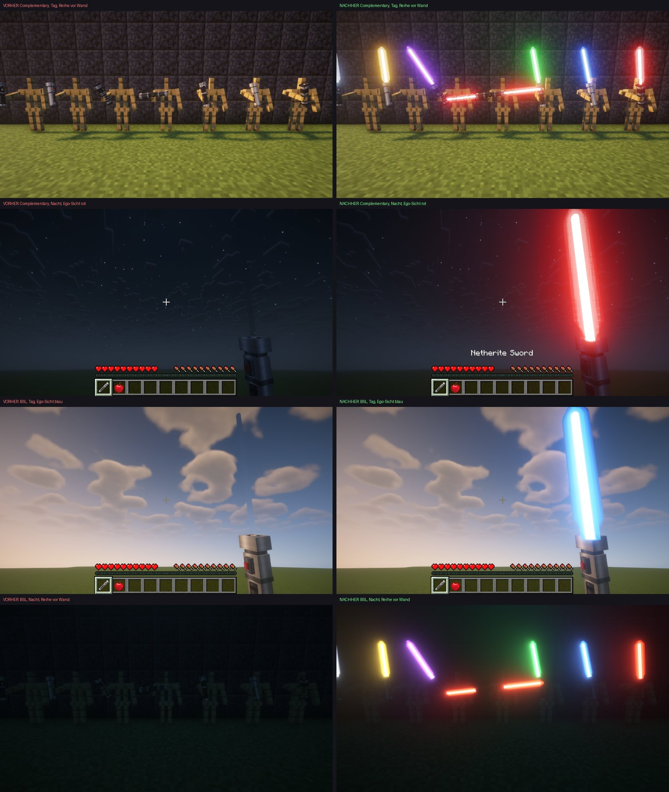
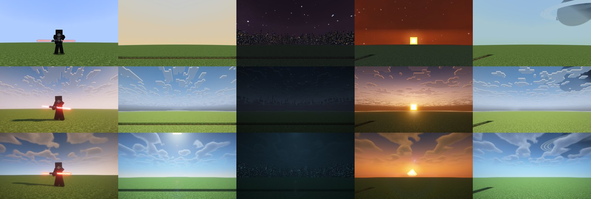
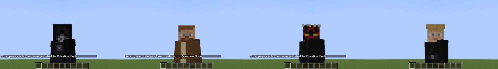
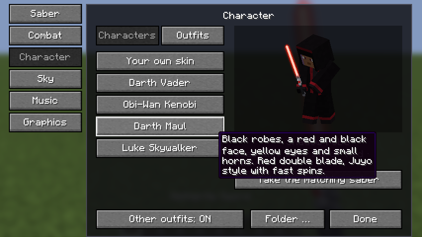
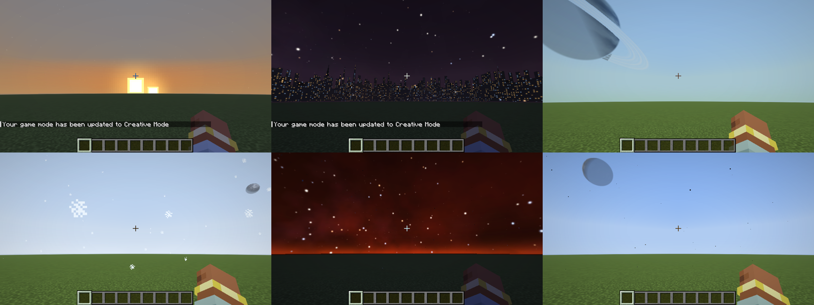
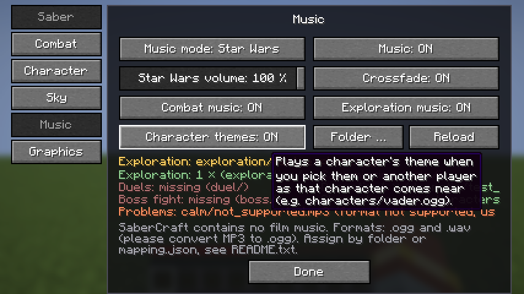

# Phase 8: Star Wars Ultimate Immersion

Stand: 24.10.2026, Minecraft 26.2, Fabric Loader 0.19.5, Fabric API 0.161.0+26.2, Java 25. **Keine neuen Pflicht-Abhängigkeiten.** Iris und Sodium sind optional; die Mod erkennt Iris zur Laufzeit.

Alles aus Phase 1 bis 7 bleibt: Griffe, Farben, Klinge, Zünden und Summen, Kampfbewegungen, Stile, Ausweichen, Machtkräfte, Weltraumhimmel, SaberCraft-Musik, Outfits, Menü (Taste V).

**In der JAR ist keine Filmmusik und keine geschützte Charakterdatei.** Alle Charakter-Texturen, Griffe und Himmel sind selbst gemalt (Skripte in `tools/`). Filmmusik und echte Skins kann jeder Spieler lokal selbst einlegen.

## 1. Shader-Bug: Klinge mit Iris durchsichtig

### Ursache

Iris tauscht jede Render-Pipeline gegen ein Programm des Shaderpacks. Es kennt aber nur die Vanilla-Pipelines und die, die eine Mod ihm übergibt. Die eigenen Pipelines der Klinge (`sabercraft:pipeline/blade_core`, `blade_glow` usw.) kannte Iris nicht. Im Log steht dann `Missing program sabercraft:pipeline/blade_core in override list`. Iris hat die Klinge deshalb mit dem Vanilla-Shader in seine G-Buffer gezeichnet. Das Shaderpack hat sie dort wie eine unbeleuchtete, nicht leuchtende Oberfläche behandelt: abgedunkelt, vernebelt und mit dem Alpha der Glow-Schichten fast unsichtbar gemacht. Dazu kam ein zweiter Effekt in der Ego-Perspektive: Iris zeichnet Wolken nach dem Hand-Pass, und weil die Klinge keine Tiefe schrieb, malten die Wolken über den Glow.

### Fix

- Solange ein Shaderpack aktiv ist, zeichnet die Klinge mit eigenen Pipelines auf Basis des Vanilla-Leuchtfeuerstrahls (`RenderPipelines.BEACON_BEAM_SNIPPET`, Vertexformat BLOCK, weiße Textur).
- Diese Pipelines werden über die öffentliche Iris-API übergeben: `IrisApi.assignPipeline(pipeline, IrisProgram.BEACON_BEAM)`. Shaderpacks zeichnen Leuchtfeuerstrahlen selbstleuchtend mit eigenem Bloom. Genau das braucht eine Lichtschwertklinge.
- Die Ego-Varianten schreiben Tiefe (`ALWAYS_PASS`), damit die Wolken den Glow nicht mehr übermalen.
- Im Schattenpass wird die Klinge nicht gezeichnet (sie wirft keinen Schatten).
- Glow-Ecken behalten ein Alpha von mindestens 1,5/255, weil BSL bei ganz klaren Strahl-Pixeln schwarze Punkte zeigt.
- Ohne Shaderpack ändert sich nichts. Iris wird nur über Reflection angesprochen.
- Neue Grafikoption „Klinge für Shaderpacks“ (Standard an), falls jemand das alte Verhalten möchte.

Keine Shader-Effekte wurden abgeschaltet.

### Tatsächlich getestete Shaderpacks

Mit **Iris 1.11.4 + Sodium 0.9.2**, je vorher und nachher, mit echten, geladenen Shaderpacks (im Spiel umgeschaltet, Pixelvergleich und Screenshots):

| Shaderpack | Version | Ergebnis |
| --- | --- | --- |
| Complementary Reimagined | r5.9.3 | Klinge kräftig farbig, weißer Kern, farbiger Glow, klare Kontur, Tag und Nacht |
| BSL Shaders | v10.1.8 | dasselbe |
| ohne Shaderpack (Vanilla und Iris aus) | – | unverändert wie Phase 7 |

Geprüft: alle 6 Farben in der Ego-Perspektive am Tag und um Mitternacht, eine Reihe Rüstungsständer (dritte Person) vor Himmel und vor einer Wand, die Doppelklinge von vorn und hinten, dazu ab dem finalen Stand ein Vader-Charakter in der dritten Person und vier Planetenhimmel unter jedem Pack.



Finaler Stand, oben ohne Shaderpack, Mitte Complementary, unten BSL: Vader, Tatooine, Coruscant (Nacht), Mustafar (Abend), Endor.



## 2. Charaktere

Fertig umgesetzt sind die vier bekanntesten Charaktere. Jeder hat ein eigenes Aussehen (über dem eigenen Skin, mit Kopf oder Helm), einen eigenen Griff, eine Farbe und einen eigenen Kampfstil mit eigenen Animationen und eigenem Klang des Stils:

| Charakter | Griff | Farbe | Kampfstil (neu in Phase 8 fett) |
| --- | --- | --- | --- |
| Darth Vader | Dunkler Lord | Rot | **Djem So**: wuchtige, schwere Hiebe aus hoher Haltung, Treffer stoßen weit zurück |
| Obi-Wan Kenobi | **Kenobi** (neu) | Blau | **Soresu**: defensive Haltung, Klinge vor dem Körper, langes Paradefenster |
| Darth Maul | Doppelklinge | Rot | **Juyo**: schnell, aggressiv, wirbelnd (nur Doppelklinge) |
| Luke Skywalker | **Skywalker** (neu) | Grün | Fließend |

- **Menü:** Taste V, Reiter „Charakter“, oben „Charaktere“ oder „Outfits“. Links die Liste, rechts eine Vorschau des Spielers mit dem Aussehen, die der Maus folgt.
- Wer einen Charakter wählt, während er ein Lichtschwert hält, bekommt dessen Griff, Farbe und Stil. Danach bleibt alles im Lichtschwert-Menü einzeln änderbar.
- **Eigene Skins:** Eine 64x64-PNG unter `config/sabercraft/characters/<id>.png` (`vader.png`, `obi_wan.png`, `maul.png`, `luke.png`) ersetzt das mitgelieferte Aussehen des Charakters. Der Knopf „Ordner …“ öffnet den Ordner. Das Menü zeigt „Eigener Skin aktiv“.
- Charakterwahl und Aussehen werden mit anderen Spielern auf dem Server geteilt (wie die Outfits aus Phase 7).





Noch nicht umgesetzt: Anakin, Yoda, Dooku, Ahsoka, Kylo, Rey. Die Struktur (Outfit-Eintrag, Griff, Stil, Textur, Musik-Thema) ist so gebaut, dass weitere Charaktere ohne Umbau dazukommen.

## 3. Planetenhimmel

V > „Himmel“ > „Planet“. Sechs Planeten, alle zur Laufzeit aus Zahlen gemalt, keine Bilder in der JAR:

| Planet | Himmel |
| --- | --- |
| Tatooine | blasser, heißer Himmel, Sanddunst, **zwei Sonnen**, zwei Monde, warme Abende |
| Coruscant | smogiger Himmel, **Stadt-Skyline rundherum**, nachts tausende Lichter und Glühen am Horizont |
| Endor | grünblauer Himmel, **Gasriese mit Ring** über den Bäumen, ein Mond |
| Hoth | blasser, kalter Himmel, weißer Nebel, Schnee in der Luft, zwei Monde |
| Mustafar | dunkelroter, rauchiger Himmel, Lava-Glühen am Horizont, fallende Asche |
| Naboo | klarer, tiefblauer Himmel, großer blasser Mond |

- Gelände und Weltgenerierung bleiben unverändert. Es ändern sich nur Himmelsfarbe, Nebelfarbe (nur unter freiem Himmel), eine Himmelsschicht, eine zweite Sonne und Partikel.
- „Kein Planet“ (Standard) schaltet alles komplett ab. Partikel lassen sich extra abschalten.
- Mit eingeschaltetem Weltraumhimmel (Phase 7) bekommt jeder Planet seinen eigenen Nachthimmel.
- Leistung: die Bilder werden einmal im Hintergrund gemalt (Qualität wie beim Weltraumhimmel), danach nur zwei Würfel pro Frame. Funktioniert mit Sodium und Iris.
- Nur die Oberwelt wird zum Planeten. Nether und End bleiben.



## 4. Musik: zwei getrennte Modi

V > „Musik“ > „Musikmodus“. Die Wahl wird gespeichert. Beide Modi haben eigene Einstellungen, die sich nicht gegenseitig überschreiben.

### Modus A: SaberCraft

Unverändert wie in Phase 7: die eingebaute, frei komponierte Musik (Erkundung, Nacht, Kampf, besondere Momente), eigene Lautstärke, Überblendungsdauer, eigene Dateien in `config/sabercraft/music/`.

### Modus B: Star Wars (eigene Dateien)

Spielt Musik, die der Spieler selbst einlegt, zum Beispiel gekaufte Soundtracks. Nichts davon ist in der Mod. Die Dateien werden nur lokal abgespielt und nie an Server oder andere Spieler geschickt.

Eigene Einstellungen: Lautstärke, Überblendung an/aus, Kampfmusik an/aus, Erkundungsmusik an/aus, Charakter-Themen an/aus, „Ordner …“, „Dateien neu laden“. Darunter: welches Stück gerade läuft, alle Situationen mit Anzahl der Stücke (fehlende in Rot) und alle Probleme (fehlende Dateien, falsches Format, zu groß).



Welche Situation gerade gilt (höchste zuerst):

1. **Boss** (Enderdrache, Wither, Warden, ...)
2. **Duell** (Kampf mit gezündeter Klinge) oder **Dramatisch** (Kampf ohne Klinge)
3. **Charakter-Thema**, wenn man selbst einen Charakter wählt oder ein Spieler mit Charakter in 32 Blöcken auftaucht (danach 5 Minuten Pause für dieses Thema)
4. **Ruhig/emotional** (nachts, unter Tage)
5. **Erkundung** (am Tag)

Ist für eine Situation nichts da, spielt die nächstpassende, sonst Stille. Die normale Minecraft-Musik ist in Modus B aus.

### Eigene Soundtracks einlegen

1. Einmal eine Welt betreten. Dann gibt es `config/sabercraft/starwars_music/` (im Minecraft-Ordner, zum Beispiel `%APPDATA%\.minecraft\config\sabercraft\starwars_music\`) mit `README.txt` und `mapping.json`.
2. Dateien in die Ordner legen:

   ```
   starwars_music/
     exploration/   Erkundung am Tag
     calm/          ruhige, emotionale Momente (Nacht, Höhlen)
     duel/          Lichtschwertduelle
     dramatic/      Kampf ohne gezündete Klinge
     boss/          Bosskämpfe
     characters/    vader.ogg, obi_wan.ogg, maul.ogg, luke.ogg (oder Ordner characters/vader/)
   ```

3. **Formate:** Ogg Vorbis `.ogg` (empfohlen) oder WAV `.wav` (16/24 Bit PCM, mono oder stereo). MP3, FLAC, M4A gehen nicht und werden im Menü als Problem angezeigt. Umwandeln mit Audacity (Datei > Exportieren > Als OGG) oder ffmpeg:

   ```
   ffmpeg -i "track.mp3" -c:a libvorbis -q:a 6 "track.ogg"
   ```

   Höchstens 64 Dateien pro Ordner, je höchstens 128 MB.
4. Optional `mapping.json`: Dateien pro Situation von Hand wählen. Pfade relativ zum Ordner, eine leere Liste nimmt den ganzen Ordner gleichen Namens:

   ```json
   {
     "duel": ["duel/duel_of_the_fates.ogg", "boss/battle_of_the_heroes.ogg"],
     "characters": { "vader": ["characters/imperial_march.ogg"] }
   }
   ```

5. Im Spiel V > Musik > Musikmodus „Star Wars“, dann „Dateien neu laden“.

## Benötigte Dateien und Einstellungen

- Pflicht: Fabric Loader 0.19.5+, Fabric API 0.161.0+26.2, Java 25, die SaberCraft-JAR. Auf dem Server und auf jedem Client.
- Für Shaderpacks: Iris (getestet 1.11.4) + Sodium (getestet 0.9.2), Option „Klinge für Shaderpacks“ an (Standard).
- Für Star-Wars-Musik: eigene `.ogg`/`.wav` im Ordner oben.
- Für echte Charakter-Skins: eigene 64x64-PNG in `config/sabercraft/characters/`.

## Tests

- Komplette Testsuite ohne Iris auf dem finalen Stand: `./gradlew build runClientGameTest`, **320 Prüfungen grün**.
- `ShaderBladeGameTest` mit Iris 1.11.4 + Sodium 0.9.2, Complementary Reimagined r5.9.3 und BSL v10.1.8 auf dem finalen Stand: **41 Prüfungen grün**, Iris bestätigt jeweils, dass das Pack wirklich geladen ist.
- Neu: `CharacterGameTest` (Charaktere, eigener Skin), `PlanetSkyGameTest` (alle 6 Planeten, Tag/Abend/Nacht, Menü), `MusicGameTest` Teil Star Wars (Ordner, README, mapping.json, ogg und wav werden gefunden und gespielt, mp3 als Problem gemeldet, Moduswechsel behält die Einstellungen), `CombatGalleryGameTest` und `ManeuverGameTest` mit Djem So, Soresu, Juyo.

## Bekannte Grenzen

- Nur 4 der 10 Charaktere sind fertig (Vader, Obi-Wan, Maul, Luke).
- Charaktere sind eine Schicht über dem Spieler-Skin, kein eigenes 3D-Modell.
- Star-Wars-Musik: kein MP3/FLAC (Minecraft kann nur Ogg; WAV wird umgewandelt).
- Nur die Oberwelt wird zum Planeten. Schnee- und Asche-Partikel nur unter freiem Himmel.
- **Planeten mit Shaderpack:** Shaderpacks berechnen Himmelsfarbe und Nebel selbst. Die Himmelsschicht (Skyline mit Lichtern, Monde, Gasriese, Lava-Glühen) erscheint, bei BSL deutlich, bei Complementary schwächer. Die Färbung des ganzen Himmels (zum Beispiel Mustafars Rot, Tatooines Sandton) kommt mit Shaderpack nur teilweise an.
- Getestet wurden zwei Shaderpacks. Andere Packs sollten über denselben Weg (Leuchtfeuerstrahl-Programm) funktionieren, sind aber nicht geprüft.
- In der Cloud-Testumgebung fehlen einige Vanilla-Partikeltexturen (lila Platzhalter auf Screenshots). Im echten Spiel nicht.

## Installation und Test

1. `sabercraft-0.1.0.jar` (Phase 8) und Fabric API 0.161.0+26.2 in `.minecraft/mods/` legen. Alte SaberCraft-JARs entfernen.
2. Optional Iris + Sodium dazulegen und ein Shaderpack in `.minecraft/shaderpacks/`.
3. Spiel starten, Welt betreten, Netherite-Schwert in die Hand nehmen, Taste V.
4. **Shader:** Optionen > Videoeinstellungen > Shaderpacks, Complementary oder BSL wählen. Klinge zünden (Rechtsklick lang), Tag (`/time set noon`) und Nacht (`/time set midnight`), F5 für dritte Person. Erwartung: kräftige Farbe, weißer Kern, Glow, klare Kontur.
5. **Charakter:** V > Charakter > Charaktere > Darth Vader. Das Schwert wird rot mit Vader-Griff und Djem-So-Stil, F5 zeigt das Aussehen.
6. **Planet:** V > Himmel > Planet > Tatooine. Mittags zwei Sonnen, bei `/time set 12500` beide über dem Horizont. Coruscant nachts für die Stadtlichter.
7. **Musik:** V > Musik > Musikmodus „Star Wars“. Ohne Dateien zeigt das Menü alle Situationen in Rot. Eine `.ogg` nach `starwars_music/exploration/` legen, „Dateien neu laden“, am Tag läuft sie. Zurück auf „SaberCraft“: die alte Musik mit ihren alten Einstellungen.
