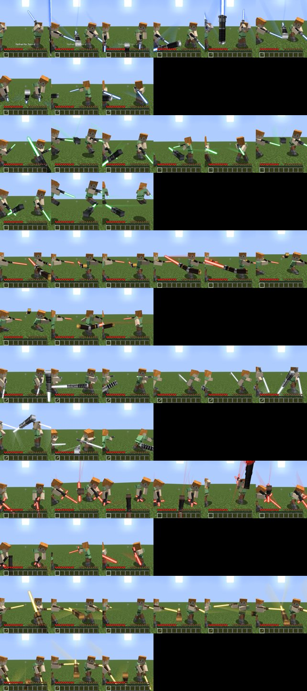
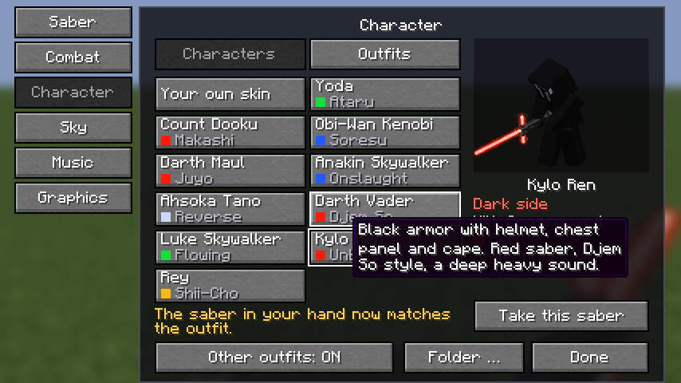
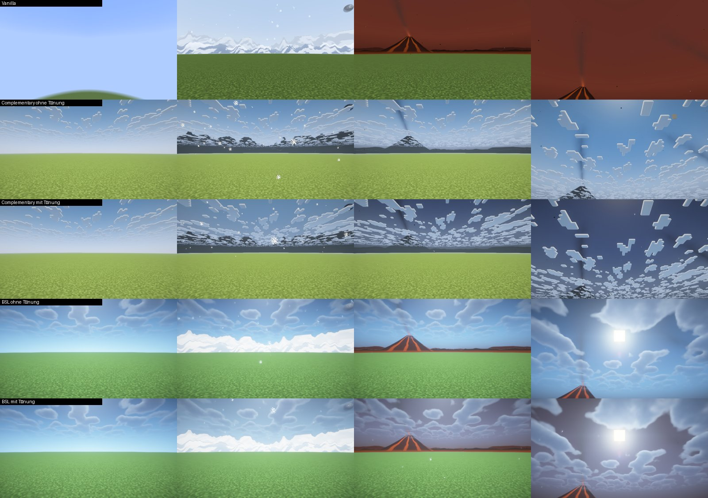
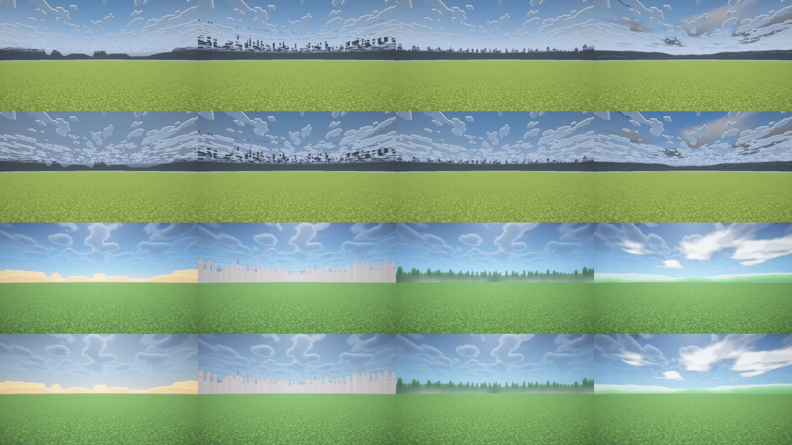
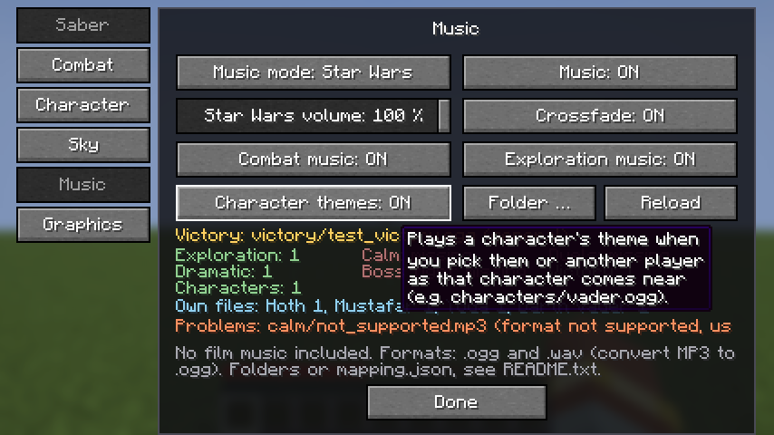

# Phase 9: Charaktere, Auswahl, Planeten, Musik

Stand: 24.10.2026, Minecraft 26.2, Fabric Loader 0.19.5, Fabric API 0.161.0+26.2, Java 25. **Keine neuen Abhängigkeiten.** Iris und Sodium bleiben optional.

Alles aus Phase 1 bis 8 bleibt erhalten: Klinge, Zünden und Summen, alle bisherigen Griffe, Farben und Kampfstile, Ausweichen, Abwehr, Machtkräfte, Weltraumhimmel, die vier Charaktere aus Phase 8, die Outfits, beide Musikmodi und das Menü (Taste V). Die alten Bewegungen und Stile in `moves.json` sind unverändert (geprüft per Vergleich der Datei).

**In der JAR ist keine Filmmusik und keine geschützte Grafik.** Griffe, Charakter-Looks und Himmel werden von eigenen Skripten berechnet (`tools/gen_hilts.py`, `tools/paint_outfits.py`, `PlanetSkyPainter`).

## 1. Sechs neue Charaktere

Jeder Charakter hat einen eigenen Griff, eine eigene Klingenfarbe, einen eigenen Look über dem Skin und einen **eigenen Kampfstil mit eigenen Bewegungen**, nicht nur andere Werte. Wählst du den Charakter mit einem Netherite-Schwert in der Hand, bekommt das Schwert sofort Griff, Farbe und Stil.

| Charakter | Griff | Klinge | Stil | Was ihn ausmacht |
| --- | --- | --- | --- | --- |
| Anakin Skywalker | „Anakin“: schwarzer Rippengriff mit gezacktem Emitter | blau | **Ansturm** (Form V) | hohe Garde über der Schulter, Überkopfhieb, Rückhand, aufsteigender Schnitt, **Doppelschlag** (zwei Treffer in einer Bewegung), **Sprungangriff**, Drehhieb. Ausfallschritt, schnelle Seitrolle, Rückwärtssalto. |
| Yoda | „Kleiner Meister“: kurzer Griff, **kurze Klinge** | grün | **Ataru** | tiefe, gespannte Haltung, **Salto über das Ziel mit Schnitt**, Drehschnitte, langer Rollsprung, Wirbelwind in der Luft. Schnellstes Ausweichen. Yoda wird **klein dargestellt** (0,56), abschaltbar. |
| Count Dooku | „Graf“: **gebogener** Griff | rot | **Makashi** | aufrecht, einhändig, **freie Hand hinter dem Rücken**, Stöße, Schläge aus dem Handgelenk, Umgehen der gegnerischen Klinge, langer fliegender Ausfall (Flèche), eine Schwungfigur als Spezialangriff. Langes Paradefenster. |
| Ahsoka Tano | „Tano“: schlanker weiß-silberner Griff | weiß | **Rückhand** (Shien im Rückhandgriff) | die Klinge zeigt am Unterarm entlang nach hinten: Hakenschlag, **Stich nach hinten**, aufsteigender Schnitt, Drehung, tiefer Sprintschnitt, Fallschnitt, Zyklon. Schnelle Rollen. |
| Kylo Ren | „Kreuzparier“: Parierstange mit **zwei kurzen Seitenklingen** | rot, **instabil und knisternd** | **Ungezügelt** | gebückt, Klinge tief, riesige **Hammerschläge** von hinter dem Kopf, weite wilde Schwünge, **Raserei aus drei Schlägen**, Sturmangriff. Weitester Rückstoß, schwacher Block. |
| Rey | „Stabstück“: Bronzegriff mit Lederwicklung | gelb | **Shii-Cho** (Form I) | beidhändige Mittelgarde, weite Schwünge von Seite zu Seite mit dem ganzen Körper, Rückschwung, **Stabwirbel**, Überkopfhieb, Sturmangriff. Solider Block. |

Technik:

- 6 neue Griffe (insgesamt 13), 6 neue Kampfstile (insgesamt 11), **102 Bewegungen** in `moves.json` (Ego-Perspektive und Third Person, erzeugt von `tools/gen_moves.py`).
- Neu im Bewegungsformat: `more_strikes`, damit eine Bewegung mehrmals trifft (Anakins Doppelschlag, Kylos Raserei).
- Neu im Klingenmodell: `unstable` für Kylos Klinge (Flackern plus ausgefranste Ringe und Funken) und Seitenklingen am Kreuzparier.
- Yodas Größe ist eine reine Darstellung (Option „Charaktergröße“ im Charaktermenü, Standard an). Seine Trefferbox bleibt die eines Spielers.
- Jeder Stil hat eigene Ausweichbewegungen, Landungen, Parade und Abwehrtreffer.

## 2. Charakterauswahl

- **Charaktermenü (V > Charakter):** alle zehn Charaktere als Karten in zwei Spalten. Jede Karte zeigt **Name, Klingenfarbe (Farbfeld) und Kampfstil**. Rechts eine 3D-Vorschau und das Profil: Name, Seite (Helle Seite, Dunkle Seite, Grau), Griff, Farbe, Stil. Der Tooltip zeigt die Beschreibung. Die Outfits aus Phase 7 bleiben im Reiter „Outfits“, eigene Skin-Dateien funktionieren wie vorher.
- **Schwertmenü (V > Schwert):** die 13 Griffe als Bildraster mit Namen im Tooltip, darunter die 11 Kampfstile. Alle bisherigen Funktionen bleiben.
- Der Knopf „Schwert übernehmen“ gibt dem Schwert in der Hand den Griff, die Farbe und den Stil des gewählten Charakters.

## 3. Planeten und Atmosphäre

Das Gelände und die Weltgeneration sind **nicht verändert**. Alles Neue ist in die Himmelsschicht gemalt und steht hinter dem echten Gelände.

| Planet | Neu in Phase 9 |
| --- | --- |
| Tatooine | Dünen am Horizont, dahinter ferne Tafelberge |
| Coruscant | Luftverkehr: vier Flugbahnen über der Skyline, tagsüber dunkle Punkte, nachts weiße und rote Lichter |
| Endor | Wand aus Riesenbäumen mit Nebel am Fuß |
| Hoth | verschneite Eisberge mit Licht- und Schattenflanken, **nachts ein Polarlicht** im Norden |
| Mustafar | vier Vulkane mit **Lavaströmen**, glühenden Lavafeldern und **Rauchsäulen**, nachts hell leuchtend |
| Naboo | sanfte grüne Hügel und **weiße Wolken** |

Neue Optionen unter V > Himmel:

- **Horizont und Details** (Standard an): die Landschaften und Details oben.
- **Planetenfarbe mit Shadern** (Standard an, wirkt nur mit Iris-Shaderpack): eine halbdurchsichtige Schicht in der Himmelsfarbe des Planeten.

### Wie viel vom Himmel mit Shadern sichtbar bleibt (gemessen)

Neuer Test `PlanetVisibilityGameTest`: Für jeden Planeten wird dasselbe Bild mit und ohne Planet aufgenommen und die mittlere Farbabweichung gemessen (0 bis 255 pro Farbkanal). „Himmel“ ist der Blick 40° nach oben (obere 60 % des Bildes), „Horizont“ der Blick geradeaus (Band knapp über der Bildmitte). Das „Rauschen“ ist die Abweichung zweier Bilder ganz ohne Planet (bewegte Wolken und Effekte des Packs). Getestet mit Iris 1.11.4 + Sodium 0.9.2, Complementary Reimagined r5.9.3 und BSL v10.1.8, auf llvmpipe (Software-Grafik). Mittags:

| Planet | Ansicht | Vanilla | Compl. ohne Tönung | Compl. mit Tönung | BSL ohne Tönung | BSL mit Tönung |
| --- | --- | --- | --- | --- | --- | --- |
| Tatooine | Himmel | 42,9 | 0,2 | 9,7 | 13,2 | 17,8 |
| Tatooine | Horizont | 47,9 | 35,2 | 55,9 | 13,8 | 22,6 |
| Coruscant | Himmel | 24,8 | 0,1 | 9,8 | 16,8 | 16,2 |
| Coruscant | Horizont | 59,4 | 60,8 | 69,9 | 18,4 | 21,6 |
| Endor | Himmel | 13,5 | 0,0 | 8,1 | 18,8 | 17,5 |
| Endor | Horizont | 59,0 | 40,3 | 53,3 | 31,0 | 35,5 |
| Hoth | Himmel | 29,0 | 0,9 | 6,2 | 19,8 | 18,3 |
| Hoth | Horizont | 23,7 | 64,2 | 71,9 | 21,7 | 23,9 |
| Mustafar | Himmel | 132,8 | 1,7 | 49,6 | 19,1 | 26,9 |
| Mustafar | Horizont | 158,3 | 37,2 | 66,1 | 43,4 | 75,7 |
| Naboo | Himmel | 8,1 | 1,2 | 10,9 | 18,1 | 17,4 |
| Naboo | Horizont | 20,6 | 36,1 | 48,6 | 11,7 | 15,0 |
| Rauschen | Himmel / Horizont | 0,0 / 0,0 | 0,2 / 0,2 | | 4,3 / 0,4 | |

Nachts sind die Werte kleiner: ohne Shader 13 bis 30, mit Complementary 5 bis 12 (mit Tönung), mit BSL nur 1 bis 6. Die ganze Tabelle mit Nachtwerten: [planet_visibility.csv](images/phase9/planet_visibility.csv).

Was das heißt, ehrlich ausgewertet (die Zahlen und die Bilder dazu):

- **Ohne Shader** ist jeder Planet deutlich sichtbar. Naboo weicht am Himmel nur wenig ab (8,1), weil sein Blau dem Minecraft-Blau ähnelt. Seine Hügel und Wolken sind klar zu sehen.
- **Complementary** zeichnet die Himmelsschicht, **nimmt ihr aber die Farbe**: Landschaften erscheinen als dunkelgraue Silhouetten, Mustafars Rot und Tatooines Sand gehen verloren. Ohne Tönung bleibt der obere Himmel fast unverändert (0 bis 2). Die Tönung macht den Himmel messbar anders, aber nur **dunkler und grauer**, nicht rot oder sandfarben. Complementarys eigene Wolken liegen vor allem.
- **BSL** behält die Farben der Schicht: Dünen, Eisberge, Vulkane mit Lava, Bäume und Skyline sind in Farbe zu sehen. Die Tönung gibt einen leichten Farbstich (Tatooine wärmer, Mustafar rötlich-grau). Nachts bleibt mit BSL fast nichts vom Planeten übrig.
- Fazit: Mit Shaderpack kommt der **Horizont mit seiner Landschaft gut an** (BSL farbig, Complementary als Silhouette). Die **Himmelsfarbe** kommt mit BSL teilweise und mit Complementary nicht an. Wer mit Complementary den grauen Himmel nicht mag, schaltet „Planetenfarbe mit Shadern“ aus.

## 4. Musik

Beide Modi bleiben: **SaberCraft** (eingebaut, unverändert) und **Star Wars** (nur eigene Dateien, `.ogg` und `.wav`). Neu im Star-Wars-Modus:

- **Musik für Planeten:** `planets/<planet>/` für Erkunden und ruhige Momente, `planets/<planet>/<situation>/` für jede Situation.
- **Musik für Charaktere:** `characters/<charakter>/<situation>/` gilt, solange du den Charakter spielst. Das Auftrittsthema (`characters/vader.ogg`) bleibt wie in Phase 8, jetzt für alle zehn Charaktere.
- **Neue Situation „Sieg“:** `victory/`, einmal nach einem gewonnenen Kampf.
- **Feste Reihenfolge:** Charakter, dann Planet mit Situation, dann Planet allgemein, dann der normale Situationsordner. Nichts muss doppelt abgelegt werden.
- **mapping.json** kennt jetzt `planets` und Charaktere als Objekt (`theme` plus Situationen). Die Form aus Phase 8 funktioniert weiter.
- **Menü:** zeigt hinter dem laufenden Titel, woher er kommt („(Planet Hoth)“, „(als Yoda)“, „(Thema Vader)“, „(allgemein)“), die Zahl der Dateien jeder Situation und welche Planeten und Charaktere eigene Dateien haben.
- Die `README.txt` im Musikordner wird mit der neuen Anleitung neu geschrieben, wenn sie noch aus Phase 8 stammt. Eine vorhandene `mapping.json` wird nie überschrieben.

**Genaue Anleitung:** [eigene-musik.md](eigene-musik.md).

## Tests

Alle Tests laufen im echten Spielclient (Fabric Client Gametest) unter Xvfb mit llvmpipe.

| Lauf | Stand | Ergebnis |
| --- | --- | --- |
| `./gradlew build` und alle 14 Client-Gametests ohne Iris | Endstand bis auf die zwei Menü-Korrekturen unten | **450 Prüfungen grün**, Exit 0 |
| `ShaderBladeGameTest` und `PlanetVisibilityGameTest` mit Iris 1.11.4 + Sodium 0.9.2, Complementary r5.9.3 und BSL v10.1.8 | Endstand bis auf die zwei Menü-Korrekturen | **57 Prüfungen grün**, Iris bestätigt jedes Pack als geladen. Zwei Läufe, Messwerte bis auf höchstens 0,7 gleich |
| `CharacterGameTest` und `MusicGameTest` nach den Menü-Korrekturen | Endstand | **89 Prüfungen grün** |

Die zwei Menü-Korrekturen zum Schluss betreffen nur die Textposition (Statuszeile im Charaktermenü, Hinweis im Musikmenü) und sind mit dem dritten Lauf geprüft.

Neu oder erweitert in Phase 9:

- `CharacterGameTest`: jeder der sechs neuen Charaktere wird mit einem Schwert in der Hand im Menü angeklickt. Geprüft wird, dass das Schwert auf dem Server genau Griff, Farbe und Stil des Charakters hat und der Server den Charakter kennt. Dazu Yodas Größe mit und ohne Option, Screenshots von vorne und hinten.
- `CombatGalleryGameTest`: alle Bewegungen der sechs neuen Stile, Bild für Bild (in Ego-Perspektive und Third Person), angesehen.
- `ManeuverGameTest`: alle vier Ausweichrichtungen für jeden neuen Stil. Der Spieler muss sich in die richtige Richtung bewegen und auf dem Boden landen.
- `SaberVariantGameTest`: jeder neue Griff hat in jeder Hand und Farbe eine Klinge (bei Yoda die kurze), ein Inventarsymbol ohne Klinge und eine eigene Modellkennung je Farbe.
- `MusicGameTest`: Datei eines Planeten (Hoth), eines Charakters (Yoda, dramatisch), Mustafar per `mapping.json` in der neuen Form, Rückfall auf die normalen Ordner, die alte `mapping.json`-Form für Vader, Siegmusik nach einem Kampf, Zähler im Menü.
- `PlanetVisibilityGameTest` (neu): die Messung oben. Ohne Shader muss jeder Planet Himmel und Horizont klar verändern. Mit Shader werden die Werte nur gemeldet.
- `PlanetSkyGameTest`: alle sechs Planeten mit den neuen Landschaften, Mittag, Abend, Nacht.

Was nicht getestet wurde:

- Andere Shaderpacks als Complementary r5.9.3 und BSL v10.1.8.
- Eine echte Grafikkarte (alle Bilder kommen von llvmpipe, Software-Rendering).
- Ein Mehrspieler-Server mit mehreren echten Spielern. Der Abgleich der Charaktere läuft über denselben Weg wie in Phase 8 und ist im Test über den integrierten Server geprüft.
- Echte Filmmusik (Tests nutzen eigene Sounds der Mod als Platzhalter-Dateien).

## Bekannte Grenzen

- **Shaderpacks:** siehe Messung oben. Complementary entfärbt die Planetenschicht, die Tönung kann das nur aufhellen oder abdunkeln. BSL zeigt nachts kaum etwas vom Planeten.
- Die Horizont-Landschaft ist gemalt und steht in fester Entfernung. Sie ist nur dort zu sehen, wo das echte Gelände den Horizont frei lässt (Ebenen, Meer, Berggipfel).
- Yoda ist nur kleiner gezeichnet. Trefferbox, Augenhöhe und Kamera bleiben die eines normalen Spielers.
- Ahsoka führt eine Klinge, nicht zwei (kein Zweihandkampf mit zwei Schwertern).
- Kylos Seitenklingen sind Teil des Modells. Sie treffen nicht eigenständig.
- Charaktere bleiben eine Schicht über dem Spieler-Skin, kein eigenes 3D-Modell (wie in Phase 8).
- Kein MP3 und FLAC im Star-Wars-Modus (wie in Phase 8).
- In der Cloud-Testumgebung fehlen einige Vanilla-Texturen und Sounds (lila Platzhalter auf manchen Screenshots). Im echten Spiel nicht.

## Installation und Test

1. `sabercraft-0.1.0.jar` (Phase 9) und Fabric API 0.161.0+26.2 in `.minecraft/mods/` legen. Alte SaberCraft-JARs entfernen.
2. Optional Iris + Sodium und ein Shaderpack.
3. **Charaktere:** Netherite-Schwert in die Hand, V > Charakter. Eine Karte anklicken, zum Beispiel Kylo Ren: das Schwert wird zum roten, knisternden Kreuzparier mit Stil „Ungezügelt“. F5 für die dritte Person, Linksklick für die Angriffe, linke Alt-Taste zum Ausweichen.
4. **Yoda:** wählen und mit F5 ansehen. Im Charaktermenü schaltet „Charaktergröße“ auf normale Größe.
5. **Planeten:** V > Himmel > Planet, zum Beispiel Hoth. Auf einer Ebene geradeaus schauen (Eisberge), nachts nach Norden (Polarlicht). Mustafar nachts für die Lava.
6. **Musik:** V > Musik > Star Wars. Eine `.ogg` nach `config/sabercraft/starwars_music/planets/hoth/` legen, „Neu laden“, Hoth als Planet wählen. Das Menü zeigt „(Planet Hoth)“ hinter dem Titel.
