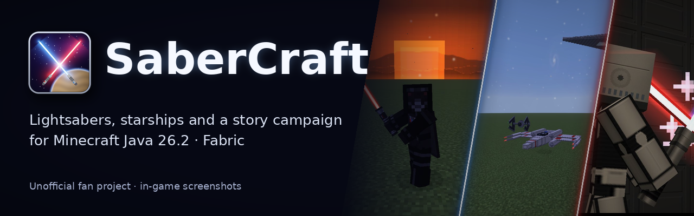

**SaberCraft brings the lightsaber to Minecraft, and builds a galaxy around it.** Ignite a blade that hums, glows and clashes like in the films, fight with fifteen styles and the Force, call your droids, climb into an X-Wing or walk the corridors of a Star Destroyer. And when you are ready, slip aboard the *Tenebris* in **"Nightshade"**, a six-mission stealth story that ends with a lightsaber duel.

> SaberCraft is an **unofficial, free fan project**, not affiliated with or endorsed by Lucasfilm, Disney, Mojang or Microsoft. It contains **no film music, film sounds or film artwork**: every model, texture, sound and piece of music was made for this mod.

## ⚔️ Lightsabers and combat

Turn any sword you choose into a lightsaber in the SaberCraft menu (key **I**). It ignites with its own rhythm, hums as you move, leaves a trail and throws sparks where blades meet, and turns back into exactly the sword it was whenever you like.

- **14 hilts** and **6 blade colors**, each color's core, glow, length and flicker adjustable
- **15 fighting styles**, guard, parry, dodges, a spin attack and bolts turned back with the blade
- **Force** push, grip, pull and jump
- Works with **Iris** shader packs

## 📖 The story: "Nightshade"

*For three weeks Kestrel, an agent hidden aboard the Star Destroyer* Tenebris, *sent data to the Rebellion. Then one last message: "Nightshade is not a ship. It is a hunt."*

Chapter 1 is a complete story in six missions. Sneak through the dark, crawl through vents, take down unaware guards, wear a stormtrooper's armour among the troops, and let your droid helpers make a noise or open a lock. The crew notices you in stages and searches where they last saw you; the characters speak to you by your own Minecraft name; and the finale throws you against troopers who fire the moment they see you, and then against the *Shadowblade* and her spinning ring saber.

Checkpoints, three difficulties, skippable cutscenes, its own music for every situation, English and German.

## 🚀 Starships

- **X-Wing**, **TIE Fighter** and **TIE Interceptor** to fly, with lasers, a flight HUD and a chase camera
- **Millennium Falcon** and **Star Destroyer** to fly *and walk through*: cockpit, lounge, gun turrets, a bridge, a hangar, a reactor and a crew at work
- Hull and flight energy; crashes break no blocks

## 🤖 Droids, blasters and more

- **8 droid companions** (R2-D2, C-3PO, BB-8, Chopper, a mouse droid, a probe droid, a B1 battle droid, K-2SO), each with moving parts, a wordless voice and an ability
- **9 blasters** that turn a bow into a blaster and fire plain arrows as ammunition
- **11 film characters** and 5 neutral outfits with original pixel skins, plus your own profiles
- A **space sky** at night and **6 planet skies** (Tatooine, Coruscant, Endor, Hoth, Mustafar, Naboo); the terrain stays yours
- **30 original pieces of music** that follow what happens, always crossfaded
- Voluntary **lightsaber duels** between players and **11 advancements**

## Requirements

- Minecraft Java Edition **26.2**
- **Fabric Loader** 0.19.5 or newer
- **[Fabric API](https://modrinth.com/mod/fabric-api)**

In single player everything works with the mod installed once. On a server, install SaberCraft and Fabric API on the server **and** on every client. Each player plays their own copy of the story.

## Good to know

- Only Minecraft 26.2 with Fabric; no Forge, NeoForge or Quilt.
- Chapter 1 of the story is complete; there are no further chapters yet.
- Starships, droids and blasters are the newest parts and have not been balanced with many players yet.
- A server full of real players at once has not been tried yet.

## Links

- Source code, all controls, commands and settings, bug reports: [GitHub](https://github.com/Phiro4241/SaberCraft)
- Support the project (voluntary, unlocks nothing): [Patreon](PATREON_URL_EINTRAGEN)
