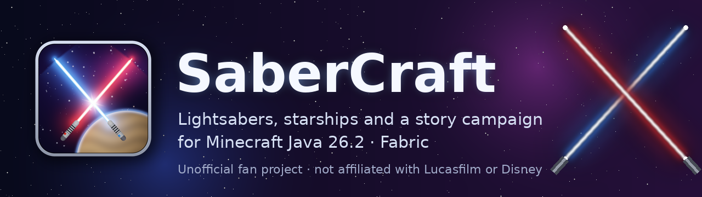

# Modrinth: Projektseite (vorbereitet, nicht veröffentlicht)

Alles, was beim Anlegen des Projekts auf [modrinth.com](https://modrinth.com) eingetragen wird. **Nicht einreichen, bevor Phiro die offenen Punkte unten geklärt hat.**

> **Stand der Regeln.** Die Modrinth-Seiten selbst konnte ich aus meiner Umgebung nicht öffnen; die Regeln unten stammen aus Suchergebnissen vom 26.11.2026 und müssen vor dem Einreichen auf den Originalseiten nachgelesen werden: [Content Rules](https://modrinth.com/legal/rules), [AI policy and disclosures](https://modrinth.com/news/article/ai-policy-and-disclosures/), [Project review times](https://support.modrinth.com/en/articles/8793355-project-review-times).

## Wichtig vor dem Einreichen

1. **KI-Offenlegung (Pflicht seit August 2026).** Modrinth verlangt, dass generative KI im Tab **Disclosures** angegeben wird. Ein Projekt, das vollständig oder überwiegend von generativer KI erstellt wurde, kann Modrinth ablehnen oder aus der Suche nehmen; auch ein Konzept, das aus KI-Ausgaben entstanden ist, soll offengelegt werden. SaberCraft wurde unter Phiros Leitung weitgehend mit einem KI-Assistenten programmiert, einschließlich der Skripte, die Modelle, Texturen, Klänge und Musik erzeugen. Es wurden keine Bild- oder Musikgeneratoren verwendet; die Assets entstehen prozedural aus Code. Das muss ehrlich angegeben werden. **Es ist möglich, dass Modrinth das Projekt deshalb ablehnt.** Vorschlag für die Offenlegung siehe unten.
2. **Patreon-Link** erst eintragen, wenn die URL geprüft ist ([`patreon.md`](patreon.md)). Modrinth erlaubt Spendenlinks, verlangt aber, dass alles, was auf der Seite beworben wird, frei verfügbar ist (keine Bezahlschranke). Das ist bei SaberCraft so.
3. **Star-Wars-Namen.** Das Projekt ist eine inoffizielle Fan-Mod. Titel und Zusammenfassung nennen deshalb keine Marke; die Beschreibung sagt klar, dass es keine offizielle Mod ist und keine Filmmusik, Filmsounds oder Filmbilder enthält.

## Projekt anlegen

| Feld | Eintrag |
| --- | --- |
| Project type | Mod |
| Name | `SaberCraft` (nur der Name, keine Versionsnummer, keine Schlagwörter) |
| URL | `sabercraft` (modrinth.com/mod/sabercraft, falls frei) |
| Visibility | erst **Draft**, nach Prüfung **Public** |
| Summary (kurz, ohne den Titel zu wiederholen) | `Film-style lightsabers, a six-mission stealth story aboard a Star Destroyer, blasters, droids and starships. Unofficial fan mod with original music and art.` |

## Allgemeine Einstellungen

| Feld | Eintrag |
| --- | --- |
| Icon | [`src/main/resources/assets/sabercraft/icon.png`](../../src/main/resources/assets/sabercraft/icon.png) (512×512 PNG, 217 KB) |
| Client side | **Required** (Klingen, Musik, Menüs, Story-Anzeige) |
| Server side | **Required** (Story, Fähigkeiten, Blaster, Droiden, Schiffe laufen auf dem Server; im Einzelspieler ist beides dabei) |
| License | **MIT** (`MIT`) |
| Source code | https://github.com/Phiro4241/SaberCraft |
| Issue tracker | https://github.com/Phiro4241/SaberCraft/issues |
| Wiki page | leer lassen (oder https://github.com/Phiro4241/SaberCraft#readme) |
| Discord | leer lassen |
| Donation links | Patreon, **erst nach Prüfung der URL** |

**Kategorien (Vorschlag, die genaue Liste zeigt das Formular):** Adventure, Equipment, Transportation. Zusätzlich passend, falls angeboten: Game Mechanics, Mobs.

Hinweis zu Client/Server: Ein Client ohne Server-Mod sieht nur die Klingen, Musik, Himmel und Menüs (siehe Tabelle im README). Wer „Client side: Optional“ wählt, weckt falsche Erwartungen; deshalb beide **Required**.

## Beschreibung (Markdown, in das Feld „Description“ kopieren)

```markdown


**SaberCraft** turns Minecraft's swords into film-style lightsabers and builds a whole galaxy around them: fighting styles and Force abilities, blasters, droid companions, starships you can fly and walk through, planet skies, original music and a story campaign.

> SaberCraft is an **unofficial fan project**, not affiliated with or endorsed by Lucasfilm, Disney, Mojang or Microsoft. It contains **no film music, no film sounds and no film artwork**: every model, texture, sound and piece of music was made for this project.

## Story mode: Chapter 1, "Nightshade"

For three weeks an agent hidden aboard the Star Destroyer *Tenebris* sent data to the Rebellion. Then one last message: *"Nightshade is not a ship. It is a hunt."* You are smuggled aboard to find her and to learn what Nightshade is.

- **Six missions**: a briefing aboard the Millennium Falcon, sneaking aboard, a disguise, the reactor, a discovery and a finale with an escape and a lightsaber duel.
- **Stealth** with darkness, cover, sneaking, crawl ways and silent takedowns. Troopers notice you in stages, chase you, call for help and search where they last saw you.
- **Disguise** as a stormtrooper, **dialogs with choices**, two **droid helpers**, short **cutscenes** (skippable).
- **The finale**: troopers who fire as soon as they see you, then a duel in phases against the *Shadowblade*.
- **Your name in the story**: the characters speak to you by your own Minecraft name.
- **Checkpoints**, three **difficulties**, own **music** for every situation, German and English.

## Features

- **Lightsabers**: ignition and retraction, glow, hum and swing sounds; 14 hilts, 6 blade colors, 15 fighting styles, guard, parry, dodges, spin attack and four Force abilities (push, grip, pull, jump). Only the swords you choose become sabers. Works with Iris shader packs.
- **Characters**: 11 film characters and 5 neutral outfits with original pixel skins, plus your own profiles.
- **Blasters** *(experimental)*: 9 blasters that use plain arrows as ammunition, with heat and recoil.
- **Droids** *(experimental)*: 8 droid companions with moving parts, wordless synthesized voices and one ability each.
- **Starships** *(experimental)*: a flyable X-Wing, TIE Fighter and TIE Interceptor; a Millennium Falcon and a Star Destroyer you can fly and walk through.
- **Skies**: a space sky and 6 planet skies (sky and sound only, the terrain stays as it is).
- **Music**: 30 original pieces that follow what happens, with crossfades. A "Star Wars" mode plays only music files you add yourself.
- **Duels** between players (voluntary, best of three) and **11 advancements**.

Everything can be set in the in-game menu (key **I**).

## Requirements

- Minecraft Java Edition **26.2** (other versions are not supported)
- **Fabric Loader** 0.19.5 or newer
- **Fabric API** (required)

## Multiplayer

In single player everything works with the mod installed once. On a server, install SaberCraft and Fabric API on the server **and** on every client. Each player plays their own copy of the story; it is not a co-op mode.

## Known limitations

- Only Minecraft 26.2 with Fabric. No Forge, NeoForge or Quilt.
- Only Chapter 1 of the story exists. Texts in German and English.
- Blasters, droids and starships are experimental: built and tested automatically, little played by hand, not balanced with real players.
- A server with several real players at once has not been tested yet.

## Links

- Source code, full documentation and bug reports: [GitHub](https://github.com/Phiro4241/SaberCraft)
- Support the project (voluntary, unlocks nothing): [Patreon](PATREON_URL_EINTRAGEN)
```

Vor dem Einfügen `PATREON_URL_EINTRAGEN` durch die geprüfte URL ersetzen oder die Zeile löschen.

## Galerie

Bilder hochladen in dieser Reihenfolge (Titel und Beschreibung auf Englisch). Die Dateien stammen alle aus dem Spiel selbst (automatische Tests, Software-Rendering). Ein Bild als **Featured** markieren.

| # | Datei | Titel | Featured |
| --- | --- | --- | --- |
| 1 | `docs/media/screenshots/story-duel.jpg` | The duel against the Shadowblade | ✔ |
| 2 | `docs/media/screenshots/story-reactor.jpg` | The reactor of the Tenebris | |
| 3 | `docs/media/screenshots/story-briefing.jpg` | Dialogs that use your own name | |
| 4 | `docs/media/screenshots/story-trooper.jpg` | A stormtrooper on patrol | |
| 5 | `docs/images/phase5/aufstellung_nacht.png` | Six blade colors | |
| 6 | `docs/media/screenshots/saber-clash.png` | Blade clash | |
| 7 | `docs/media/screenshots/droids.png` | Droid companions | |
| 8 | `docs/media/screenshots/x-wing-flight.png` | X-Wing in flight | |

Mehr dazu und fehlende Wunschbilder: [`screenshots.md`](screenshots.md).

## Version 0.1.0 hochladen

| Feld | Eintrag |
| --- | --- |
| File | `sabercraft-0.1.0.jar` (nicht die `-sources.jar`) |
| Version name | `SaberCraft 0.1.0` |
| Version number | `0.1.0` |
| Release channel | **Beta** |
| Loaders | Fabric |
| Game versions | 26.2 |
| Dependencies | Fabric API: **required** (Projekt `fabric-api` auf Modrinth) |
| Changelog | Inhalt von [`release-notes-0.1.0.md`](release-notes-0.1.0.md) |

## Disclosures (Vorschlag)

Die genauen Auswahlfelder zeigt erst das Formular. Inhaltlich zutreffend ist:

- **Generative AI:** ja. Code und die Generator-Skripte für Modelle, Texturen, Klänge und Musik wurden mit einem KI-Assistenten geschrieben, unter Anleitung, Prüfung und Spieltests des Autors. Keine Bilder, Klänge oder Musik aus KI-Generatoren; die Assets entstehen prozedural aus diesen Skripten.
- **Monetization:** optionaler Patreon-Link, nichts hinter einer Bezahlschranke.
- **Third-party content:** Namen aus Star Wars werden beschreibend verwendet (Fan-Projekt, keine Lizenz); keine Assets Dritter.

Englischer Text zum Kopieren, falls ein Freitextfeld angeboten wird:

```
SaberCraft was developed with extensive help from an AI coding assistant: the source code and the scripts that generate its models, textures, sounds and music were written with it, directed, reviewed and play-tested by the author. No images, sounds or music come from AI generators; all assets are generated procedurally by those scripts.
```
